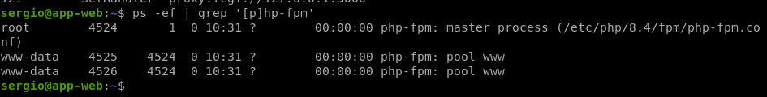
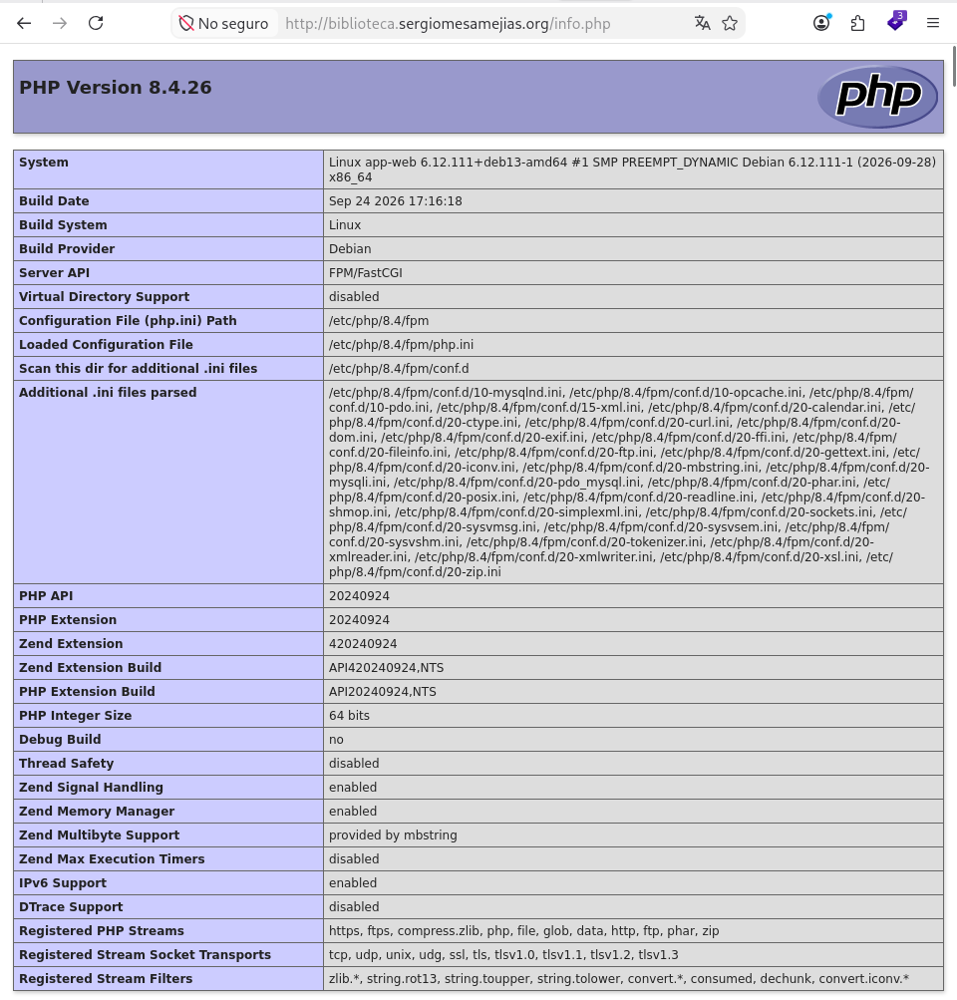
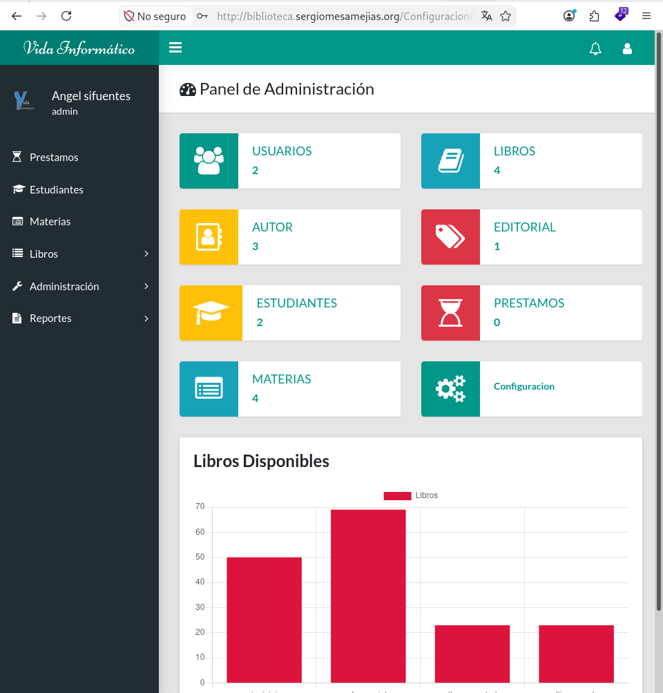
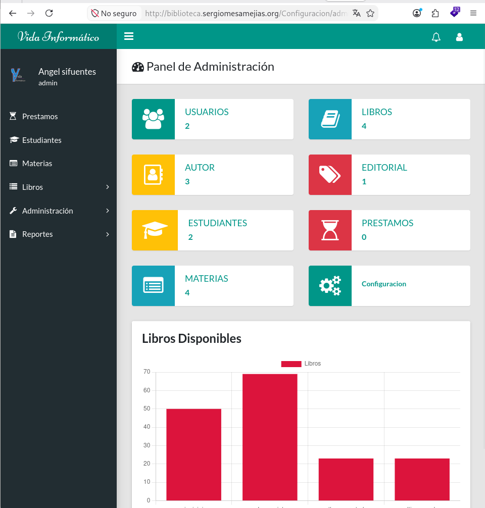
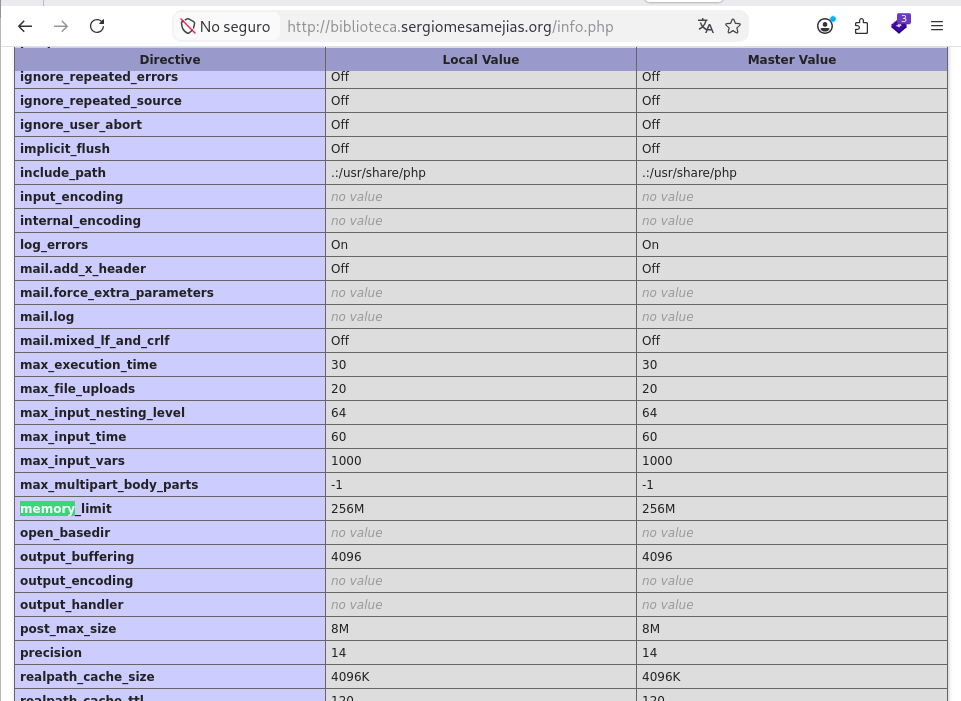

# Configuración de Apache2 + PHP-FPM

Alumno: Sergio Mesa Mejías  
Maquina: `app-web` — `192.168.122.198`  

## 1. Desinstalación del módulo PHP e instalación de PHP-FPM

Partiendo de la aplicación Biblioteca instalada, detuve Apache y desactivé y desinstalé el módulo PHP integrado:

```bash
sergio@app-web:~$ sudo systemctl stop apache2
sergio@app-web:~$ sudo a2dismod php8.4
Module php8.4 disabled.
To activate the new configuration, you need to run:
  systemctl restart apache2
sergio@app-web:~$ sudo apt remove libapache2-mod-php libapache2-mod-php8.4
Installing dependencies:        
  php8.4-fpm

Suggested packages:
  php-pear

REMOVING:
  libapache2-mod-php  libapache2-mod-php8.4

Summary:
  Upgrading: 0, Installing: 1, Removing: 2, Not Upgrading: 0
  Download size: 1871 kB
  Space needed: 136 kB / 18.3 GB available

Continue? [Y/n] 
Get:1 file:/etc/apt/mirrors/debian-security.list Mirrorlist [39 B]
10% [Waiting for headers]                                                                              
10% [Waiting for headers]
Get:2 https://deb.debian.org/debian-security trixie-security/main amd64 php8.4-fpm amd64 8.4.26-1~deb13u1 [1871 kB]
Fetched 1871 kB in 40s (47.4 kB/s)  
(Reading database ... 35324 files and directories currently installed.)
Removing libapache2-mod-php (2:8.4+96) ...
Selecting previously unselected package php8.4-fpm.
(Reading database ... 35321 files and directories currently installed.)
Preparing to unpack .../php8.4-fpm_8.4.26-1~deb13u1_amd64.deb ...
Unpacking php8.4-fpm (8.4.26-1~deb13u1) ...
dpkg: libapache2-mod-php8.4: dependency problems, but removing anyway as you requested:
 php8.4 depends on libapache2-mod-php8.4 | php8.4-fpm | php8.4-cgi; however:
  Package libapache2-mod-php8.4 is to be removed.
  Package php8.4-fpm is not configured yet.
  Package php8.4-cgi is not installed.

(Reading database ... 35344 files and directories currently installed.)
Removing libapache2-mod-php8.4 (8.4.26-1~deb13u1) ...
apache2_invoke php8.4 prerm: No action required
Setting up php8.4-fpm (8.4.26-1~deb13u1) ...
Creating config file /etc/php/8.4/fpm/php.ini with new version
NOTICE: Not enabling PHP 8.4 FPM by default.
NOTICE: To enable PHP 8.4 FPM in Apache2 do:
NOTICE: a2enmod proxy_fcgi setenvif
NOTICE: a2enconf php8.4-fpm
NOTICE: You are seeing this message because you have apache2 package installed.
Created symlink '/etc/systemd/system/multi-user.target.wants/php8.4-fpm.service' → '/usr/lib/systemd/system/php8.4-fpm.service'.
Processing triggers for man-db (2.13.1-1) ...
Processing triggers for php8.4-fpm (8.4.26-1~deb13u1) ...
NOTICE: Not enabling PHP 8.4 FPM by default.
NOTICE: To enable PHP 8.4 FPM in Apache2 do:
NOTICE: a2enmod proxy_fcgi setenvif
NOTICE: a2enconf php8.4-fpm
NOTICE: You are seeing this message because you have apache2 package installed.
```

Durante la desinstalación, APT instaló automáticamente `php8.4-fpm` para satisfacer las dependencias. Después comprobé su instalación y habilité el servicio:

```bash
sergio@app-web:~$ sudo apt update
Get:1 file:/etc/apt/mirrors/debian.list Mirrorlist [30 B]
Get:3 file:/etc/apt/mirrors/debian-security.list Mirrorlist [39 B]
Hit:2 https://deb.debian.org/debian trixie InRelease
Get:4 https://deb.debian.org/debian trixie-updates InRelease [47.3 kB]
Get:5 https://deb.debian.org/debian trixie-backports InRelease [54.0 kB]
Get:6 https://deb.debian.org/debian-security trixie-security InRelease [43.4 kB]
Get:7 https://deb.debian.org/debian trixie-backports/main Sources.diff/Index [63.3 kB]
Get:8 https://deb.debian.org/debian trixie-backports/main amd64 Packages.diff/Index [63.3 kB]
Get:12 https://deb.debian.org/debian trixie-backports/main Sources T-2026-10-14-2042.42-F-2026-10-09-2003.56.pdiff [12.1 kB]
Get:12 https://deb.debian.org/debian trixie-backports/main Sources T-2026-10-14-2042.42-F-2026-10-09-2003.56.pdiff [12.1 kB]
Get:13 https://deb.debian.org/debian trixie-backports/main amd64 Packages T-2026-10-14-2042.42-F-2026-10-10-0203.56.pdiff [34.0 kB]
Get:13 https://deb.debian.org/debian trixie-backports/main amd64 Packages T-2026-10-14-2042.42-F-2026-10-10-0203.56.pdiff [34.0 kB]
Get:9 https://deb.debian.org/debian-security trixie-security/main Sources [240 kB]
Get:10 https://deb.debian.org/debian-security trixie-security/main amd64 Packages [267 kB]
Get:11 https://deb.debian.org/debian-security trixie-security/main Translation-en [165 kB]
Fetched 990 kB in 1s (953 kB/s)                                 
3 packages can be upgraded. Run 'apt list --upgradable' to see them.
sergio@app-web:~$ sudo apt install php8.4-fpm
php8.4-fpm is already the newest version (8.4.26-1~deb13u1).
php8.4-fpm set to manually installed.
Summary:
  Upgrading: 0, Installing: 0, Removing: 0, Not Upgrading: 3
sergio@app-web:~$ sudo systemctl enable --now php8.4-fpm
Synchronizing state of php8.4-fpm.service with SysV service script with /usr/lib/systemd/systemd-sysv-install.
Executing: /usr/lib/systemd/systemd-sysv-install enable php8.4-fpm
```

Comprobé los procesos PHP-FPM:

```bash
sergio@app-web:~$ ps -ef | grep '[p]hp-fpm'
root        3936       1  0 10:18 ?        00:00:00 php-fpm: master process (/etc/php/8.4/fpm/php-fpm.conf)
www-data    3937    3936  0 10:18 ?        00:00:00 php-fpm: pool www
www-data    3938    3936  0 10:18 ?        00:00:00 php-fpm: pool www
```

Se observa el proceso maestro y dos procesos del pool `www (son PID diferentes ya que he parado el servicio y he vuelto a iniciarlo)`.

> 

## 2. Configuración de Apache para utilizar PHP-FPM

Configuré PHP-FPM globalmente para Apache, sin modificar individualmente los Virtual Hosts:

```bash
sergio@app-web:~$ sudo a2enmod proxy_fcgi setenvif
Considering dependency proxy for proxy_fcgi:
Enabling module proxy.
Enabling module proxy_fcgi.
Module setenvif already enabled
To activate the new configuration, you need to run:
  systemctl restart apache2
sergio@app-web:~$ sudo a2enconf php8.4-fpm
Enabling conf php8.4-fpm.
To activate the new configuration, you need to run:
  systemctl reload apache2
```

El archivo de configuración utilizado es:

```text
/etc/apache2/conf-available/php8.4-fpm.conf
```

Inicialmente, su bloque activo utilizaba un socket Unix:

```apache
<FilesMatch ".+\.ph(?:ar|p|tml)$">
    SetHandler "proxy:unix:/run/php/php8.4-fpm.sock|fcgi://localhost"
</FilesMatch>
```

El pool de PHP-FPM tenía configurada la misma ruta en `/etc/php/8.4/fpm/pool.d/www.conf`:

```ini
listen = /run/php/php8.4-fpm.sock
```

Validé la configuración y arranqué Apache:

```bash
sergio@app-web:~$ sudo php-fpm8.4 -t
[15-Oct-2026 10:19:12] NOTICE: configuration file /etc/php/8.4/fpm/php-fpm.conf test is successful
sergio@app-web:~$ sudo apache2ctl configtest
AH00558: apache2: Could not reliably determine the server's fully qualified domain name, using fe80::5054:ff:fe32:56b3%enp1s0. Set the 'ServerName' directive globally to suppress this message
Syntax OK
sergio@app-web:~$ sudo systemctl restart apache2
```

Las comprobaciones indicaron:

```text
configuration file /etc/php/8.4/fpm/php-fpm.conf test is successful
Syntax OK
```

## 3. Comprobación de Server API y Biblioteca

Preparé el fichero de comprobación en el DocumentRoot de la aplicación:

```bash
sergio@app-web:~$ cat /var/www/biblioteca/info.php 
<?php phpinfo(); ?>

sergio@app-web:~$ sudo chown www-data:www-data /var/www/biblioteca/info.php
sergio@app-web:~$ sudo chmod 644 /var/www/biblioteca/info.php
```

Accedí desde el navegador a:

```text
http://biblioteca.sergiomesamejias.org/info.php
```

Comprobé los siguientes valores:

| Parámetro                 | Resultado                  |
| ------------------------- | -------------------------- |
| Server API                | `FPM/FastCGI`              |
| Loaded Configuration File | `/etc/php/8.4/fpm/php.ini` |

Estos valores verifican que los scripts se ejecutan mediante PHP-FPM.

> 

También accedí a Biblioteca con el usuario `admin` y la contraseña `admin`. El panel de administración se mostró correctamente.

> 

## 4. Cambio a TCP/9000

### Configuración de PHP-FPM

Edité el archivo:

```bash
sergio@app-web:~$ sudo nano /etc/php/8.4/fpm/pool.d/www.conf
```

Sustituí la escucha mediante socket por TCP y limité los clientes al propio servidor:

```bash
sergio@app-web:~$ sudo grep -nE '^[[:space:]]*listen([.]allowed_clients)?[[:space:]]*=' /etc/php/8.4/fpm/pool.d/www.conf
41:listen = 127.0.0.1:9000
69:listen.allowed_clients = 127.0.0.1

```

### Configuración de Apache

Edité el archivo:

```bash
sergio@app-web:~$ sudo nano /etc/apache2/conf-available/php8.4-fpm.conf
```

Sustituí el manejador anterior por:

```bash
sergio@app-web:~$ sudo grep -nE '^[[:space:]]*SetHandler' /etc/apache2/conf-available/php8.4-fpm.conf
12:        SetHandler "proxy:fcgi://127.0.0.1:9000"

```

Conservé el resto del archivo. Validé y apliqué la configuración:

```bash
sergio@app-web:~$ sudo php-fpm8.4 -t
[15-Oct-2026 10:27:07] NOTICE: configuration file /etc/php/8.4/fpm/php-fpm.conf test is successful
sergio@app-web:~$ sudo apache2ctl configtest
AH00558: apache2: Could not reliably determine the server's fully qualified domain name, using fe80::5054:ff:fe32:56b3%enp1s0. Set the 'ServerName' directive globally to suppress this message
Syntax OK
sergio@app-web:~$ sudo systemctl restart php8.4-fpm
sergio@app-web:~$ sudo systemctl restart apache2
```

### Comprobaciones obtenidas

Comprobé la escucha:

```bash
sudo ss -ltnp 'sport = :9000'
```

Salida obtenida, con espaciado simplificado:

```bash
sergio@app-web:~$ sudo ss -ltnp 'sport = :9000'
State        Recv-Q       Send-Q               Local Address:Port               Peer Address:Port       Process                                                                                                 
LISTEN       0            4096                     127.0.0.1:9000                    0.0.0.0:*           users:(("php-fpm8.4",pid=4445,fd=10),("php-fpm8.4",pid=4444,fd=10),("php-fpm8.4",pid=4443,fd=8))  
```

Comprobé las directivas de PHP-FPM:

```bash
sudo grep -nE '^[[:space:]]*listen([.]allowed_clients)?[[:space:]]*=' /etc/php/8.4/fpm/pool.d/www.conf
```

Salida real:

```text
sergio@app-web:~$ sudo grep -nE '^[[:space:]]*listen([.]allowed_clients)?[[:space:]]*=' /etc/php/8.4/fpm/pool.d/www.conf
41:listen = 127.0.0.1:9000
69:listen.allowed_clients = 127.0.0.1
```

Comprobé el manejador de Apache:

```bash
sudo grep -nE '^[[:space:]]*SetHandler' /etc/apache2/conf-available/php8.4-fpm.conf
```

Salida real:

```bash
sergio@app-web:~$ sudo grep -nE '^[[:space:]]*SetHandler' /etc/apache2/conf-available/php8.4-fpm.conf
12:        SetHandler "proxy:fcgi://127.0.0.1:9000"Estas salidas confirman que ambos servicios están configurados para comunicarse mediante `127.0.0.1:9000`.
```

Volví a acceder a Biblioteca y comprobé que el panel de administración seguía funcionando después del cambio.

> 

## 5. Cambio de memory_limit a 256 MB

El fichero que modifiqué fue:

```text
/etc/php/8.4/fpm/php.ini
```

Esta ruta corresponde al archivo cargado por PHP-FPM, como comprobé en `info.php`.

Edité el archivo:

```bash
sergio@app-web:~$ sudo nano /etc/php/8.4/fpm/php.ini
```

Establecí el parámetro:

```bash
sergio@app-web:~$ sudo grep -n '^memory_limit' /etc/php/8.4/fpm/php.ini
435:memory_limit = 256M
```

Reinicié PHP-FPM para aplicar el cambio:

```bash
sergio@app-web:~$ sudo systemctl restart php8.4-fpm
```

Recargué `http://biblioteca.sergiomesamejias.org/info.php` y comprobé en el navegador:

| Directiva      | Local Value | Master Value |
| -------------- | ----------- | ------------ |
| `memory_limit` | `256M`      | `256M`       |

> 
