# Instalación y conexión remota a Oracle Database con SQL Developer

## Objetivo

Instalé Oracle SQL Developer en mi equipo local `Sergio-PC` y configuré una conexión remota mediante TNS hacia una base de datos Oracle instalada en el servidor `oracle26ai`.

Realicé la conexión con el usuario `PRACTICA`, creado específicamente para esta práctica, en lugar de utilizar la cuenta administrativa `SYS`.

## Datos de la conexión

| Dato                           | Valor                                 |
| ------------------------------ | ------------------------------------- |
| Servidor Oracle                | `oracle26ai`                          |
| Sistema operativo del servidor | Linux                                 |
| Oracle Database                | Oracle AI Database 26ai Free          |
| Versión de Oracle              | 23.26.3.0.0                           |
| Oracle Home                    | `/opt/oracle/product/26ai/dbhomeFree` |
| Instancia Oracle               | `FREE`                                |
| PDB utilizada                  | `FREEPDB1`                            |
| Servicio Oracle Net            | `freepdb1`                            |
| Puerto del listener            | `1521`                                |
| Usuario de conexión            | `PRACTICA`                            |
| Tablespace por defecto         | `USERS`                               |
| Cuota asignada                 | 20 MB                                 |

## Comprobaciones previas

Antes de instalar SQL Developer, comprobé que el servidor Oracle estaba preparado para aceptar conexiones remotas.

En el servidor, como usuario `oracle`, ejecuté el siguiente comando para comprobar el estado del listener:

```bash
lsnrctl status
```

El listener estaba iniciado en el puerto `1521`. Entre los servicios registrados aparecía `freepdb1`, correspondiente a la PDB `FREEPDB1`, con estado `READY`.

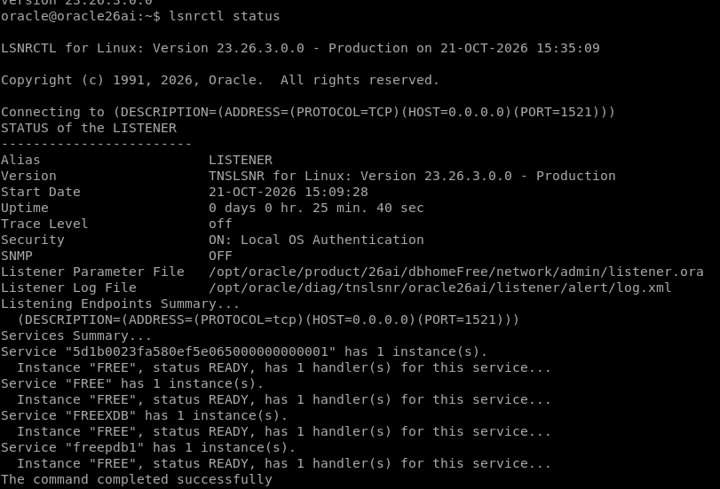

En SQL*Plus, conectado como administrador, comprobé el estado de las PDB:

```sql
SHOW PDBS;
```

La PDB `FREEPDB1` estaba abierta en modo `READ WRITE`, por lo que permite realizar operaciones de lectura y escritura.

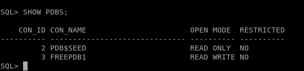

## Creación del usuario PRACTICA

Creé el usuario `PRACTICA` dentro de la PDB `FREEPDB1` para realizar la conexión desde SQL Developer sin utilizar la cuenta `SYS`.

En SQL*Plus, conectado como administrador, cambié a la PDB:

```sql
ALTER SESSION SET CONTAINER = FREEPDB1;

SHOW CON_NAME;
```

Después creé el usuario con una cuota limitada en el tablespace `USERS`:

```sql
CREATE USER practica IDENTIFIED BY "practica1223"
  DEFAULT TABLESPACE users
  TEMPORARY TABLESPACE temp
  QUOTA 20M ON users;
```


Concedí los permisos mínimos necesarios para iniciar sesión y crear tablas propias:

```sql
GRANT CREATE SESSION, CREATE TABLE TO practica;
```

El permiso `CREATE SESSION` permite iniciar sesión en la base de datos. El permiso `CREATE TABLE` permite crear tablas dentro del esquema del usuario. La cuota de 20 MB en `USERS` permite almacenar los objetos de la práctica sin conceder privilegios de administrador.

*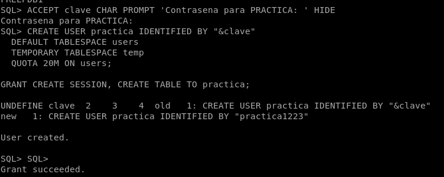*

Para comprobar que la cuenta se había creado correctamente, ejecuté:

```sql
SELECT username, account_status, default_tablespace
FROM dba_users
WHERE username = 'PRACTICA';
```

El resultado mostró que el usuario `PRACTICA` estaba en estado `OPEN` y utilizaba `USERS` como tablespace por defecto.

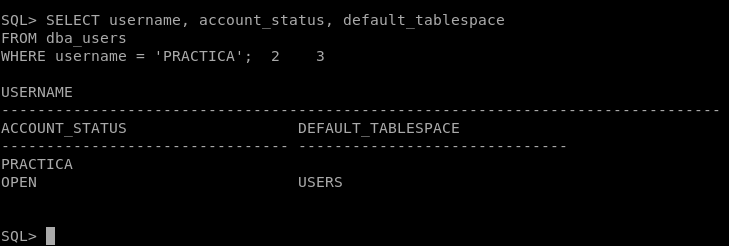

También comprobé que tenía los permisos necesarios:

```sql
SELECT privilege
FROM dba_sys_privs
WHERE grantee = 'PRACTICA'
ORDER BY privilege;
```

El resultado mostró los permisos `CREATE SESSION` y `CREATE TABLE`.

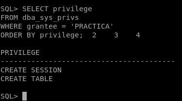

## Creación de las tablas

Para comprobar la conexión desde SQL Developer, creé tres tablas: `CLIENTES`, `PRODUCTOS` y `PEDIDOS`, importante que se hagan con el usuario PRACTICA.

La tabla `CLIENTES` almacena los datos básicos de cada cliente:

```sql
CREATE TABLE clientes (
    id_cliente     NUMBER GENERATED ALWAYS AS IDENTITY,
    nombre         VARCHAR2(60) NOT NULL,
    email          VARCHAR2(100),
    ciudad         VARCHAR2(50),
    CONSTRAINT pk_clientes PRIMARY KEY (id_cliente)
);
```

La tabla `PRODUCTOS` almacena los productos disponibles:

```sql
CREATE TABLE productos (
    id_producto    NUMBER GENERATED ALWAYS AS IDENTITY,
    nombre         VARCHAR2(80) NOT NULL,
    precio         NUMBER(10,2) NOT NULL,
    stock          NUMBER,
    CONSTRAINT pk_productos PRIMARY KEY (id_producto)
);
```

La tabla `PEDIDOS` registra los pedidos realizados por los clientes. Contiene una clave externa hacia la tabla `CLIENTES`, de forma que cada pedido queda asociado a un cliente:

```sql
CREATE TABLE pedidos (
    id_pedido      NUMBER GENERATED ALWAYS AS IDENTITY,
    id_cliente     NUMBER NOT NULL,
    fecha_pedido   DATE DEFAULT SYSDATE,
    total          NUMBER(10,2),
    CONSTRAINT pk_pedidos PRIMARY KEY (id_pedido),
    CONSTRAINT fk_pedidos_cliente FOREIGN KEY (id_cliente)
        REFERENCES clientes (id_cliente)
);
```

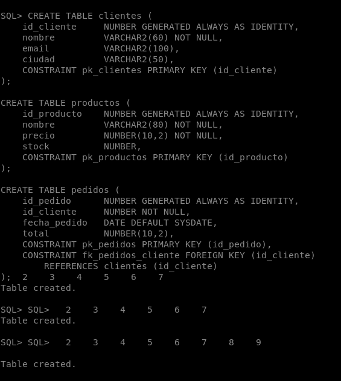

## Inserción de datos de ejemplo

Inserté algunos registros para poder comprobar posteriormente que la conexión remota permite consultar datos reales.

```sql
INSERT INTO clientes (nombre, email, ciudad)
VALUES ('Ana Garcia', 'ana.garcia@example.com', 'Madrid');

INSERT INTO clientes (nombre, email, ciudad)
VALUES ('Luis Perez', 'luis.perez@example.com', 'Barcelona');

INSERT INTO productos (nombre, precio, stock)
VALUES ('Teclado inalambrico', 29.99, 15);

INSERT INTO productos (nombre, precio, stock)
VALUES ('Raton optico', 14.50, 30);

INSERT INTO pedidos (id_cliente, total)
VALUES (1, 44.49);

INSERT INTO pedidos (id_cliente, total)
VALUES (2, 29.99);

COMMIT;
```

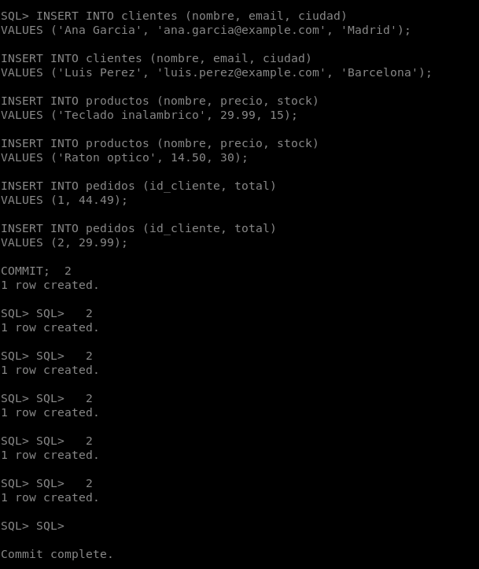

## Instalación de SQL Developer en Sergio-PC

Oracle SQL Developer es una herramienta gratuita que permite administrar bases de datos Oracle, ejecutar consultas SQL y desarrollar aplicaciones PL/SQL.

### Descarga

1. Abrí el navegador en `Sergio-PC`.
2. Accedí a la página oficial de descargas de Oracle SQL Developer: https://www.oracle.com/database/sqldeveloper/technologies/download/
3. Descargué la versión **Windows 64-bit con JDK incluido**.
4. Guardé el archivo ZIP en una carpeta conocida, por ejemplo `Descargas`.

La versión publicada por Oracle incluye JDK 17, por lo que no es necesario instalar Java por separado si se utiliza esa versión.

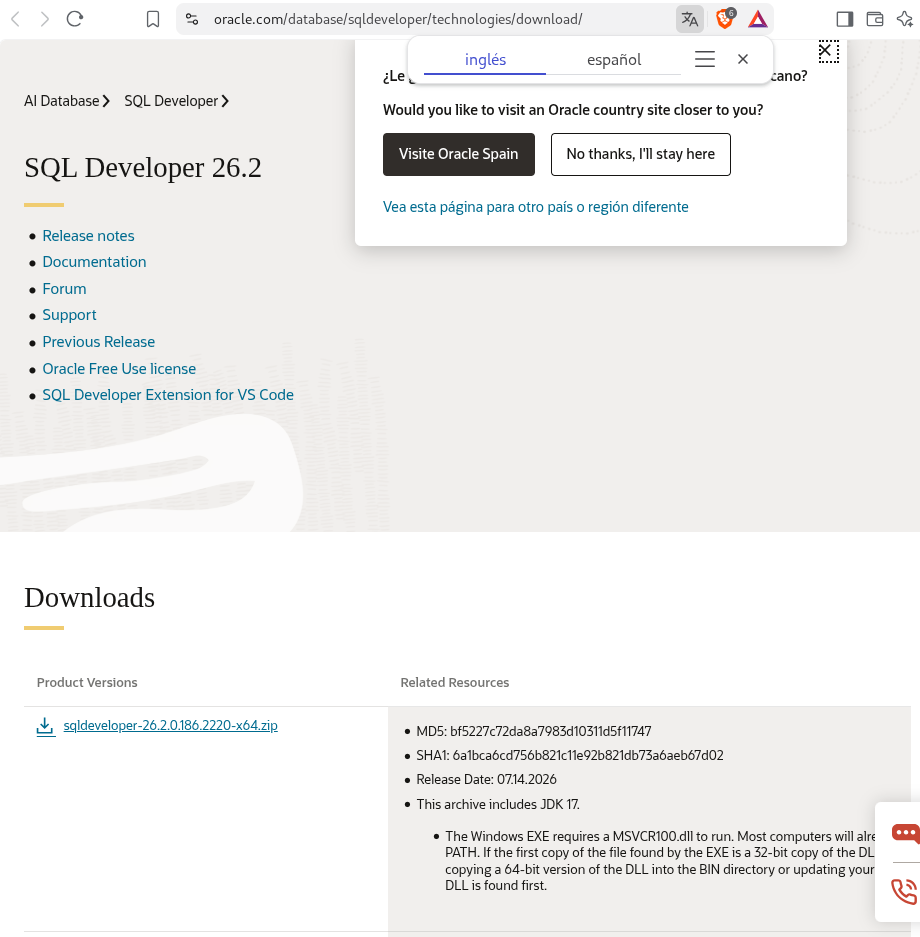

## Requisitos previos

Antes de comenzar comprobé que:

- El servidor `oracle26ai` estaba encendido y accesible desde mi equipo.
- El listener de Oracle estaba iniciado en el servidor.
- La PDB `FREEPDB1` estaba abierta en modo lectura y escritura.
- El usuario `PRACTICA` existía y tenía permisos para iniciar sesión y crear tablas.
- Tenía instalado un JDK compatible con la versión de SQL Developer que iba a utilizar.

### Preparación de Java: Zulu FX 17

Oracle SQL Developer para Linux necesita un JDK 17 que incluya **JavaFX**. La distribución ZIP descargada desde Oracle no incluye JavaFX, por lo que, al ejecutarla con un JDK normal, aparece este error:

```text
java.lang.module.FindException: Module javafx.base not found
```

Para evitarlo, descargué **Azul Zulu FX 17**, un JDK 17 con JavaFX incluido.

### Descarga de Zulu FX 17

Descargué el paquete oficial de Azul Zulu FX 17 para Linux x86-64 en formato `.tar.gz` desde:

[https://cdn.azul.com/zulu/bin/zulu17.54.21-ca-fx-jdk17.0.13-linux_x64.tar.gz](https://cdn.azul.com/zulu/bin/zulu17.54.21-ca-fx-jdk17.0.13-linux_x64.tar.gz)

El archivo se guardó en la carpeta `Descargas`.

El nombre del archivo debe contener `ca-fx-jdk17`, porque eso indica que incluye JavaFX. Un JDK llamado solo `ca-jdk` no sirve para SQL Developer, ya que no incluye JavaFX.

## Extracción de Zulu FX 17

Extraje el JDK descargado en la carpeta `~/Oracle/jdk` con los siguientes comandos:

```bash
mkdir -p "$HOME/Oracle/jdk"
cd ~/Descargas
tar -xzf zulu17.54.21-ca-fx-jdk17.0.13-linux_x64.tar.gz -C "$HOME/Oracle/jdk"
```

Comprobé que se había creado la carpeta del JDK:

```bash
ls "$HOME/Oracle/jdk"
```

Debe aparecer:

```text
zulu17.54.21-ca-fx-jdk17.0.13-linux_x64
```

Comprobé también que incluía JavaFX:

```bash
ls "$HOME/Oracle/jdk/zulu17.54.21-ca-fx-jdk17.0.13-linux_x64/lib" | grep -i javafx
```

El resultado debe incluir módulos como `javafx.base`, `javafx.controls` y `javafx.fxml`.

## Extracción y ejecución de SQL Developer

Extraje el ZIP de Oracle SQL Developer en la siguiente ruta:

```text
/home/sergio/Oracle/Oracle/SQLDeveloper
```

A continuación, inicié SQL Developer indicando expresamente el JDK de Zulu FX 17 mediante la variable `JAVA_HOME`:

```bash
cd "$HOME/Oracle/Oracle/SQLDeveloper/sqldeveloper"

JAVA_HOME="$HOME/Oracle/jdk/zulu17.54.21-ca-fx-jdk17.0.13-linux_x64" \
sh sqldeveloper.sh
```

De esta forma, SQL Developer utiliza el JDK 17 con JavaFX incluido y arranca correctamente en Debian.

### Comando para abrir SQL Developer

Para abrir SQL Developer en futuras sesiones, utilicé siempre:

```bash
cd "$HOME/Oracle/Oracle/SQLDeveloper/sqldeveloper"

JAVA_HOME="$HOME/Oracle/jdk/zulu17.54.21-ca-fx-jdk17.0.13-linux_x64" \
sh sqldeveloper.sh
```

No es necesario volver a descargar ni extraer Zulu FX 17: solo hay que ejecutar este comando.*

## Configuración de la conexión TNS

TNS permite utilizar un alias definido en un archivo `tnsnames.ora` en lugar de introducir manualmente el servidor, el puerto y el servicio en cada conexión.

### Crear la carpeta TNS

En una terminal del host, creé la carpeta:

```bash
mkdir -p "$HOME/Oracle/TNS"
```

Para mi usuario `sergio`, la ruta completa es:

```text
/home/sergio/Oracle/TNS
```

### Crear el archivo tnsnames.ora

Ejecuté el siguiente bloque para crear el archivo con el nombre y el contenido correctos:

```bash
cat > "$HOME/Oracle/TNS/tnsnames.ora" <<'EOF'
ORACLE26AI =
  (DESCRIPTION =
    (ADDRESS = (PROTOCOL = TCP)(HOST = 192.168.122.54)(PORT = 1521))
    (CONNECT_DATA =
      (SERVER = DEDICATED)
      (SERVICE_NAME = freepdb1)
    )
  )
EOF
```

Este alias identifica el servidor `oracle26ai`, el puerto `1521` y el servicio `freepdb1`.

Comprobé si Debian podía resolver el nombre del servidor:

```bash
getent hosts oracle26ai
```

Si no se resolvía o devolvía una dirección incorrecta, sustituí `oracle26ai` en el campo `HOST` del archivo por la IP real y accesible del servidor Oracle. No utilicé la IP de otra máquina de bases de datos por suposición.

### Comprobar el archivo

```bash
ls -l "$HOME/Oracle/TNS/tnsnames.ora"
cat "$HOME/Oracle/TNS/tnsnames.ora"
```

El archivo debe llamarse exactamente `tnsnames.ora`, sin la extensión adicional `.txt`.

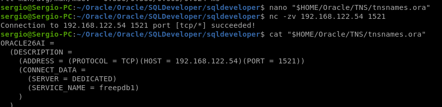

## Configuración de SQL Developer

Para que SQL Developer reconociera el archivo `tnsnames.ora`:

1. Abrí Oracle SQL Developer.
2. Fui a **Tools > Preferences**.
3. Expandí **Database** y seleccioné **Advanced**.
4. En **Tnsnames Directory**, pulsé **Browse**.
5. Seleccioné la carpeta:

```text
/home/sergio/Oracle/TNS
```

6. Pulsé **OK**.
7. Cerré y volví a abrir SQL Developer si el alias todavía no aparecía.

Seleccioné la carpeta que contiene el archivo, no el archivo individual. En el selector utilicé la ruta absoluta, no el texto literal `$HOME`.

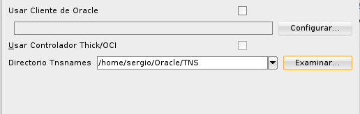


## Creación de la conexión en SQL Developer

1. En el panel **Connections**, hice clic derecho y seleccioné **New Connection**.
2. Completé los siguientes campos:

| Campo           | Valor                 |
| --------------- | --------------------- |
| Connection Name | `Oracle26AI Practica` |
| Username        | `PRACTICA`            |
| Password        | practica1223          |
| Save Password   | Opcional              |
| Connection Type | `TNS`                 |
| Network Alias   | `ORACLE26AI`          |
| Role            | `Default`             |

3. Pulsé **Test**.
4. Comprobé que aparecía:

```text
Status: Success
```

5. Pulsé **Save** y después **Connect**.

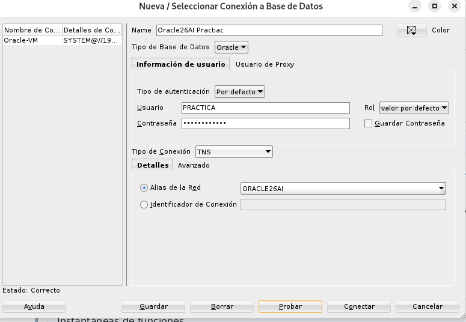

La conexión utiliza el alias `ORACLE26AI` y el usuario `PRACTICA`, sin utilizar la cuenta administrativa `SYS`.

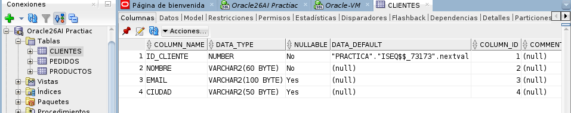

## Consulta remota desde SQL Developer

Abrí una hoja de trabajo SQL asociada a la conexión `Oracle26AI Practica`.

Ejecuté una consulta sencilla para mostrar los clientes:

`SELECT id_cliente, nombre, email, ciudad FROM clientes ORDER BY id_cliente;`

Comprobé que aparecían los datos de los clientes y que podía consultarlos desde SQL Developer en `Sergio-PC` mediante la conexión **remota** al servidor Oracle.


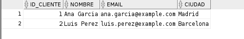

## 
