# Instalación de Oracle AI Database 26ai Free en Debian 13

En esta práctica he instalado Oracle AI Database 26ai Free en una máquina virtual con Debian 13. Después la he configurado (SPFILE, listener, tnsnames.ora y arranque automático), he creado un usuario con tres tablas con datos y, por último, me he conectado a ella en remoto desde mi portátil con sqlplus usando una conexión TNS.

## 1. Entorno

| Elemento | Valor |
| --- | --- |
| Servidor | Máquina virtual Debian 13.7 (KVM / virt-manager) |
| Nombre del servidor | `oracle-sergio` |
| IP del servidor | `192.168.122.50` |
| Recursos | 4 GB de RAM, 2 CPU, 40 GB de disco |
| Versión de Oracle | Oracle AI Database 26ai Free 23.26.3 |
| Puerto del listener | 1521 |
| Servicio de la práctica | `ABD` (dentro de la PDB `FREEPDB1`) |
| Cliente | Mi portátil (`Sergio-PC`) con Oracle Instant Client 23.26.2 |

Oracle solo publica la versión Free para Linux en formato RPM, pensado para Oracle Linux y Red Hat. Debian usa paquetes .deb y no está soportado oficialmente, así que he convertido el RPM a .deb con la herramienta `alien` y he preparado a mano todo lo que en Oracle Linux haría el paquete *preinstall* de Oracle.

## 2. Preparación de Debian para Oracle

Todos los pasos de este apartado los he hecho como root.

### 2.1. Nombre de la máquina en /etc/hosts

Debian asocia por defecto el nombre de la máquina a la dirección `127.0.1.1`. El instalador de Oracle usa ese nombre para configurar el listener, y si apunta a 127.0.1.1 el listener solo atendería conexiones de la propia máquina. Por eso he cambiado en `/etc/hosts` esa línea para que el nombre apunte a la IP real del servidor:

```text
root@oracle-sergio:~# diff /etc/hosts.original /etc/hosts
2c2
< 127.0.1.1	oracle-sergio
---
> 192.168.122.50	oracle-sergio
root@oracle-sergio:~# getent hosts oracle-sergio
192.168.122.50  oracle-sergio
```

### 2.2. Paquetes necesarios

He instalado los paquetes que necesita Oracle para instalarse y funcionar. `alien` sirve para convertir el RPM a .deb y `rlwrap` para poder usar las flechas del teclado dentro de sqlplus:

```bash
apt install -y alien libaio1t64 bc binutils ksh sysstat unzip file procps net-tools rlwrap
```

```text
root@oracle-sergio:~# dpkg -l alien libaio1t64 bc binutils ksh sysstat unzip rlwrap | grep ^ii
ii  alien            8.95.8            all          convert and install rpm and other packages
ii  bc               1.07.1-4          amd64        GNU bc arbitrary precision calculator language
ii  binutils         2.44-3            amd64        GNU assembler, linker and binary utilities
ii  ksh              20240113-1.0.10-2 all          transitional package
ii  libaio1t64:amd64 0.3.113-8+b1      amd64        Linux kernel AIO access library - shared library
ii  rlwrap           0.46.1-1+b1       amd64        readline feature command line wrapper
ii  sysstat          12.7.5-2          amd64        system performance tools for Linux
ii  unzip            6.0-29+deb13u1    amd64        De-archiver for .zip files
```

### 2.3. Librería libaio

Oracle usa la librería libaio para escribir en disco y la busca con el nombre `libaio.so.1`, pero en Debian 13 se llama `libaio.so.1t64`. He creado un enlace con el nombre que espera Oracle:

```bash
ln -s /usr/lib/x86_64-linux-gnu/libaio.so.1t64 /usr/lib/x86_64-linux-gnu/libaio.so.1
ldconfig
```

```text
root@oracle-sergio:~# ls -l /usr/lib/x86_64-linux-gnu/libaio.so.1
lrwxrwxrwx 1 root root 40 oct 24 21:41 /usr/lib/x86_64-linux-gnu/libaio.so.1 -> /usr/lib/x86_64-linux-gnu/libaio.so.1t64
```

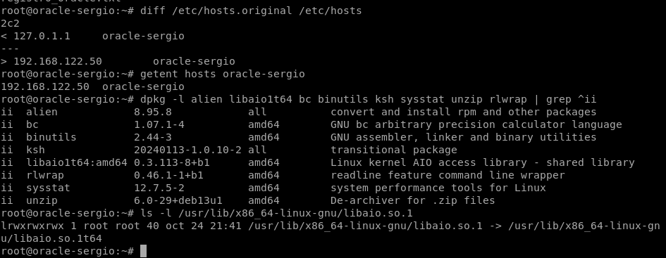

### 2.4. Usuario oracle y sus grupos

He creado el usuario `oracle` y los grupos que usa Oracle, con los mismos identificadores que pone el paquete *preinstall* en Oracle Linux. El grupo `oinstall` es el dueño del software y el grupo `dba` permite administrar la base de datos:

```bash
groupadd -g 54321 oinstall
groupadd -g 54322 dba
groupadd -g 54323 oper
groupadd -g 54324 backupdba
groupadd -g 54325 dgdba
groupadd -g 54326 kmdba
groupadd -g 54330 racdba
useradd -u 54321 -g oinstall -G dba,oper,backupdba,dgdba,kmdba,racdba -m -s /bin/bash oracle
passwd oracle
```

### 2.5. Parámetros del kernel

He creado el fichero `/etc/sysctl.d/97-oracle.conf` con los parámetros del kernel que recomienda Oracle, y los he aplicado con `sysctl --system`. Este es su contenido:

```text
fs.file-max = 6815744
fs.aio-max-nr = 1048576
kernel.sem = 250 32000 100 128
kernel.shmmni = 4096
kernel.shmall = 1073741824
kernel.shmmax = 4398046511104
kernel.panic_on_oops = 1
net.core.rmem_default = 262144
net.core.rmem_max = 4194304
net.core.wmem_default = 262144
net.core.wmem_max = 1048576
net.ipv4.ip_local_port_range = 9000 65500
```

| Parámetro | Para qué sirve |
| --- | --- |
| `kernel.sem` | Semáforos, que Oracle usa para coordinar sus procesos |
| `kernel.shm*` | Memoria compartida, la zona de RAM común a todos los procesos de Oracle (SGA) |
| `fs.aio-max-nr` | Máximo de operaciones de disco asíncronas |
| `fs.file-max` | Máximo de ficheros abiertos en todo el sistema |
| `net.core.*` | Tamaño de los búferes de red |
| `ip_local_port_range` | Rango de puertos para las conexiones salientes |

### 2.6. Límites del usuario oracle

He creado el fichero `/etc/security/limits.d/oracle.conf` para subir los límites de ficheros abiertos, procesos y memoria de pila del usuario oracle:

```text
oracle soft nofile 1024
oracle hard nofile 65536
oracle soft nproc  16384
oracle hard nproc  16384
oracle soft stack  10240
oracle hard stack  32768
```

En Debian estos límites solo se aplican si el módulo `pam_limits` está activo, y en `/etc/pam.d/su` viene desactivado (comentado). Como el script de arranque de Oracle usa `su` para pasar al usuario oracle, he quitado el comentario de esa línea.

Comprobación de todo el apartado:

```text
root@oracle-sergio:~# id oracle
uid=54321(oracle) gid=54321(oinstall) grupos=54321(oinstall),54322(dba),54323(oper),54324(backupdba),54325(dgdba),54326(kmdba),54330(racdba)
root@oracle-sergio:~# sysctl kernel.sem kernel.shmmax fs.aio-max-nr fs.file-max
kernel.sem = 250	32000	100	128
kernel.shmmax = 4398046511104
fs.aio-max-nr = 1048576
fs.file-max = 6815744
root@oracle-sergio:~# grep pam_limits /etc/pam.d/su
session    required   pam_limits.so
root@oracle-sergio:~# su - oracle -c 'echo "nofile: $(ulimit -Sn)/$(ulimit -Hn)  nproc: $(ulimit -Su)/$(ulimit -Hu)  stack: $(ulimit -Ss)/$(ulimit -Hs)"'
nofile: 1024/65536  nproc: 16384/16384  stack: 10240/32768
```

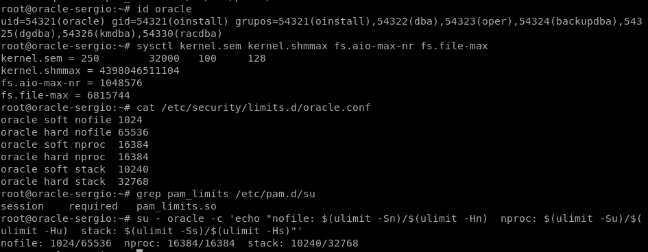

## 3. Descarga e instalación del software

### 3.1. Descarga y verificación

He descargado el RPM para Oracle Linux 9 desde la web oficial de Oracle. Lo he guardado en `/opt/instalar` y no en `/tmp`, porque en Debian 13 `/tmp` está en la RAM y el fichero ocupa casi 1,5 GB:

```bash
mkdir -p /opt/instalar
cd /opt/instalar
wget https://download.oracle.com/otn-pub/otn_software/db-free/oracle-ai-database-free-26ai-23.26.3-1.el9.x86_64.rpm
```

La web de Oracle publica el tamaño y la suma SHA256 del fichero:

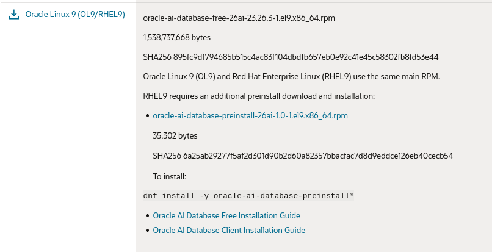

He calculado la suma del fichero descargado y coincide exactamente, así que se ha descargado entero y sin alterar:

```text
root@oracle-sergio:/opt/instalar# sha256sum /opt/instalar/oracle-ai-database-free-26ai-*.rpm
895fc9df794685b515c4ac83f104dbdfb657eb0e92c41e45c58302fb8fd53e44  /opt/instalar/oracle-ai-database-free-26ai-23.26.3-1.el9.x86_64.rpm
```

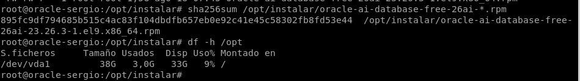

### 3.2. Conversión del RPM a .deb

He convertido el RPM a .deb con `alien`. La opción `--scripts` incluye en el .deb los scripts de instalación del RPM y `-d` indica que el formato de salida es .deb. Como tarda bastante (unos 15 minutos), lo lancé en segundo plano guardando la salida en un fichero de log:

```bash
nohup alien --scripts -d oracle-ai-database-free-26ai-23.26.3-1.el9.x86_64.rpm > alien.log 2>&1 &
```

```text
root@oracle-sergio:/opt/instalar# cat /opt/instalar/alien.log
nohup: no se tendrá en cuenta la entrada
warning: oracle-ai-database-free-26ai-23.26.3-1.el9.x86_64.rpm: Header V3 RSA/SHA256 Signature, key ID 8d8b756f: NOKEY
(la misma línea se repite varias veces)
oracle-ai-database-free-26ai_23.26.3-2_amd64.deb generated
root@oracle-sergio:/opt/instalar# ls -lh /opt/instalar/
total 2,8G
-rw-rw-r-- 1 root root 2,1K oct 24 22:09 alien.log
-rw-rw-r-- 1 root root 1,5G ago 18 07:45 oracle-ai-database-free-26ai-23.26.3-1.el9.x86_64.rpm
-rw-r--r-- 1 root root 1,4G oct 24 22:09 oracle-ai-database-free-26ai_23.26.3-2_amd64.deb
```

Los avisos `NOKEY` no son errores. El RPM viene firmado digitalmente por Oracle, pero la herramienta `rpm` de Debian no tiene la clave pública de Oracle para comprobar esa firma, así que avisa y continúa. La autenticidad del fichero ya la había comprobado con la suma SHA256.

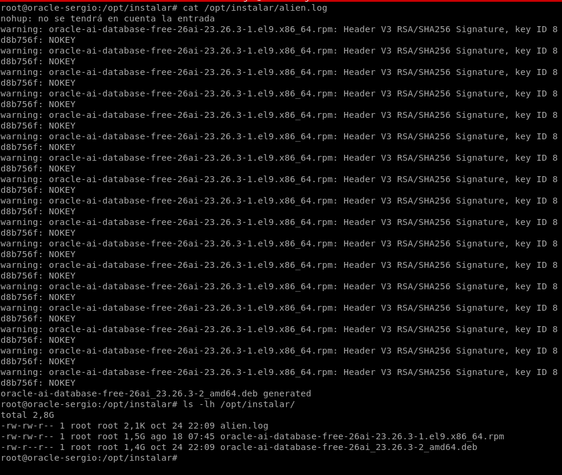

### 3.3. Instalación del paquete

He instalado el .deb con `dpkg`:

```text
root@oracle-sergio:/opt/instalar# dpkg -i oracle-ai-database-free-26ai_23.26.3-2_amd64.deb 2>&1 | tee dpkg.log | tail -n 30
Seleccionando el paquete oracle-ai-database-free-26ai previamente no seleccionado.
(Leyendo la base de datos ... 45568 ficheros o directorios instalados actualmente.)
Preparando para desempaquetar oracle-ai-database-free-26ai_23.26.3-2_amd64.deb ...
ln: fallo al crear el enlace simbólico '/bin/awk': El fichero ya existe
Desempaquetando oracle-ai-database-free-26ai (23.26.3-2) ...
Configurando oracle-ai-database-free-26ai (23.26.3-2) ...
[INFO] Executing post installation scripts...
[INFO] Oracle home installed successfully and ready to be configured.
To configure Oracle AI Database Free, optionally modify the parameters in '/etc/sysconfig/oracle-free-26ai.conf' and then run '/etc/init.d/oracle-free-26ai configure' as root.
Procesando disparadores para libc-bin (2.41-12+deb13u4) ...
root@oracle-sergio:/opt/instalar# dpkg -l | grep oracle-ai
ii  oracle-ai-database-free-26ai     23.26.3-2                            amd64        Oracle 26ai Free Database
root@oracle-sergio:/opt/instalar# ls -d /opt/oracle/product/*/dbhomeFree
/opt/oracle/product/26ai/dbhomeFree
root@oracle-sergio:/opt/instalar# ls -l /etc/init.d/oracle-free-26ai /etc/sysconfig/oracle-free-26ai.conf
-r-xr-xr-x 1 root root 21600 jul  5 22:30 /etc/init.d/oracle-free-26ai
-rwxrwxr-x 1 root root   705 jul  5 22:30 /etc/sysconfig/oracle-free-26ai.conf
root@oracle-sergio:/opt/instalar# ls -ld /opt/oracle /opt/oracle/product/*/dbhomeFree
drwxr-xr-x  5 oracle oinstall 4096 oct 24 22:19 /opt/oracle
drwxrwxr-x 63 oracle oinstall 4096 oct 24 22:19 /opt/oracle/product/26ai/dbhomeFree
root@oracle-sergio:/opt/instalar# du -sh /opt/oracle
3,9G	/opt/oracle
```

El paquete queda en estado `ii` (instalado y configurado), el software está en `/opt/oracle/product/26ai/dbhomeFree` (este es el `ORACLE_HOME`) y pertenece al usuario oracle. El aviso sobre `/bin/awk` es inofensivo: el script del RPM intenta crear ese enlace porque en Oracle Linux a veces no existe, pero en Debian ya existe.

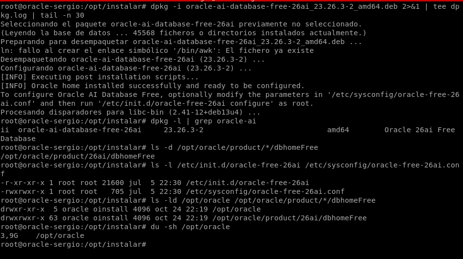

## 4. Creación de la base de datos

### 4.1. Configuración inicial

Hasta aquí solo estaba instalado el software. La base de datos se crea con el script `configure` de Oracle, que usa los valores del fichero `/etc/sysconfig/oracle-free-26ai.conf`. Los he dejado todos por defecto: `LISTENER_PORT` vacío significa puerto automático (el 1521) y el juego de caracteres es `AL32UTF8`, es decir, UTF-8.

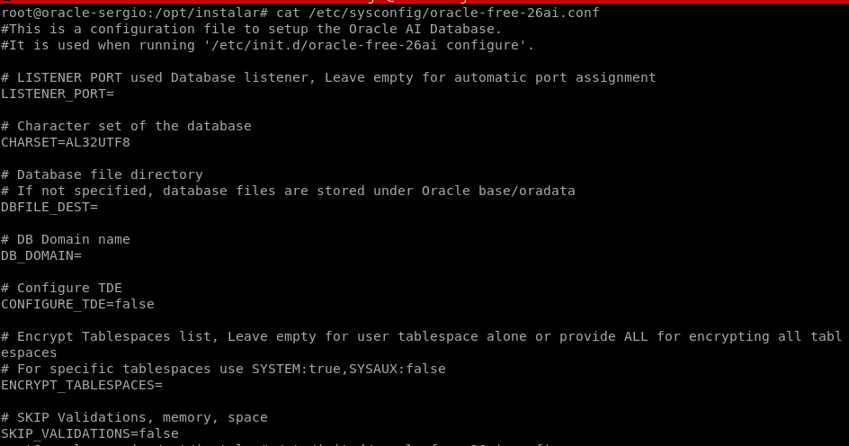

He lanzado la configuración como root. El script pide una única contraseña para las cuentas administrativas SYS, SYSTEM y PDBADMIN:

```text
root@oracle-sergio:/opt/instalar# /etc/init.d/oracle-free-26ai configure
Specify a password to be used for database accounts. [...]
Confirm the password:
Configuring Oracle Listener.
Listener configuration succeeded.
Configuring Oracle AI Database FREE.
/opt/oracle/product/26ai/dbhomeFree/bin/dbca: 279: [[: not found
/opt/oracle/product/26ai/dbhomeFree/bin/dbca: 279: [[: not found
[...]
Preparar para funcionamiento de base de datos
7% completado
Copiando archivos de base de datos
29% completado
Creando e iniciando instancia Oracle
[...]
Creando Bases de Datos de Conexión
71% completado
Ejecutando acciones posteriores a la configuración
93% completado
Ejecutando archivos de comandos personalizados
100% completado
Creación de la base de datos terminada. Consulte los archivos log de /opt/oracle/cfgtoollogs/dbca/FREE
 para obtener más información.
Información de Base de Datos:
Nombre de la Base de Datos Global:FREE
Identificador del Sistema (SID):FREE
Para obtener información detallada, consulte el archivo log "/opt/oracle/cfgtoollogs/dbca/FREE/FREE.log".

Connect to Oracle AI Database using one of the connect strings:
     Pluggable database: oracle-sergio/FREEPDB1
     Multitenant container database: oracle-sergio
```

El script ha creado tres cosas: la base de datos contenedora (CDB) **FREE**, la base de datos *pluggable* (PDB) **FREEPDB1** y el **listener**.

Los mensajes `[[: not found` aparecen porque el script `dbca` está escrito para bash, pero se ejecuta con `/bin/sh`, que en Debian es *dash*, un intérprete más simple que no entiende `[[`. En Oracle Linux `/bin/sh` es bash y por eso allí no sale. Solo afectó a una comprobación sin importancia: la creación terminó al 100%.

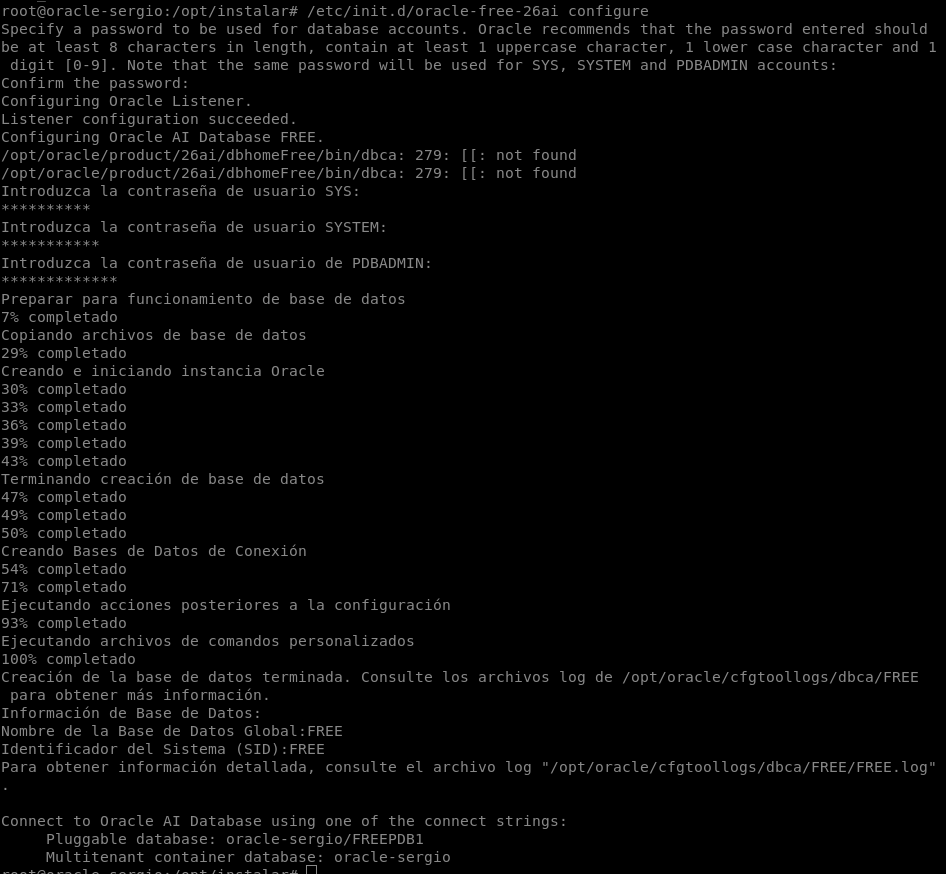

### 4.2. Entorno del usuario oracle

Para que el usuario oracle pueda usar `sqlplus` y `lsnrctl` sin escribir rutas largas, he añadido estas líneas al final de su fichero `/home/oracle/.profile`:

```text
# --- Oracle AI Database 26ai Free ---
export ORACLE_HOME=/opt/oracle/product/26ai/dbhomeFree
export ORACLE_SID=FREE
export ORAENV_ASK=NO
export PATH=$ORACLE_HOME/bin:$PATH
export NLS_LANG=SPANISH_SPAIN.AL32UTF8
```

Y en su `.bashrc` he añadido un alias para que sqlplus tenga historial con las flechas del teclado:

```text
alias sqlplus='rlwrap sqlplus'
```

| Variable | Para qué sirve |
| --- | --- |
| `ORACLE_HOME` | Dónde está instalado el software de Oracle |
| `ORACLE_SID` | A qué instancia se conectan las herramientas por defecto (FREE) |
| `PATH` | Poder ejecutar `sqlplus` o `lsnrctl` sin la ruta completa |
| `NLS_LANG` | Idioma, formatos y codificación del cliente; se explica en el apartado 9 |

Al principio puse estas variables en el `.bashrc`, pero luego vi que no se cargaban al ejecutar comandos con `su - oracle -c '...'`. El `.bashrc` de Debian termina en cuanto detecta que la sesión no es interactiva, antes de llegar a mis líneas. Por eso las moví al `.profile`, que se lee en cualquier inicio de sesión.

### 4.3. Primera comprobación

Como usuario oracle he comprobado el listener y la base de datos:

```text
oracle@oracle-sergio:~$ lsnrctl status
[...]
Listening Endpoints Summary...
  (DESCRIPTION=(ADDRESS=(PROTOCOL=tcp)(HOST=oracle-sergio)(PORT=1521)))
  (DESCRIPTION=(ADDRESS=(PROTOCOL=ipc)(KEY=EXTPROC1521)))
Services Summary...
Service "5e9ce157cd153850e063327aa8c0639d" has 1 instance(s).
  Instance "FREE", status READY, has 1 handler(s) for this service...
Service "FREE" has 1 instance(s).
  Instance "FREE", status READY, has 1 handler(s) for this service...
Service "FREEXDB" has 1 instance(s).
  Instance "FREE", status READY, has 1 handler(s) for this service...
Service "freepdb1" has 1 instance(s).
  Instance "FREE", status READY, has 1 handler(s) for this service...
The command completed successfully
```

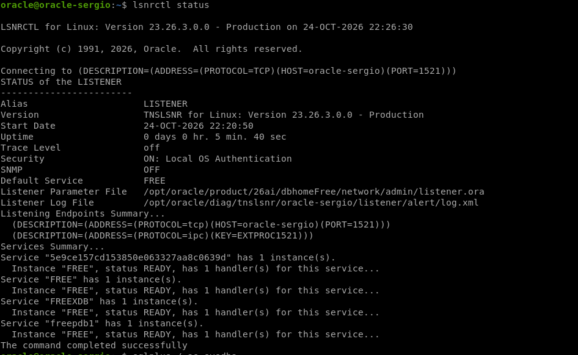

```text
SQL> SELECT instance_name, host_name, version_full, status FROM v$instance;

INSTANCE_NAME	 HOST_NAME	      VERSION_FULL    STATUS
---------------- -------------------- --------------- ------------
FREE		 oracle-sergio	      23.26.3.0.0     OPEN

SQL> SHOW PDBS

    CON_ID CON_NAME			  OPEN MODE  RESTRICTED
---------- ------------------------------ ---------- ----------
	 2 PDB$SEED			  READ ONLY  NO
	 3 FREEPDB1			  READ WRITE NO
```

La instancia FREE está abierta y la PDB FREEPDB1 está en lectura y escritura. `PDB$SEED` es la plantilla interna que usa Oracle para crear nuevas PDB y siempre está en solo lectura. El servicio con nombre largo (`5e9ce157…`) es un identificador interno de la PDB que Oracle crea siempre.

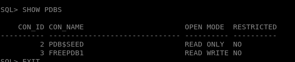

## 5. Configuración del SPFILE

El SPFILE es el fichero que Oracle lee al arrancar para saber cómo configurarse: nombre de la base de datos y de la instancia, memoria, a qué listener debe avisar, etc. Es un fichero binario, así que no se edita a mano: se modifica desde SQL con `ALTER SYSTEM SET ... SCOPE=...`.

| SCOPE | Qué hace |
| --- | --- |
| `MEMORY` | Cambia el valor solo ahora; se pierde al reiniciar |
| `SPFILE` | Guarda el valor en el SPFILE; se aplica en el próximo arranque |
| `BOTH` | Las dos cosas a la vez |

### 5.1. Consulta del SPFILE y del nombre de la instancia

Conectado como administrador (`sqlplus / as sysdba`) he comprobado que la instancia arranca con SPFILE y he consultado su nombre y el de la base de datos:

```text
SQL> SHOW PARAMETER spfile

NAME				     TYPE	 VALUE
------------------------------------ ----------- ------------------------------
spfile				     string	 /opt/oracle/product/26ai/dbhom
						 eFree/dbs/spfileFREE.ora
SQL> SHOW PARAMETER instance_name

NAME				     TYPE	 VALUE
------------------------------------ ----------- ------------------------------
instance_name			     string	 FREE
SQL> SHOW PARAMETER db_name

NAME				     TYPE	 VALUE
------------------------------------ ----------- ------------------------------
db_name 			     string	 FREE
SQL> SHOW PARAMETER db_domain

NAME				     TYPE	 VALUE
------------------------------------ ----------- ------------------------------
db_domain			     string
SQL> SHOW PARAMETER service_names

NAME				     TYPE	 VALUE
------------------------------------ ----------- ------------------------------
service_names			     string	 FREE
```

El SPFILE está en `$ORACLE_HOME/dbs/spfileFREE.ora` (lleva el SID en el nombre). La instancia y la base de datos se llaman **FREE**: en la edición Free, Oracle obliga a usar ese nombre y no se puede cambiar. Lo que sí he configurado es un nombre de servicio propio (apartado 5.3).

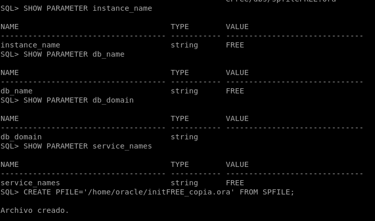

### 5.2. Copia legible del SPFILE

Para poder ver el contenido del SPFILE he sacado una copia en formato texto (PFILE):

```text
SQL> CREATE PFILE='/home/oracle/initFREE_copia.ora' FROM SPFILE;

Archivo creado.

SQL> HOST cat /home/oracle/initFREE_copia.ora
FREE.__data_transfer_cache_size=0
FREE.__datamemory_area_size=0
FREE.__db_cache_size=771751936
FREE.__inmemory_ext_roarea=0
FREE.__inmemory_ext_rwarea=0
FREE.__java_pool_size=0
FREE.__large_pool_size=16777216
FREE.__oracle_base='/opt/oracle'#ORACLE_BASE set from environment
FREE.__pga_aggregate_target=419430400
FREE.__sga_target=1241513984
FREE.__shared_io_pool_size=67108864
FREE.__shared_pool_size=352321536
FREE.__streams_pool_size=0
FREE.__unified_pga_pool_size=0
FREE._instance_recovery_bloom_filter_size=1048576
*.compatible='23.6.0'
*.control_files='/opt/oracle/oradata/FREE/control01.ctl','/opt/oracle/oradata/FREE/control02.ctl'
*.db_block_size=8192
*.db_name='FREE'
*.diagnostic_dest='/opt/oracle'
*.dispatchers='(PROTOCOL=TCP) (SERVICE=FREEXDB)'
*.enable_pluggable_database=true
*.fast_start_parallel_rollback='FALSE'
*.local_listener='LISTENER_FREE'
*.nls_language='SPANISH'
*.nls_territory='SPAIN'
*.open_cursors=300
*.pga_aggregate_target=392m
*.processes=200
*.remote_login_passwordfile='EXCLUSIVE'
*.sga_target=1176m
*.undo_tablespace='UNDOTBS1'
```

Las líneas que empiezan por `*.` valen para cualquier instancia y son las que ha definido el instalador o el administrador. Las que empiezan por `FREE.__` (con doble guion bajo) son tamaños de memoria que Oracle ajusta solo y recuerda para el siguiente arranque. Un parámetro importante es `local_listener='LISTENER_FREE'`, que indica a la base de datos en qué listener debe anunciar sus servicios (se ve en el apartado 7).

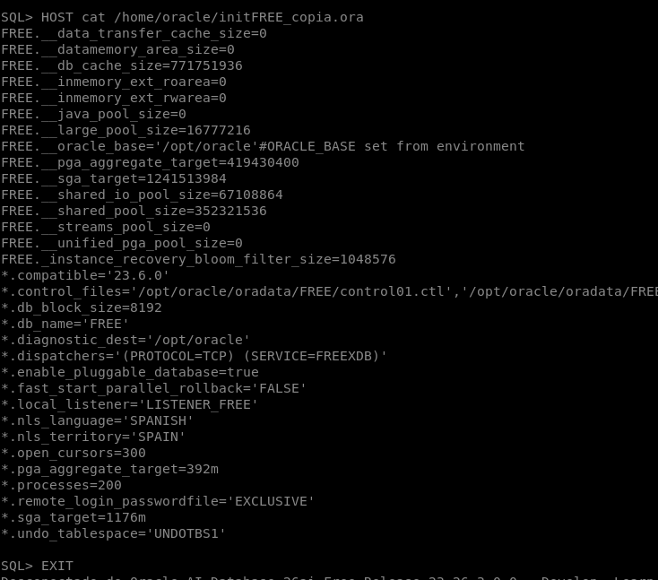

### 5.3. Modificación del SPFILE y creación del servicio ABD

He hecho dos cambios:

1. He subido `open_cursors` (máximo de consultas abiertas por sesión) de 300 a 500 con `SCOPE=SPFILE`, para demostrar que el cambio se guarda en el SPFILE y solo se aplica al reiniciar.
2. He creado el servicio **ABD** dentro de FREEPDB1, que es el nombre con el que los clientes se conectarán a los datos de la práctica. Con `SAVE STATE` he guardado que FREEPDB1 debe abrirse sola, y con el servicio ABD arrancado, cada vez que se inicie la instancia.

```text
SQL> SHOW PARAMETER open_cursors

NAME				     TYPE	 VALUE
------------------------------------ ----------- ------------------------------
open_cursors			     integer	 300
SQL> ALTER SYSTEM SET open_cursors=500 SCOPE=SPFILE;

Sistema modificado.

SQL> SHOW PARAMETER open_cursors

NAME				     TYPE	 VALUE
------------------------------------ ----------- ------------------------------
open_cursors			     integer	 300
SQL> ALTER SESSION SET CONTAINER = FREEPDB1;

Sesion modificada.

SQL> BEGIN
  2    DBMS_SERVICE.CREATE_SERVICE(service_name => 'ABD', network_name => 'ABD');
  3    DBMS_SERVICE.START_SERVICE('ABD');
  4  END;
  5  /

Procedimiento PL/SQL terminado correctamente.

SQL> ALTER SESSION SET CONTAINER = CDB$ROOT;

Sesion modificada.

SQL> ALTER PLUGGABLE DATABASE FREEPDB1 SAVE STATE;

Base de datos de conexion modificada.
```

Justo después del `ALTER SYSTEM`, `open_cursors` sigue valiendo 300 porque el cambio solo se ha guardado en el SPFILE.

No he creado el servicio con el parámetro `service_names` del SPFILE porque es la forma antigua y Oracle lo marca como obsoleto. Además, ese parámetro crearía el servicio en la raíz (CDB) y no en la PDB, que es donde están los datos.

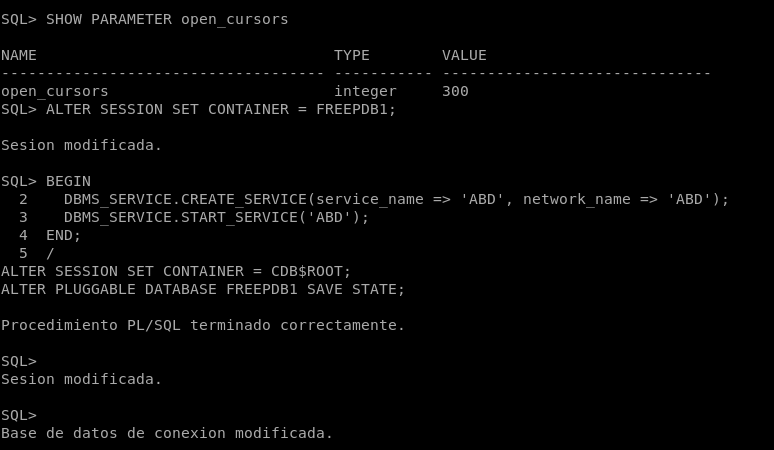

### 5.4. Reinicio y comprobación

He reiniciado la instancia para comprobar que los cambios se mantienen:

```text
SQL> SHUTDOWN IMMEDIATE
Base de datos cerrada.
Base de datos desmontada.
Instancia ORACLE cerrada.
SQL> STARTUP
Instancia ORACLE iniciada.

Total System Global Area 1234299120 bytes
Fixed Size		    5032176 bytes
Variable Size		  385875968 bytes
Database Buffers	  838860800 bytes
Redo Buffers		    4530176 bytes
Base de datos montada.
Base de datos abierta.
SQL> SHOW PARAMETER open_cursors

NAME				     TYPE	 VALUE
------------------------------------ ----------- ------------------------------
open_cursors			     integer	 500
SQL> SHOW PDBS

    CON_ID CON_NAME			  OPEN MODE  RESTRICTED
---------- ------------------------------ ---------- ----------
	 2 PDB$SEED			  READ ONLY  NO
	 3 FREEPDB1			  READ WRITE NO
SQL> SELECT name, con_id FROM v$active_services ORDER BY con_id;

NAME					CON_ID
----------------------------------- ----------
freeXDB 				     1
SYS$BACKGROUND				     1
SYS$USERS				     1
free					     1
freepdb1				     3
ABD					     3

6 filas seleccionadas.
```

Tras el reinicio, `open_cursors` vale 500, FREEPDB1 se ha abierto sola y el servicio ABD está activo en el contenedor 3, que es FREEPDB1.

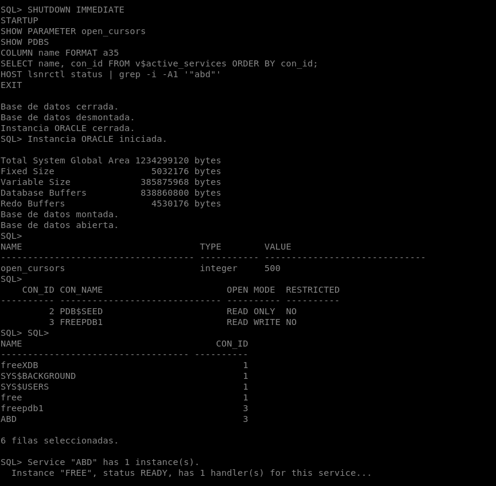

## 6. Configuración del listener

El listener es el proceso que escucha en el puerto 1521 y recibe las conexiones que llegan por la red. Cuando un cliente pide el servicio ABD, el listener le pasa la conexión a la base de datos. Se configura en el fichero `listener.ora`, que está en `$ORACLE_HOME/network/admin`.

Así lo dejó el instalador:

```text
# listener.ora Network Configuration File: /opt/oracle/product/26ai/dbhomeFree/network/admin/listener.ora
# Generated by Oracle configuration tools.

DEFAULT_SERVICE_LISTENER = FREE

LISTENER =
  (DESCRIPTION_LIST =
    (DESCRIPTION =
      (ADDRESS = (PROTOCOL = TCP)(HOST = oracle-sergio)(PORT = 1521))
      (ADDRESS = (PROTOCOL = IPC)(KEY = EXTPROC1521))
    )
  )
```

Con `HOST = oracle-sergio` el listener solo escuchaba en la IP asociada a ese nombre. He cambiado `oracle-sergio` por `0.0.0.0` para que escuche en todas las IP de la máquina:

```text
oracle@oracle-sergio:/opt/oracle/product/26ai/dbhomeFree/network/admin$ diff listener.ora.original listener.ora
9c9
<       (ADDRESS = (PROTOCOL = TCP)(HOST = oracle-sergio)(PORT = 1521))
---
>       (ADDRESS = (PROTOCOL = TCP)(HOST = 0.0.0.0)(PORT = 1521))
```

| Elemento | Significado |
| --- | --- |
| `LISTENER` | Nombre del proceso listener |
| `PROTOCOL = TCP` | Acepta conexiones por red TCP/IP |
| `HOST = 0.0.0.0` | Escucha en todas las IP de la máquina |
| `PORT = 1521` | Puerto estándar de Oracle |
| `PROTOCOL = IPC` | Conexiones locales internas, sin pasar por la red |
| `DEFAULT_SERVICE_LISTENER = FREE` | Servicio al que va una conexión que no indica ninguno |

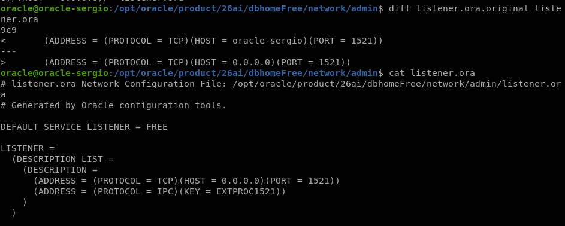

Después he reiniciado el listener. Justo al arrancar no conocía ningún servicio:

```text
oracle@oracle-sergio:/opt/oracle/product/26ai/dbhomeFree/network/admin$ lsnrctl start
[...]
Listening Endpoints Summary...
  (DESCRIPTION=(ADDRESS=(PROTOCOL=tcp)(HOST=0.0.0.0)(PORT=1521)))
  (DESCRIPTION=(ADDRESS=(PROTOCOL=ipc)(KEY=EXTPROC1521)))
The listener supports no services
The command completed successfully
```

Esto es normal, porque los servicios no se escriben en `listener.ora`: es la propia base de datos la que se los anuncia al listener (registro dinámico), gracias al parámetro `local_listener` del SPFILE. Lo hace sola cada poco tiempo, pero lo forcé en ese momento con `ALTER SYSTEM REGISTER`:

```text
oracle@oracle-sergio:/opt/oracle/product/26ai/dbhomeFree/network/admin$ sqlplus -s / as sysdba <<< "ALTER SYSTEM REGISTER;"

Sistema modificado.

oracle@oracle-sergio:/opt/oracle/product/26ai/dbhomeFree/network/admin$ lsnrctl status
[...]
Listening Endpoints Summary...
  (DESCRIPTION=(ADDRESS=(PROTOCOL=tcp)(HOST=0.0.0.0)(PORT=1521)))
  (DESCRIPTION=(ADDRESS=(PROTOCOL=ipc)(KEY=EXTPROC1521)))
Services Summary...
Service "5e9ce157cd153850e063327aa8c0639d" has 1 instance(s).
  Instance "FREE", status READY, has 1 handler(s) for this service...
Service "ABD" has 1 instance(s).
  Instance "FREE", status READY, has 1 handler(s) for this service...
Service "FREE" has 1 instance(s).
  Instance "FREE", status READY, has 1 handler(s) for this service...
Service "FREEXDB" has 1 instance(s).
  Instance "FREE", status READY, has 1 handler(s) for this service...
Service "freepdb1" has 1 instance(s).
  Instance "FREE", status READY, has 1 handler(s) for this service...
The command completed successfully
oracle@oracle-sergio:/opt/oracle/product/26ai/dbhomeFree/network/admin$ ss -ltn | grep 1521
LISTEN 0      1024         0.0.0.0:1521       0.0.0.0:*
```

Ahora el listener escucha en `0.0.0.0:1521` y anuncia todos los servicios, incluido ABD.

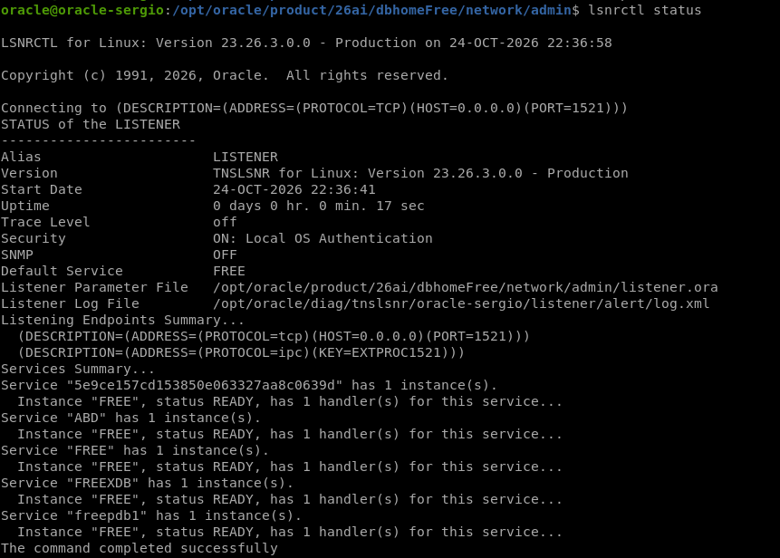

## 7. Configuración de tnsnames.ora

El fichero `tnsnames.ora` es una agenda de conexiones. Cada entrada es un alias, un nombre corto que guarda la dirección completa (máquina, puerto y servicio). Así, en lugar de escribir todos los datos, me conecto con `usuario@ALIAS`. Está en la misma carpeta que `listener.ora`.

Así lo dejó el instalador:

```text
# tnsnames.ora Network Configuration File: /opt/oracle/product/26ai/dbhomeFree/network/admin/tnsnames.ora
# Generated by Oracle configuration tools.

FREE =
  (DESCRIPTION =
    (ADDRESS = (PROTOCOL = TCP)(HOST = oracle-sergio)(PORT = 1521))
    (CONNECT_DATA =
      (SERVER = DEDICATED)
      (SERVICE_NAME = FREE)
    )
  )

LISTENER_FREE =
  (ADDRESS = (PROTOCOL = TCP)(HOST = oracle-sergio)(PORT = 1521))
```

La entrada `LISTENER_FREE` es la que usa el parámetro `local_listener='LISTENER_FREE'` del SPFILE. Así se relacionan los dos ficheros: el SPFILE dice "anuncia los servicios en LISTENER_FREE" y el tnsnames.ora dice dónde está ese listener.

He añadido al final del fichero una entrada para el servicio de la práctica:

```text
ABD =
  (DESCRIPTION =
    (ADDRESS = (PROTOCOL = TCP)(HOST = localhost)(PORT = 1521))
    (CONNECT_DATA =
      (SERVER = DEDICATED)
      (SERVICE_NAME = ABD)
    )
  )
```

| Elemento | Significado |
| --- | --- |
| `ABD =` | Alias, el nombre que se usa al conectar (`system@ABD`) |
| `HOST = localhost` | Máquina del servidor; aquí es `localhost` porque este fichero lo usa el propio servidor |
| `PORT = 1521` | Puerto del listener |
| `SERVER = DEDICATED` | Cada conexión tiene su propio proceso servidor |
| `SERVICE_NAME = ABD` | Servicio al que se conecta, el creado en el apartado 5.3 |

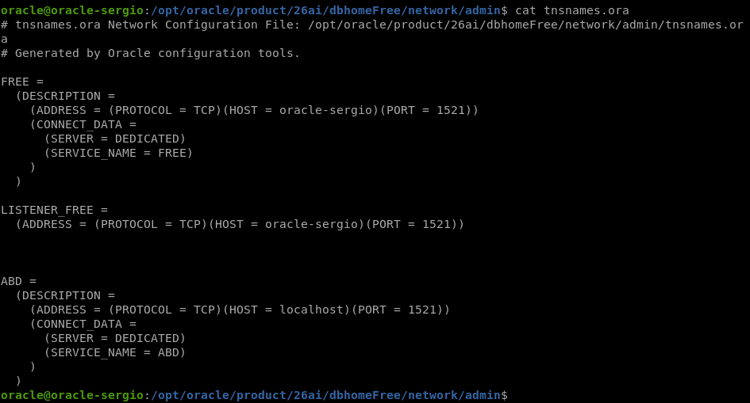

El orden en que Oracle busca los nombres de conexión lo indica el fichero `sqlnet.ora`, que he dejado como estaba:

```text
NAMES.DIRECTORY_PATH= (TNSNAMES, EZCONNECT)
```

Primero busca el nombre en tnsnames.ora y, si no lo encuentra, lo interpreta como una dirección directa del tipo `servidor:puerto/servicio` (EZCONNECT).

He probado el alias con `tnsping` y conectándome con él:

```text
oracle@oracle-sergio:/opt/oracle/product/26ai/dbhomeFree/network/admin$ tnsping ABD
[...]
Used parameter files:
/opt/oracle/product/26ai/dbhomeFree/network/admin/sqlnet.ora


Used TNSNAMES adapter to resolve the alias
Attempting to contact (DESCRIPTION = (ADDRESS = (PROTOCOL = TCP)(HOST = localhost)(PORT = 1521)) (CONNECT_DATA = (SERVER = DEDICATED) (SERVICE_NAME = ABD)))
OK (10 msec)
```

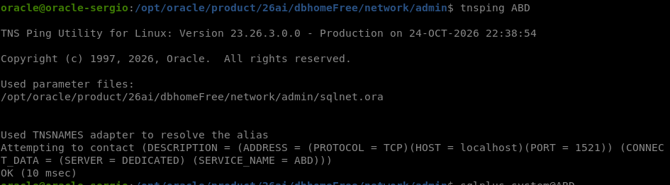

```text
oracle@oracle-sergio:~$ sqlplus system@ABD
[...]
SQL> SELECT SYS_CONTEXT('USERENV','SERVICE_NAME') AS servicio,
  2         SYS_CONTEXT('USERENV','CON_NAME')     AS pdb
  3  FROM dual;

SERVICIO	PDB
--------------- ---------------
ABD		FREEPDB1
```

La conexión con el alias entra en el servicio ABD, dentro de FREEPDB1.

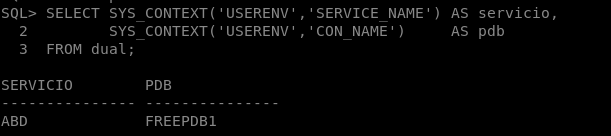

## 8. Arranque automático

Para que Oracle arranque solo al encender la máquina hacen falta dos cosas:

1. Que Debian arranque la instancia y el listener, con un servicio de systemd.
2. Que Oracle abra FREEPDB1 con el servicio ABD, que ya quedó resuelto con `SAVE STATE` en el apartado 5.3.

Primero comprobé que no hubiera ya ningún arranque de Oracle configurado, para no arrancarlo dos veces:

```text
root@oracle-sergio:/opt/instalar# systemctl list-unit-files | grep -i oracle
root@oracle-sergio:/opt/instalar# ls /etc/rc?.d/ | grep -i oracle
```

Después he creado el fichero `/etc/systemd/system/oracle-free.service` con este contenido:

```text
[Unit]
Description=Oracle AI Database 26ai Free (instancia + listener)
After=network-online.target
Wants=network-online.target

[Service]
Type=oneshot
RemainAfterExit=yes
ExecStart=/etc/init.d/oracle-free-26ai start
ExecStop=/etc/init.d/oracle-free-26ai stop
TimeoutStartSec=600
TimeoutStopSec=300

[Install]
WantedBy=multi-user.target
```

| Línea | Significado |
| --- | --- |
| `After=network-online.target` | Arranca cuando la red ya está lista, porque el listener la necesita |
| `Type=oneshot` y `RemainAfterExit=yes` | El script arranca Oracle y termina, pero systemd considera el servicio activo hasta que se pare |
| `ExecStart` / `ExecStop` | Usan el script oficial de Oracle para arrancar y parar la instancia y el listener |
| `TimeoutStartSec=600` | Le da hasta 10 minutos para arrancar |
| `WantedBy=multi-user.target` | Se arranca en el arranque normal del sistema |

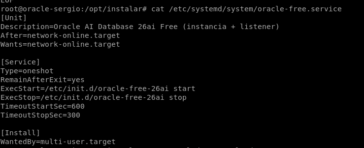

Lo he activado y lo he probado: paré Oracle con su script y lo arranqué con systemd.

```text
root@oracle-sergio:/opt/instalar# systemctl daemon-reload
root@oracle-sergio:/opt/instalar# systemctl enable oracle-free.service
Created symlink '/etc/systemd/system/multi-user.target.wants/oracle-free.service' → '/etc/systemd/system/oracle-free.service'.
root@oracle-sergio:/opt/instalar# /etc/init.d/oracle-free-26ai stop
Shutting down Oracle AI Database instance FREE.
Oracle AI Database instance FREE shut down.
Stopping Oracle Net Listener.
Oracle Net Listener stopped.

root@oracle-sergio:/opt/instalar# systemctl start oracle-free.service
root@oracle-sergio:/opt/instalar# systemctl status oracle-free.service --no-pager
● oracle-free.service - Oracle AI Database 26ai Free (instancia + listener)
     Loaded: loaded (/etc/systemd/system/oracle-free.service; enabled; preset: enabled)
     Active: active (exited) since Sat 2026-10-24 22:42:49 CEST; 2s ago
[...]
```

Por último, reinicié la máquina virtual. Tras el reinicio, el servicio había arrancado solo, primero el listener y después la instancia:

```text
root@oracle-sergio:~# systemctl status oracle-free.service --no-pager
● oracle-free.service - Oracle AI Database 26ai Free (instancia + listener)
     Loaded: loaded (/etc/systemd/system/oracle-free.service; enabled; preset: enabled)
     Active: active (exited) since Sat 2026-10-24 22:44:11 CEST; 38s ago
 Invocation: 9d0e337396d848ee916c103313d7ffda
    Process: 728 ExecStart=/etc/init.d/oracle-free-26ai start (code=exited, status=0/SUCCESS)
   Main PID: 728 (code=exited, status=0/SUCCESS)
[...]
oct 24 22:43:59 oracle-sergio oracle-free-26ai[728]: Starting Oracle Net Listener.
oct 24 22:44:01 oracle-sergio oracle-free-26ai[728]: Oracle Net Listener started.
oct 24 22:44:01 oracle-sergio oracle-free-26ai[728]: Starting Oracle AI Database instance FREE.
oct 24 22:44:11 oracle-sergio oracle-free-26ai[728]: Oracle AI Database instance FREE started.
```

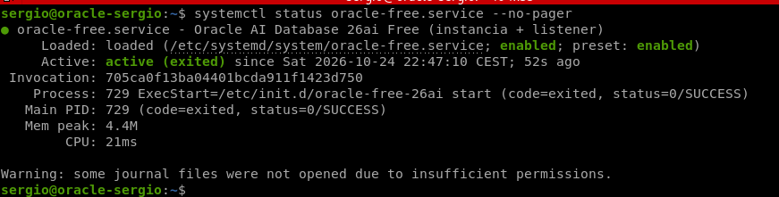

También comprobé que tras el reinicio se mantenía toda la configuración anterior: el listener en `0.0.0.0` con el servicio ABD, `open_cursors` a 500 y FREEPDB1 abierta.

```text
root@oracle-sergio:~# su - oracle -c 'lsnrctl status' | grep -E 'HOST=0|Service "ABD"|Service "freepdb1"'
Connecting to (DESCRIPTION=(ADDRESS=(PROTOCOL=TCP)(HOST=0.0.0.0)(PORT=1521)))
  (DESCRIPTION=(ADDRESS=(PROTOCOL=tcp)(HOST=0.0.0.0)(PORT=1521)))
Service "ABD" has 1 instance(s).
Service "freepdb1" has 1 instance(s).
root@oracle-sergio:~# su - oracle -c 'sqlplus -s / as sysdba' <<'EOF'
SHOW PARAMETER open_cursors
SHOW PDBS
SELECT name FROM v$active_services WHERE con_id = 3;
EOF

NAME				     TYPE	 VALUE
------------------------------------ ----------- ------------------------------
open_cursors			     integer	 500

    CON_ID CON_NAME			  OPEN MODE  RESTRICTED
---------- ------------------------------ ---------- ----------
	 2 PDB$SEED			  READ ONLY  NO
	 3 FREEPDB1			  READ WRITE NO

NAME
----------------------------------------------------------------
freepdb1
ABD
```

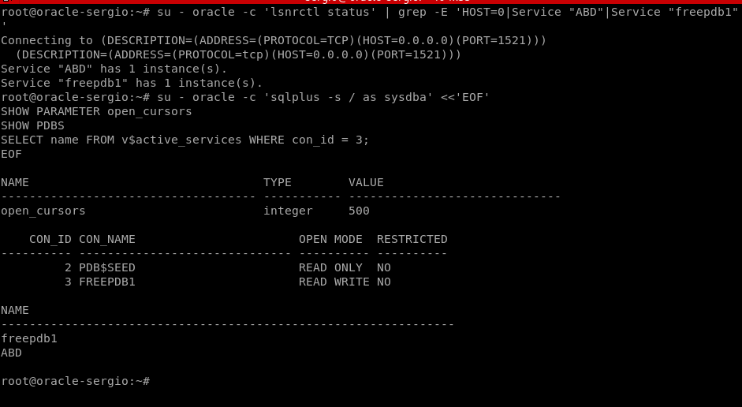

## 9. Usuarios, tablas y datos

### 9.1. Creación de los usuarios

He creado dos usuarios en el servicio ABD, conectado como SYSTEM:

- `abd_user`, dueño de las tablas, con permiso para conectarse y crear objetos.
- `abd_lector`, que solo puede leer las tablas. Es el usuario que se facilita al resto del grupo.

```text
oracle@oracle-sergio:~$ sqlplus system@ABD
[...]
SQL> CREATE USER abd_user IDENTIFIED BY "********"
  2    DEFAULT TABLESPACE users
  3    QUOTA 100M ON users;

Usuario creado.

SQL> GRANT CREATE SESSION, CREATE TABLE, CREATE VIEW, CREATE SEQUENCE TO abd_user;

Concesion terminada correctamente.

SQL> CREATE USER abd_lector IDENTIFIED BY "********";

Usuario creado.

SQL> GRANT CREATE SESSION TO abd_lector;

Concesion terminada correctamente.
```

El privilegio `CREATE SESSION` es el que permite conectarse, también en remoto: sin él el usuario existe pero no puede entrar. La cuota (`QUOTA 100M ON users`) hace falta para que el usuario pueda guardar datos en el tablespace, aunque tenga permiso para crear tablas.

### 9.2. Tablas y datos

He creado el script `/home/oracle/practica.sql` con tres tablas relacionadas (clientes, productos y pedidos), sus datos y el permiso de lectura para `abd_lector`. Este es su contenido:

```sql
-- Tablas de la práctica ABD (usuario abd_user)
CREATE TABLE clientes (
  id_cliente  NUMBER GENERATED ALWAYS AS IDENTITY PRIMARY KEY,
  nombre      VARCHAR2(60) NOT NULL,
  ciudad      VARCHAR2(40),
  email       VARCHAR2(80) UNIQUE
);

CREATE TABLE productos (
  id_producto NUMBER GENERATED ALWAYS AS IDENTITY PRIMARY KEY,
  nombre      VARCHAR2(60) NOT NULL,
  precio      NUMBER(8,2) CHECK (precio > 0),
  stock       NUMBER DEFAULT 0
);

CREATE TABLE pedidos (
  id_pedido   NUMBER GENERATED ALWAYS AS IDENTITY PRIMARY KEY,
  id_cliente  NUMBER NOT NULL REFERENCES clientes(id_cliente),
  id_producto NUMBER NOT NULL REFERENCES productos(id_producto),
  cantidad    NUMBER NOT NULL CHECK (cantidad > 0),
  fecha       DATE DEFAULT SYSDATE
);

INSERT INTO clientes (nombre, ciudad, email) VALUES ('Ana López',   'Madrid',   'ana@correo.es');
INSERT INTO clientes (nombre, ciudad, email) VALUES ('Luis Pérez',  'Sevilla',  'luis@correo.es');
INSERT INTO clientes (nombre, ciudad, email) VALUES ('Marta Ruiz',  'Valencia', 'marta@correo.es');
INSERT INTO clientes (nombre, ciudad, email) VALUES ('Jorge Sanz',  'Bilbao',   'jorge@correo.es');
INSERT INTO clientes (nombre, ciudad, email) VALUES ('Elena Gómez', 'Madrid',   'elena@correo.es');

INSERT INTO productos (nombre, precio, stock) VALUES ('Teclado',     25.90, 40);
INSERT INTO productos (nombre, precio, stock) VALUES ('Ratón',       12.50, 75);
INSERT INTO productos (nombre, precio, stock) VALUES ('Monitor 24',  149.00, 12);
INSERT INTO productos (nombre, precio, stock) VALUES ('Auriculares', 39.99, 30);
INSERT INTO productos (nombre, precio, stock) VALUES ('Webcam',      54.00, 18);

INSERT INTO pedidos (id_cliente, id_producto, cantidad) VALUES (1, 3, 1);
INSERT INTO pedidos (id_cliente, id_producto, cantidad) VALUES (1, 1, 2);
INSERT INTO pedidos (id_cliente, id_producto, cantidad) VALUES (2, 2, 3);
INSERT INTO pedidos (id_cliente, id_producto, cantidad) VALUES (3, 4, 1);
INSERT INTO pedidos (id_cliente, id_producto, cantidad) VALUES (4, 5, 2);
INSERT INTO pedidos (id_cliente, id_producto, cantidad) VALUES (5, 3, 1);

COMMIT;

-- Permiso de solo lectura para abd_lector
GRANT SELECT ON clientes  TO abd_lector;
GRANT SELECT ON productos TO abd_lector;
GRANT SELECT ON pedidos   TO abd_lector;

-- Comprobación
SELECT table_name FROM user_tables ORDER BY table_name;
SELECT (SELECT COUNT(*) FROM clientes)  AS clientes,
       (SELECT COUNT(*) FROM productos) AS productos,
       (SELECT COUNT(*) FROM pedidos)   AS pedidos
FROM dual;
```

El `COMMIT` es importante: sin él, los datos no se verían desde otras sesiones.

Lo he ejecutado conectado como `abd_user`:

```text
oracle@oracle-sergio:~$ sqlplus abd_user@ABD @/home/oracle/practica.sql
[...]
Tabla creada.

Tabla creada.

Tabla creada.

1 fila creada.
[...]
Confirmación terminada.

Concesión terminada correctamente.

Concesión terminada correctamente.

Concesión terminada correctamente.

TABLE_NAME
--------------------------------------------------------------------------------
CLIENTES
PEDIDOS
PRODUCTOS

  CLIENTES  PRODUCTOS	 PEDIDOS
---------- ---------- ----------
	 5	    5	       6
```

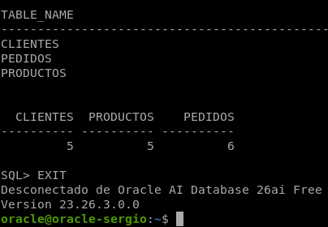

### 9.3. Problema con las tildes (NLS_LANG)

La primera vez que ejecuté el script, los nombres con tilde se guardaron mal: aparecían como "Ana L??pez" o "Luis P??rez". La causa era que no tenía definida la variable `NLS_LANG`. Sin ella, sqlplus supone que el texto que recibe está en ASCII básico, que no tiene tildes ni eñes, y las sustituye por `?` al insertarlas.

Lo solucioné añadiendo `NLS_LANG` al `.profile` del usuario oracle (apartado 4.2). Tiene tres partes: el idioma de los mensajes (`SPANISH`), los formatos de fecha y número (`SPAIN`) y la codificación del cliente (`AL32UTF8`, es decir, UTF-8, la misma que usa la terminal). Después borré las tres tablas y volví a ejecutar el script.

### 9.4. Comprobación de los privilegios

Con el usuario `abd_lector` he comprobado que puede leer las tablas pero no modificarlas:

```text
oracle@oracle-sergio:~$ sqlplus abd_lector@ABD
[...]
SQL> SELECT nombre, ciudad FROM abd_user.clientes;

NOMBRE		     CIUDAD
-------------------- ------------
Ana López            Madrid
Luis Pérez           Sevilla
Marta Ruiz	     Valencia
Jorge Sanz	     Bilbao
Elena Gómez          Madrid

SQL> INSERT INTO abd_user.clientes (nombre) VALUES ('Intruso');
INSERT INTO abd_user.clientes (nombre) VALUES ('Intruso')
                     *
ERROR en línea 1:
ORA-41900: Falta el privilegio INSERT en "ABD_USER"."CLIENTES"
Ayuda: https://docs.oracle.com/error-help/db/ora-41900/
```

La consulta funciona y las tildes ya se ven bien, mientras que el `INSERT` falla con `ORA-41900` porque el usuario solo tiene permiso de lectura.

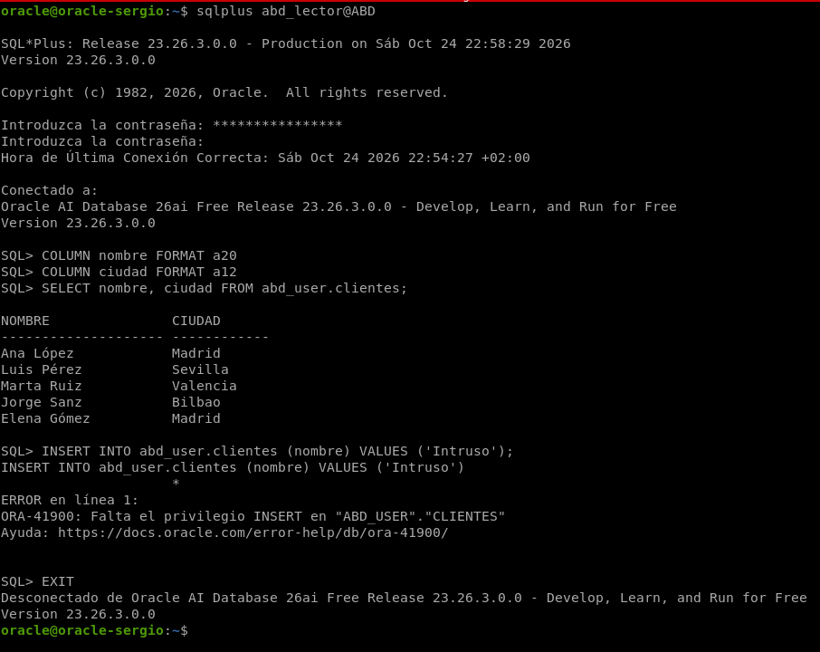

## 10. Acceso remoto desde mi portátil

Para demostrar el acceso remoto me he conectado desde mi portátil, que es una máquina distinta del servidor, usando sqlplus con su propio fichero tnsnames.ora.

### 10.1. Comprobación del puerto

Primero comprobé desde el portátil que el puerto 1521 del servidor era accesible:

```text
sergio@Sergio-PC:~$ nc -vz 192.168.122.50 1521
Connection to 192.168.122.50 1521 port [tcp/*] succeeded!
```


### 10.2. Instalación del cliente (Oracle Instant Client)

En el portátil no hace falta instalar Oracle entero: basta con Oracle Instant Client, que son las librerías para conectar con Oracle más el programa sqlplus. He descargado los paquetes *Basic* y *SQL\*Plus* y los he descomprimido en la carpeta `~/oracle` de mi usuario, sin tocar el sistema:

```bash
mkdir -p ~/oracle && cd ~/oracle
wget https://download.oracle.com/otn_software/linux/instantclient/instantclient-basic-linuxx64.zip
wget https://download.oracle.com/otn_software/linux/instantclient/instantclient-sqlplus-linuxx64.zip
unzip -o instantclient-basic-linuxx64.zip
unzip -o instantclient-sqlplus-linuxx64.zip
```

Se ha creado la carpeta `/home/sergio/oracle/instantclient_23_26`. Igual que en el servidor, el cliente busca la librería `libaio.so.1`, así que he creado el enlace dentro de la propia carpeta del cliente:

```bash
ln -sf /usr/lib/x86_64-linux-gnu/libaio.so.1t64 ~/oracle/instantclient_23_26/libaio.so.1
```

### 10.3. tnsnames.ora del cliente

He creado el fichero `~/oracle/tns/tnsnames.ora` en el portátil con este contenido:

```text
# Desde el portátil, por la red NAT de libvirt (funciona siempre)
ABD_CASA =
  (DESCRIPTION =
    (ADDRESS = (PROTOCOL = TCP)(HOST = 192.168.122.50)(PORT = 1521))
    (CONNECT_DATA =
      (SERVER = DEDICATED)
      (SERVICE_NAME = ABD)
    )
  )
```

A diferencia del tnsnames.ora del servidor, aquí el HOST es la IP del servidor y no `localhost`, porque en el portátil `localhost` sería el propio portátil.

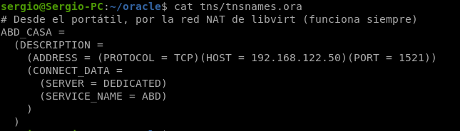

### 10.4. Variables de entorno del cliente

He añadido estas líneas al final del `.bashrc` de mi usuario en el portátil:

```text
# --- Oracle Instant Client (cliente de la práctica ABD) ---
export ORACLE_IC=/home/sergio/oracle/instantclient_23_26
export LD_LIBRARY_PATH=$ORACLE_IC${LD_LIBRARY_PATH:+:$LD_LIBRARY_PATH}
export PATH=$ORACLE_IC:$PATH
export TNS_ADMIN=$HOME/oracle/tns
export NLS_LANG=SPANISH_SPAIN.AL32UTF8
```

| Variable | Para qué sirve |
| --- | --- |
| `LD_LIBRARY_PATH` | Dónde están las librerías del cliente (y el enlace de libaio) |
| `PATH` | Poder ejecutar `sqlplus` sin la ruta completa |
| `TNS_ADMIN` | Carpeta donde el cliente busca su tnsnames.ora |
| `NLS_LANG` | Codificación UTF-8, para que las tildes viajen bien |

```text
sergio@Sergio-PC:~/oracle$ sqlplus -v

SQL*Plus: Release 23.26.2.0.0 - Production
Version 23.26.2.0.0
```

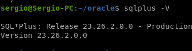

### 10.5. Conexión remota por TNS

Desde el portátil me he conectado con el alias `ABD_CASA`:

```text
sergio@Sergio-PC:~/oracle$ sqlplus abd_user@ABD_CASA

SQL*Plus: Release 23.26.2.0.0 - Production on Sáb Oct 24 23:05:28 2026
Version 23.26.2.0.0

Copyright (c) 1982, 2026, Oracle.  All rights reserved.

Introduzca la contraseña:
Hora de Última Conexión Correcta: Sáb Oct 24 2026 22:57:29 +02:00

Conectado a:
Oracle AI Database 26ai Free Release 23.26.3.0.0 - Develop, Learn, and Run for Free
Version 23.26.3.0.0
```

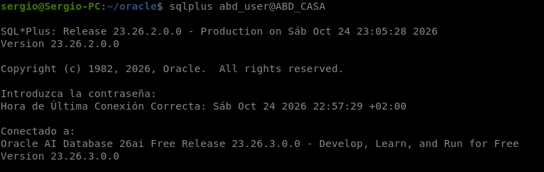

Para dejar constancia de que la conexión viene de otra máquina, consulté la IP del cliente y el nombre del servidor:

```text
SQL> SELECT
  SYS_CONTEXT('USERENV','SERVICE_NAME') AS servicio,
  SYS_CONTEXT('USERENV','CON_NAME')     AS pdb,
  SYS_CONTEXT('USERENV','SERVER_HOST')  AS servidor,
  SYS_CONTEXT('USERENV','IP_ADDRESS')   AS ip_cliente,
  USER                                  AS usuario
FROM dual;

SERVICIO   PDB	      SERVIDOR	      IP_CLIENTE      USUARIO
---------- ---------- --------------- --------------- ----------
ABD	   FREEPDB1   oracle-sergio   192.168.122.1   ABD_USER
```

El servidor es `oracle-sergio` y la conexión llega desde `192.168.122.1`, que es la IP de mi portátil vista desde la máquina virtual.

Por último, algunas consultas sobre los datos:

```text
SQL> SHOW USER
USER es "ABD_USER"
SQL> SELECT * FROM clientes;

ID_CLIENTE NOMBRE          CIUDAD     EMAIL
---------- --------------- ---------- ------------------
         1 Ana López       Madrid     ana@correo.es
         2 Luis Pérez      Sevilla    luis@correo.es
         3 Marta Ruiz      Valencia   marta@correo.es
         4 Jorge Sanz      Bilbao     jorge@correo.es
         5 Elena Gómez     Madrid     elena@correo.es

SQL> SELECT nombre, precio, stock FROM productos;

NOMBRE              PRECIO      STOCK
--------------- ---------- ----------
Teclado               25,9         40
Ratón                 12,5         75
Monitor 24             149         12
Auriculares          39,99         30
Webcam                  54         18
```

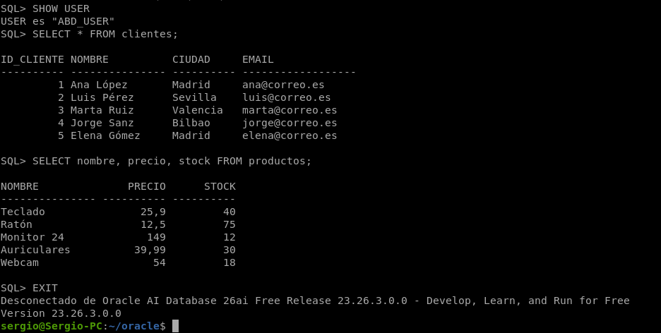

## 11. Problemas encontrados y soluciones

| Problema | Causa | Solución |
| --- | --- | --- |
| Oracle no publica paquete .deb | Oracle Free solo se distribuye en RPM | Convertir el RPM con `alien --scripts -d` |
| Oracle busca `libaio.so.1` y no existe | En Debian 13 la librería se llama `libaio.so.1t64` | Crear un enlace con el nombre antiguo (en el servidor y en el cliente) |
| Riesgo de que el listener solo escuche en local | Debian asocia el nombre de la máquina a `127.0.1.1` | Cambiar la línea en `/etc/hosts` para que apunte a la IP real |
| Límites del usuario oracle sin aplicar con `su` | `pam_limits` viene desactivado en `/etc/pam.d/su` | Descomentar la línea de `pam_limits` |
| Avisos `NOKEY` al convertir el RPM | La herramienta `rpm` de Debian no tiene la clave pública de Oracle | Ignorarlos; la integridad se comprobó con la suma SHA256 |
| Aviso `ln: '/bin/awk': El fichero ya existe` | El script del RPM crea un enlace que en Debian ya existe | Ninguna, es inofensivo |
| Mensajes `[[: not found` en `dbca` | `/bin/sh` en Debian es dash, que no entiende sintaxis de bash | Ninguna, la creación terminó al 100% |
| `sqlplus: orden no encontrada` con `su - oracle -c` | El `.bashrc` de Debian no se lee entero en sesiones no interactivas | Mover las variables de entorno al `.profile` |
| Tildes guardadas como `??` | Faltaba la variable `NLS_LANG` y sqlplus suponía ASCII | Definir `NLS_LANG=SPANISH_SPAIN.AL32UTF8` y recargar los datos |

## 12. Datos de conexión

| Dato | Valor |
| --- | --- |
| Servidor | `192.168.122.50` (`oracle-sergio`) |
| Puerto | 1521 |
| Servicio | `ABD` |
| Alias TNS en el servidor | `ABD` |
| Alias TNS en el cliente | `ABD_CASA` |
| Usuario propietario de los datos | `abd_user` |
| Usuario de solo lectura para el grupo | `abd_lector` |
| Tablas | `CLIENTES`, `PRODUCTOS`, `PEDIDOS` |

Las contraseñas no aparecen en este documento; se facilitan al grupo por separado.
