# Práctica 2: Interconexión de servidores de bases de datos

**Alumno:** Sergio Mesa
**Módulo:** Administración de Sistemas Gestores de Bases de Datos (ASIR 2º)

En esta práctica voy a crear enlaces entre distintos servidores de bases de datos para poder consultar datos que están en otro servidor como si fueran míos, y mezclarlos con los que ya tengo.

Lo que voy a hacer es:

1. Enlace entre dos servidores **Oracle**.
2. Enlace entre dos servidores **PostgreSQL**.
3. Enlace bidireccional **Oracle ↔ MariaDB** con Heterogeneous Services.
4. Enlace bidireccional **Oracle ↔ PostgreSQL** con Heterogeneous Services.
5. Una consulta que saca datos de los **tres servidores** a la vez usando dos enlaces.

---

## 0. Preparación del escenario

### 0.1. Las máquinas que voy a usar

Todo lo hago con máquinas virtuales en KVM en mi PC. Como el enunciado dice que los servidores enlazados tienen que estar en maquinas distintas, he montado este escenario:

| Máquina (VM) | Hostname | IP | Qué tiene |
|---|---|---|---|
| `oracle26ai` | oracle-sergio | 192.168.122.50 | Oracle 26ai Free |
| `oracle2` | oracle2 | 192.168.122.51 | Oracle 26ai Free + PostgreSQL |
| `sgbd-vm` | bd-sergio | 192.168.122.22 | MariaDB + PostgreSQL |

Las tres están en la red `default` de libvirt (192.168.122.0/24), así que se ven entre ellas sin tocar nada de red.

Y así quedan repartidos los enlaces:

| Enlace | Máquina origen | Máquina destino |
|---|---|---|
| Oracle ↔ Oracle | oracle-sergio | oracle2 |
| PostgreSQL ↔ PostgreSQL | bd-sergio | oracle2 |
| Oracle ↔ MariaDB | oracle-sergio | bd-sergio |
| Oracle ↔ PostgreSQL | oracle-sergio | bd-sergio |
| Consulta de los tres | oracle-sergio | oracle2 + bd-sergio |

### 0.2. Clonar la máquina de Oracle

Yo ya tenía una máquina con Oracle (`oracle26ai`), pero me hacia falta un segundo Oracle en otra máquina. En vez de instalarlo otra vez desde cero, he clonado la VM.

Primero la apago (para clonar una VM tiene que estar apagada):

```bash
virsh -c qemu:///system shutdown oracle26ai
```

Y la clono con `virt-clone`. Como la VM tiene dos tarjetas de red, le paso dos MACs nuevas, una para cada tarjeta:

```bash
virt-clone --connect qemu:///system --original oracle26ai --name oracle2 \
  --file /home/sergio/vms-oracle/oracle2.qcow2 \
  --mac 52:54:00:26:00:51 --mac 52:54:00:71:a3:b6
```

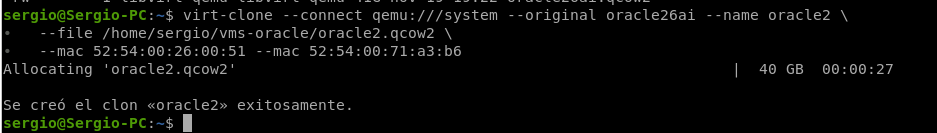

Para que el clon tenga siempre la misma IP, le hago una reserva en el DHCP de la red `default` usando su MAC:

```bash
virsh -c qemu:///system net-update default add ip-dhcp-host \
  "<host mac='52:54:00:26:00:51' name='oracle2' ip='192.168.122.51'/>" --live --config
```

Arranco las dos máquinas y compruebo que el clon ha cogido la IP que le reservé:

```bash
virsh -c qemu:///system start oracle26ai
virsh -c qemu:///system start oracle2
virsh -c qemu:///system domifaddr oracle2
```

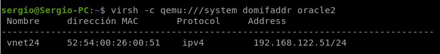

### 0.3. Cambiar el nombre del clon

Al ser un clon, la máquina nueva se sigue llamando `oracle-sergio`, igual que la original. Le cambio el hostname a `oracle2` y también lo cambio en el `/etc/hosts` y en el `tnsnames.ora` de Oracle, que tenía puesto el nombre de la máquina original:

```bash
hostnamectl set-hostname oracle2
nano /etc/hosts
nano /opt/oracle/product/26ai/dbhomeFree/network/admin/tnsnames.ora
```

Compruebo que todo ha quedado bien y reinicio para que Oracle arranque con el nombre nuevo:

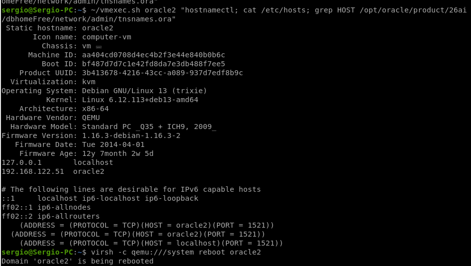

### 0.4. Resolución de nombres

Para no tener que usar las IPs todo el rato, añado las tres máquinas al `/etc/hosts` de mi PC y de cada VM. Asi en los enlaces puedo poner directamente `oracle2` o `bd-sergio`.

```bash
nano /etc/hosts
```

En mi PC:

```
192.168.122.50  oracle-sergio
192.168.122.51  oracle2
192.168.122.22  bd-sergio
```

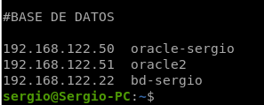

En cada VM añado las otras dos y compruebo con `ping` que se ven por nombre:

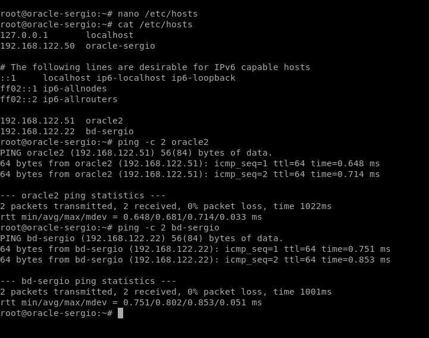

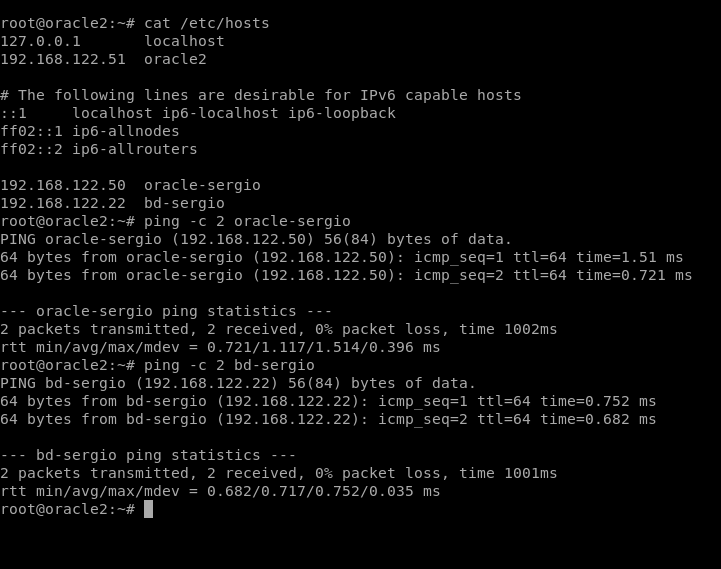

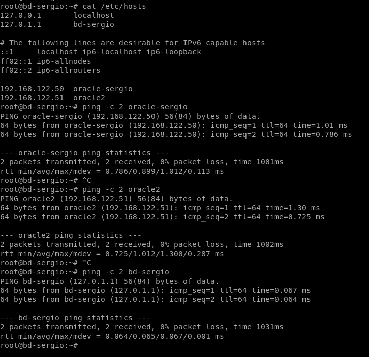

### 0.5. Comprobar que los dos Oracle están levantados

En las dos máquinas compruebo que el listener está escuchando en el puerto 1521 y que la base de datos está arrancada (el proceso `db_pmon_FREE` es el que dice que la instancia esta levantada):

```bash
ss -tlnp | grep 1521
ps -ef | grep pmon
```

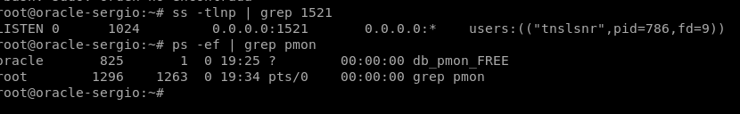

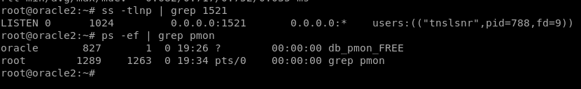

---

## 1. Enlace entre dos servidores Oracle

La idea de esta parte es tener una tabla `EMPLEADOS` en **oracle2** y una tabla `DEPARTAMENTOS` en **oracle-sergio**, y desde oracle-sergio sacar en una sola consulta cada empleado con su departamento, usando un *database link*.

| Lado | Máquina | Usuario | Tabla |
|---|---|---|---|
| Remoto | oracle2 | `sergio2` | `EMPLEADOS` |
| Local (donde creo el enlace) | oracle-sergio | `sergio1` | `DEPARTAMENTOS` |

### 1.1. Configuración en el servidor remoto (oracle2)

En el lado remoto lo único que hace falta es que el listener escuche por la red (no solo en localhost) y que ofrezca el servicio de la base de datos. Lo compruebo con `lsnrctl status` como usuario `oracle`:

```bash
su - oracle
lsnrctl status
```

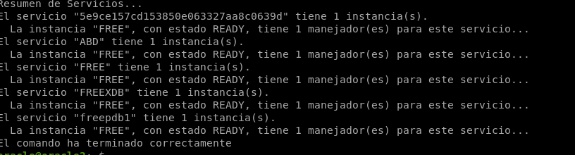

El listener escucha en `0.0.0.0:1521` (todas las interfaces) y ofrece el servicio `freepdb1`, que es la PDB que voy a usar.

> Al principio intenté usar `ABD`, que me salia como servicio, pero al hacer `SHOW PDBS` vi que la única PDB que existe es `FREEPDB1`. `ABD` es solo un servicio que tenia registrado de otra práctica.

```
SQL> SHOW PDBS

    CON_ID CON_NAME                       OPEN MODE  RESTRICTED
---------- ------------------------------ ---------- ----------
         2 PDB$SEED                       READ ONLY  NO
         3 FREEPDB1                       READ WRITE NO
```

Ahora creo el usuario `sergio2` dentro de `FREEPDB1` y su tabla con unos datos de prueba:

```sql
ALTER SESSION SET CONTAINER = FREEPDB1;

CREATE USER sergio2 IDENTIFIED BY sergio2;
GRANT CONNECT, RESOURCE, UNLIMITED TABLESPACE TO sergio2;

CONNECT sergio2/sergio2@//localhost:1521/freepdb1

CREATE TABLE empleados (
  id_emp    NUMBER PRIMARY KEY,
  nombre    VARCHAR2(30),
  puesto    VARCHAR2(30),
  id_depto  NUMBER
);

INSERT INTO empleados VALUES (1, 'Ana Garcia',  'Programadora',        10);
INSERT INTO empleados VALUES (2, 'Luis Perez',  'Tecnico de sistemas', 10);
INSERT INTO empleados VALUES (3, 'Marta Ruiz',  'Comercial',           20);
INSERT INTO empleados VALUES (4, 'Jose Lopez',  'Jefe de ventas',      20);
INSERT INTO empleados VALUES (5, 'Laura Diaz',  'Tecnica de RRHH',     30);
COMMIT;
```

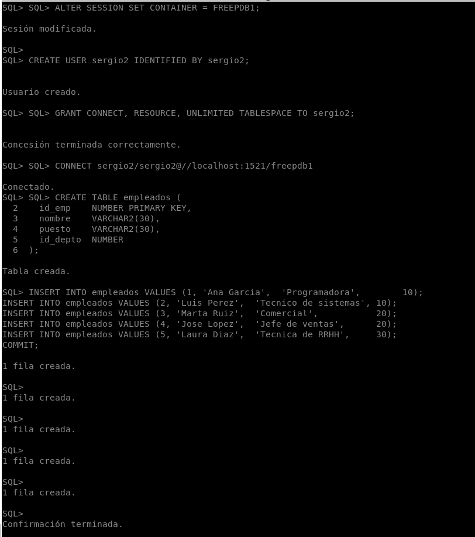

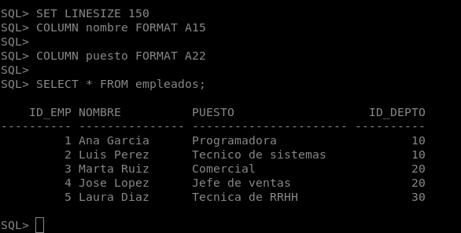

### 1.2. Configuración en el servidor local (oracle-sergio)

En el lado local tengo que decirle a Oracle dónde está el otro servidor. Para eso añado una entrada nueva al `tnsnames.ora` con el nombre `ORACLE2`, que apunta a la máquina `oracle2`, puerto 1521 y servicio `freepdb1`:

```bash
su - oracle
nano /opt/oracle/product/26ai/dbhomeFree/network/admin/tnsnames.ora
```

```
ORACLE2 =
  (DESCRIPTION =
    (ADDRESS = (PROTOCOL = TCP)(HOST = oracle2)(PORT = 1521))
    (CONNECT_DATA =
      (SERVER = DEDICATED)
      (SERVICE_NAME = freepdb1)
    )
  )
```

Con `tnsping` compruebo que desde oracle-sergio llego al listener de oracle2:

```bash
tnsping ORACLE2
```

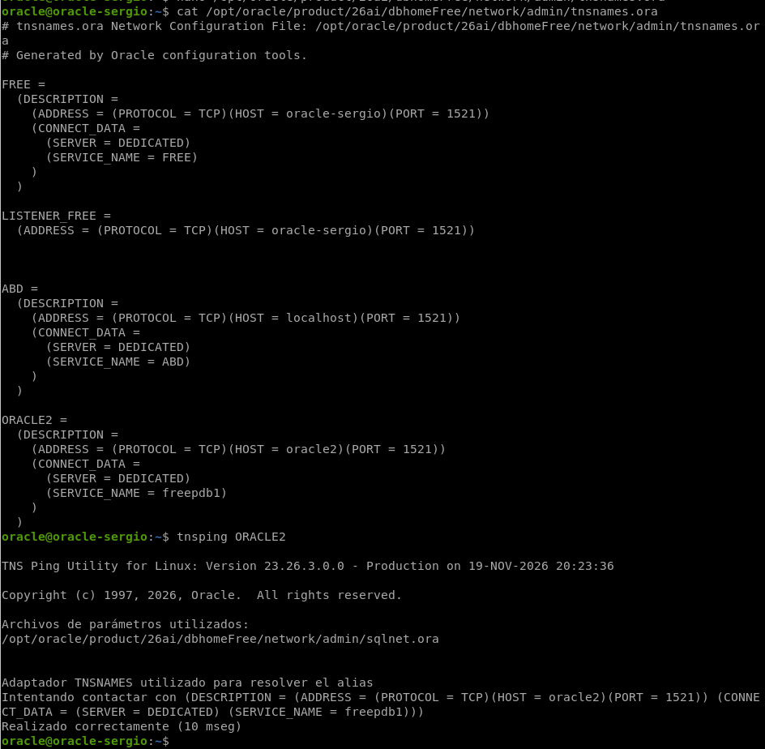

Despues creo el usuario local `sergio1`. Además de los permisos normales, le doy el permiso `CREATE DATABASE LINK`, que es el que le deja crear enlaces:

```sql
ALTER SESSION SET CONTAINER = FREEPDB1;

CREATE USER sergio1 IDENTIFIED BY sergio1;
GRANT CONNECT, RESOURCE, UNLIMITED TABLESPACE TO sergio1;
GRANT CREATE DATABASE LINK TO sergio1;

CONNECT sergio1/sergio1@//localhost:1521/freepdb1
```

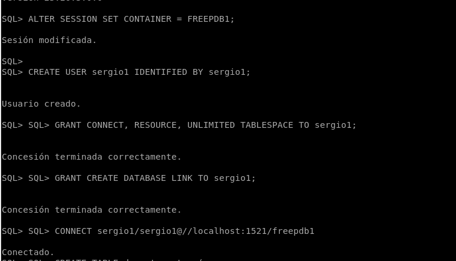

Y creo su tabla `DEPARTAMENTOS`:

```sql
CREATE TABLE departamentos (
  id_depto  NUMBER PRIMARY KEY,
  nombre    VARCHAR2(20),
  ciudad    VARCHAR2(20)
);

INSERT INTO departamentos VALUES (10, 'Informatica', 'Sevilla');
INSERT INTO departamentos VALUES (20, 'Ventas',      'Madrid');
INSERT INTO departamentos VALUES (30, 'RRHH',        'Malaga');
COMMIT;
```

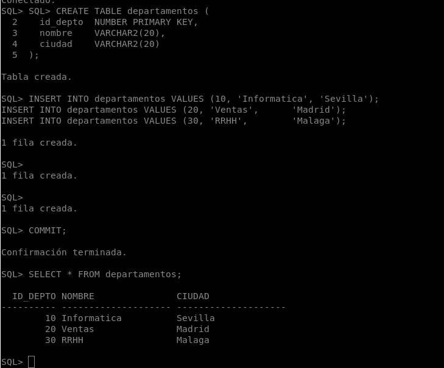

### 1.3. Crear el enlace

Ya como `sergio1` creo el enlace. Le digo con qué usuario se conecta al otro lado (`sergio2`) y qué entrada del `tnsnames.ora` usa (`ORACLE2`):

```sql
CREATE DATABASE LINK enlace_oracle2
  CONNECT TO sergio2 IDENTIFIED BY sergio2
  USING 'ORACLE2';
```

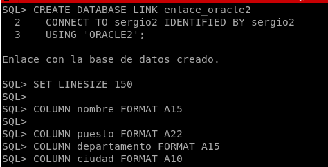

### 1.4. Prueba de funcionamiento

Para usar una tabla del otro servidor solo tengo que poner `@nombre_del_enlace` detrás del nombre de la tabla. Primero consulto la tabla remota tal cual, y después la junto con mi tabla local:

```sql
SELECT * FROM empleados@enlace_oracle2;

SELECT e.nombre, e.puesto, d.nombre AS departamento, d.ciudad
FROM   empleados@enlace_oracle2 e, departamentos d
WHERE  e.id_depto = d.id_depto
ORDER BY d.nombre;
```

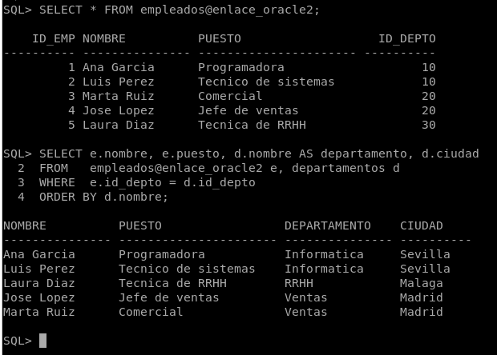

La segunda consulta usa las dos bases de datos a la vez: los empleados vienen de **oracle2** y los departamentos de **oracle-sergio**, y salen juntos en el mismo resultado.

---

## 2. Enlace entre dos servidores PostgreSQL

Aquí hago lo mismo que con Oracle pero con PostgreSQL. La tabla `empleados` va a estar en **oracle2** (al que le instalo Postgres) y la tabla `departamentos` en **bd-sergio**, que ya tenía Postgres instalado. El enlace lo creo desde bd-sergio usando la extensión **`postgres_fdw`** (Foreign Data Wrapper), que permite ver tablas de otro servidor Postgres como si fueran tablas locales.

| Lado | Máquina | Usuario | Base de datos | Tabla |
|---|---|---|---|---|
| Remoto | oracle2 | `sergio2` | `empresa2` | `empleados` |
| Local (donde creo el enlace) | bd-sergio | `sergio1` | `empresa1` | `departamentos` |

### 2.1. Instalar PostgreSQL en oracle2

```bash
apt update
apt install -y postgresql
```

Se instala la versión 17, que es la que trae Debian 13.

### 2.2. Configuración en el servidor remoto (oracle2)

Por defecto Postgres solo escucha en localhost y no deja entrar a nadie de fuera, así que tengo que cambiar dos ficheros.

En `postgresql.conf` le digo que escuche en todas las interfaces:

```bash
nano /etc/postgresql/17/main/postgresql.conf
```

```
listen_addresses = '*'
```

En `pg_hba.conf` le doy permiso a las máquinas de la red 192.168.122.0/24 para conectarse con usuario y contraseña:

```bash
nano /etc/postgresql/17/main/pg_hba.conf
```

```
# Acceso desde la red de las VMs
host    all    all    192.168.122.0/24    scram-sha-256
```

Reinicio el servicio y compruebo que ya escucha en `0.0.0.0:5432`:

```bash
systemctl restart postgresql
ss -tlnp | grep 5432
```

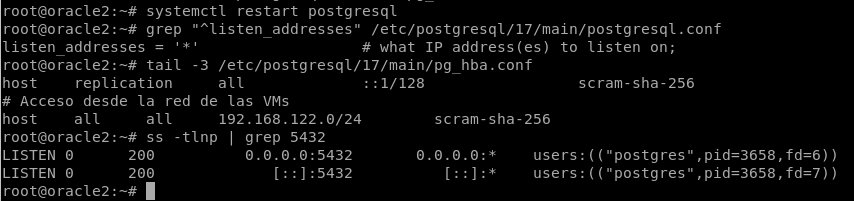

Ahora creo el usuario `sergio2`, su base de datos `empresa2` y la tabla `empleados`:

```sql
CREATE USER sergio2 WITH PASSWORD 'sergio2';
CREATE DATABASE empresa2 OWNER sergio2;
\c empresa2 sergio2 localhost 5432
```

> Para conectarme como `sergio2` tengo que poner `localhost`. Si no lo pongo, psql entra por el socket local y usa autenticación *peer*, que solo deja entrar si existe un usuario de Linux con el mismo nombre, y fallaba.

```sql
CREATE TABLE empleados (
  id_emp    INTEGER PRIMARY KEY,
  nombre    VARCHAR(30),
  puesto    VARCHAR(30),
  id_depto  INTEGER
);

INSERT INTO empleados VALUES
  (1, 'Ana Garcia', 'Programadora',        10),
  (2, 'Luis Perez', 'Tecnico de sistemas', 10),
  (3, 'Marta Ruiz', 'Comercial',           20),
  (4, 'Jose Lopez', 'Jefe de ventas',      20),
  (5, 'Laura Diaz', 'Tecnica de RRHH',     30);
```

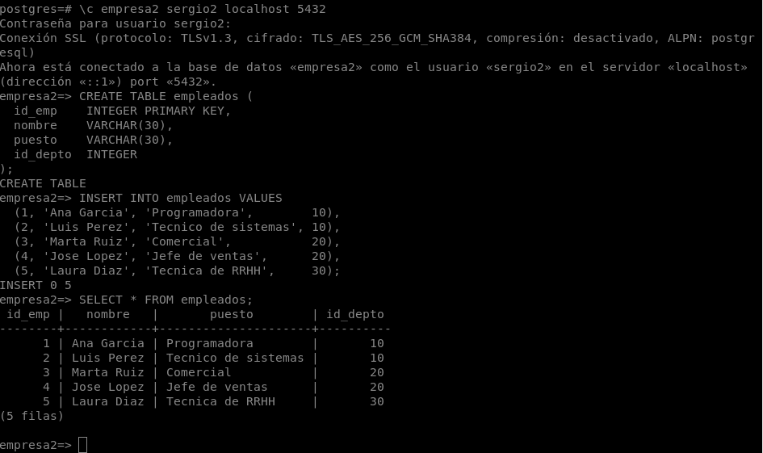

Antes de crear el enlace compruebo desde bd-sergio que puedo conectarme a oracle2 con el cliente `psql`. Si esto funciona, el lado remoto ya esta bien configurado:

```bash
psql -h oracle2 -U sergio2 -d empresa2 -c "SELECT * FROM empleados;"
```

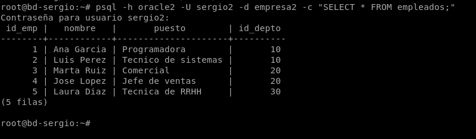

### 2.3. Configuración en el servidor local (bd-sergio)

En el lado local no hay que tocar ningún fichero de configuración, porque es bd-sergio el que se conecta hacia fuera. Lo que hago es, como `postgres` (hace falta ser superusuario para crear la extensión):

1. Crear el usuario `sergio1` y su base de datos `empresa1`.
2. Activar la extensión `postgres_fdw`.
3. Crear el **servidor remoto**: le digo dónde está (host, puerto y base de datos).
4. Crear el **user mapping**: cuando `sergio1` use ese servidor, se conecta al otro lado como `sergio2`.
5. Darle permiso a `sergio1` para usar el servidor.

```sql
CREATE USER sergio1 WITH PASSWORD 'sergio1';
CREATE DATABASE empresa1 OWNER sergio1;
\c empresa1
CREATE EXTENSION postgres_fdw;

CREATE SERVER servidor_oracle2
  FOREIGN DATA WRAPPER postgres_fdw
  OPTIONS (host 'oracle2', port '5432', dbname 'empresa2');

CREATE USER MAPPING FOR sergio1
  SERVER servidor_oracle2
  OPTIONS (user 'sergio2', password 'sergio2');

GRANT USAGE ON FOREIGN SERVER servidor_oracle2 TO sergio1;
```

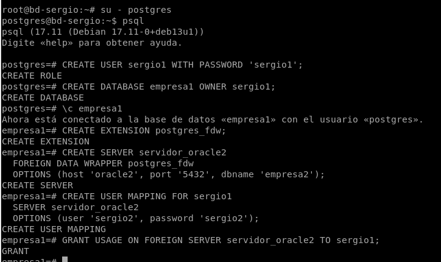

### 2.4. Crear la tabla local e importar la remota

Me conecto como `sergio1`, creo la tabla `departamentos` y con `IMPORT FOREIGN SCHEMA` traigo la tabla `empleados` de oracle2 como **tabla foránea**. Los datos no se copian, se leen en directo del otro servidor cada vez que hago una consulta.

```sql
\c empresa1 sergio1 localhost 5432

CREATE TABLE departamentos (
  id_depto  INTEGER PRIMARY KEY,
  nombre    VARCHAR(20),
  ciudad    VARCHAR(20)
);

INSERT INTO departamentos VALUES
  (10, 'Informatica', 'Sevilla'),
  (20, 'Ventas',      'Madrid'),
  (30, 'RRHH',        'Malaga');

IMPORT FOREIGN SCHEMA public LIMIT TO (empleados)
  FROM SERVER servidor_oracle2 INTO public;
```

### 2.5. Prueba de funcionamiento

Con `\det` se ve que `empleados` es una tabla foránea que viene de `servidor_oracle2`. Después la consulto sola y junto con mi tabla local:

```sql
\det
SELECT * FROM empleados;

SELECT e.nombre, e.puesto, d.nombre AS departamento, d.ciudad
FROM   empleados e
JOIN   departamentos d ON e.id_depto = d.id_depto
ORDER BY d.nombre;
```

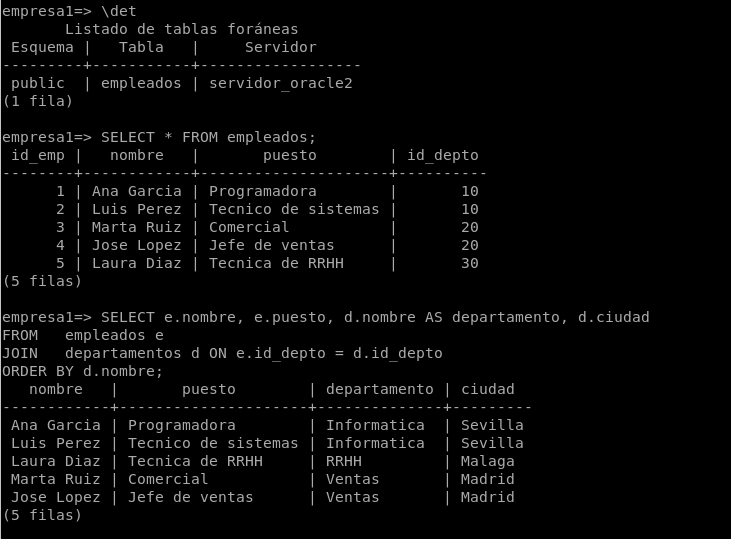

Igual que en Oracle, la última consulta junta datos de los dos servidores: `empleados` está en **oracle2** y `departamentos` en **bd-sergio**.

---

## 3. Enlace bidireccional Oracle ↔ MariaDB

Esta parte tiene dos sentidos:

- **De Oracle a MariaDB**: desde oracle-sergio consulto MariaDB usando **Heterogeneous Services**. Oracle no sabe hablar con MariaDB directamente, así que usa un agente llamado `dg4odbc` que hace de traductor y se conecta a MariaDB por **ODBC**.
- **De MariaDB a Oracle**: desde bd-sergio consulto Oracle usando el motor **CONNECT** de MariaDB, que también tira de ODBC.

En MariaDB creo una tabla `proyectos` en la que cada proyecto pertenece a un departamento, así la puedo juntar con la tabla `departamentos` de Oracle.

| Máquina | Gestor | Usuario | Tabla |
|---|---|---|---|
| oracle-sergio | Oracle | `sergio1` | `DEPARTAMENTOS` |
| bd-sergio | MariaDB | `sergio_maria` | `proyectos` |

### 3.1. Preparar MariaDB (bd-sergio)

Lo primero es comprobar que MariaDB escucha por la red y no solo en localhost. En `50-server.cnf` el `bind-address` ya estaba en `0.0.0.0`:

```bash
grep bind-address /etc/mysql/mariadb.conf.d/50-server.cnf
ss -tlnp | grep 3306
```

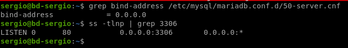

Entro como root (con `sudo mariadb`, porque en Debian el root de MariaDB entra por socket y no por contraseña) y creo la base de datos y un usuario que se pueda conectar desde cualquier máquina (`'%'`):

```sql
CREATE DATABASE empresa_maria;
CREATE USER 'sergio_maria'@'%' IDENTIFIED BY 'sergio_maria';
GRANT ALL PRIVILEGES ON empresa_maria.* TO 'sergio_maria'@'%';
FLUSH PRIVILEGES;
```

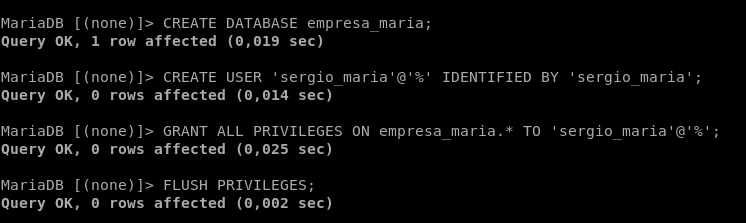

Y la tabla `proyectos`:

```sql
USE empresa_maria;

CREATE TABLE proyectos (
  id_proyecto  INT PRIMARY KEY,
  nombre       VARCHAR(30),
  presupuesto  INT,
  id_depto     INT
);

INSERT INTO proyectos VALUES
  (1, 'Web corporativa',     15000, 10),
  (2, 'Migracion a la nube', 30000, 10),
  (3, 'Campana de verano',    8000, 20),
  (4, 'Plan de formacion',    5000, 30);
```

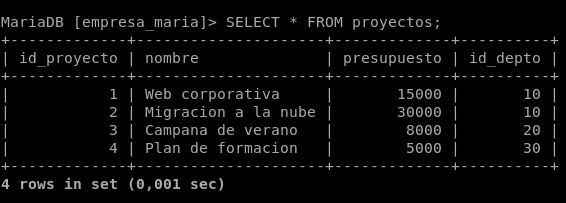

### 3.2. De Oracle a MariaDB: ODBC en oracle-sergio

Instalo unixODBC (el gestor de ODBC de Linux) y el driver ODBC de MariaDB:

```bash
apt install -y unixodbc odbc-mariadb
```

El paquete del driver se registra solo en `/etc/odbcinst.ini` con el nombre `MariaDB Unicode`:

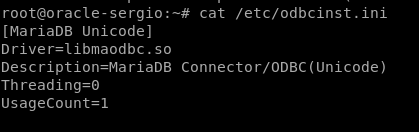

Ahora creo un **DSN** (una conexión ODBC con nombre) que se llama `MARIADB` y apunta a la base de datos de bd-sergio:

```bash
nano /etc/odbc.ini
```

```
[MARIADB]
Description = MariaDB de bd-sergio
Driver      = MariaDB Unicode
Server      = bd-sergio
Port        = 3306
Database    = empresa_maria
User        = sergio_maria
Password    = sergio_maria
```

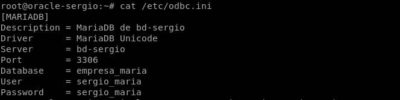

Antes de meter a Oracle por medio, pruebo que el ODBC funciona solo, con `isql`:

```bash
isql -v MARIADB sergio_maria sergio_maria
```

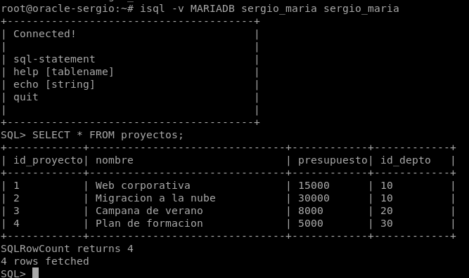

### 3.3. De Oracle a MariaDB: configurar Heterogeneous Services

Para que Oracle use ese DSN hay que tocar tres ficheros, todos como usuario `oracle`.

**1. Fichero del agente HS.** Se llama `init` + el nombre del SID + `.ora`, y va en `$ORACLE_HOME/hs/admin`. Aquí le digo qué DSN usar y dónde está la librería de unixODBC:

```bash
nano /opt/oracle/product/26ai/dbhomeFree/hs/admin/initMARIADB.ora
```

```
HS_FDS_CONNECT_INFO = MARIADB
HS_FDS_SHAREABLE_NAME = /usr/lib/x86_64-linux-gnu/libodbc.so.2
HS_FDS_SUPPORT_STATISTICS = FALSE
HS_LANGUAGE = AMERICAN_AMERICA.WE8ISO8859P1
HS_NLS_NCHAR = UCS2
HS_FDS_TRACE_LEVEL = OFF

set ODBCINI=/etc/odbc.ini
```

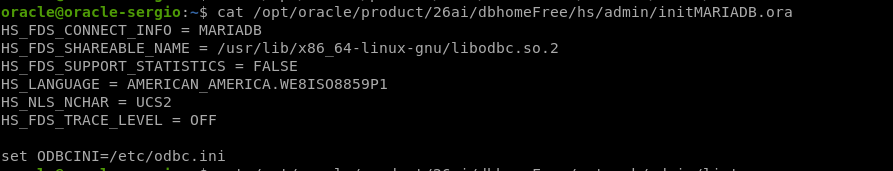

**2. listener.ora.** Le añado un `SID_LIST_LISTENER` para que cuando alguien pida el SID `MARIADB`, el listener arranque el programa `dg4odbc`:

```bash
nano /opt/oracle/product/26ai/dbhomeFree/network/admin/listener.ora
```

```
SID_LIST_LISTENER =
  (SID_LIST =
    (SID_DESC =
      (SID_NAME = MARIADB)
      (ORACLE_HOME = /opt/oracle/product/26ai/dbhomeFree)
      (PROGRAM = dg4odbc)
    )
  )
```

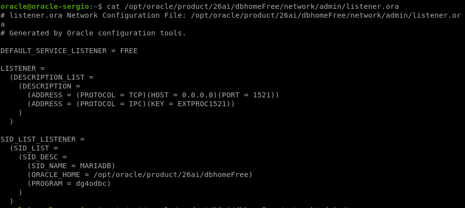

**3. tnsnames.ora.** Añado la entrada `MARIADB`, que apunta al propio listener local con ese SID. La linea `(HS = OK)` es la que le dice a Oracle que es una conexión de Heterogeneous Services:

```bash
nano /opt/oracle/product/26ai/dbhomeFree/network/admin/tnsnames.ora
```

```
MARIADB =
  (DESCRIPTION =
    (ADDRESS = (PROTOCOL = TCP)(HOST = localhost)(PORT = 1521))
    (CONNECT_DATA = (SID = MARIADB))
    (HS = OK)
  )
```

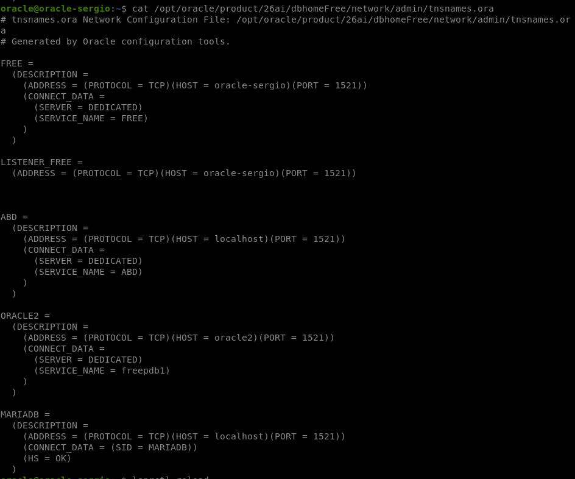

Recargo el listener y compruebo que aparece el servicio `MARIADB`. Sale con estado `UNKNOWN`, que es normal, porque el agente no se registra solo sino que lo he puesto yo a mano en el `listener.ora`:

```bash
lsnrctl reload
lsnrctl status
tnsping MARIADB
```

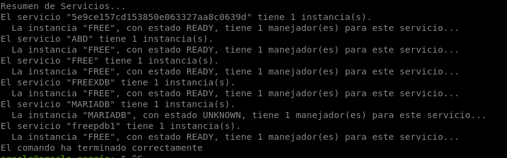

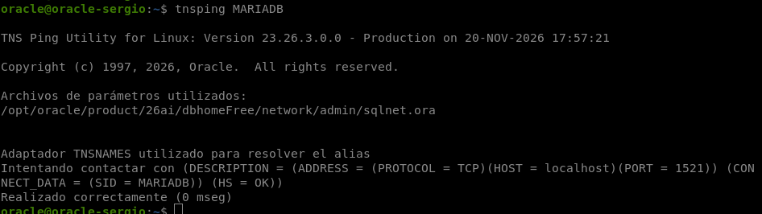

### 3.4. De Oracle a MariaDB: crear el enlace y probarlo

Como `sergio1` creo el enlace. El usuario y la contraseña van entre comillas dobles porque en MariaDB están en minúsculas:

```sql
CREATE DATABASE LINK enlace_mariadb
  CONNECT TO "sergio_maria" IDENTIFIED BY "sergio_maria"
  USING 'MARIADB';
```

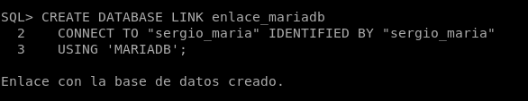

Y lo pruebo. La tabla y las columnas de MariaDB también van entre comillas dobles, porque si no Oracle las pasa a mayúsculas y no las encuentra:

```sql
SELECT * FROM "proyectos"@enlace_mariadb;

SELECT p."nombre" AS proyecto, p."presupuesto", d.nombre AS departamento, d.ciudad
FROM   "proyectos"@enlace_mariadb p, departamentos d
WHERE  p."id_depto" = d.id_depto
ORDER BY d.nombre;
```

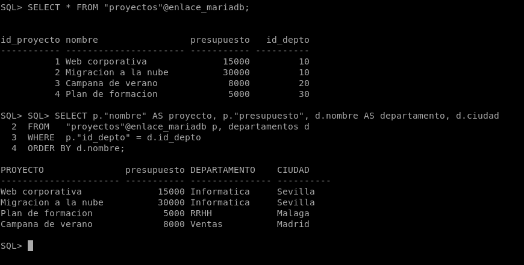

La segunda consulta junta los proyectos, que están en **MariaDB (bd-sergio)**, con los departamentos, que están en **Oracle (oracle-sergio)**.

### 3.5. De MariaDB a Oracle: instalar Oracle Instant Client en bd-sergio

Para el otro sentido, bd-sergio tiene que saber hablar con Oracle. Para eso instalo el **Oracle Instant Client**, que es el cliente ligero de Oracle. Me bajo el paquete básico, el de ODBC, el de sqlplus (para probar) y el SDK (que lo necesitaré luego en la parte 4):

```bash
apt install -y unzip wget libaio1t64 unixodbc
mkdir -p /opt/oracle
cd /opt/oracle
wget https://download.oracle.com/otn_software/linux/instantclient/instantclient-basic-linuxx64.zip
wget https://download.oracle.com/otn_software/linux/instantclient/instantclient-odbc-linuxx64.zip
wget https://download.oracle.com/otn_software/linux/instantclient/instantclient-sqlplus-linuxx64.zip
wget https://download.oracle.com/otn_software/linux/instantclient/instantclient-sdk-linuxx64.zip
unzip -o instantclient-basic-linuxx64.zip
unzip -o instantclient-odbc-linuxx64.zip
unzip -o instantclient-sqlplus-linuxx64.zip
unzip -o instantclient-sdk-linuxx64.zip
```

Se descomprime todo en la carpeta `instantclient_23_26`:

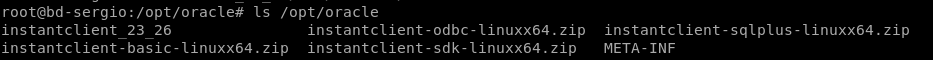

En Debian 13 la librería `libaio` se llama `libaio.so.1t64`, pero Oracle busca `libaio.so.1`, así que le hago un enlace con el nombre que espera:

```bash
ln -s /usr/lib/x86_64-linux-gnu/libaio.so.1t64 /usr/lib/x86_64-linux-gnu/libaio.so.1
```

Y le digo al sistema donde estan las librerías de Oracle para que cualquier programa las encuentre:

```bash
nano /etc/ld.so.conf.d/oracle-instantclient.conf
```

```
/opt/oracle/instantclient_23_26
```

```bash
ldconfig
```

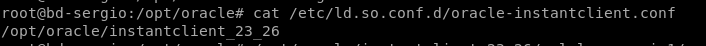

> La primera vez se me coló el comando `nano` dentro del fichero en vez de la ruta, y el sqlplus fallaba con *"libsqlplus.so: cannot open shared object file"*. Al poner bien la ruta y hacer `ldconfig` se arregló.

Pruebo con el sqlplus del Instant Client que desde bd-sergio llego al Oracle de oracle-sergio:

```bash
/opt/oracle/instantclient_23_26/sqlplus sergio1/sergio1@//oracle-sergio:1521/freepdb1
```

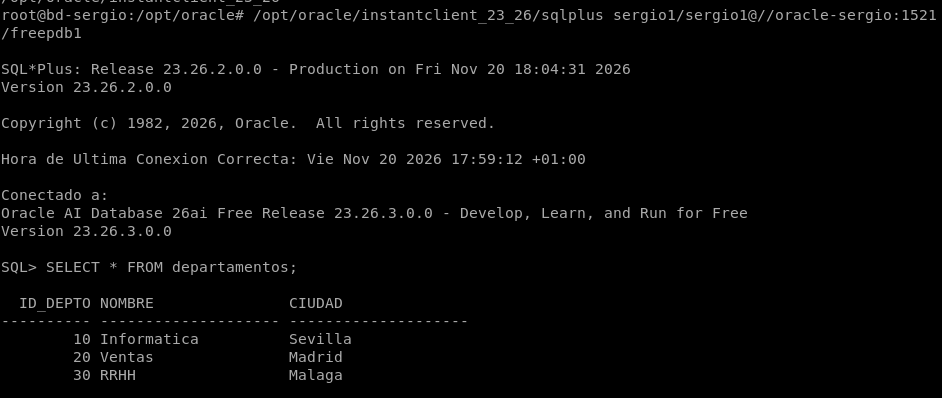

### 3.6. De MariaDB a Oracle: ODBC en bd-sergio

Registro el driver ODBC de Oracle (la librería `libsqora`) y creo un DSN llamado `ORACLE` que apunta a la PDB `freepdb1` de oracle-sergio:

```bash
nano /etc/odbcinst.ini
```

```
[Oracle ODBC]
Description = Driver ODBC de Oracle Instant Client
Driver      = /opt/oracle/instantclient_23_26/libsqora.so.23.1
```

```bash
nano /etc/odbc.ini
```

```
[ORACLE]
Description = Oracle de oracle-sergio
Driver      = Oracle ODBC
ServerName  = //oracle-sergio:1521/freepdb1
UserID      = sergio1
Password    = sergio1
```

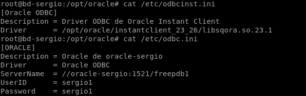

Y lo pruebo con `isql`:

```bash
isql -v ORACLE sergio1 sergio1
```

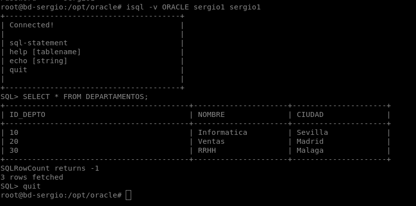

### 3.7. De MariaDB a Oracle: motor CONNECT

MariaDB tiene un motor de almacenamiento llamado **CONNECT** que permite crear tablas cuyos datos están fuera, por ejemplo en otra base de datos a la que se llega por ODBC. Lo instalo y reinicio MariaDB:

```bash
apt install -y mariadb-plugin-connect
systemctl restart mariadb
```

Compruebo que el motor está activo y le doy a `sergio_maria` el permiso `FILE`, que es el que pide CONNECT para crear este tipo de tablas:

```sql
SELECT ENGINE, SUPPORT FROM information_schema.ENGINES WHERE ENGINE = 'CONNECT';

GRANT FILE ON *.* TO 'sergio_maria'@'%';
FLUSH PRIVILEGES;
```

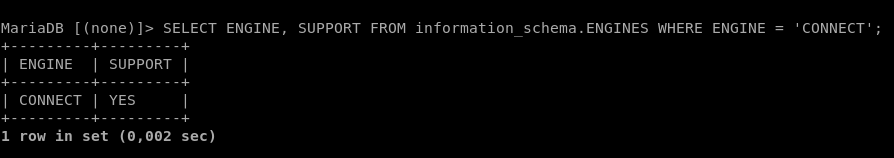

Ya como `sergio_maria` creo la tabla `departamentos_oracle`. No le pongo columnas porque CONNECT las saca él solo de Oracle. Le digo que es de tipo ODBC, qué tabla de Oracle es y qué DSN usar:

```sql
CREATE TABLE departamentos_oracle
  ENGINE = CONNECT
  TABLE_TYPE = ODBC
  TABNAME = 'SERGIO1.DEPARTAMENTOS'
  CONNECTION = 'DSN=ORACLE;UID=sergio1;PWD=sergio1';
```

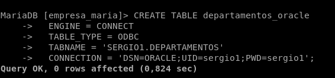

### 3.8. De MariaDB a Oracle: prueba de funcionamiento

```sql
SELECT * FROM departamentos_oracle;

SELECT p.nombre AS proyecto, p.presupuesto, d.NOMBRE AS departamento, d.CIUDAD
FROM   proyectos p
JOIN   departamentos_oracle d ON p.id_depto = d.ID_DEPTO
ORDER BY d.NOMBRE;
```

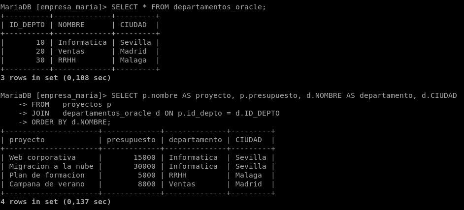

Ahora es al revés que antes: la consulta se lanza desde **MariaDB**, los proyectos son locales y los departamentos se leen en directo de **Oracle**. Con esto el enlace entre Oracle y MariaDB funciona en los dos sentidos.

---

## 4. Enlace bidireccional Oracle ↔ PostgreSQL

Esta parte es muy parecida a la anterior, pero ahora el otro lado es el **PostgreSQL de bd-sergio**:

- **De Oracle a Postgres**: Heterogeneous Services con `dg4odbc` y el driver ODBC de Postgres.
- **De Postgres a Oracle**: la extensión **`oracle_fdw`**, que usa el Instant Client que ya instalé en bd-sergio en la parte anterior.

En Postgres creo una tabla `oficinas` con la dirección y el teléfono de la oficina de cada departamento, para poder juntarla con `departamentos` de Oracle.

| Máquina | Gestor | Usuario | Base de datos | Tabla |
|---|---|---|---|---|
| oracle-sergio | Oracle | `sergio1` | `FREEPDB1` | `DEPARTAMENTOS` |
| bd-sergio | PostgreSQL | `sergio_pg` | `empresa_pg` | `oficinas` |

### 4.1. Preparar PostgreSQL (bd-sergio)

Postgres en bd-sergio ya escuchaba en todas las interfaces (`listen_addresses = '*'`), pero en el `pg_hba.conf` solo tenía permiso para la red `192.168.1.0/24` de otra práctica. Añado la red de las VMs:

```bash
nano /etc/postgresql/17/main/pg_hba.conf
```

```
# Acceso desde la red de las VMs
host    all    all    192.168.122.0/24    scram-sha-256
```

```bash
systemctl restart postgresql
```

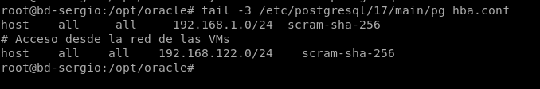

Creo el usuario `sergio_pg` con su base de datos `empresa_pg`:

```sql
CREATE USER sergio_pg WITH PASSWORD 'sergio_pg';
CREATE DATABASE empresa_pg OWNER sergio_pg;
\c empresa_pg sergio_pg localhost 5432
```


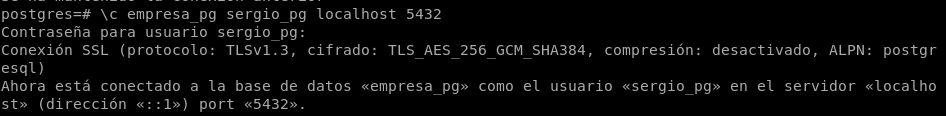

Y la tabla `oficinas`:

```sql
CREATE TABLE oficinas (
  id_depto   INTEGER PRIMARY KEY,
  direccion  VARCHAR(40),
  telefono   VARCHAR(15)
);

INSERT INTO oficinas VALUES
  (10, 'Avda. de la Palmera 12', '954111222'),
  (20, 'Calle Gran Via 45',      '915333444'),
  (30, 'Calle Larios 8',         '952555666');
```

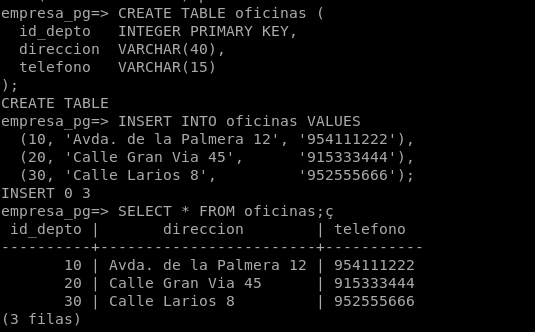

### 4.2. De Oracle a Postgres: ODBC en oracle-sergio

Instalo el driver ODBC de Postgres. Se registran dos drivers, uno ANSI y otro Unicode; yo uso el ANSI:

```bash
apt install -y odbc-postgresql
```

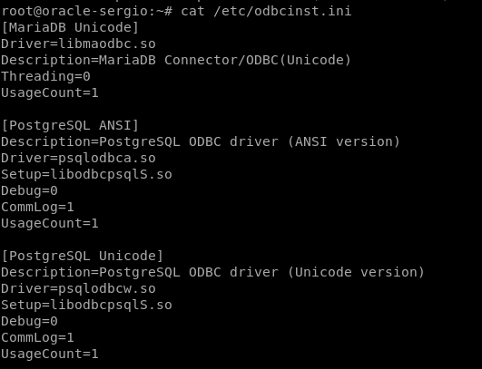

Añado un DSN nuevo, `POSTGRES`, al `odbc.ini` (debajo del de MariaDB):

```bash
nano /etc/odbc.ini
```

```
[POSTGRES]
Description = PostgreSQL de bd-sergio
Driver      = PostgreSQL ANSI
Servername  = bd-sergio
Port        = 5432
Database    = empresa_pg
Username    = sergio_pg
Password    = sergio_pg
```

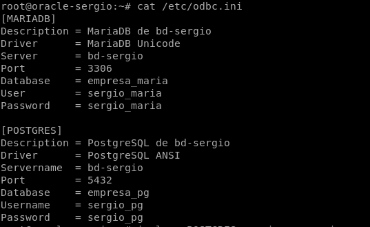

```bash
isql -v POSTGRES sergio_pg sergio_pg
```

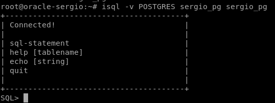

### 4.3. De Oracle a Postgres: configurar Heterogeneous Services

Hago lo mismo que con MariaDB, ahora con el nombre `POSTGRES`. Todo como usuario `oracle` (entrando con `su - oracle`, con guion, para que se carguen las variables de Oracle; sin el guion no encuentra `lsnrctl` ni `tnsping`).

**1. Fichero del agente HS:**

```bash
nano /opt/oracle/product/26ai/dbhomeFree/hs/admin/initPOSTGRES.ora
```

```
HS_FDS_CONNECT_INFO = POSTGRES
HS_FDS_SHAREABLE_NAME = /usr/lib/x86_64-linux-gnu/libodbc.so.2
HS_FDS_SUPPORT_STATISTICS = FALSE
HS_LANGUAGE = AMERICAN_AMERICA.WE8ISO8859P1
HS_NLS_NCHAR = UCS2
HS_FDS_TRACE_LEVEL = OFF

set ODBCINI=/etc/odbc.ini
```

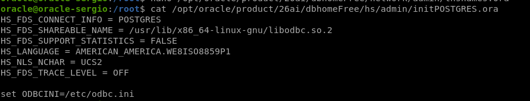

**2. listener.ora:** añado un segundo `SID_DESC` dentro del `SID_LIST` que ya tenía para MariaDB:

```
SID_LIST_LISTENER =
  (SID_LIST =
    (SID_DESC =
      (SID_NAME = MARIADB)
      (ORACLE_HOME = /opt/oracle/product/26ai/dbhomeFree)
      (PROGRAM = dg4odbc)
    )
    (SID_DESC =
      (SID_NAME = POSTGRES)
      (ORACLE_HOME = /opt/oracle/product/26ai/dbhomeFree)
      (PROGRAM = dg4odbc)
    )
  )
```


**3. tnsnames.ora:**

```
POSTGRES =
  (DESCRIPTION =
    (ADDRESS = (PROTOCOL = TCP)(HOST = localhost)(PORT = 1521))
    (CONNECT_DATA = (SID = POSTGRES))
    (HS = OK)
  )
```


Recargo el listener y compruebo:

```bash
lsnrctl reload
lsnrctl status
tnsping POSTGRES
```


### 4.4. De Oracle a Postgres: crear el enlace y probarlo

```sql
CREATE DATABASE LINK enlace_postgres
  CONNECT TO "sergio_pg" IDENTIFIED BY "sergio_pg"
  USING 'POSTGRES';
```


```sql
SELECT * FROM "oficinas"@enlace_postgres;

SELECT d.nombre AS departamento, d.ciudad, o."direccion", o."telefono"
FROM   departamentos d, "oficinas"@enlace_postgres o
WHERE  d.id_depto = o."id_depto"
ORDER BY d.nombre;
```


Los departamentos salen de **Oracle (oracle-sergio)** y la dirección y el teléfono de **PostgreSQL (bd-sergio)**.

### 4.5. De Postgres a Oracle: compilar oracle_fdw

Para el otro sentido uso **`oracle_fdw`**, una extensión de Postgres que permite crear tablas foráneas que apuntan a Oracle (igual que `postgres_fdw` en la parte 2, pero hacia Oracle). No viene en los repositorios de Debian, así que la compilo desde su código fuente. Para eso necesito las herramientas de compilación y las cabeceras de Postgres:

```bash
apt install -y git build-essential postgresql-server-dev-17
```

Me bajo el código y lo compilo. Con la variable `ORACLE_HOME` le digo dónde está el Instant Client (con su SDK, que me bajé en la parte 3):

```bash
cd /opt
git clone https://github.com/laurenz/oracle_fdw.git
cd oracle_fdw
export ORACLE_HOME=/opt/oracle/instantclient_23_26
make
make install
```


Compruebo que la librería y los ficheros de la extensión están en su sitio y reinicio Postgres:

```bash
ls /usr/lib/postgresql/17/lib/ | grep oracle
ls /usr/share/postgresql/17/extension/ | grep oracle
systemctl restart postgresql
```


### 4.6. De Postgres a Oracle: crear el enlace

Como `postgres`, en la base de datos `empresa_pg`, activo la extensión, creo el servidor remoto apuntando a la PDB `freepdb1` de oracle-sergio, el user mapping (cuando `sergio_pg` use ese servidor entra en Oracle como `sergio1`) y le doy permiso de uso:

```sql
\c empresa_pg
CREATE EXTENSION oracle_fdw;

CREATE SERVER servidor_oracle
  FOREIGN DATA WRAPPER oracle_fdw
  OPTIONS (dbserver '//oracle-sergio:1521/freepdb1');

CREATE USER MAPPING FOR sergio_pg
  SERVER servidor_oracle
  OPTIONS (user 'sergio1', password 'sergio1');

GRANT USAGE ON FOREIGN SERVER servidor_oracle TO sergio_pg;
```


Ya como `sergio_pg` creo la tabla foránea. El esquema y la tabla van en mayúsculas porque Oracle los guarda así:

```sql
\c empresa_pg sergio_pg localhost 5432

CREATE FOREIGN TABLE departamentos_oracle (
  id_depto  INTEGER,
  nombre    VARCHAR(20),
  ciudad    VARCHAR(20)
) SERVER servidor_oracle
  OPTIONS (schema 'SERGIO1', table 'DEPARTAMENTOS');
```


### 4.7. De Postgres a Oracle: prueba de funcionamiento

```sql
SELECT * FROM departamentos_oracle;

SELECT d.nombre AS departamento, d.ciudad, o.direccion, o.telefono
FROM   oficinas o
JOIN   departamentos_oracle d ON o.id_depto = d.id_depto
ORDER BY d.nombre;
```


Ahora la consulta se lanza desde **PostgreSQL**: las oficinas son locales y los departamentos se leen de **Oracle**. Con esto el enlace Oracle ↔ PostgreSQL también funciona en los dos sentidos.

---

## 5. Consulta con los tres servidores a la vez

Para terminar hago una consulta que saca información de los **tres gestores** usando **dos enlaces a la vez**. La lanzo desde Oracle (oracle-sergio) como `sergio1`:

| Tabla | Gestor | Máquina | Cómo llego |
|---|---|---|---|
| `departamentos` | Oracle | oracle-sergio | tabla local |
| `proyectos` | MariaDB | bd-sergio | `enlace_mariadb` |
| `oficinas` | PostgreSQL | bd-sergio | `enlace_postgres` |

La consulta saca cada proyecto con su presupuesto, el departamento al que pertenece y la dirección y telefono de la oficina de ese departamento:

```sql
SELECT p."nombre"      AS proyecto,
       p."presupuesto" AS presupuesto,
       d.nombre        AS departamento,
       d.ciudad,
       o."direccion"   AS direccion,
       o."telefono"    AS telefono
FROM   "proyectos"@enlace_mariadb p,
       departamentos d,
       "oficinas"@enlace_postgres o
WHERE  p."id_depto" = d.id_depto
AND    d.id_depto   = o."id_depto"
ORDER BY d.nombre, p."nombre";
```


Cada fila del resultado mezcla datos de tres sitios distintos: el nombre del proyecto y el presupuesto vienen de **MariaDB**, el departamento y la ciudad de **Oracle**, y la dirección y el teléfono de **PostgreSQL**.

También se pueden usar funciones de grupo con los datos remotos. Por ejemplo, el número de proyectos y el presupuesto total de cada departamento junto con su oficina:

```sql
SELECT d.nombre AS departamento,
       o."direccion" AS direccion,
       COUNT(*) AS num_proyectos,
       SUM(p."presupuesto") AS presupuesto_total
FROM   "proyectos"@enlace_mariadb p,
       departamentos d,
       "oficinas"@enlace_postgres o
WHERE  p."id_depto" = d.id_depto
AND    d.id_depto   = o."id_depto"
GROUP BY d.nombre, o."direccion"
ORDER BY presupuesto_total DESC;
```


---

## Resumen

Al final he montado estos enlaces:

| Enlace | Desde | Hacia | Herramienta |
|---|---|---|---|
| Oracle → Oracle | oracle-sergio | oracle2 | Database link + `tnsnames.ora` |
| Postgres → Postgres | bd-sergio | oracle2 | `postgres_fdw` |
| Oracle → MariaDB | oracle-sergio | bd-sergio | Heterogeneous Services (`dg4odbc` + ODBC) |
| MariaDB → Oracle | bd-sergio | oracle-sergio | Motor CONNECT + ODBC (Instant Client) |
| Oracle → Postgres | oracle-sergio | bd-sergio | Heterogeneous Services (`dg4odbc` + ODBC) |
| Postgres → Oracle | bd-sergio | oracle-sergio | `oracle_fdw` (Instant Client) |

Lo que más me ha costado ha sido la parte de Heterogeneous Services, porque hay que configurar varias piezas en cadena (ODBC, el fichero `init*.ora`, el `listener.ora` y el `tnsnames.ora`). Lo que mejor me ha funcionado es ir probando cada pieza por separado antes de pasar a la siguiente: primero que el ODBC conecte con `isql`, luego que el listener ofrezca el servicio y el `tnsping` responda, y solo al final crear el enlace. Así, si algo falla, sabes exactamente en qué paso está el problema.
