# Aplicación web con MariaDB — Práctica ABD 26/27

## 1. Qué he realizado

He realizado una aplicación web con Python y Flask para conectarme desde el contenedor `app-web` al servidor MariaDB de otra máquina. La parte visual HTML/CSS y algunas funciones auxiliares las generé con ayuda de una IA; yo integré y probé el proyecto, configuré la conexión a la base de datos, comprobé los permisos y realicé la demostración de inyección SQL y su corrección.

He utilizado MariaDB. La rúbrica nombra MySQL; no presento MariaDB como si fuera MySQL. La aplicación usa PyMySQL y la conexión podría adaptarse a un servidor MySQL compatible, pero tendría que probarse con ese gestor y esta práctica se ha comprobado contra MariaDB. La compatibilidad entre ambos no significa que sean el mismo producto. [web:993]

## 2. Mi entorno

| Equipo    | Uso                                         | Dirección                         |
| --------- | ------------------------------------------- | --------------------------------- |
| Sergio-PC | Anfitrión de LXC y Virt-Manager             | Accedo a la web desde este equipo |
| app-web   | Contenedor Debian 13 con Flask              | 10.0.3.46                         |
| sgbd-vm   | Máquina virtual de Virt-Manager con MariaDB | 192.168.122.22                    |

Dentro de la máquina virtual, el nombre del sistema es `bd-sergio`. El contenedor está conectado a `lxcbr0` (10.0.3.1) y la máquina virtual a la red de `virbr0` (192.168.122.1).

La base se llama `practica_web` y MariaDB escucha en el puerto 3306. Por tanto, la aplicación y el servidor de base de datos están en sistemas separados, como pide la práctica.

La dirección de mi aplicación es:

```text
http://10.0.3.46:5000
```

Las IP son las obtenidas en mi instalación. Si vuelvo a crear las máquinas, compruebo la dirección asignada antes de conectar.

## 3. Creación del contenedor LXC

### En mi PC anfitrión

Con LXC clásico instalado, creo el contenedor Debian 13:

```bash
sudo lxc-create -n app-web -t download -- --dist debian --release trixie --arch amd64
```

El fichero generado está en `/var/lib/lxc/app-web/config`. Compruebo su contenido:

```bash
sudo cat /var/lib/lxc/app-web/config
```

Las líneas de configuración de mi contenedor son:

```ini
lxc.include = /usr/share/lxc/config/common.conf
lxc.arch = linux64
lxc.apparmor.profile = generated
lxc.apparmor.allow_nesting = 1
lxc.rootfs.path = dir:/var/lib/lxc/app-web/rootfs
lxc.uts.name = app-web

lxc.net.0.type = veth
lxc.net.0.link = lxcbr0
lxc.net.0.flags = up
```

He mantenido el puente `lxcbr0`, que ya estaba configurado en mi anfitrión. No necesito modificar los demás puentes de mis prácticas. El permiso de nesting aparece en mi configuración; la aplicación Flask no depende de él.

Arranco el contenedor y entro:

```bash
sudo lxc-start -n app-web
sudo lxc-attach -n app-web
```

### Dentro del contenedor

Compruebo la versión y dirección:

```bash
cat /etc/os-release
ip -br addr
```

En mi caso aparece Debian GNU/Linux 13 (trixie) y la interfaz `eth0` tiene `10.0.3.46/24`.

## 4. Preparación de MariaDB en sgbd-vm

Esta parte la realizo en la máquina virtual `sgbd-vm`, no dentro del contenedor web. Parto de MariaDB ya instalado en la parte de servidores de la práctica.

### 4.1 Permitir conexiones remotas

Edito el fichero:

```bash
sudo nano /etc/mysql/mariadb.conf.d/50-server.cnf
```

La directiva queda así:

```ini
bind-address = 0.0.0.0
```

Con esto MariaDB escucha en las interfaces de red, no solamente en localhost. Mantengo el servidor dentro de mi laboratorio; no abro el puerto a Internet.

Aplico el cambio y entro al servidor:

```bash
sudo systemctl restart mariadb
sudo mariadb
```

Compruebo la configuración:

```sql
SHOW VARIABLES LIKE 'bind_address';
```

El resultado es `0.0.0.0`.

### 4.2 Crear la base y las tablas

Para reproducir la base desde cero, ejecuto este SQL dentro de MariaDB. No lo vuelvo a ejecutar sobre la base ya preparada, porque las tablas y registros ya existen.

```sql
CREATE DATABASE practica_web
  CHARACTER SET utf8mb4 COLLATE utf8mb4_uca1400_ai_ci;
USE practica_web;

CREATE TABLE clientes (
  id INT NOT NULL AUTO_INCREMENT,
  nombre VARCHAR(100) NOT NULL,
  email VARCHAR(150) NOT NULL,
  PRIMARY KEY (id),
  UNIQUE KEY email (email)
) ENGINE=InnoDB;

CREATE TABLE notas (
  id INT NOT NULL AUTO_INCREMENT,
  titulo VARCHAR(100) NOT NULL,
  contenido VARCHAR(500) NOT NULL,
  interna TINYINT(1) NOT NULL DEFAULT 0,
  PRIMARY KEY (id)
) ENGINE=InnoDB;

CREATE TABLE pedidos (
  id INT NOT NULL AUTO_INCREMENT,
  cliente_id INT NOT NULL,
  producto VARCHAR(100) NOT NULL,
  importe DECIMAL(10,2) NOT NULL,
  PRIMARY KEY (id),
  KEY cliente_id (cliente_id),
  CONSTRAINT pedidos_ibfk_1 FOREIGN KEY (cliente_id)
    REFERENCES clientes(id)
) ENGINE=InnoDB;

CREATE TABLE notas_privadas (
  id INT NOT NULL AUTO_INCREMENT,
  nota VARCHAR(200) NOT NULL,
  PRIMARY KEY (id)
) ENGINE=InnoDB;
```

La opción de cotejamiento de esta base pertenece a MariaDB. Si adapto el proyecto a MySQL, uso un cotejamiento compatible con la versión instalada.

### 4.3 Introducir los datos de prueba

```sql
INSERT INTO clientes (nombre, email) VALUES
('Sergio', 'sergio@example.com'),
('Ana', 'ana@example.com'),
('Luis', 'luis@example.com');

INSERT INTO notas (titulo, contenido, interna) VALUES
('Horario', 'Atención de 9:00 a 14:00', 0),
('Mantenimiento', 'Reinicio previsto el viernes', 0),
('Presupuesto pendiente', 'Propuesta interna de 4500 euros', 1);

INSERT INTO pedidos (cliente_id, producto, importe) VALUES
(1, 'Teclado', 39.90),
(2, 'Monitor', 149.50),
(3, 'Ratón', 19.90);

INSERT INTO notas_privadas (nota) VALUES
('Dato de prueba reservado para la demostración');
```

He creado cuatro tablas. En `notas`, el valor `interna = 1` identifica la nota que oculto en la web a los usuarios distintos de admin.

### 4.4 Crear los usuarios y asignar permisos

Para el laboratorio utilizo estas cuentas y contraseñas de prueba. No son contraseñas para un servicio publicado.

```sql
CREATE USER 'lectura'@'%' IDENTIFIED BY 'lectura1223';
CREATE USER 'admin'@'%' IDENTIFIED BY 'admin1223';

GRANT SELECT ON practica_web.clientes TO 'lectura'@'%';
GRANT SELECT ON practica_web.notas TO 'lectura'@'%';

GRANT SELECT ON practica_web.* TO 'admin'@'%';
GRANT SELECT ON practica_web.notas_privadas TO 'admin'@'%';
```

El último permiso de admin es redundante porque ya tiene SELECT sobre toda la base, pero aparece así en mis permisos reales.

Compruebo el resultado:

```sql
SHOW GRANTS FOR 'lectura'@'%';
SHOW GRANTS FOR 'admin'@'%';
```

| Usuario | Tablas que puede consultar                |
| ------- | ----------------------------------------- |
| lectura | clientes y notas                          |
| admin   | clientes, notas, pedidos y notas_privadas |

Aunque se llama admin, esta cuenta tiene permisos SELECT en esta base: el nombre no la convierte en administrador global. El host `%` permite conexiones desde distintos orígenes si la red las permite; lo he usado dentro del laboratorio.

La cuenta lectura puede leer la tabla `notas` completa desde SQL. La restricción que oculta las filas internas la añado en la aplicación. Esta distinción es importante para la demostración de inyección.

Salgo de MariaDB:

```sql
exit;
```

## 5. Preparación del proyecto Python

Vuelvo al contenedor desde mi PC:

```bash
sudo lxc-attach -n app-web
```

Dentro instalo lo necesario:

```bash
apt update
apt install -y python3 python3-venv python3-pip nano default-mysql-client
mkdir -p /root/app-web/templates
cd /root/app-web
python3 -m venv .venv
source .venv/bin/activate
pip install Flask Flask-Session cachelib PyMySQL
pip freeze > requirements.txt
```

El prefijo `(.venv)` me indica que estoy usando el entorno del proyecto. Las dependencias quedan recogidas en `requirements.txt`, por lo que puedo reinstalarlas con `pip install -r requirements.txt`.

Compruebo la conexión remota desde el contenedor:

```bash
mariadb -h 192.168.122.22 -P 3306 -u lectura -p practica_web
```

Introduzco la contraseña cuando la pide y ejecuto:

```sql
SHOW TABLES;
exit;
```

Deben aparecer `clientes` y `notas`. Esta conexión confirma que el contenedor puede autenticarse en el servidor remoto.

## 6. Creación de los archivos

Creo cada archivo con `nano`. Guardo con `Ctrl+O`, pulso Enter y salgo con `Ctrl+X`. Todos los comandos de esta sección se ejecutan dentro de `/root/app-web`, en el contenedor.

### 6.1 config.py

```bash
nano config.py
```

Contenido:

```python
MYSQL_HOST = "192.168.122.22"
MYSQL_PORT = 3306
MYSQL_DATABASE = "practica_web"
```

Aquí guardo dónde está la base. El usuario y la contraseña se solicitan en la pantalla de acceso.

### 6.2 Clave secreta de Flask

Flask utiliza una clave secreta para proteger las sesiones. En mi archivo real esa clave está escrita en `app.py`; no incluyo su valor en esta memoria por seguridad. No cambié la configuración de claves para preparar el documento.

### 6.3 app.py

```bash
nano app.py
```

Este es el contenido completo con la búsqueda corregida:

```python
from flask import Flask, request, session, redirect, url_for, render_template, flash
import pymysql
import config
from flask_session import Session
from cachelib.file import FileSystemCache

app = Flask(__name__)
app.secret_key = "[CLAVE OCULTA]"

app.config["SESSION_TYPE"] = "cachelib"
app.config["SESSION_CACHELIB"] = FileSystemCache(
    cache_dir="/root/app-web/.sessions",
    threshold=100
)
Session(app)


def conectar(usuario, password):
    return pymysql.connect(
        host=config.MYSQL_HOST,
        port=config.MYSQL_PORT,
        user=usuario,
        password=password,
        database=config.MYSQL_DATABASE,
        cursorclass=pymysql.cursors.DictCursor,
        connect_timeout=5
    )


@app.route("/", methods=["GET", "POST"])
def login():
    if request.method == "POST":
        usuario = request.form.get("usuario", "").strip()
        password = request.form.get("password", "")

        try:
            conexion = conectar(usuario, password)
            conexion.close()

            session.clear()
            session["usuario"] = usuario
            session["password"] = password
            return redirect(url_for("tablas"))

        except pymysql.MySQLError:
            flash("Usuario o contrasena incorrectos.")

    return render_template("login.html")


@app.route("/tablas")
def tablas():
    if "usuario" not in session:
        return redirect(url_for("login"))

    conexion = conectar(session["usuario"], session["password"])

    try:
        with conexion.cursor() as cursor:
            cursor.execute("SHOW TABLES")
            nombres = cursor.fetchall()
            tablas = [next(iter(fila.values())) for fila in nombres]
    finally:
        conexion.close()

    return render_template("tablas.html", tablas=tablas)


@app.route("/tabla/<nombre>")
def ver_tabla(nombre):
    if "usuario" not in session:
        return redirect(url_for("login"))

    conexion = conectar(session["usuario"], session["password"])

    try:
        with conexion.cursor() as cursor:
            cursor.execute("SHOW TABLES")
            permitidas = [
                next(iter(fila.values()))
                for fila in cursor.fetchall()
            ]

            if nombre not in permitidas:
                flash("Esa tabla no está disponible.")
                return redirect(url_for("tablas"))

            if nombre == "notas" and session["usuario"] != "admin":
                cursor.execute(
                    "SELECT id, titulo, contenido "
                    "FROM notas WHERE interna = 0 LIMIT 100"
                )
            else:
                cursor.execute(f"SELECT * FROM `{nombre}` LIMIT 100")

            registros = cursor.fetchall()
            columnas = [columna[0] for columna in cursor.description]
    finally:
        conexion.close()

    return render_template(
        "tabla.html",
        nombre=nombre,
        columnas=columnas,
        registros=registros
    )


@app.route("/buscar-notas", methods=["GET", "POST"])
def buscar_notas():
    if "usuario" not in session:
        return redirect(url_for("login"))

    resultados = []
    termino = ""

    if request.method == "POST":
        termino = request.form.get("termino", "")
        conexion = conectar(session["usuario"], session["password"])

        try:
            with conexion.cursor() as cursor:
                # Consulta parametrizada: la entrada se trata como dato.
                consulta = (
                    "SELECT id, titulo, contenido FROM notas "
                    "WHERE titulo LIKE %s"
                )

                if session["usuario"] != "admin":
                    consulta += " AND interna = 0"

                consulta += " LIMIT 100"
                cursor.execute(consulta, (f"%{termino}%",))
                resultados = cursor.fetchall()
        except pymysql.MySQLError:
            flash("No se pudo realizar la búsqueda.")
        finally:
            conexion.close()

    return render_template(
        "buscar_notas.html",
        termino=termino,
        resultados=resultados,
        buscado=request.method == "POST"
    )


@app.route("/logout")
def logout():
    session.clear()
    return redirect(url_for("login"))


if __name__ == "__main__":
    app.run(host="0.0.0.0", port=5000, debug=False)
```

### Resumen de las funciones

| Función      | Qué hace                                                                   |
| ------------ | -------------------------------------------------------------------------- |
| conectar     | Abre la conexión con el servidor remoto usando las credenciales recibidas. |
| login        | Prueba las credenciales, inicia la sesión y lleva a las tablas.            |
| tablas       | Obtiene las tablas visibles para esa cuenta con SHOW TABLES.               |
| ver_tabla    | Comprueba la tabla solicitada y muestra sus registros.                     |
| buscar_notas | Busca por título y aplica el filtro de notas internas.                     |
| logout       | Borra la sesión y vuelve al acceso.                                        |

Uso `DictCursor` para obtener filas con nombres de columnas. `render_template` envía los datos a las páginas HTML. Las sesiones se guardan en el servidor mediante Flask-Session y CacheLib.

En esta práctica guardo temporalmente las credenciales de la base en la sesión del servidor para reconectar como ese usuario. Es una simplificación del laboratorio, no un diseño para publicar la aplicación.

### 6.4 templates/base.html

Contiene el diseño común, el menú y los mensajes.

```bash
nano templates/base.html
```

```html
<!doctype html>
<html lang="es">
<head>
<meta charset="utf-8">
<meta name="viewport" content="width=device-width, initial-scale=1">
<title>Panel MariaDB</title>
<style>
body { margin:0; font-family:Arial,sans-serif; color:#243247; background:#f1f5f9; }
header { background:#17324d; color:white; padding:20px; }
nav { display:flex; gap:20px; }
nav a { color:white; }
main { max-width:900px; margin:30px auto; padding:15px; }
.card { background:white; padding:24px; border-radius:10px; }
input,button { padding:10px; font-size:16px; }
button { background:#176b87; color:white; border:0; cursor:pointer; }
table { width:100%; border-collapse:collapse; margin-top:20px; }
th,td { padding:12px; text-align:left; border-bottom:1px solid #ddd; }
th,.notice { background:#e9f2f8; }
.notice,.error { padding:12px; }
.error { background:#fff0f0; color:#9d2424; }
a { color:#176b87; }
</style>
</head>
<body>
<header>
<h1>Panel de consulta MariaDB</h1>

<nav>
<a href="{{ url_for('tablas') }}">Tablas</a>
<a href="{{ url_for('buscar_notas') }}">Buscar notas</a>
<a href="{{ url_for('logout') }}">Cerrar sesión</a>
</nav>

</header>
<main>
<p class="error">{{ mensaje }}</p>
<section class="card"></section>
</main>
</body>
</html>
```

### 6.5 templates/login.html

Contiene el formulario de autenticación.

```bash
nano templates/login.html
```

```html


<h2>Iniciar sesión</h2>
<p>Accede con una cuenta MariaDB.</p>
<form method="post">
<label for="usuario">Usuario</label><br><br>
<input id="usuario" name="usuario" autocomplete="username" required><br><br>
<label for="password">Contraseña</label><br><br>
<input id="password" type="password" name="password" autocomplete="current-password" required><br><br>
<button type="submit">Entrar</button>
</form>

```

### 6.6 templates/tablas.html

Recorre las tablas permitidas y crea sus enlaces.

```bash
nano templates/tablas.html
```

```html


<h2>Tablas accesibles</h2>
<p class="notice">Usuario conectado: {{ session["usuario"] }}</p>
<ul>

<li><a href="{{ url_for('ver_tabla', nombre=tabla) }}">{{ tabla }}</a></li>
<li>No hay tablas disponibles.</li>
</ul>

```

### 6.7 templates/tabla.html

Muestra las columnas y registros de la tabla elegida.

```bash
nano templates/tabla.html
```

```html


<h2>Registros de {{ nombre }}</h2>


<p class="notice">Puedes consultar las notas compartidas e internas.</p>
<p class="notice">Solo se muestran las notas compartidas.</p>


<table>
<tr><th>{{ columna }}</th></tr>

<tr><td>{{ registro[columna] }}</td></tr>

</table>
<p>No hay registros disponibles.</p>

```

### 6.8 templates/buscar_notas.html

Contiene el formulario de búsqueda y sus resultados.

```bash
nano templates/buscar_notas.html
```

```html


<h2>Buscar notas de trabajo</h2>
<p class="notice">
Usuario: {{ session["usuario"] }}.

Puedes consultar las notas compartidas e internas.
Solo puedes consultar notas compartidas.
</p>
<form method="post">
<label for="termino">Título de la nota</label><br><br>
<input id="termino" name="termino" value="{{ termino }}" placeholder="Por ejemplo: Horario" required>
<button type="submit">Buscar</button>
</form>

<table>
<tr><th>ID</th><th>Título</th><th>Contenido</th></tr>

<tr><td>{{ nota.id }}</td><td>{{ nota.titulo }}</td><td>{{ nota.contenido }}</td></tr>

</table>
<p>No se encontraron coincidencias.</p>

```

## 7. Arrancar y comprobar la aplicación

Dentro del contenedor:

```bash
cd /root/app-web
source .venv/bin/activate
python3 -m py_compile app.py
python3 app.py
```

Abro desde el navegador de mi PC:

```text
http://10.0.3.46:5000
```

### Prueba con lectura

Inicio sesión con `lectura` y su contraseña de laboratorio. Aparecen `clientes` y `notas`. Al abrir `notas` solo aparecen Horario y Mantenimiento, porque la web añade `WHERE interna = 0`.

### Prueba con admin

Cierro sesión y entro con `admin`. Aparecen las cuatro tablas. En `notas` también aparece Presupuesto pendiente.

La diferencia en las tablas disponibles depende de los permisos de MariaDB; la diferencia entre filas compartidas e internas de `notas` depende del filtro de la aplicación.

## 8. SQL Injection: prueba y corrección

La inyección SQL ocurre cuando la aplicación mezcla texto recibido del usuario con la consulta SQL, de modo que parte de esa entrada puede interpretarse como SQL. En mi aplicación la prueba se hace sobre el buscador de notas y datos ficticios, únicamente dentro del laboratorio.

### 8.1 Versión vulnerable

En la versión vulnerable, el bloque de consulta de `buscar_notas()` concatenaba el término directamente:

```python
consulta = (
    "SELECT id, titulo, contenido FROM notas "
    "WHERE titulo LIKE '%" + termino + "%'
)

if session["usuario"] != "admin":
    consulta += " AND interna = 0"

cursor.execute(consulta + " LIMIT 100")
```

Con `lectura`, una búsqueda normal de `Presupuesto` no debía mostrar la nota interna. En el laboratorio utilicé la entrada de prueba que aparece en el vídeo para comprobar que la consulta vulnerable permitía saltarse el filtro de la aplicación.

> 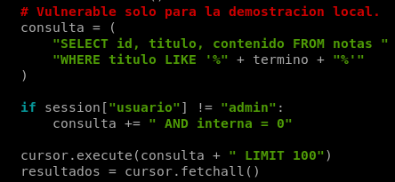
> 
> 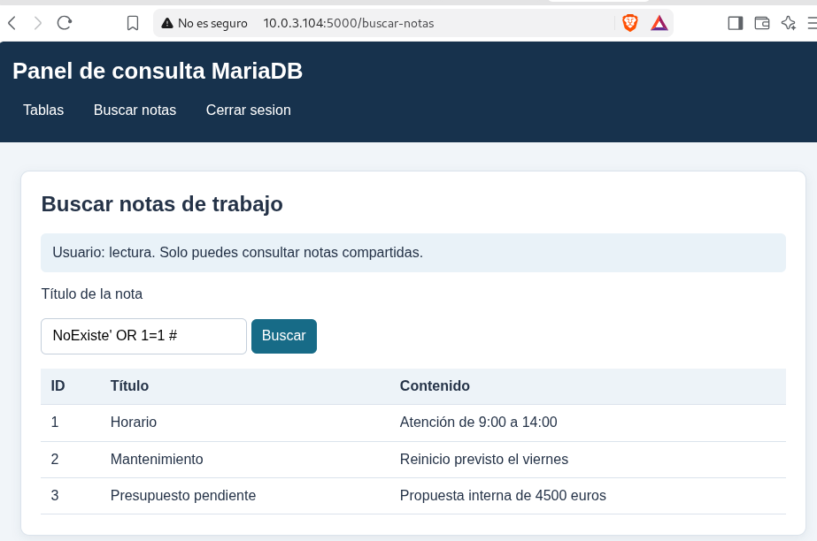
> 
> La consulta vulnerable permite que la entrada altere la condición y muestre una fila interna a un usuario que normalmente no la ve.

### 8.2 Cambio realizado

Para corregirlo, cambié la consulta a un parámetro `%s` y paso el texto como argumento separado a `cursor.execute()`:

```python
consulta = (
    "SELECT id, titulo, contenido FROM notas "
    "WHERE titulo LIKE %s"
)

if session["usuario"] != "admin":
    consulta += " AND interna = 0"

consulta += " LIMIT 100"
cursor.execute(consulta, (f"%{termino}%",))
```

El valor de búsqueda se entrega por separado, así que no se añade como sintaxis SQL. PyMySQL admite marcadores `%s` y valores pasados como parámetros. [web:695]

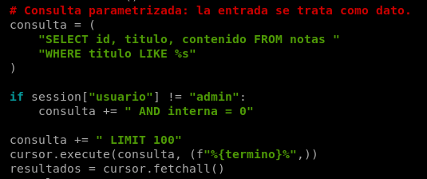

### 8.3 Comprobación de la corrección

Después de cambiar el código repetí la misma búsqueda como `lectura`. La búsqueda normal de `Horario` seguía funcionando, pero la entrada usada en la demostración ya no mostraba la nota interna. También comprobé que `admin` podía seguir consultando esa nota.

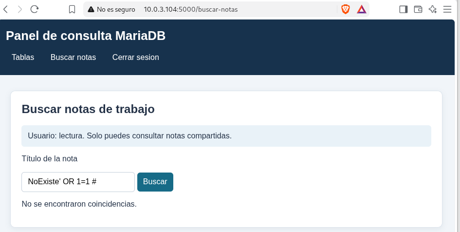

En el vídeo se ve el proceso seguido: primero la versión vulnerable, luego el cambio del codigo y finalmente la misma comprobación con la consulta corregida. No describo variantes de inyección que no haya probado, la demostracion documentada aquí es la que realicé.

## 9. Capturas de la aplicación y dónde colocarlas

Aquí mostraré diferentes capturas para explicar los permisos de usuario que he aplicado en mi aplicacion web.

### Entorno separado

**Informacion sobre mi contenedor Debian 13 donde tengo alojada la aplicacion web y la maquina virtual donde tengo mis bases de datos**

> 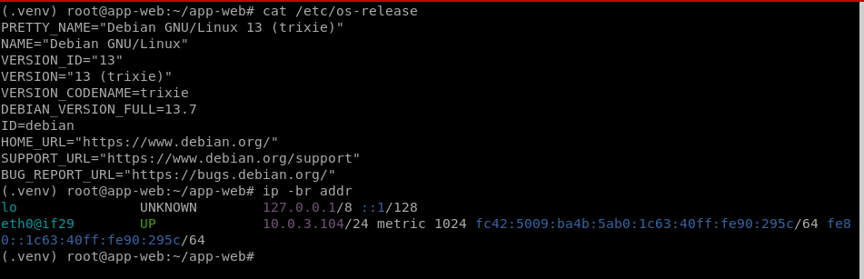
> 
> 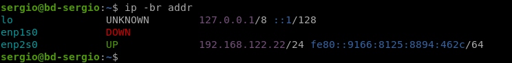
> 
> La aplicación Flask está en el contenedor `app-web` y MariaDB en una máquina virtual distinta, `bd-sergio`.

### Pantalla de autenticación


> 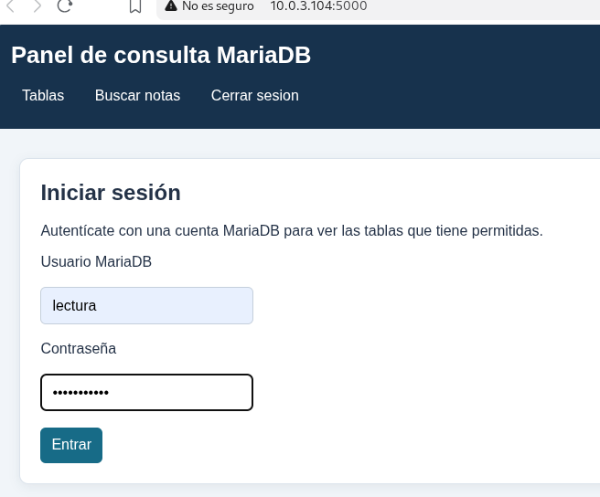
> 
> La aplicación solicita las credenciales de la cuenta de MariaDB antes de mostrar la información.

### Acceso como lectura


> 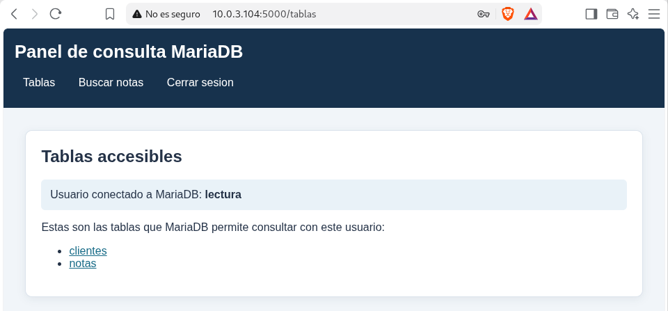
> 
> 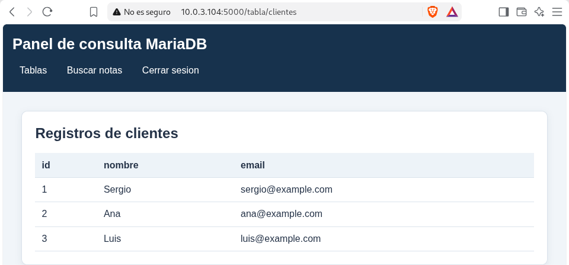
> 
> 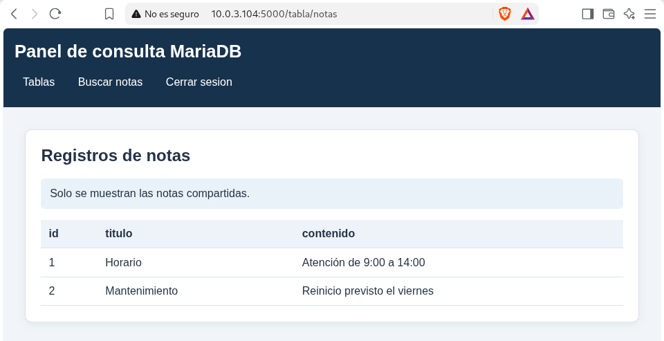
> 
> El usuario lectura tiene SELECT sobre `clientes` y `notas`; la aplicación oculta las notas con `interna = 1`.

### Acceso como admin

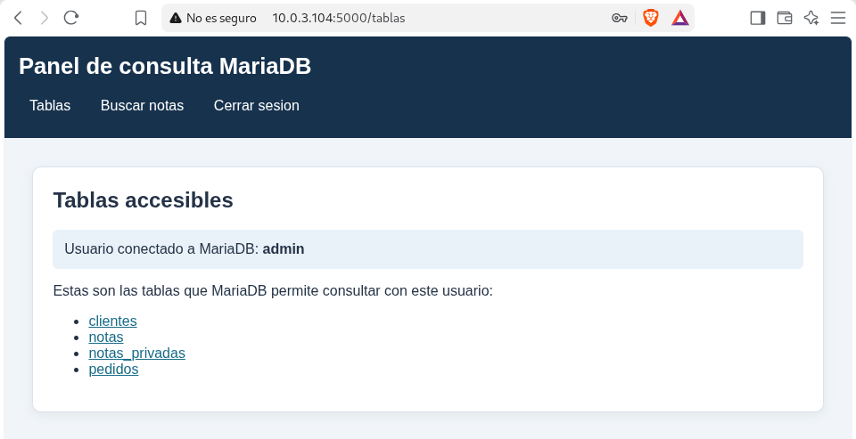

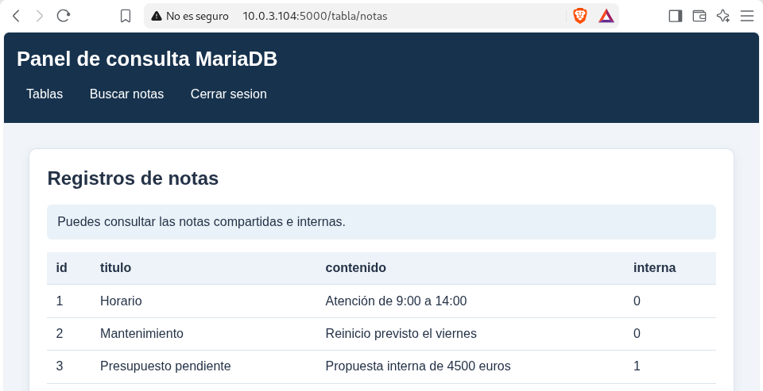

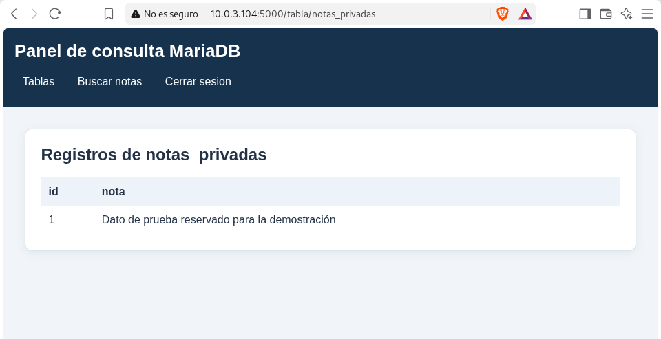

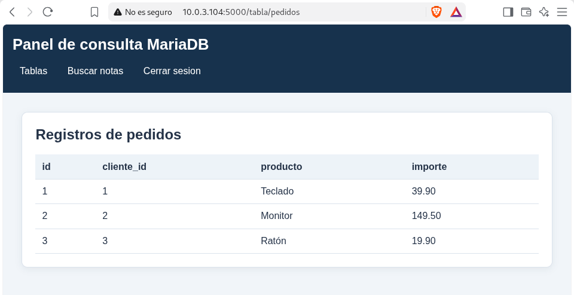

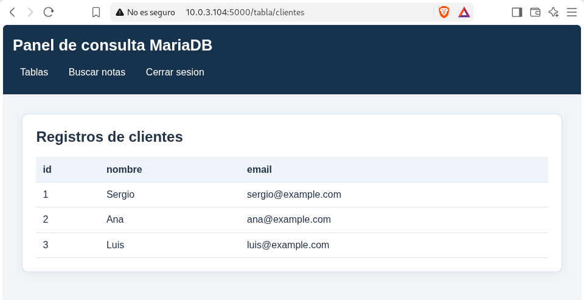

> Admin tiene SELECT en toda la base `practica_web`, por eso puede consultar las cuatro tablas.

### Prueba de conexión y permisos


> 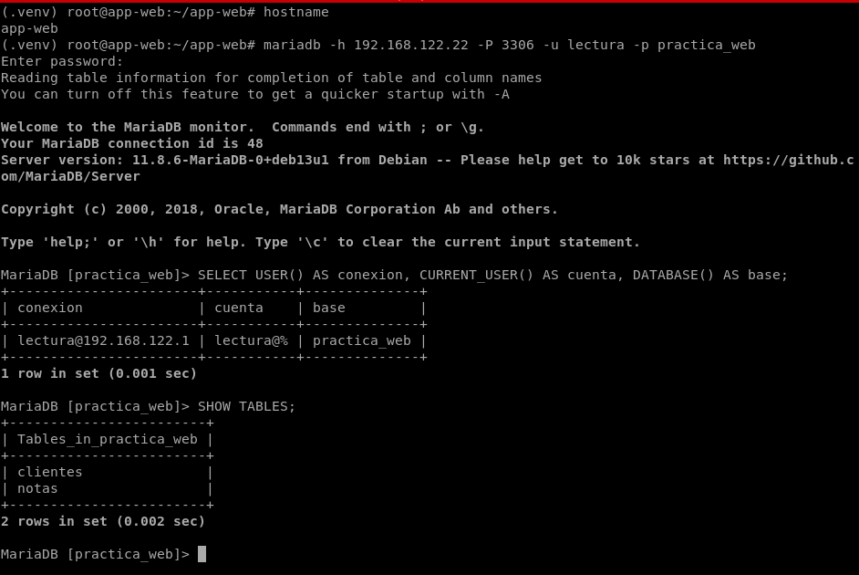
> 
> Comprobé que el contenedor llega al servidor remoto y que las cuentas tienen los permisos usados por la aplicación.

## 10. Resultado

He documentado el despliegue de la aplicación en un contenedor separado del servidor MariaDB, el acceso con las cuentas de prueba, las capturas que evidencian los permisos y el cambio del buscador vulnerable a una consulta parametrizada. La estructura HTML/CSS se generó con ayuda de IA; he centrado la explicación en la conexión, los permisos y las pruebas de seguridad que realicé.
