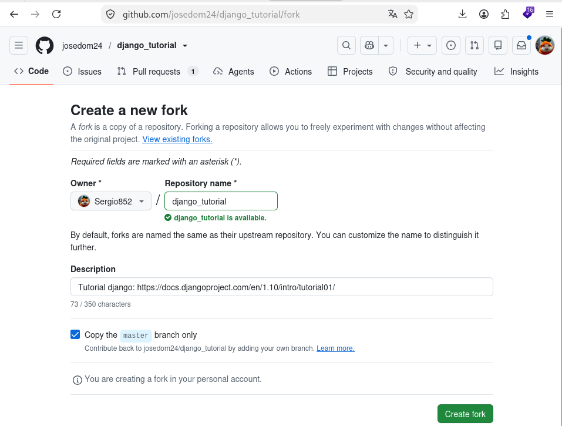
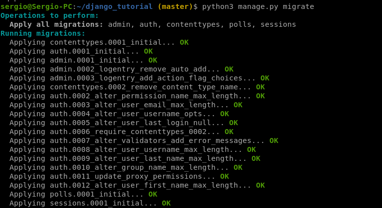
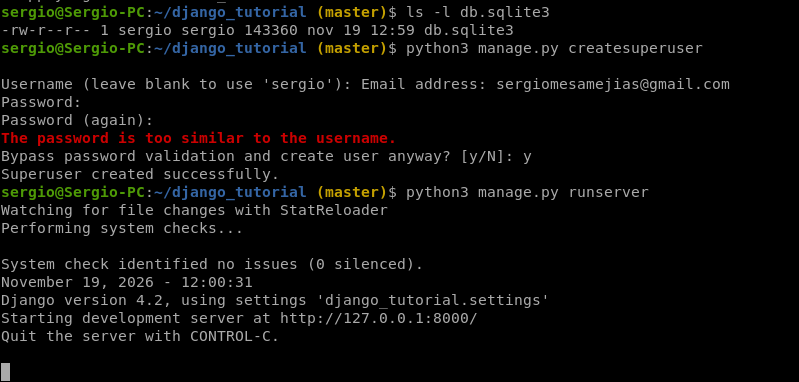
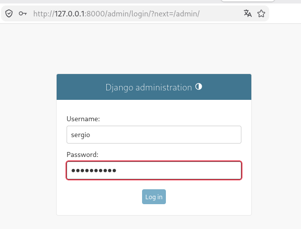
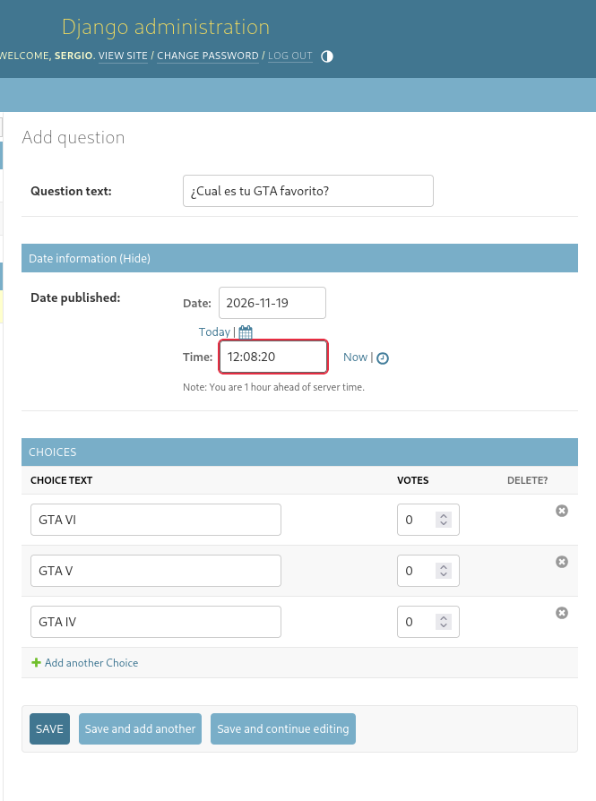
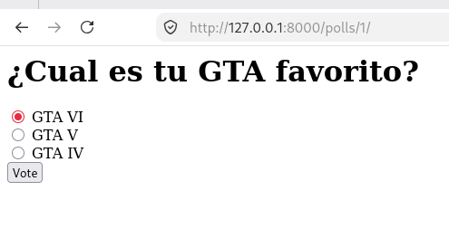
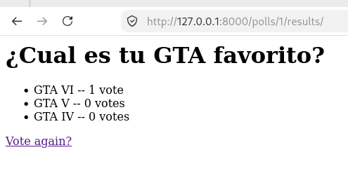

# Práctica 2 - Introducción a Django (2ª parte)

En esta práctica trabajo con otra aplicación Django, [django_tutorial](https://github.com/josedom24/django_tutorial), que sirve para hacer encuestas: se crean preguntas con varias respuestas y los usuarios pueden votar. Todo lo hago en mi equipo, en el entorno de desarrollo.

## 1. Fork y puesta en marcha de la aplicación

### Fork del repositorio

Primero hago un fork del repositorio en GitHub para tener una copia en mi cuenta (Sergio852).



### Clonado

Clono mi copia por SSH y miro qué hay dentro:

```
sergio@Sergio-PC:~$ git clone git@github.com:Sergio852/django_tutorial.git
Clonando en 'django_tutorial'...
remote: Enumerating objects: 179, done.
remote: Counting objects: 100% (52/52), done.
remote: Compressing objects: 100% (32/32), done.
remote: Total 179 (delta 30), reused 20 (delta 20), pack-reused 127 (from 2)
Recibiendo objetos: 100% (179/179), 4.26 MiB | 5.64 MiB/s, listo.
Resolviendo deltas: 100% (60/60), listo.
sergio@Sergio-PC:~$ ls django_tutorial
django_tutorial  manage.py  polls  README.md  requirements.txt
```

Se ve la estructura típica de Django: `django_tutorial` es la carpeta del **proyecto** (configuración y rutas generales), `polls` es la **aplicación** de encuestas y `manage.py` es el programa con el que manejo todo.

### Entorno virtual y dependencias

Este proyecto usa una versión distinta de Django que el de la primera parte (la 4.2), así que le creo su propio entorno virtual, `tutorial`, para que no se mezclen:

```
sergio@Sergio-PC:~$ python3 -m venv tutorial
sergio@Sergio-PC:~$ source tutorial/bin/activate
sergio@Sergio-PC:~$ cd django_tutorial
sergio@Sergio-PC:~/django_tutorial (master)$ pip install -r requirements.txt
Collecting Django==4.2 (from -r requirements.txt (line 1))
...
Installing collected packages: sqlparse, asgiref, Django
Successfully installed Django-4.2 asgiref-3.13.0 sqlparse-0.6.1
sergio@Sergio-PC:~/django_tutorial (master)$ pip list
Package  Version
-------- -------
asgiref  3.13.0
Django   4.2
pip      25.1.1
sqlparse 0.6.1
```

Queda instalado Django 4.2, que es justo la versión que pide el `requirements.txt`.

## 2. Base de datos, superusuario y servidor de desarrollo

### Creación de las tablas

Antes de usar la aplicación hay que crear las tablas en la base de datos, y eso se hace con `migrate`:



```
sergio@Sergio-PC:~/django_tutorial (master)$ ls -l db.sqlite3
-rw-r--r-- 1 sergio sergio 143360 nov 19 12:59 db.sqlite3
```

Todas las migraciones salen con OK y se crea el fichero `db.sqlite3`, que es la base de datos. La migración que nos interesa es `polls.0001_initial`, que crea las tablas de las encuestas (lo explico más abajo).

### Superusuario

Creo un usuario administrador para poder entrar al panel de administración:



Django me avisa de que la contraseña se parece demasiado al usuario. Como es un entorno de pruebas en mi equipo, le digo que sí y lo crea igualmente.

### Servidor de desarrollo

Después arranco el servidor de pruebas con `python3 manage.py runserver` (se ve en la misma captura de arriba). Arranca sin errores en `http://127.0.0.1:8000`.

## 3. Alta de una encuesta y prueba de la aplicación

### Alta desde la zona de administración

Entro en `http://127.0.0.1:8000/admin/` con el usuario que he creado:



En el apartado **Polls → Questions** añado una pregunta nueva. Le pongo el texto, la fecha de publicación (con los botones *Today* y *Now*) y abajo, en la misma pantalla, las tres respuestas posibles con 0 votos:



Las respuestas se añaden en la misma página que la pregunta porque cada respuesta va unida a su pregunta (esto se ve luego en el modelo).

### Prueba desde el navegador

Ahora entro en la aplicación como un usuario normal. En `http://127.0.0.1:8000/polls/1/` sale mi encuesta con las tres opciones, elijo una y le doy a **Vote**:



Al votar me lleva a la página de resultados, donde se ve que GTA VI ya tiene 1 voto:



La aplicación funciona: la encuesta creada en el admin aparece en la web y los votos se guardan.

## 4. El modelo y la base de datos

Para mirar los ficheros abro otra terminal (el servidor sigue encendido en la primera) y activo el entorno:

```
sergio@Sergio-PC:~$ source ~/tutorial/bin/activate
sergio@Sergio-PC:~$ cd ~/django_tutorial
```

### Modelo de la aplicación

El modelo está en `polls/models.py`. En Django cada clase del modelo se convierte en una tabla de la base de datos, y cada atributo en una columna:

```
sergio@Sergio-PC:~/django_tutorial (master)$ cat polls/models.py
class Question(models.Model):
    question_text = models.CharField(max_length=200)
    pub_date = models.DateTimeField('date published')
    ...

class Choice(models.Model):
    question = models.ForeignKey(Question, on_delete=models.CASCADE)
    choice_text = models.CharField(max_length=200)
    votes = models.IntegerField(default=0)
    ...
```

(Quito las funciones de dentro de las clases porque no crean columnas, solo sirven para mostrar los datos.)

Se van a crear **dos tablas**:

| Tabla | Atributo | Qué guarda |
| --- | --- | --- |
| polls_question | id | Número de la pregunta (lo pone Django solo, autoincremental) |
| | question_text | El texto de la pregunta (hasta 200 caracteres) |
| | pub_date | Fecha y hora de publicación |
| polls_choice | id | Número de la respuesta (autoincremental) |
| | choice_text | El texto de la respuesta (hasta 200 caracteres) |
| | votes | Los votos que lleva (empieza en 0) |
| | question_id | La pregunta a la que pertenece |

El nombre de cada tabla es el de la aplicación más el de la clase en minúsculas (`polls_question`, `polls_choice`).

**¿Hay relación entre las tablas?** Sí. El campo `question` de `Choice` es un `ForeignKey` (clave ajena) hacia `Question`. Es una relación **uno a muchos**: una pregunta tiene varias respuestas, y cada respuesta pertenece a una sola pregunta. Además, con `on_delete=models.CASCADE`, si borro una pregunta se borran también sus respuestas. Por eso en el admin las respuestas se añadían dentro de la pantalla de la pregunta.

### ¿Cómo se crean las tablas?

Las tablas no se crean a mano con SQL. El proceso es este:

1. Se describen las tablas como clases en `models.py`.
2. A partir del modelo se genera una **migración**, que es un fichero con las instrucciones para crear las tablas. Esta aplicación ya la trae hecha en `polls/migrations/0001_initial.py` (si cambiara el modelo, se haría una nueva con `python3 manage.py makemigrations`).
3. Con `python3 manage.py migrate` Django aplica las migraciones y las traduce al SQL de la base de datos que tengamos configurada.

Con `sqlmigrate` puedo ver el SQL que Django ejecutó por debajo para crear las tablas de polls:

```
sergio@Sergio-PC:~/django_tutorial (master)$ python3 manage.py sqlmigrate polls 0001
BEGIN;
--
-- Create model Question
--
CREATE TABLE "polls_question" ("id" integer NOT NULL PRIMARY KEY AUTOINCREMENT, "question_text" varchar(200) NOT NULL, "pub_date" datetime NOT NULL);
--
-- Create model Choice
--
CREATE TABLE "polls_choice" ("id" integer NOT NULL PRIMARY KEY AUTOINCREMENT, "choice_text" varchar(200) NOT NULL, "votes" integer NOT NULL, "question_id" integer NOT NULL REFERENCES "polls_question" ("id") DEFERRABLE INITIALLY DEFERRED);
CREATE INDEX "polls_choice_question_id_c5b4b260" ON "polls_choice" ("question_id");
COMMIT;
```

Aquí se confirma todo lo de antes: las dos tablas con sus columnas, y en `polls_choice` la columna `question_id` con `REFERENCES "polls_question"`, que es la clave ajena que las relaciona.

### Base de datos configurada

La base de datos que usa el proyecto se configura en `django_tutorial/settings.py`, en el apartado `DATABASES`:

```
sergio@Sergio-PC:~/django_tutorial (master)$ grep -A6 DATABASES django_tutorial/settings.py
DATABASES = {
    'default': {
        'ENGINE': 'django.db.backends.sqlite3',
        'NAME': BASE_DIR / 'db.sqlite3',
    }
}
```

- `ENGINE`: el tipo de base de datos, en este caso **SQLite**.
- `NAME`: el fichero donde se guarda, `db.sqlite3`, en la carpeta principal del proyecto (es el que se creó al hacer el `migrate`).

## 5. Acceso a la base de datos

Para ver la base de datos por dentro instalo el cliente de SQLite y abro el fichero `db.sqlite3`:

```
sergio@Sergio-PC:~/django_tutorial (master)$ sudo apt install sqlite3
...
Configurando sqlite3 (3.46.1-7+deb13u2) ...
sergio@Sergio-PC:~/django_tutorial (master)$ sqlite3 db.sqlite3
SQLite version 3.46.1 2024-08-13 09:16:08
Enter ".help" for usage hints.
```

### Tablas creadas

Con `.tables` veo todas las tablas que hay:

```
sqlite> .tables
auth_group                  django_admin_log
auth_group_permissions      django_content_type
auth_permission             django_migrations
auth_user                   django_session
auth_user_groups            polls_choice
auth_user_user_permissions  polls_question
```

Las que empiezan por `auth_` y `django_` son las que Django trae de serie (usuarios, permisos, sesiones, el historial del admin...). Las de nuestra aplicación son `polls_question` y `polls_choice`, justo las dos que salían en el modelo.

### Consulta de la encuesta

Activo `.headers on` para que salgan los nombres de las columnas y consulto la pregunta que creé:

```
sqlite> .headers on
sqlite> SELECT * FROM polls_question;
id|question_text|pub_date
1|¿Cual es tu GTA favorito?|2026-11-19 12:08:20
```

Ahí está mi pregunta, con el id 1 (por eso su dirección en la web era `/polls/1/`). Miro también sus respuestas:

```
sqlite> SELECT * FROM polls_choice;
id|choice_text|votes|question_id
1|GTA VI|1|1
2|GTA V|0|1
3|GTA IV|0|1
sqlite> .quit
```

Las tres respuestas tienen `question_id = 1`, es decir, todas pertenecen a mi pregunta: es la relación entre tablas que veía en el modelo. Y GTA VI tiene el voto que hice desde la web, así que se guardó bien en la base de datos.

## 6. Rutas de la aplicación

En Django las direcciones (rutas) son virtuales: no son carpetas ni ficheros reales como pasa en PHP, sino que en unos ficheros `urls.py` se dice qué función se ejecuta para cada dirección. Se definen en dos niveles.

### Nivel de proyecto

```
sergio@Sergio-PC:~/django_tutorial (master)$ cat django_tutorial/urls.py
from django.contrib import admin
from django.urls import include, path
from . import views

urlpatterns = [
    path('polls/', include('polls.urls')),
    path('admin/', admin.site.urls),
    path("", views.index, name="frontpage"),
]
```

- `polls/`: todo lo que empiece por `polls/` se lo pasa a las rutas de la aplicación polls (`include('polls.urls')`).
- `admin/`: lo que empiece por `admin/` va al panel de administración.
- `""`: la raíz de la web, que muestra la página de portada.

### Nivel de aplicación

```
sergio@Sergio-PC:~/django_tutorial (master)$ cat polls/urls.py
from django.urls import path

from . import views

app_name = 'polls'
urlpatterns = [
    path('', views.IndexView.as_view(), name='index'),
    path('<int:pk>/', views.DetailView.as_view(), name='detail'),
    path('<int:pk>/results/', views.ResultsView.as_view(), name='results'),
    path('<int:question_id>/vote/', views.vote, name='vote'),
]
```

Hay 4 rutas, que se suman a `polls/` del proyecto:

| Ruta | Función | Qué hace | Ejemplo |
| --- | --- | --- | --- |
| `''` | index | Muestra la lista de encuestas | `http://localhost:8000/polls/` |
| `<int:pk>/` | detail | Muestra una encuesta con sus opciones para votar | `http://localhost:8000/polls/1/` |
| `<int:pk>/results/` | results | Muestra los resultados de esa encuesta | `http://localhost:8000/polls/1/results/` |
| `<int:question_id>/vote/` | vote | Guarda el voto y redirige a los resultados | `http://localhost:8000/polls/1/vote/` |

El `<int:pk>` significa que ahí va un número entero, que es el id de la pregunta en la base de datos. Por eso mi encuesta, que tiene el id 1, estaba en `/polls/1/`. Lo he comprobado al probar la aplicación en el apartado 3: votar en `/polls/1/` (ruta *detail*) envía el voto a `/polls/1/vote/` (ruta *vote*), y esta me lleva a `/polls/1/results/` (ruta *results*).

## Conclusión

Con esta práctica he puesto en marcha otra aplicación Django y he visto cómo está hecha por dentro: el modelo define las tablas con clases de Python, las migraciones las crean en la base de datos sin escribir SQL, el `settings.py` dice qué base de datos se usa, y los ficheros `urls.py` reparten cada dirección a su función. Además he comprobado en SQLite que lo que hago desde la web (crear la encuesta y votar) se guarda de verdad en las tablas.
