# CRIPTOGRAFÍA III

**PRÁCTICA: Certificados digitales. HTTPS**

*Sergio Mesa Mejías*

## PARTE 1: Certificado Digital de Persona Física

### Tarea 1: Instalación y Gestión del Certificado

> Una vez que hayas obtenido tu certificado digital explica brevemente cómo se instala en el almacén de certificados de tu sistema operativo o navegador web favorito.

El certificado lo saqué con la app Certificado digital FNMT del móvil, leyendo mi DNI electrónico por NFC (antes tuve que ir a la comisaría a renovar los certificados del DNI y poner un PIN nuevo). La FNMT me mandó el certificado en un fichero .p12.

Para instalarlo en Firefox voy a Ajustes &gt; Privacidad y seguridad &gt; Ver certificados &gt; pestaña Sus certificados &gt; Importar. Elijo el .p12 de Descargas y pongo la contraseña con la que está protegido:

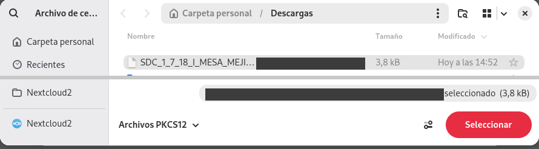

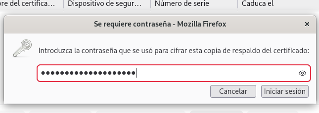

> Muestra una captura de pantalla del gestor de certificados donde se vea instalado tu certificado correctamente.

Ya me sale mi certificado en Sus certificados, dentro de FNMT-RCM:

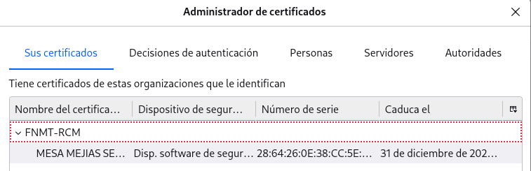

Y en el detalle se ve que está a mi nombre, que lo emite AC FNMT Usuarios y que vale hasta el 31/12/2028 (he tapado el DNI):

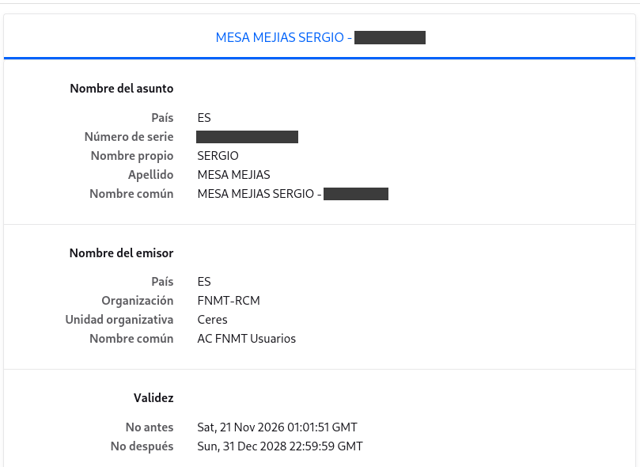

> ¿Cómo se realiza una copia de seguridad de tu certificado digital? Razona qué formato de archivo se utiliza (ej. .pfx o .p12) y por qué es fundamental protegerlo con contraseña.

Desde el mismo gestor de Firefox selecciono mi certificado y pulso Hacer copia. Le pongo nombre al fichero y una contraseña para protegerlo:

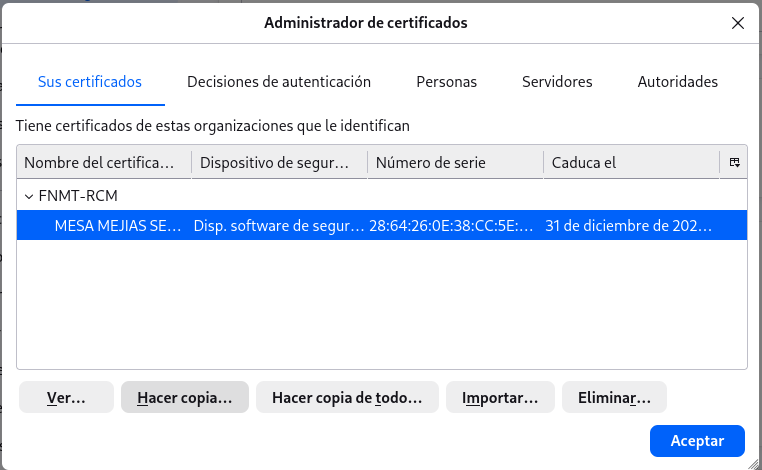

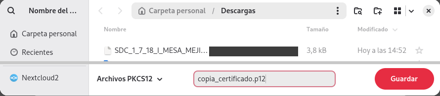

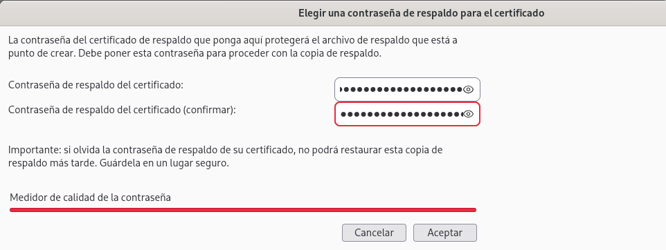

Se usa el formato PKCS#12 (.p12 o .pfx) porque guarda en un solo fichero el certificado y también la clave privada, así puedo restaurarlo entero en otro equipo. Es fundamental ponerle contraseña porque la clave privada va dentro: si alguien consigue el fichero podria firmar documentos y hacer trámites como si fuera yo. La contraseña es la que cifra el fichero.

> Explica la diferencia técnica entre exportar el certificado con su clave privada frente a exportar únicamente el certificado (que contiene la clave pública y los metadatos de identidad).

Para compararlo, exporto también solo el certificado desde Ver &gt; Descargar &gt; PEM (cert):

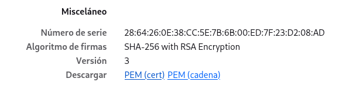

Y miro los ficheros en la terminal:

```
sergio@Sergio-PC:~/Descargas$ ls -l *.p12 *.pem
-rw-rw-r-- 1 sergio sergio 3944 nov 21 18:17 copia_certificado.p12
-rw-rw-r-- 1 sergio sergio 2722 nov 21 18:19 mesa-mejias-sergio--XXXXXXXXX.pem
-rw-rw-r-- 1 sergio sergio 3751 nov 21 14:52 SDC_1_7_18_I_MESA_MEJIAS_SERGIO___XXXXXXXXX.p12
sergio@Sergio-PC:~/Descargas$ head -3 *.pem
-----BEGIN CERTIFICATE-----
MIIHjDCCBnSgAwIBAgIQKGQmDjjMXntrAO1/I9IIrTANBgkqhkiG9w0BAQsFADBL
MQswCQYDVQQGEwJFUzERMA8GA1UECgwIRk5NVC1SQ00xDjAMBgNVBAsMBUNlcmVz
```

- El .p12 lleva el certificado y la clave privada, va cifrado con contraseña y es binario. Con él se puede firmar y autenticarse, por eso es secreto.

- El .pem solo lleva el certificado: mi clave pública y mis datos (nombre, emisor, fechas...), en texto, por eso empieza por BEGIN CERTIFICATE. Con él solo se pueden comprobar mis firmas o cifrar algo para mí, pero no se puede firmar, así que se puede compartir sin problema.

### Tarea 2: Validación del Certificado

> Instala en tu equipo la aplicación AutoFirma y utiliza la plataforma web VALIDe para validar el estado de tu certificado digital.

Descargo AutoFirma para Linux de firmaelectronica.gob.es. Viene en un zip con el .deb dentro, así que lo descomprimo y lo instalo:

```
sergio@Sergio-PC:~/Descargas$ unzip Autofirma_Linux_Debian.zip
Archive:  Autofirma_Linux_Debian.zip
  inflating: autofirma_1_9.deb
sergio@Sergio-PC:~/Descargas$ sudo apt install ./autofirma_1_9.deb
```

En VALIDe entro en Validar Certificado y pulso Seleccionar Certificado. Se abre AutoFirma y me deja elegir mi certificado del almacén de Firefox (el almacén NSS):

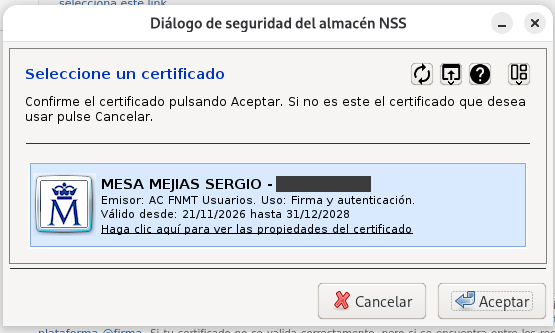

> Muestra capturas de pantalla donde se compruebe el resultado de la validación.

VALIDe dice que mi certificado es válido. En la información ampliada salen sus datos y al final pone que es válido incluyendo su estado de revocación:

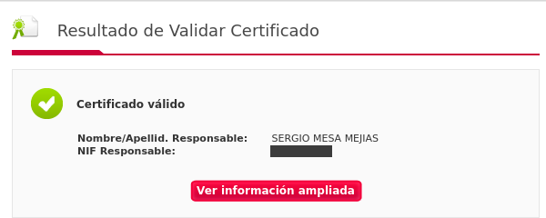
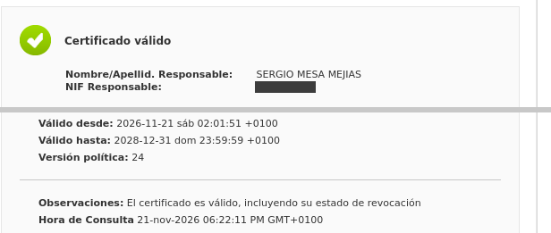

### Tarea 3: Firma Electrónica

> Utilizando la plataforma VALIDe y la aplicación AutoFirma, firma un documento con tu certificado y envíaselo a un compañero.

En AutoFirma selecciono un PDF (mi práctica de GitHub). Como es un PDF usa el formato Firma PDF (PAdES), que mete la firma dentro del propio fichero. Activo la firma visible y le doy a Firmar:

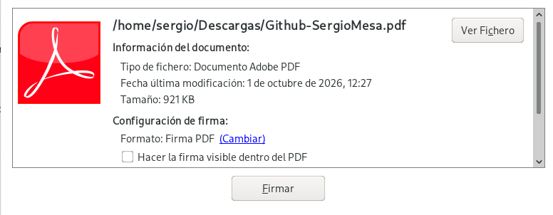

Me pide confirmar la firma y elegir dónde va el recuadro, que lo pongo arriba a la derecha:

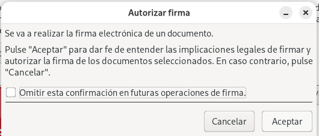
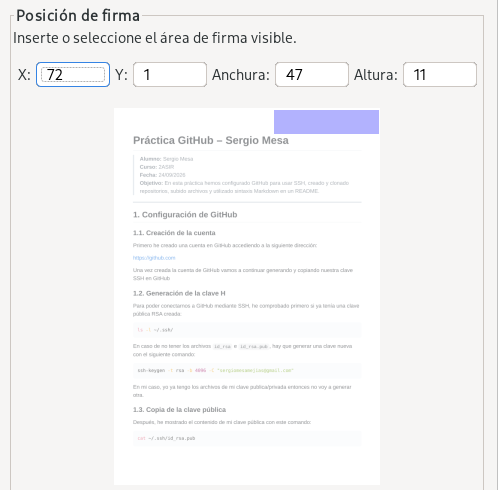

Elijo mi certificado y AutoFirma crea Github-SergioMesa_signed.pdf, con mi firma hecha con el certificado de AC FNMT Usuarios:

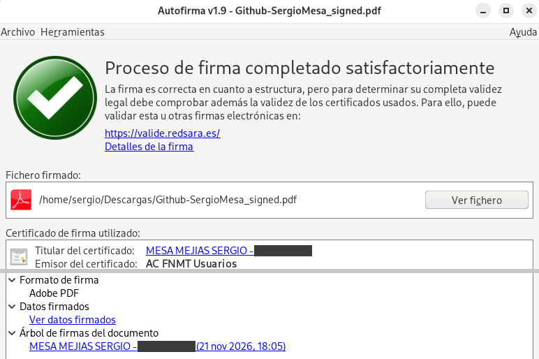

Al abrir el PDF ya se ve el recuadro de la firma, y se lo mando a Gabriel por correo:

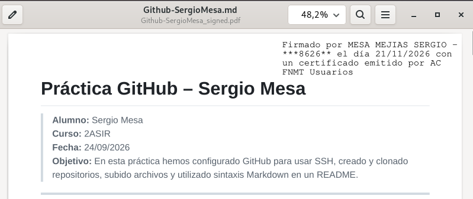
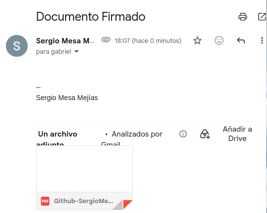

> Debes recibir un documento firmado por un compañero. Utilizando las herramientas anteriores, visualiza la firma y verifica su validez.

Gabriel me manda un PDF firmado por él. Lo subo a VALIDe (Validar Firma) y sale firma válida con él como firmante:

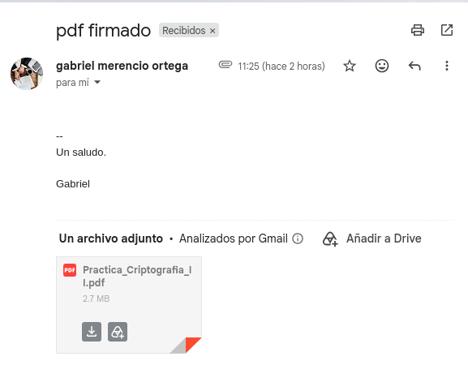
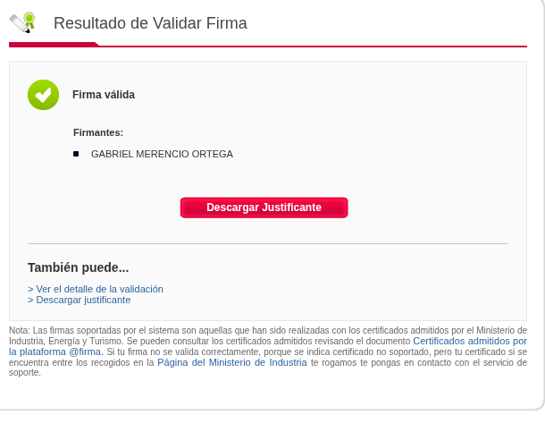

También lo abro con AutoFirma, que lo detecta como firmado y dice firma válida. En Detalles de la firma se ve el perfil PAdES, el algoritmo SHA256withRSA y su certificado de la FNMT:

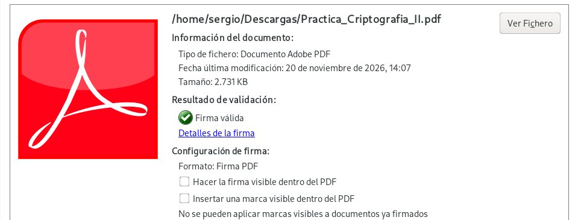

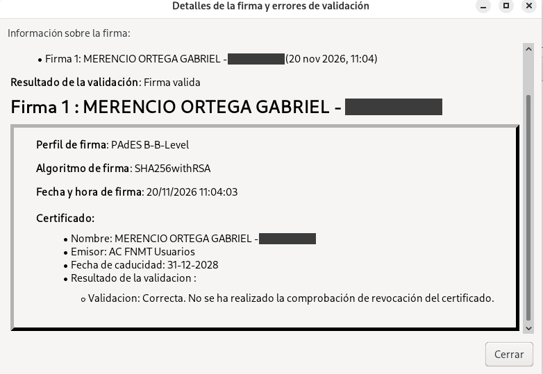

> Razona las siguientes cuestiones:

> ¿Puedes verificar la firma digital aunque no dispongas de la clave pública de tu compañero de forma independiente?

Sí. Dentro del PDF firmado va el certificado de Gabriel con su clave pública, así que no hace falta que me la pase aparte como hacíamos con gpg. Y me puedo fiar de ese certificado porque lo ha emitido la FNMT, que es una autoridad en la que ya confía mi sistema.

> ¿Es estrictamente necesario estar conectado a internet en el momento de realizar la validación de la firma? Dí la razón.

Para comprobar que la firma es correcta y que el documento no se ha cambiado no hace falta, porque todo va dentro del PDF. Pero para saber si el certificado sigue siendo válido o lo han revocado sí hace falta internet, porque hay que preguntarlo a la FNMT. Se ve en las capturas: AutoFirma pone que no ha comprobado la revocación, y VALIDe, que va por internet, dice que es válido incluyendo su estado de revocación. Asi que para una validación completa sí hay que estar conectado.

> Realizad una firma conjunta: entre dos compañeros, firmad el mismo documento de forma sucesiva y verificad que ambas firmas son válidas y reconocidas.

Gabriel cogió mi PDF ya firmado y lo firmó él encima, con su recuadro a la izquierda. Ahora el PDF tiene las dos firmas:

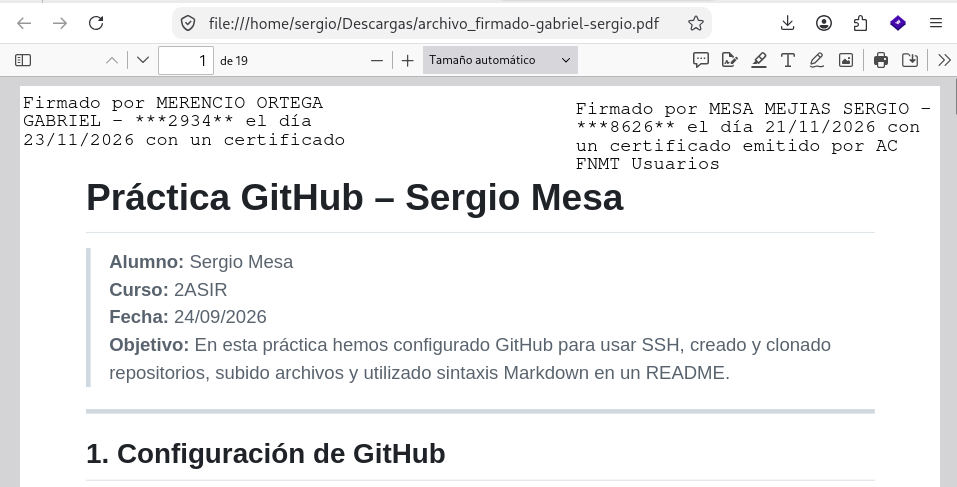

En AutoFirma salen los dos firmantes en el árbol de firmas y las dos firmas son correctas, y VALIDe la da por válida con los dos:

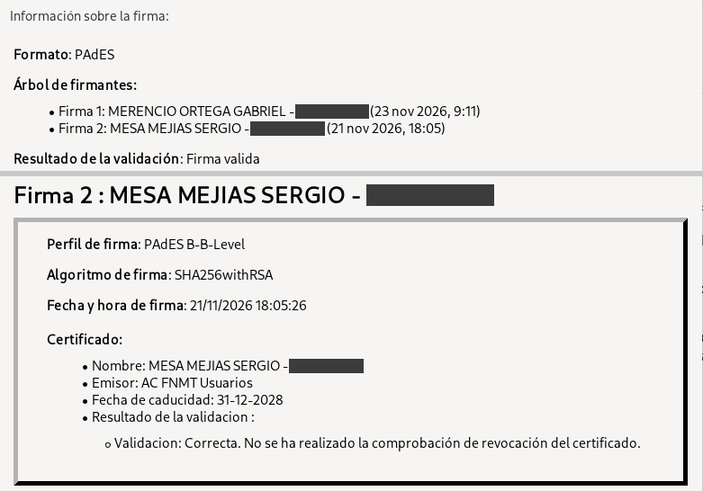

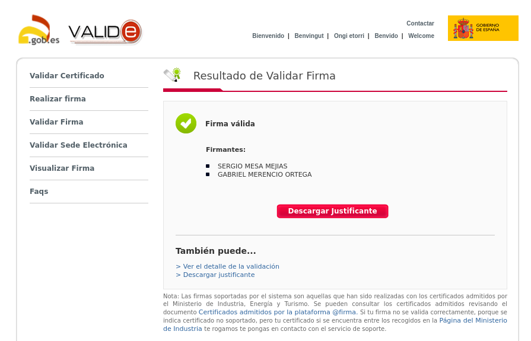

Cada firma nueva se añade al final del PDF sin romper la anterior: la de Gabriel cubre el documento entero, incluida mi firma.

### Tarea 4: Autenticación en la Administración Pública

> Utilizando tu certificado digital, accede a algún servicio telemático de la administración pública (por ejemplo: consulta de puntos de la DGT, vida laboral, cita médica, becas, etc.).

He entrado en la Carpeta Ciudadana (carpetaciudadana.gob.es). Al acceder elijo identificarme con certificado y Firefox me pregunta cuál usar:

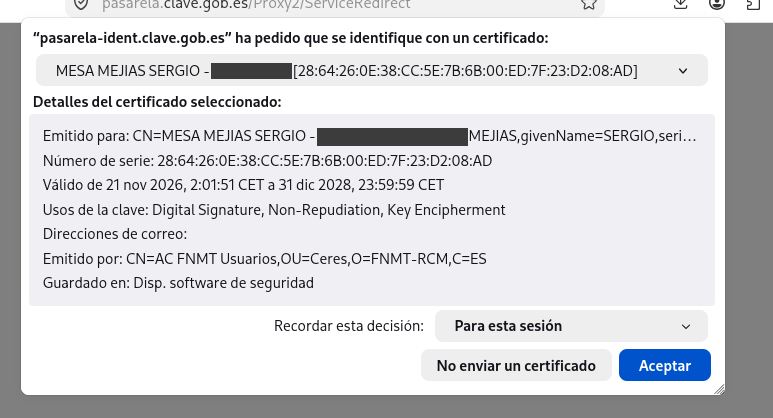

> Entrega capturas de pantalla anonimizadas que demuestren el acceso autenticado con éxito.

Y entro con mi nombre. Hasta sale la fecha de caducidad de mi certificado en próximos eventos (he tapado el DNI):

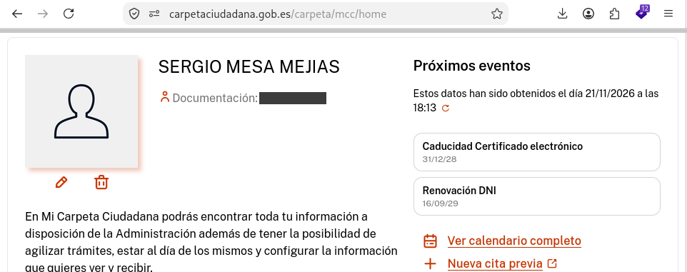

## PARTE 2: Infraestructura PKI y Servidores Web (TLS)

> Nota previa: Para esta parte, crearéis una página web estática o aplicación web en un servidor web configurado para responder al nombre de dominio local tunombre.iesgn.org.

He montado el servidor en una máquina virtual Debian 13 (192.168.122.181) con Apache y una página sencilla, y en mi PC he añadido el nombre al /etc/hosts:

```
# /etc/hosts de mi PC
192.168.122.181   sergio.iesgn.org

# en la VM, la pagina
echo "<h1>Web de Sergio Mesa - sergio.iesgn.org</h1>" | sudo tee /var/www/html/index.html
```

Así se veía al principio, todavía por HTTP (No seguro):

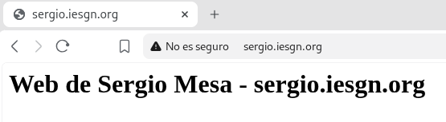

La práctica la he hecho con Gabriel Merencio: yo he sido la CA para su servidor y él la CA para el mío.

### Tarea 1: Creación de una Autoridad Certificadora (CA) Propia

> Esta práctica se realizará por parejas. Un alumno actuará como Autoridad Certificadora (CA) y el otro como Administrador del Servidor Web. Posteriormente, se intercambiarán los roles.

> El alumno que ejerce de Autoridad Certificadora debe documentar los siguientes puntos:

> Creación de su propia CA raíz utilizando OpenSSL (generación de la clave privada de la CA y del certificado autofirmado). Muestra y explica el fichero de configuración utilizado (openssl.cnf).

Primero creo la estructura de la CA en mi PC:

```
mkdir -p ~/CA/{certs,newcerts,private,csr}
cd ~/CA
chmod 700 private
touch index.txt
echo 1000 > serial
```

certs guarda los certificados, newcerts una copia de cada uno que firmo, private la clave de la CA (solo yo puedo entrar), index.txt es el registro de lo que firmo y serial el número de serie del siguiente:

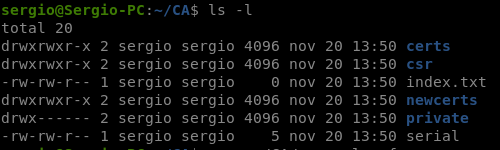

Este es el openssl.cnf que uso:

```
[ ca ]
default_ca = CA_default

[ CA_default ]
dir             = /home/sergio/CA
certs           = $dir/certs
new_certs_dir   = $dir/newcerts
database        = $dir/index.txt
serial          = $dir/serial
private_key     = $dir/private/ca.key.pem
certificate     = $dir/certs/ca.cert.pem
default_md      = sha256
default_days    = 375
preserve        = no
policy          = policy_flexible
copy_extensions = copy

[ policy_flexible ]
countryName            = optional
stateOrProvinceName    = optional
localityName           = optional
organizationName       = optional
organizationalUnitName = optional
commonName             = supplied
emailAddress           = optional

[ req ]
default_bits       = 4096
default_md         = sha256
distinguished_name = req_distinguished_name
string_mask        = utf8only
x509_extensions    = v3_ca

[ req_distinguished_name ]
countryName         = Pais (2 letras)
stateOrProvinceName = Provincia
localityName        = Localidad
organizationName    = Organizacion
commonName          = Nombre comun

[ v3_ca ]
subjectKeyIdentifier   = hash
authorityKeyIdentifier = keyid:always,issuer
basicConstraints       = critical, CA:true
keyUsage               = critical, digitalSignature, cRLSign, keyCertSign

[ server_cert ]
basicConstraints       = CA:FALSE
subjectKeyIdentifier   = hash
authorityKeyIdentifier = keyid,issuer:always
keyUsage               = critical, digitalSignature
extendedKeyUsage       = serverAuth
```

- [CA_default]: dónde está todo (clave y certificado de la CA, el registro y el serial), que use SHA-256 y que los certificados duren 375 días. copy_extensions = copy copia el subjectAltName de la CSR, que es lo que miran los navegadores.

- [policy_flexible]: qué datos tiene que traer la CSR. Solo obligo el nombre común (el dominio).

- [req] y [req_distinguished_name]: cómo se crean las peticiones y el certificado raíz.

- [v3_ca]: extensiones del certificado de la CA. CA:true y keyCertSign, o sea que puede firmar otros certificados.

- [server_cert]: extensiones de los certificados que firmo. CA:FALSE y serverAuth, o sea que son para un servidor web y no pueden firmar a otros.

Luego genero la clave privada de la CA (RSA de 4096 bits cifrada con AES-256, así que lleva contraseña) y el certificado raíz autofirmado, válido 10 años:

```
openssl genrsa -aes256 -out private/ca.key.pem 4096
chmod 400 private/ca.key.pem
openssl req -config openssl.cnf -key private/ca.key.pem -new -x509 -days 3650 \
  -extensions v3_ca -out certs/ca.cert.pem \
  -subj "/C=ES/ST=Sevilla/L=Dos Hermanas/O=CA Sergio Mesa/CN=CA Sergio Mesa"
```

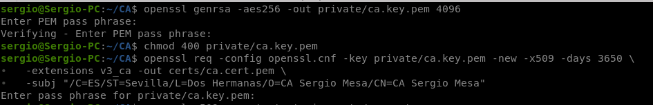

Al verlo, el emisor y el sujeto son el mismo (por eso es autofirmado), y tiene CA:TRUE y permiso para firmar certificados:

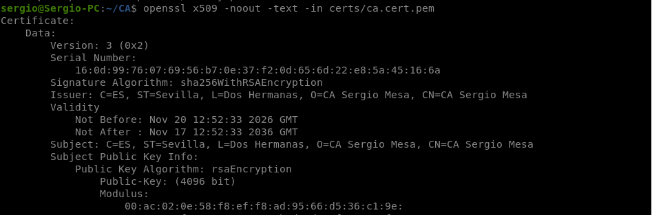

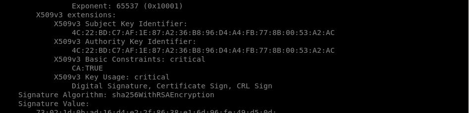

> Recepción del fichero CSR (Certificate Signing Request) enviado por su compañero, proceso de firma del mismo utilizando las directivas de la CA, y envío del certificado final al compañero.

Gabriel me manda su CSR por correo. Antes de firmarla la copio a la carpeta de la CA y compruebo que es correcta:

```
cp ~/Descargas/gabriel.iesgn.org.csr ~/CA/csr/
openssl req -in ~/CA/csr/gabriel.iesgn.org.csr -noout -text -verify
```

Sale verify OK, el CN es gabriel.iesgn.org, la clave es de curva elíptica prime256v1 y trae el subjectAltName:

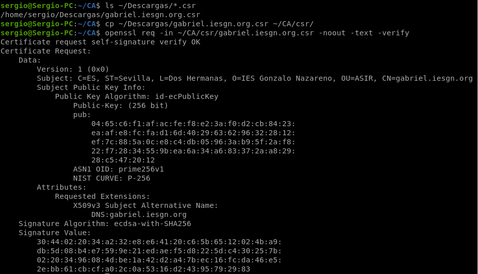

La firmo con mi CA usando la sección server_cert. Me pide la contraseña de la CA y confirmar dos veces:

```
openssl ca -config openssl.cnf -extensions server_cert -days 375 -notext \
  -in csr/gabriel.iesgn.org.csr -out certs/gabriel.iesgn.org.crt
```

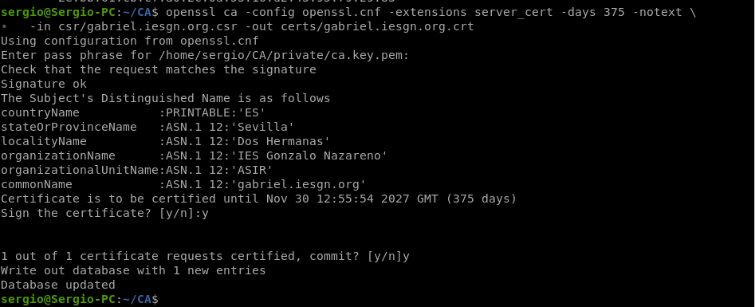

Compruebo el certificado: lo emite mi CA, es para gabriel.iesgn.org, tiene CA:FALSE, uso de servidor web y el DNS. En index.txt queda apuntado con el serial 1000, y su copia está en newcerts/1000.pem:

```
openssl x509 -noout -subject -issuer -dates -in certs/gabriel.iesgn.org.crt
openssl x509 -noout -ext basicConstraints,keyUsage,extendedKeyUsage,subjectAltName -in 
certs/gabriel.iesgn.org.crt
cat index.txt
ls newcerts
```

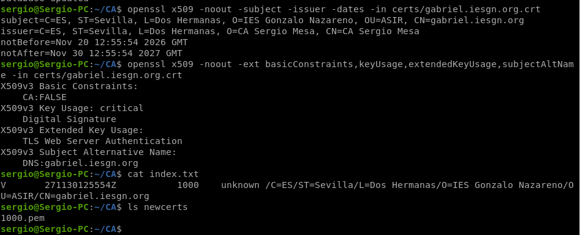

Y le devuelvo su certificado firmado junto con el certificado de mi CA:

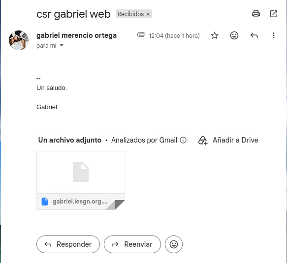
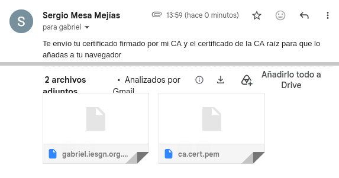

> ¿Qué otra información crítica (además del certificado firmado) debe aportar la CA a su compañero para que el servidor web confíe plenamente en él y no muestre errores en el navegador?

El certificado de la CA raíz (mi ca.cert.pem). Mi CA no la conocen los navegadores, así que si no importan ese certificado como autoridad de confianza les sale el aviso de que el emisor es desconocido. Con él, el navegador puede comprobar que el certificado del servidor lo ha firmado una CA en la que confía.

> El alumno que actúa como Administrador del Servidor Web debe documentar los siguientes puntos:

> Generación de claves mediante Curvas Elípticas (ECDSA): En lugar de utilizar el clásico algoritmo RSA, genera una clave privada optimizada basada en curvas elípticas (por ejemplo, utilizando la curva estándar prime256v1 con OpenSSL).

En la VM genero la clave privada con la curva prime256v1:

```
mkdir ~/tls && cd ~/tls
openssl ecparam -name prime256v1 -genkey -noout -out sergio.iesgn.org.key
openssl ec -in sergio.iesgn.org.key -noout -text | head -3
```

La clave es de 256 bits. Da la misma seguridad que una RSA de 3072 bits pero es mucho más pequeña y las operaciones son más rápidas:

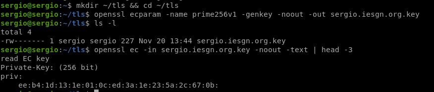

> Utiliza dicha clave privada para generar una solicitud de firma de certificado (CSR), especificando como nombre común (Common Name / FQDN) el dominio tunombre.iesgn.org.

Con esa clave hago la CSR. Le pongo CN=sergio.iesgn.org y añado el subjectAltName con el mismo nombre, que es lo que comprueban los navegadores modernos:

```
openssl req -new -key sergio.iesgn.org.key -out sergio.iesgn.org.csr \
  -subj "/C=ES/ST=Sevilla/L=Dos Hermanas/O=IES Gonzalo Nazareno/OU=SAD/CN=sergio.iesgn.org" \
  -addext "subjectAltName=DNS:sergio.iesgn.org"
openssl req -in sergio.iesgn.org.csr -noout -text
```

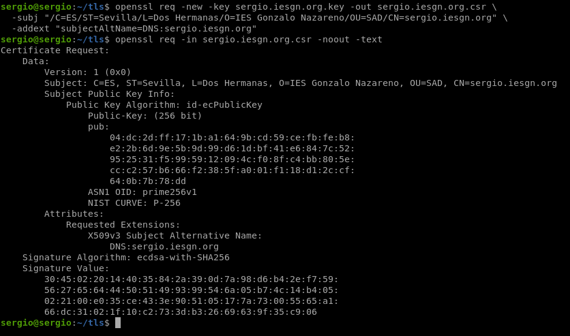

> Envía la solicitud de firma (CSR) a la entidad certificadora (tu compañero).

Me traigo la CSR de la VM a mi PC y se la mando a Gabriel por correo, porque no estamos en la misma red. La CSR no es secreta; la clave privada no sale nunca de la VM:

```
sergio@Sergio-PC:~$ scp -i ~/.ssh/id_rsa sergio@192.168.122.181:~/tls/sergio.iesgn.org.csr ~/
sergio.iesgn.org.csr                                  100%  566   415.0KB/s   00:00
```

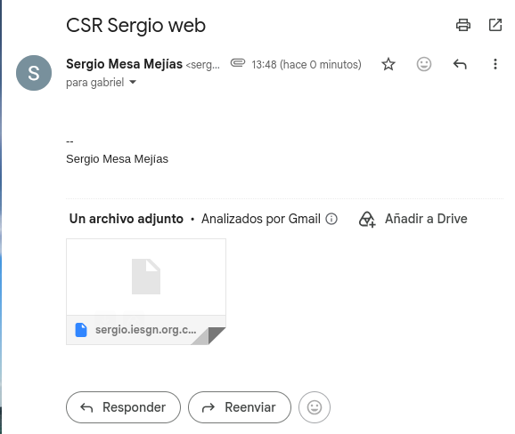

> Recibe como respuesta el certificado X.509 firmado para el servidor y el certificado de la CA raíz.

Gabriel me devuelve mi certificado y el de su CA (ca.crt). Le cambio el nombre a su CA para no confundirla con la mía y los paso a la VM:

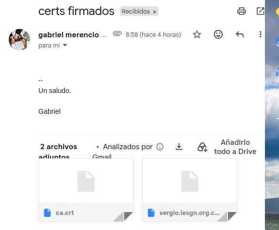

```
sergio@Sergio-PC:~/Descargas$ mv ca.crt ca_gabriel.crt
sergio@Sergio-PC:~/Descargas$ scp -i ~/.ssh/id_rsa sergio.iesgn.org.crt ca_gabriel.crt 
sergio@192.168.122.181:~/tls/
sergio.iesgn.org.crt                                  100% 4907    27.2MB/s   00:00
ca_gabriel.crt                                        100% 2130    13.0MB/s   00:00
```

En la VM compruebo que lo ha firmado su CA, que es para sergio.iesgn.org, que es de servidor web y que se verifica bien contra su CA:

```
sergio@sergio:~/tls$ openssl x509 -noout -subject -issuer -dates -in sergio.iesgn.org.crt
subject=C=ES, ST=Sevilla, O=IES Gonzalo Nazareno, OU=SAD, CN=sergio.iesgn.org
issuer=C=ES, ST=Sevilla, L=Dos Hermanas, O=IES Gonzalo Nazareno, OU=ASIR, CN=CA Gabriel 
Merencio
notBefore=Nov 23 07:56:27 2026 GMT
notAfter=Nov 23 07:56:27 2027 GMT
sergio@sergio:~/tls$ openssl x509 -noout -ext subjectAltName,extendedKeyUsage -in 
sergio.iesgn.org.crt
X509v3 Extended Key Usage:
    TLS Web Server Authentication
X509v3 Subject Alternative Name:
    DNS:sergio.iesgn.org
sergio@sergio:~/tls$ openssl verify -CAfile ca_gabriel.crt sergio.iesgn.org.crt
sergio.iesgn.org.crt: OK
```

### Tarea 2: Despliegue en Servidores Web (Apache y Nginx)

> Servidor Apache2: Configura el servidor web Apache para habilitar TLS en el puerto por defecto 443. Implementa una regla de reescritura para forzar que cualquier petición realizada por HTTP (80) sea redirigida automáticamente a HTTPS (443). Comprueba el funcionamiento desde un navegador o mediante herramientas como curl.

Activo los módulos de TLS y de reescritura y pongo la clave privada en su sitio, solo legible por root:

```
sudo a2enmod ssl rewrite
sudo cp ~/tls/sergio.iesgn.org.key /etc/ssl/private/
sudo chmod 600 /etc/ssl/private/sergio.iesgn.org.key
```

Creo el sitio /etc/apache2/sites-available/sergio.iesgn.org.conf con dos VirtualHost. El del puerto 80 solo redirige todo a HTTPS con un 301 (redirección permanente) usando mod_rewrite, y el del 443 activa TLS con mi certificado y mi clave elíptica:

```
<VirtualHost *:80>
    ServerName sergio.iesgn.org

    RewriteEngine On
    RewriteRule ^(.*)$ https://%{HTTP_HOST}$1 [R=301,L]
</VirtualHost>

<VirtualHost *:443>
    ServerName sergio.iesgn.org
    DocumentRoot /var/www/html

    SSLEngine on
    SSLCertificateFile    /etc/ssl/certs/sergio.iesgn.org.crt
    SSLCertificateKeyFile /etc/ssl/private/sergio.iesgn.org.key
</VirtualHost>
```

Copio el certificado, activo el sitio, quito el de por defecto y compruebo la sintaxis antes de recargar:

```
sergio@sergio:~/tls$ sudo cp sergio.iesgn.org.crt /etc/ssl/certs/
sergio@sergio:~/tls$ sudo a2ensite sergio.iesgn.org
Enabling site sergio.iesgn.org.
sergio@sergio:~/tls$ sudo a2dissite 000-default
Site 000-default disabled.
sergio@sergio:~/tls$ sudo apache2ctl configtest
Syntax OK
sergio@sergio:~/tls$ sudo systemctl reload apache2
```

Lo pruebo con curl desde mi PC. Por HTTP devuelve el 301 hacia https, y por HTTPS (diciéndole a curl que se fíe de la CA de Gabriel) devuelve 200 OK:

```
sergio@Sergio-PC:~$ curl -I http://sergio.iesgn.org
HTTP/1.1 301 Moved Permanently
Server: Apache/2.4.71 (Debian)
Location: https://sergio.iesgn.org/

sergio@Sergio-PC:~$ curl --cacert ~/Descargas/ca_gabriel.crt -I https://sergio.iesgn.org
HTTP/1.1 200 OK
Server: Apache/2.4.71 (Debian)
Content-Type: text/html
```

Para que Firefox no dé error, importo la CA de Gabriel en Ver certificados &gt; Autoridades, marcando que confíe en ella para identificar sitios web:

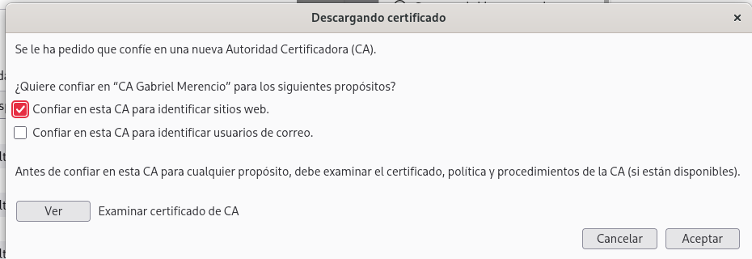

Al entrar por http://sergio.iesgn.org salta solo a HTTPS y la conexión sale segura, con el certificado emitido por la CA de Gabriel:

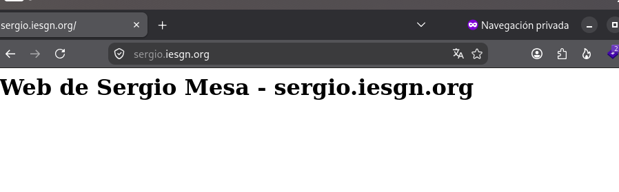
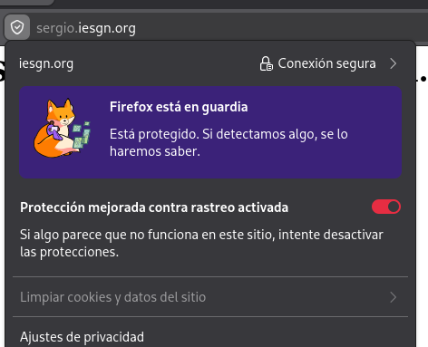

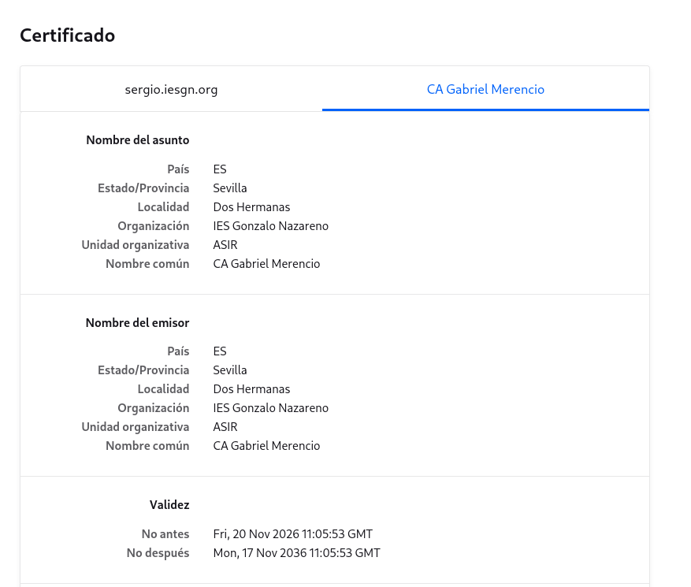

> Servidor Nginx: Desinstala o detén temporalmente Apache (para liberar el puerto 443), instala el servidor web Nginx y realiza la misma configuración de seguridad TLS utilizando el mismo certificado y clave elíptica. Documenta los bloques de configuración de ambos servidores y explica las diferencias sintácticas principales entre ellos.

Paro y deshabilito Apache para liberar los puertos 80 y 443, e instalo Nginx:

```
sudo systemctl stop apache2
sudo systemctl disable apache2
sudo apt install nginx
```

Creo el sitio /etc/nginx/sites-available/sergio.iesgn.org con el mismo certificado y la misma clave elíptica. El server del 80 redirige a HTTPS y el del 443 sirve la web con TLS:

```
server {
    listen 80;
    server_name sergio.iesgn.org;
    return 301 https://$host$request_uri;
}

server {
    listen 443 ssl;
    server_name sergio.iesgn.org;

    root /var/www/html;
    index index.html;

    ssl_certificate     /etc/ssl/certs/sergio.iesgn.org.crt;
    ssl_certificate_key /etc/ssl/private/sergio.iesgn.org.key;
}
```

Lo activo con un enlace en sites-enabled, quito el default y compruebo la configuración:

```
sergio@sergio:~/tls$ sudo ln -s /etc/nginx/sites-available/sergio.iesgn.org /etc/nginx/sites-
enabled/
sergio@sergio:~/tls$ sudo rm /etc/nginx/sites-enabled/default
sergio@sergio:~/tls$ sudo nginx -t
nginx: the configuration file /etc/nginx/nginx.conf syntax is ok
nginx: configuration file /etc/nginx/nginx.conf test is successful
sergio@sergio:~/tls$ sudo systemctl reload nginx
```

Funciona igual que con Apache, pero ahora la cabecera Server dice nginx:

```
sergio@Sergio-PC:~$ curl -I http://sergio.iesgn.org
HTTP/1.1 301 Moved Permanently
Server: nginx
Location: https://sergio.iesgn.org/

sergio@Sergio-PC:~$ curl --cacert ~/Descargas/ca_gabriel.crt -I https://sergio.iesgn.org
HTTP/1.1 200 OK
Server: nginx
Content-Type: text/html
```

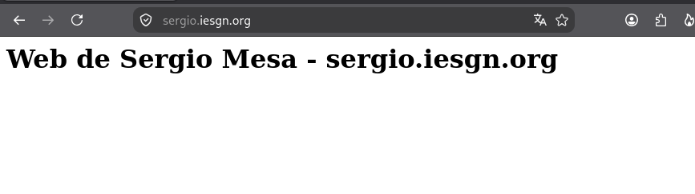

Diferencias de sintaxis que he visto entre los dos:

- Apache usa bloques tipo etiqueta (&lt;VirtualHost \*:443&gt; ... &lt;/VirtualHost&gt;) y Nginx bloques server { } con llaves, donde cada línea acaba en punto y coma.

- En Apache TLS se activa con SSLEngine on y SSLCertificateFile / SSLCertificateKeyFile, y hace falta activar el módulo ssl. En Nginx basta con poner listen 443 ssl y ssl_certificate / ssl_certificate_key.

- La redirección en Apache la hago con mod_rewrite (RewriteEngine y RewriteRule). En Nginx es una sola línea: return 301 https://\$host\$request_uri;

- Para activar el sitio en Apache uso a2ensite y compruebo con apache2ctl configtest. En Nginx hago un enlace a sites-enabled y compruebo con nginx -t.
