# CRIPTOGRAFÍA II

**PRÁCTICA: Firmas electrónicas, integridad y autenticación**

*Sergio Mesa Mejías*

## Parte 1. Firmas Electrónicas.

> En este primer apartado vamos a trabajar con las firmas electrónicas, para ello te puede ayudar el siguiente enlace:

[Firmado de claves (Debian)](https://www.debian.org/events/keysigning.es.html)

### Apartado A. Firma de documentos.

> Crea un documento de texto y firma dicho documento con tu clave privada (generando una firma desacoplada o transparente). Manda el documento y la firma electrónica del mismo a un compañero. Verifica la firma que tu has recibido de él.

Creo el fichero documento_sergio.txt y lo firmo con mi clave privada usando --detach-sign, que genera la firma aparte en un fichero .sig. Luego compruebo yo mismo que la firma es correcta.

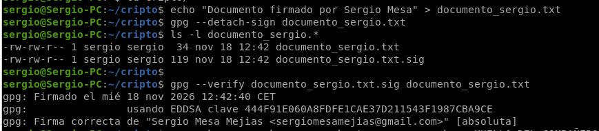

Le paso el documento y la firma a mi compañero Gabriel por scp (la primera vez me equivoqué al poner la contraseña):

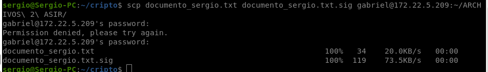

Para verificar lo suyo, primero me bajo su clave pública del servidor con su huella (la saqué de la wiki de Redmine) y compruebo que la huella coincide:

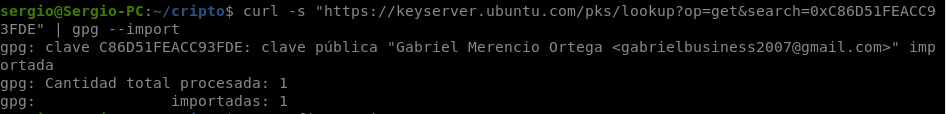

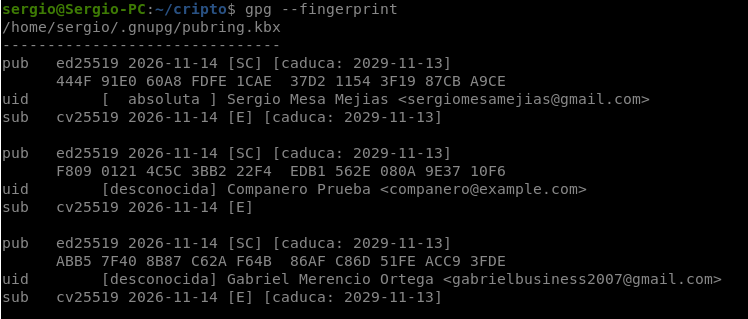

Gabriel me pasa su documento y su firma (documento.txt y documento.txt.asc). Los muevo a mi carpeta, cambiandoles el nombre para no liarme, y verifico la firma:

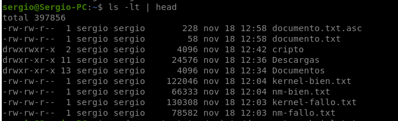

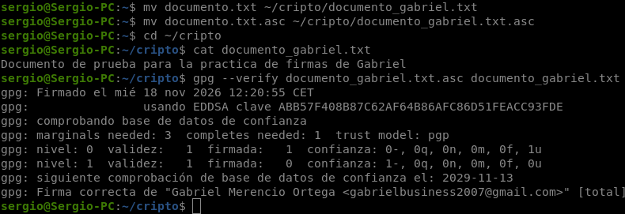

Sale Firma correcta y sin aviso porque para entonces ya había firmado yo su clave (lo explico en el apartado B).

> Explica detalladamente qué significa el siguiente mensaje de advertencia al verificar la firma:

```
gpg: Firma correcta de "Pepe D <josedom24@gmail.com>" [desconocido]
gpg: ATENCIÓN: ¡Esta clave no está certificada por una firma de confianza!
gpg:          No hay indicios de que la firma pertenezca al propietario.
Huellas dactilares de la clave primaria: E8DD 5DA9 3B88 F08A DA1D  26BF 5141 3DDB 0C99 55FC
```

Para que me saliera el aviso he verificado la firma de un usuario cuya clave tengo importada pero no he firmado:

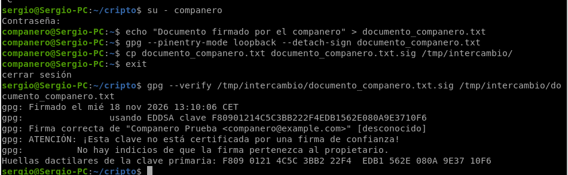

El mensaje dice dos cosas. La primera, Firma correcta, quiere decir que el documento no se ha modificado y que se firmó con la clave privada que va con esa clave pública. Eso está comprobado matematicamente.

El aviso es por otra cosa: gpg no sabe si esa clave pública es de verdad de la persona que dice ser. Cualquiera puede crearse una clave poniendo el nombre y el correo de Pepe. Como ni yo ni nadie en quien yo confíe ha firmado esa clave, gpg la marca como [desconocido] y avisa de que no hay pruebas de que pertenezca a su dueño. Por eso enseña la huella, para que la compruebe por otro medio. Si la compruebo y la firmo, el aviso desaparece.

### Apartado B. Creación del anillo de confianza.

> Vamos a crear un anillo de confianza (web of trust) entre los miembros de la clase, para ello.

> Sube tu clave pública a un servidor de claves si aun no lo has hecho.

Mi clave ya la subi a keyserver.ubuntu.com en la práctica anterior. En el apartado C se ve en la web del servidor junto con las firmas que me han hecho.

> Escribe su huella digital o fingerprint en un papel y dáselo a tu compañero, para que puede descargarse tu clave pública con seguridad.

En vez de en un papel, cada uno ha puesto su huella en la wiki de Redmine del instituto. La mía es:

```
444F 91E0 60A8 FDFE 1CAE  37D2 1154 3F19 87CB A9CE
```

> Te debes descargar la clave pública de al menos tres compañeros usando el fingerprint que te habrán entregado anteriormente. Firma estas claves.

Me bajo cada clave del servidor con su huella, compruebo que la huella coincide con la de la wiki y la firmo con gpg --sign-key. Por ejemplo, con Alfredo:

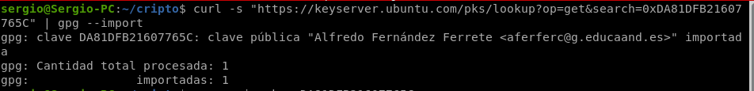

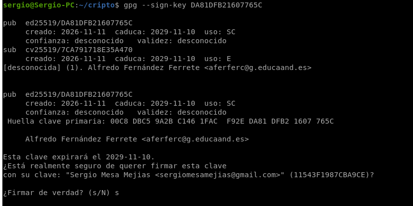

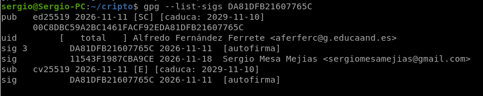

Con Gabriel igual (la huella la comprobé en el apartado A):

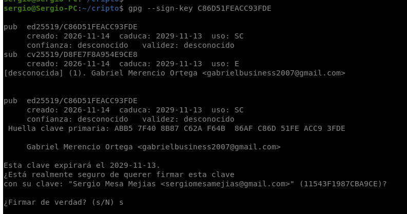

Al final he firmado las claves de Gabriel, Alfredo, Pablo e Ismael. En todas sale mi firma:

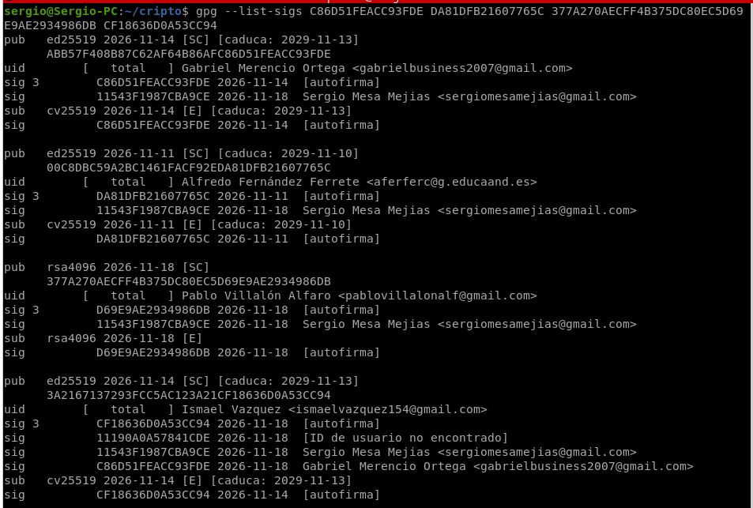

> Tu te debes asegurar que tu clave pública es firmada por al menos tres compañeros de la clase.

Mis compañeros han firmado mi clave y la han subido al servidor. Me la vuelvo a bajar y ya tiene 4 firmas: Adrián, Gabriel, Ismael y Alfredo.

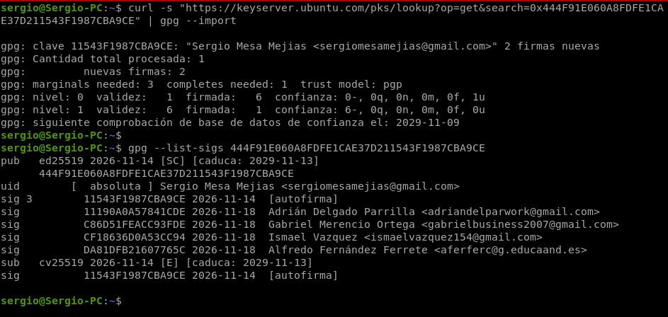

> Una vez que firmes una clave se la tendrás que devolver a su dueño o subirla de nuevo al servidor, para que otra persona se la firme.

Exporto la clave firmada y la subo al servidor desde la web (Submit Key), porque desde mi red gpg --send-keys no llegaba al servidor. Con Gabriel:

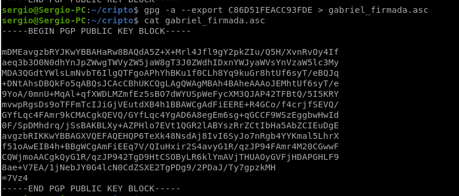

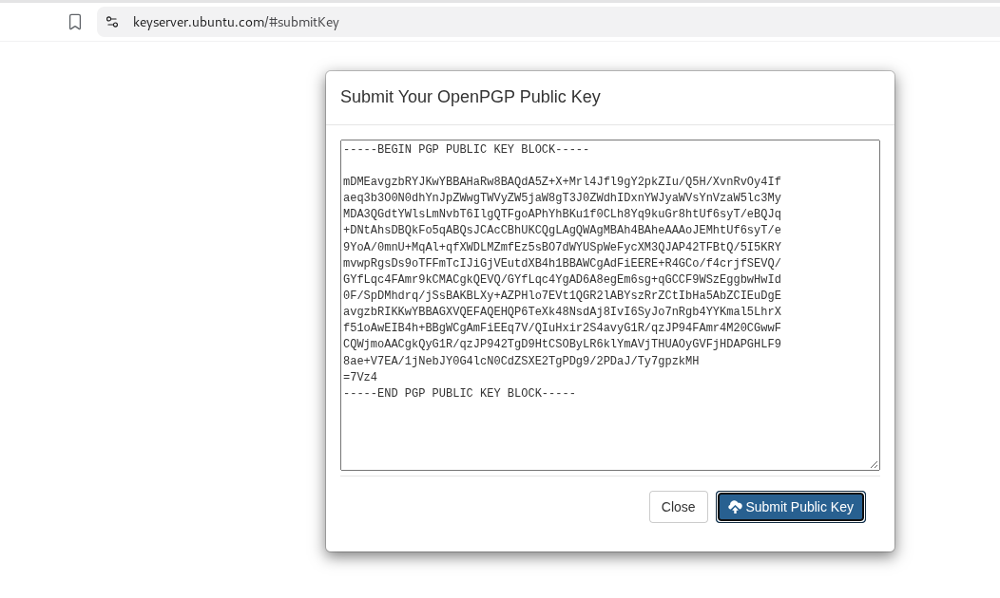

Y con Alfredo, donde el servidor responde que ha actualizado su clave:

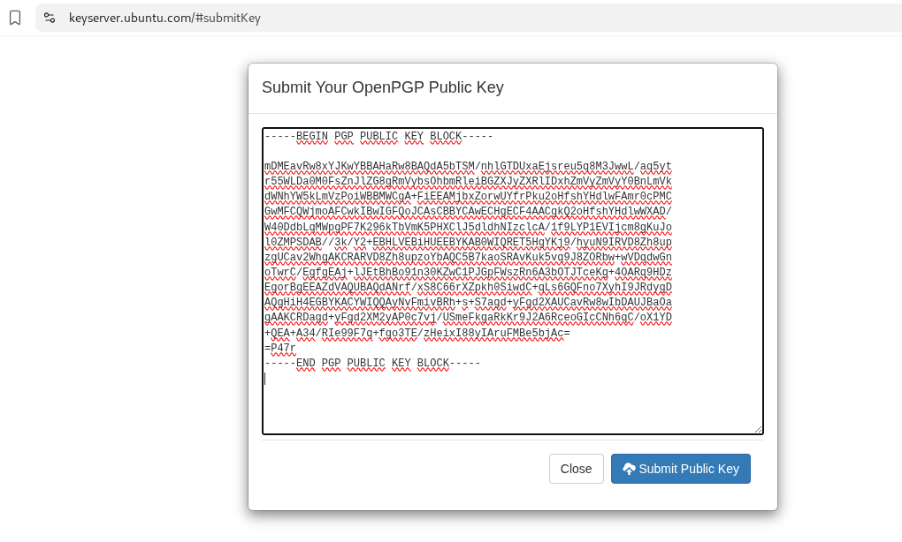

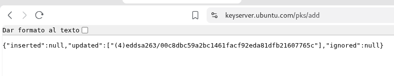

En el servidor ya sale mi firma en la clave de Gabriel (y también la de Alfredo):

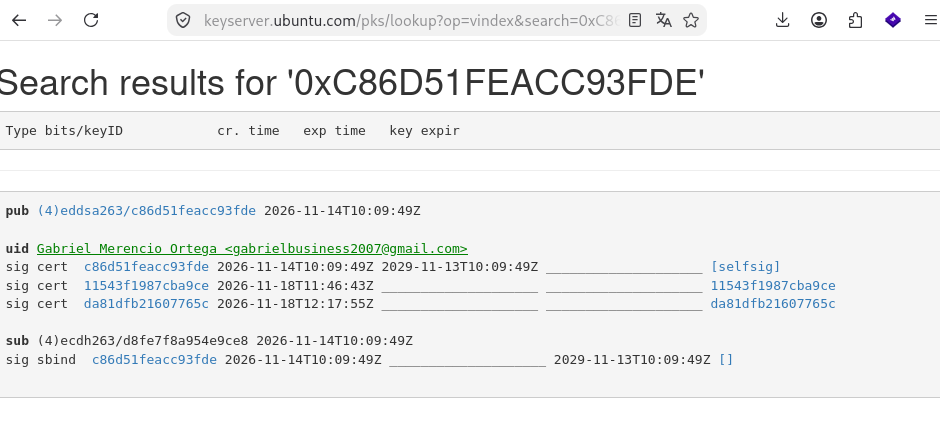

> Cuando tengas las tres firmas sube la clave al servidor de claves y rellena tus datos en la tabla Claves Públicas 2026-2027

Mi clave ya está en el servidor con las firmas de mis compañeros, y he rellenado mis datos en la tabla de la wiki.


> Asegurate que te vuelves a bajar las claves públicas de tus compañeros que tengan las tres firmas.

Vuelvo a bajar las claves de mis compañeros para tener las firmas que les han ido haciendo los demás. Por ejemplo, a la de Alfredo le llegan 2 firmas nuevas:

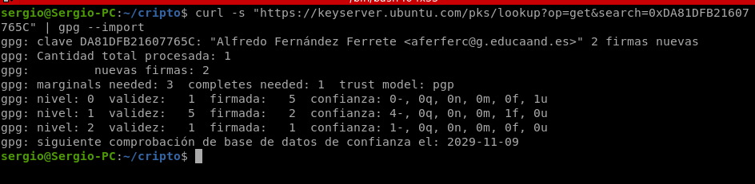

### Apartado C. Comprobación de confianza.

> Muestra las firmas que tiene tu clave pública.

Con gpg --list-sigs veo las firmas de mi clave: mi autofirma y las de Adrián, Gabriel, Ismael y Alfredo. También se pueden ver en la web del servidor:

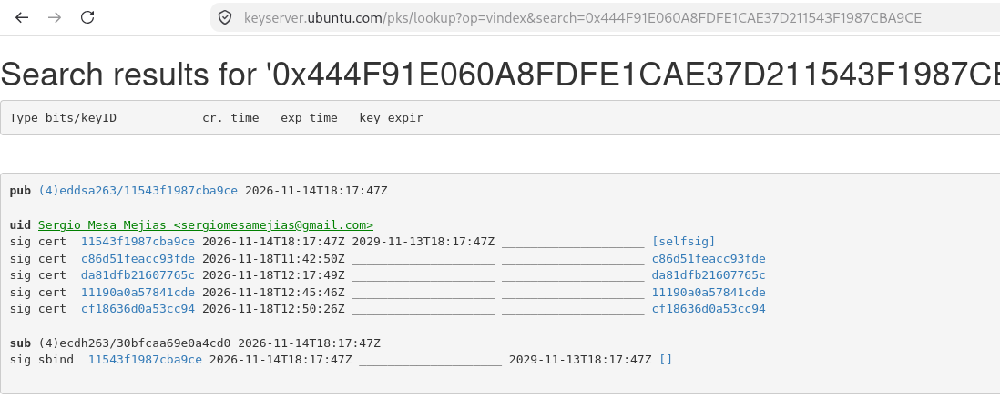

> Comprueba que ya puedes verificar sin advertencias una firma recibida de una persona en la que has establecido confianza directa.

Como he firmado la clave de Gabriel, su firma ya sale correcta y sin el aviso, con validez [total]:


> Comprueba el concepto de confianza transitiva: verifica la firma de una persona a la que tú no has firmado directamente, pero ha sido firmada por otra persona en la que tu tienes confianza total.

Para probarlo uso la clave de Adrián, que está firmada por Gabriel y por Ismael. Yo también la había firmado, así que he quitado mi firma solo en mi ordenador (con gpg --edit-key y delsig) para que no haya confianza directa. Sin mi firma, Adrián sale como [no definida]:

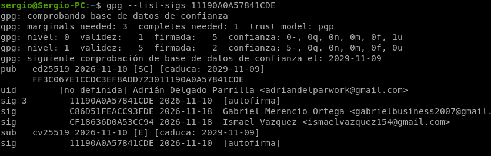

Verifico un documento firmado por Adrián y sale el aviso:

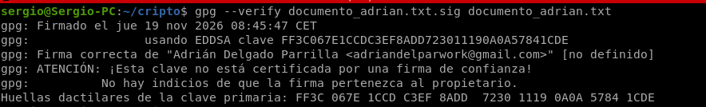

Ahora le digo a gpg que confío totalmente en Gabriel (trust, opción 4):

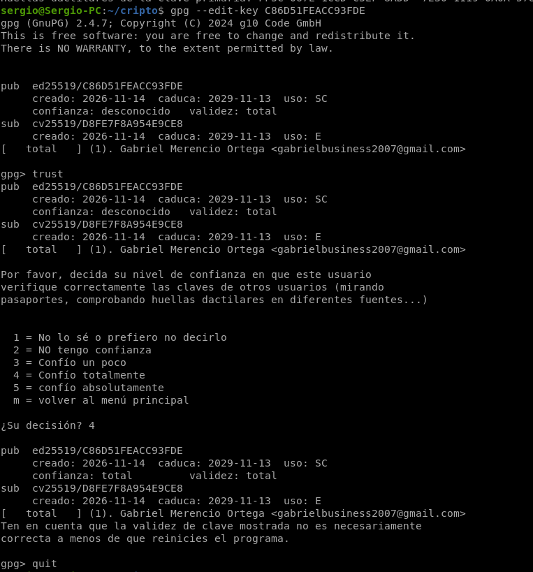

Y sin haber firmado yo a Adrián, su clave pasa a [total] y su firma sale correcta sin aviso:

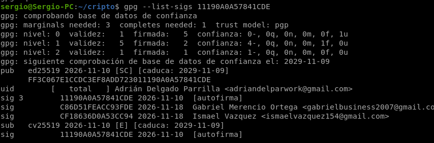

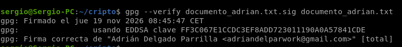

Esto es la confianza transitiva: me fío de Adrián porque lo ha firmado Gabriel, y yo confío totalmente en Gabriel para comprobar las claves de otros.

## Parte 2. Correo electrónico seguro.

> Ahora vamos a configurar nuestro cliente de correo electrónico para poder mandar correos cifrados, para ello:

> Configura un cliente gráfico de correo electrónico (por ejemplo, Thunderbird) con tu cuenta de correo habitual.

He instalado Thunderbird (sudo apt install thunderbird) y he añadido mi cuenta de Gmail iniciando sesión con Google. La cuenta se ve a la izquierda en las capturas del siguiente punto.

> Vincula tu par de claves GPG en la sección de seguridad de la cuenta aprovechando que el cliente tiene OpenPGP integrado.

Thunderbird usa su propio almacén de claves, así que exporto mi clave privada a un fichero, la importo y luego borro el fichero:

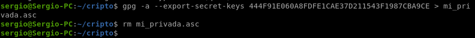

En Account Settings > End-To-End Encryption > Add Key > Import an existing OpenPGP Key:

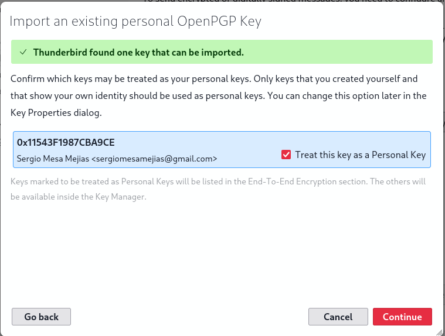

Y la selecciono para mi cuenta. Ahora pone que la configuración usa mi clave 0x11543F1987CBA9CE:

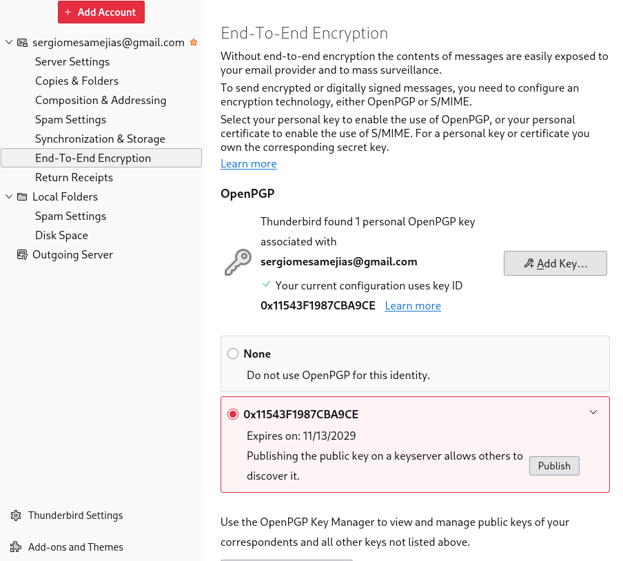

> Envía y recibe varios mensajes con tus compañeros y comprueba el funcionamiento adecuado de GPG.

Importo la clave pública de Gabriel en el OpenPGP Key Manager desde un fichero exportado con gpg:

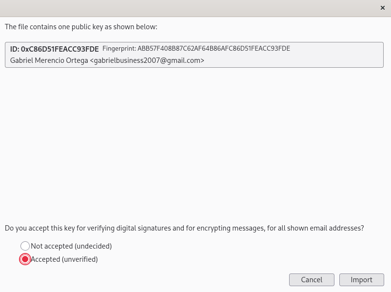

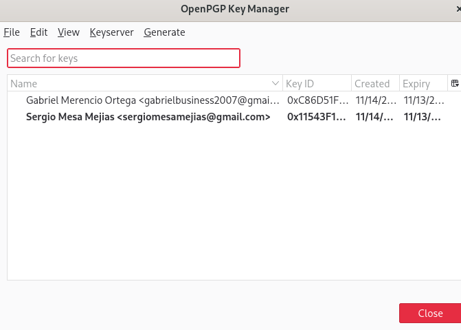

Le escribo un correo y en el menú de OpenPGP activo cifrar, cifrar el asunto y firmar:

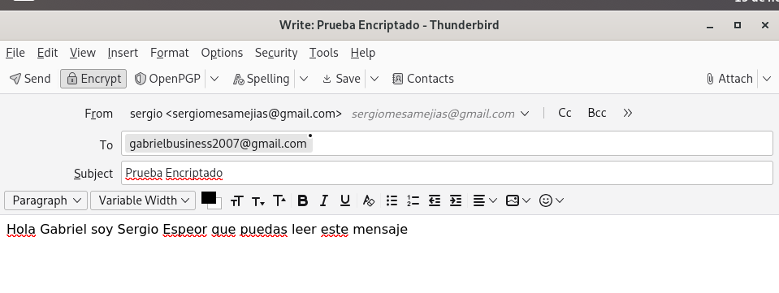

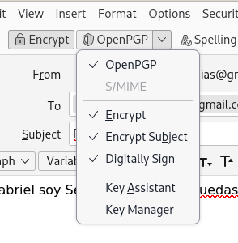

Gabriel lo ha leído y me ha contestado también cifrado y firmado. Al abrirlo salen el candado (cifrado) y el sello (firma). El sello salía con un aviso porque había aceptado su clave sin verificar:

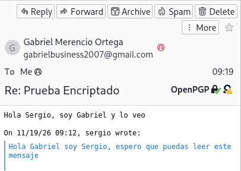

Marco su clave como verificada, porque ya comprobé la huella:

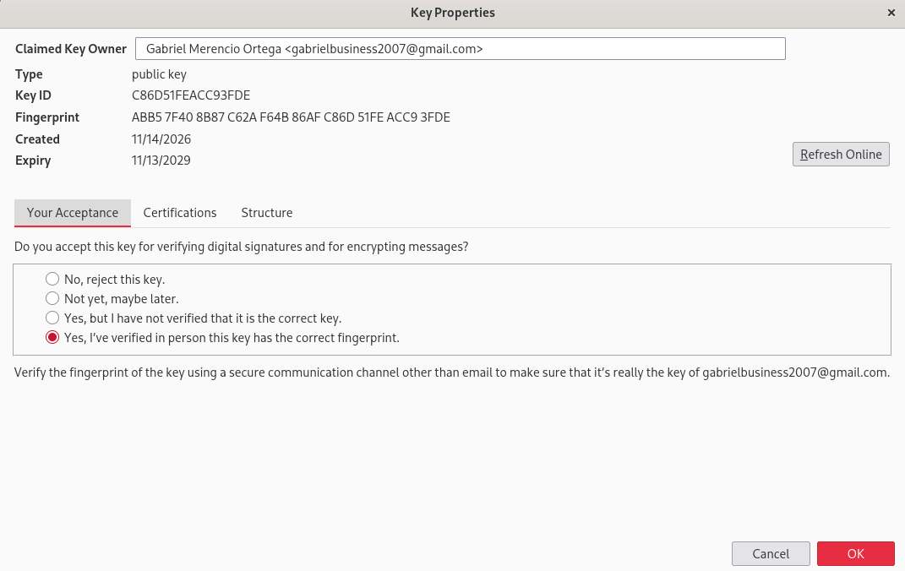

Y ya salen los dos iconos en verde:

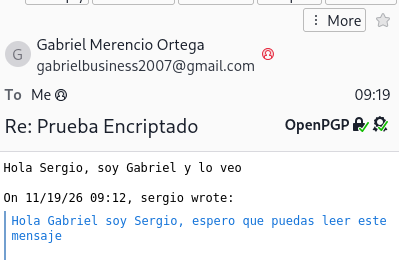

> Manda un correo cifrado y firmado a rruipad182@g.educaand.es importando previamente su clave pública y comprobando que es correcta.

El profe nos dijo que usaramos la clave de su correo personal, porque la del corporativo daba problemas. Me bajo su clave con la huella de la wiki y compruebo que coincide:

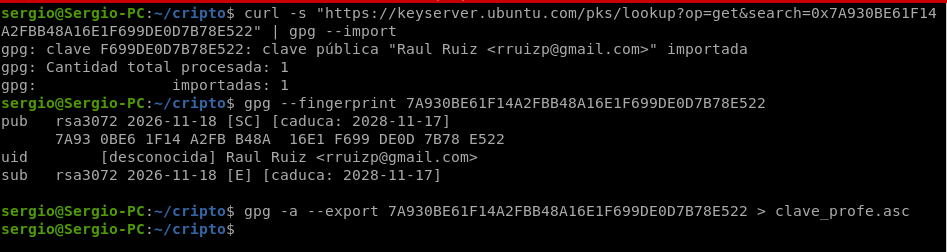

La importo en Thunderbird:

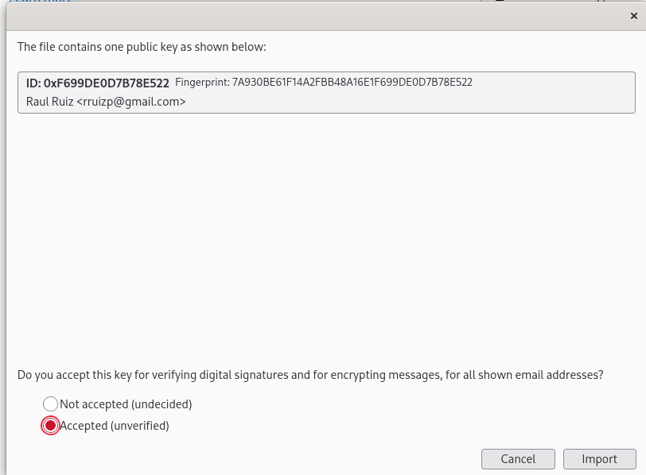

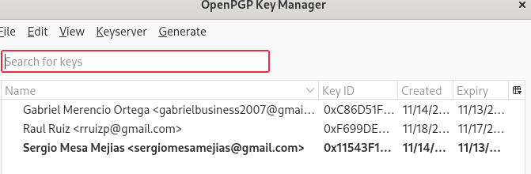

Y le mando el correo cifrado y firmado:

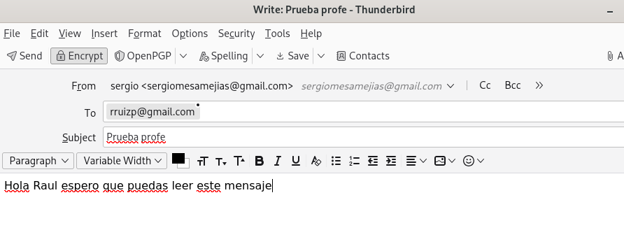

## Parte 3. Integridad de ficheros.

> Descarga la imagen ISO oficial de Debian (netinst o CD) desde el repositorio oficial: https://cdimage.debian.org/debian-cd/current/amd64/iso-cd/

Descargo con wget la ISO netinst de Debian 13.7 y los ficheros SHA256SUMS y SHA256SUMS.sign:

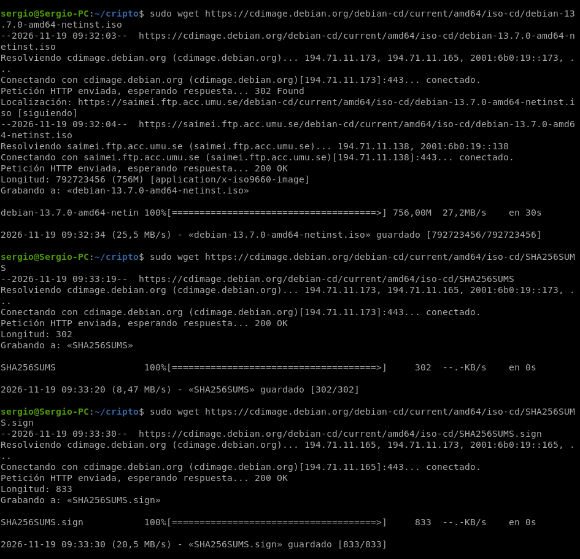

> Descarga los archivos de sumas de verificación y sus correspondientes archivos de firma (.sign)

Son SHA256SUMS (los hashes de las imágenes) y SHA256SUMS.sign (la firma de ese fichero). Se descargan en la captura anterior.

> Calcula el hash de la ISO descargada usando sha256sum o sha512sum y comprueba que coincide con el indicado en el fichero.

Calculo el hash de la ISO y lo comparo con el del fichero. Son iguales, y con sha256sum -c lo compruebo automaticamente:

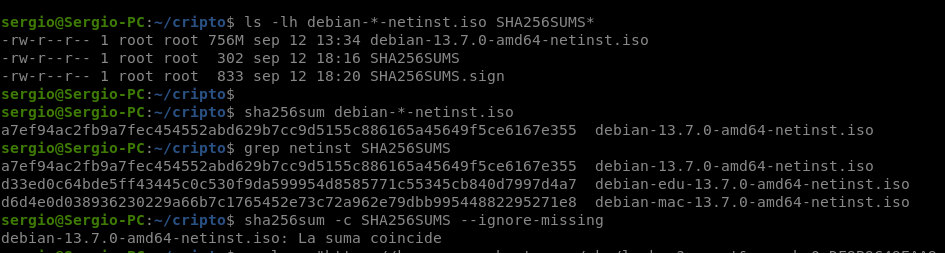

> Importa la clave pública oficial de firmado de imágenes de Debian y verifica mediante GPG la firma digital del archivo SHA256SUMS.sign

Me bajo la clave Debian CD signing key y miro su huella:

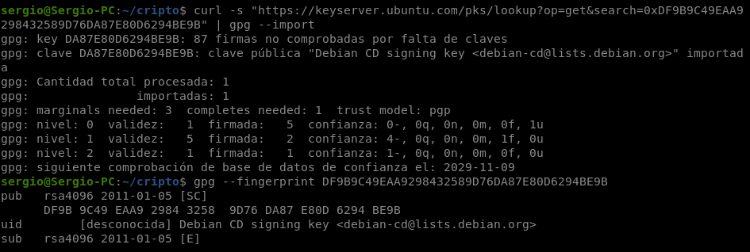

Compruebo en la web oficial (debian.org/CD/verify) que la huella es la misma:

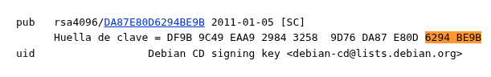

Y verifico la firma del SHA256SUMS. La firma es correcta. Sale el aviso de confianza porque no he firmado esa clave, pero he comprobado la huella en la web oficial.

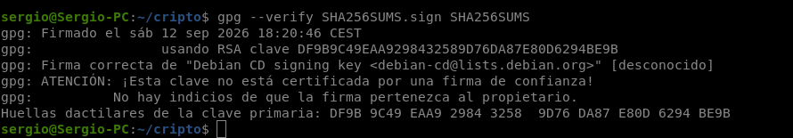

> Explica por qué este doble paso (hash + gpg) garantiza tanto la integridad como la autenticidad.

El hash garantiza la integridad: si la ISO tuviera un solo bit cambiado, el hash saldria distinto. Pero el hash solo no basta, porque si alguien manipula la ISO también puede cambiar el fichero SHA256SUMS para que coincida.

La firma gpg garantiza la autenticidad: el SHA256SUMS está firmado con la clave privada de Debian, que solo tiene Debian. Si alguien lo cambiara, la firma ya no seria válida. Así sé que los hashes son los de Debian, y con el hash sé que mi ISO es exactamente la que ellos publicaron.

## Parte 4. Integridad y autenticidad.

> Cuando nos instalamos un paquete en nuestra distribución linux tenemos que asegurarnos que ese paquete es legítimo. Para conseguir este objetivo se utiliza criptografía asimétrica, y en el caso de Debian a este sistema se llama apt secure.

> Esto lo debemos tener en cuenta al utilizar los repositorios oficiales. Cuando añadamos nuevos repositorios tendremos que añadir las firmas necesarias para confiar en que los paquetes son legítimos y no han sido modificados.

> Busca información sobre apt secure y responde las siguientes preguntas:

> ¿Por qué la herramienta apt-key ha quedado obsoleta en las distribuciones recientes de Debian y Ubuntu?

Porque apt-key metía todas las claves en un anillo común en el que apt confía para todos los repositorios. Eso no es seguro, así que ahora cada repositorio dice con qué clave se valida usando signed-by. En Debian 13 apt-key ya ni viene instalado.

> ¿Qué riesgo de seguridad implicaba almacenar todas las claves en el anillo global /etc/apt/trusted.gpg?

Que una clave de cualquier repositorio servía para validar paquetes de todos los demás. Si a un repositorio de terceros le roban la clave, el atacante podría firmar paquetes falsos y hacerlos pasar por paquetes oficiales de Debian, y apt se los creería.

> Explica en qué directorio del sistema se deben almacenar actualmente las claves de repositorios de terceros.

En /etc/apt/keyrings/, que es para las claves que añade el administrador. Las que instala un paquete van en /usr/share/keyrings/. En los dos casos la clave se indica en la línea del repositorio con signed-by, para que solo valga para ese repositorio.

> Explica el papel de los ficheros Release y Release.gpg (o InRelease) dentro de un repositorio de paquetes. ¿Qué información contienen y cómo se valida en un apt update.

El fichero Release tiene la información del repositorio (version, componentes, arquitecturas) y los hashes de los índices de paquetes (los ficheros Packages). Release.gpg es la firma de ese fichero, y InRelease es lo mismo pero con la firma dentro del propio fichero.

En un apt update, apt descarga el InRelease (o Release y Release.gpg) y comprueba la firma con la clave del repositorio. Si es correcta, descarga los Packages y comprueba que su hash coincide con el del Release. Y los Packages tienen el hash de cada .deb, que se comprueba al instalar. Así queda todo encadenado a la firma.

> Añade el repositorio oficial de Tailscale a tu sistema siguiendo las buenas prácticas actuales:

> Descarga la clave pública GPG del proveedor.

Yo ya tenía Tailscale instalado, así que he quitado su repositorio y su clave para volver a añadirlo paso a paso. Descargo la clave de Tailscale (la versión noarmor, que ya viene en binario) directamente en /etc/apt/keyrings/:

> Guárdala en formato binario en el directorio adecuado.

Con file compruebo que está en binario (OpenPGP Public Key, no texto) y con gpg --show-keys veo que es la clave de firma de Tailscale:

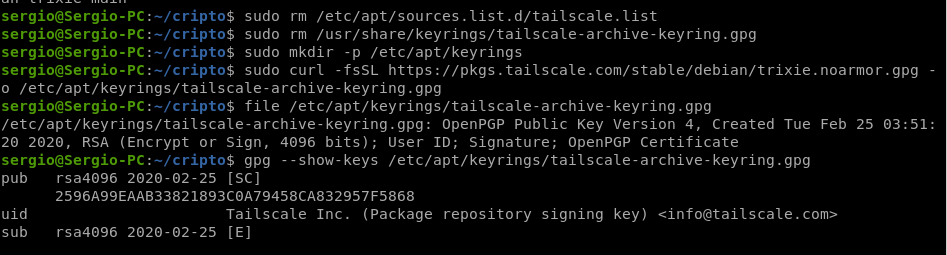

> Configura la línea del repositorio indicando de forma explícita la opción signed-by.

Creo el fichero tailscale.list con la línea del repositorio y signed-by apuntando a la clave:

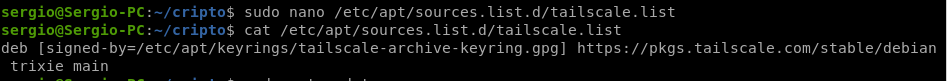

> Ejecuta apt update y comprueba que el repositorio se valida correctamente sin advertencias.

En el apt update sale el InRelease de pkgs.tailscale.com sin ningun aviso ni error de firma:

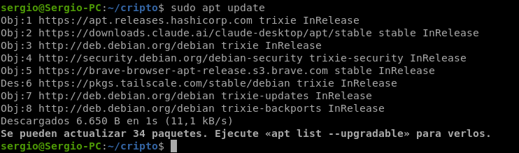

## Parte 5. Autenticación con SSH.

> Vamos a estudiar como la criptografía nos ayuda a cifrar las comunicaciones que hacemos utilizando el protocolo ssh, y cómo nos puede servir también para conseguir que un cliente se autentifique contra el servidor. Responde las siguientes cuestiones:

> Explica las fases del establecimiento de sesión SSH: ¿Para qué se usa la criptografía asimétrica en el saludo (handshake)? ¿Para qué se utiliza la criptografía simétrica más tarde?

1. Cliente y servidor se dicen qué versión de SSH y qué algoritmos soportan, y eligen unos comunes.

2. Intercambio de claves: con criptografía asimétrica (Diffie-Hellman) acuerdan una clave de sesión sin que viaje por la red. Además el servidor firma con su clave de host, y así el cliente comprueba que es el servidor de verdad.

3. A partir de ahí todo va cifrado con criptografía simétrica (por ejemplo AES o ChaCha20) usando esa clave de sesión, porque es mucho más rápida para cifrar todo el tráfico.

4. Ya con el canal cifrado, el usuario se autentica, con contraseña o con claves.

> Compara la autenticación mediante contraseña y  mediante un par de claves públicas y privadas. ¿Cómo se usa y para qué sirve ssh-keygen?

Con contraseña, la contraseña se manda (cifrada) al servidor, y se puede intentar adivinar a fuerza bruta. Con claves, el cliente demuestra que tiene la clave privada firmando un reto del servidor, y la privada nunca sale de mi ordenador. Es mas seguro y además no hay que escribir la contraseña cada vez.

ssh-keygen sirve para generar el par de claves. Por ejemplo:

```
ssh-keygen -t ed25519
ssh-copy-id usuario@servidor
```

Crea ~/.ssh/id_ed25519 (privada) y ~/.ssh/id_ed25519.pub (pública). La pública se copia al servidor, por ejemplo con ssh-copy-id. También sirve para otras cosas, como borrar una entrada de known_hosts con -R.

Lo he probado. Para no tocar mis claves de siempre, genero una clave nueva con otro nombre (-f):

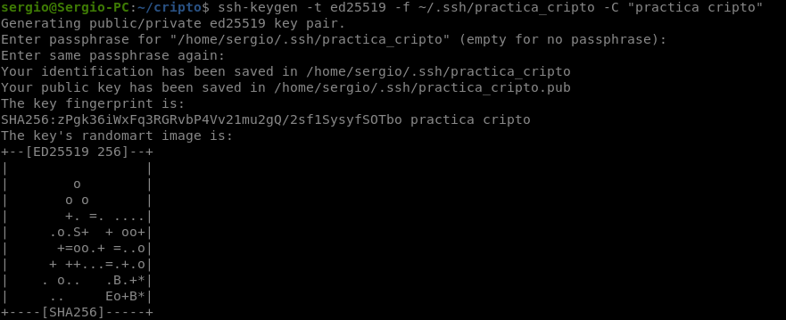

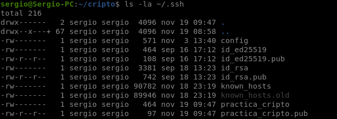

Copio la pública al usuario companero de mi máquina con ssh-copy-id (me pide su contraseña solo esta vez) y despues entro con la clave sin que me pida contraseña:

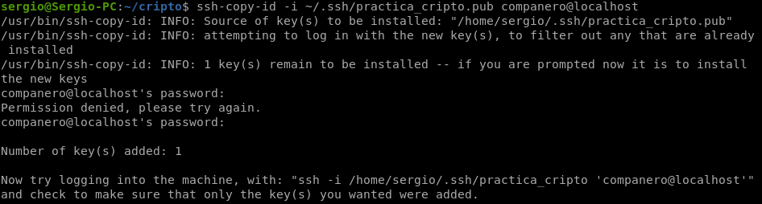


> ¿Qué función cumple el fichero ~/.ssh/know_hosts?

Guarda las claves públicas de los servidores a los que ya me he conectado. Cada vez que me conecto, ssh compara la clave que manda el servidor con la guardada, para saber que es el mismo servidor y no otro haciéndose pasar por él.

Así se ve el mio. Los nombres de los servidores salen cifrados (las líneas que empiezan por |1|) para que nadie pueda saber a qué máquinas me conecto, y detrás va el tipo y la clave pública de cada servidor:

```
sergio@Sergio-PC:~/cripto$ head -3 ~/.ssh/known_hosts
|1|Jxuag96XJt9jgks0YhlKfpdSohg=|QP5PZ+/rSKCra1gWjYDyOzYPIgw= ssh-ed25519 
AAAAC3NzaC1lZDI1NTE5AAAAIOMqqnkVzrm0SdG6UOoqKLsabgH5C9okWi0dh2l9GKJl
|1|KZtm2vJG8Q69Smakw6a5LvTzY7M=|TW1epHUhGrcGF9dB7yRLusRwjfk= ssh-rsa AAAAB3NzaC1yc2EAAAADAQABAA
ABgQCj7ndNxQowgcQnjshcLrqPEiiphnt+VTTvDP6mHBL9j1aNUkY4Ue1gvwnGLVlOhGeYrnZaMgRK6+PKCUXaDbC7qtbW8
gIkhL7aGCsOr/C56SJMy/BCZfxd1nWzAOxSDPgVsmerOBYfNqltV9/hWCqBywINIR+5dIg6JTJ72pcEpEjcYgXkE2YEFXV1
JHnsKgbLWNlhScqb2UmyRkQyytRLtL+38TGxkxCflmO+5Z8CSSNY7GidjMIZ7Q4zMjA2n1nGrlTDkzwDCsw+wqFPGQA179c
nfGWOWRVruj16z6XyvxvjJwbz0wQZ75XK5tKSb7FNyeIEs4TT4jk+S4dhPeAUC5y+bDYirYgM4GC7uEnztnZyaVWQ7B381A
K4Qdrwt51ZqExKbQpTUNn+EjqoTwvqNj4kqx5QUCI0ThS/YkOxJCXmPUWZbhjpCg56i+2aB6CmK2JGhn57K5mj0MNdBXA4/
WnwH6XoPWJzK5Nyu2zB3nAZp+S5hpQs+p1vN1/wsjk=
|1|kKfqeEpYIvOijbk0YFQqig5EuFE=|4qNqhe1I8ba6w2hMb33oNJn9rvk= ecdsa-sha2-nistp256 AAAAE2VjZHNhLX
NoYTItbmlzdHAyNTYAAAAIbmlzdHAyNTYAAABBBEmKSENjQEezOmxkZMy7opKgwFB9nkt5YRrYMjNuG5N87uRgg6CLrbo5w
AdT/y6v0mKV0U2w0WZ2YB/++Tpockg=
```

> ¿Qué significa este mensaje que aparece la primera vez que nos conectamos a un servidor?

```
$ ssh debian@172.22.200.74
The authenticity of host '172.22.200.74 (172.22.200.74)' can't be established.
ECDSA key fingerprint is SHA256:7ZoNZPCbQTnDso1meVSNoKszn38ZwUI4i6saebbfL4M.
Are you sure you want to continue connecting (yes/no)?
```

Que es la primera vez que me conecto a ese servidor y su clave no está en mi known_hosts, así que ssh no puede saber si es el servidor de verdad. Me enseña la huella de su clave para que la compruebe. Si digo yes, la guarda en known_hosts y no vuelve a preguntar.

> En ocasiones cuando estamos trabajando en el cloud, y reutilizamos una ip flotante nos aparece este mensaje:

```
$ ssh debian@172.22.200.74
@@@@@@@@@@@@@@@@@@@@@@@@@@@@@@@@@@@@@@@@@@@@@@@@@@@@@@@@@@@
@    WARNING: REMOTE HOST IDENTIFICATION HAS CHANGED!     @
@@@@@@@@@@@@@@@@@@@@@@@@@@@@@@@@@@@@@@@@@@@@@@@@@@@@@@@@@@@
IT IS POSSIBLE THAT SOMEONE IS DOING SOMETHING NASTY!
Someone could be eavesdropping on you right now (man-in-the-middle attack)!
It is also possible that a host key has just been changed.
The fingerprint for the ECDSA key sent by the remote host is
SHA256:W05RrybmcnJxD3fbwJOgSNNWATkVftsQl7EzfeKJgNc.
Please contact your system administrator.
Add correct host key in /home/jose/.ssh/known_hosts to get rid of this message.
Offending ECDSA key in /home/jose/.ssh/known_hosts:103
remove with:
ssh-keygen -f "/home/jose/.ssh/known_hosts" -R "172.22.200.74"
```

> ECDSA host key for 172.22.200.74 has changed and you have requested strict checking.

La clave que manda el servidor no coincide con la que tengo guardada en known_hosts para esa IP. Podría ser un ataque man-in-the-middle, por eso ssh no deja conectar.

En el cloud lo normal es que la IP flotante ahora la tenga otra instancia, que tiene otra clave. Si sé que es eso, borro la clave antigua con el comando que indica y vuelvo a conectar:

```
ssh-keygen -f "/home/jose/.ssh/known_hosts" -R "172.22.200.74"
```

> ¿Qué guardamos y para qué sirve el fichero en el servidor ~/.ssh/authorized_keys? ¿Qué permisos debe tener este archivo y el directorio ~/.ssh para que el servicio SSH funcione con seguridad?

En ~/.ssh/authorized_keys del servidor se guardan las claves públicas que pueden entrar con ese usuario, una por línea. Si mi clave pública está ahí, puedo entrar con mi clave privada sin contraseña.

El directorio ~/.ssh tiene que tener permisos 700 y el fichero authorized_keys 600 (solo el dueño). Si otros usuarios pudieran escribir ahí, podrían meter su clave y entrar como yo, y por eso SSH no la acepta si los permisos son demasiado abiertos.

```
chmod 700 ~/.ssh
chmod 600 ~/.ssh/authorized_keys
```

En la prueba de antes, ssh-copy-id dejó mi clave pública en el authorized_keys de companero, y ya con los permisos correctos (700 y 600):


