# CRIPTOGRAFÍA I

**PRÁCTICA: Cifrado con gpg y OpenSSL**

*Sergio Mesa Mejías*

En esta práctica cifro ficheros con gpg y OpenSSL: primero con cifrado simétrico (una sola contraseña), luego con cifrado asimétrico (par de claves pública y privada) y al final con cifrado híbrido, que mezcla los dos.

Como hago la práctica solo, he creado en mi máquina otro usuario llamado companero que hace de compañero, y usamos la carpeta /tmp/intercambio para pasarnos los ficheros.

## Parte 1. Cifrado simétrico

### Paso 1. Fichero de prueba

> Crea un fichero de texto llamado prueba.txt en un directorio creado previamente. Comprueba el tamaño y contenido del fichero.

Creo el directorio cripto y dentro el fichero prueba.txt. Ocupa 44 bytes y con cat veo lo que tiene dentro.

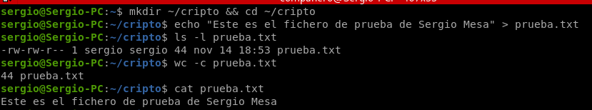

### Paso 2. Cifrado simétrico con gpg

> Cifra el fichero usando cifrado simétrico con gpg. ¿Qué parámetro tienes que usar? ¿Qué extensión tiene el fichero? ¿Qué pasa al leerlo con cat?

El parámetro es -c (tambien vale --symmetric). El fichero cifrado tiene la extensión .gpg. Al hacerle un cat salen símbolos raros, porque está en binario y ya no se puede leer el texto.

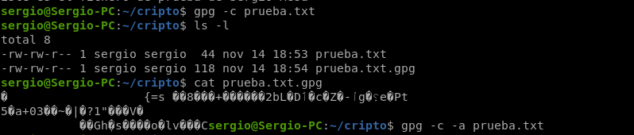

### Paso 3. Salida en texto con -a

> Cifra el fichero añadiendo la opción -a. ¿Qué extensión tiene? ¿Qué ha pasado con el texto?

Ahora la extensión es .asc. El texto sigue cifrado y no se entiende, pero ya no son símbolos raros sino letras y numeros normales, así que se puede copiar y pegar por ejemplo en un correo. También ocupa más que el .gpg.

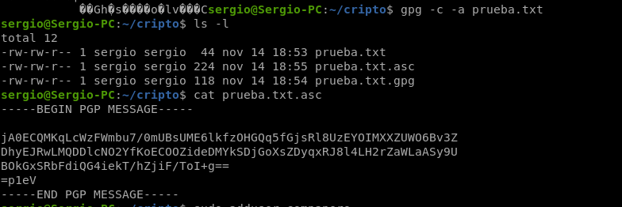

### Paso 4. Intercambio con un compañero

> Intercambia tu archivo cifrado con el de un compañero e intenta descifrarlo. ¿Qué necesitas saber?

El compañero cifra su fichero y me lo deja en /tmp/intercambio. Le he tenido que poner --pinentry-mode loopback porque entrando con su no le dejaba escribir la contraseña.

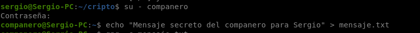

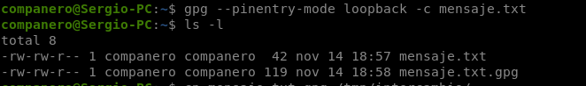


Y yo lo descifro desde mi usuario:

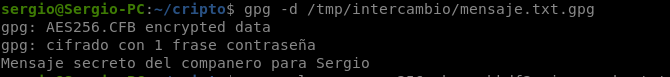

Necesito saber la contraseña que puso el compañero al cifrar, porque en el cifrado simétrico se usa la misma para cifrar y para descifrar.

### Paso 5. Cifrado simétrico con OpenSSL

> Repite el proceso con OpenSSL: `enc -aes-256-cbc -pbkdf2 -in fichero.txt -out fichero.txt.enc`. Explica los parámetros y el concepto de "Salt".

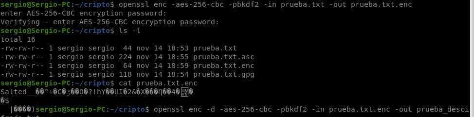

- **enc**: la orden de openssl para cifrar y descifrar con cifrado simétrico.
- **-aes-256-cbc**: el algoritmo, AES con clave de 256 bits en modo CBC (cifra por bloques).
- **-pbkdf2**: la forma de sacar la clave a partir de mi contraseña. Hace que probar contraseñas a lo bruto sea mucho mas lento.
- **-in**: el fichero que quiero cifrar.
- **-out**: el fichero donde se guarda lo cifrado.

El salt es un dato aleatorio que se mezcla con la contraseña antes de sacar la clave. Sirve para que la misma contraseña no dé siempre el mismo resultado. No es secreto, se guarda al principio del fichero (por eso en el cat se ve que empieza por `Salted__`).

### Paso 6. Descifrado con OpenSSL

> Descifra con openssl -d y comprueba que es igual al original.

Uso los mismos parámetros añadiendo -d y me pide la misma contraseña. Con diff compruebo que el fichero descifrado es igual que el original.

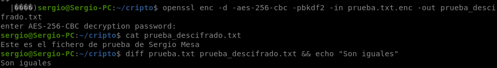

### Preguntas

> a) ¿Qué diferencia ves en el formato de salida por defecto entre gpg y openssl?

Los dos sacan un fichero binario, pero gpg guarda dentro información de cómo se ha cifrado, por eso al descifrar no tuve que decirle el algoritmo, y le pone él solo la extension .gpg. openssl solo guarda el salt y los datos cifrados, así que para descifrar tengo que poner yo los mismos parámetros que usé al cifrar.

> b) ¿Por qué dos archivos idénticos cifrados con la misma clave en OpenSSL pueden ser diferentes?

Por el salt. Cada vez que cifro se genera uno distinto, así que aunque el fichero y la contraseña sean los mismos el resultado cambia. Lo he comprobado cifrando otra vez prueba.txt y los hashes salen diferentes:

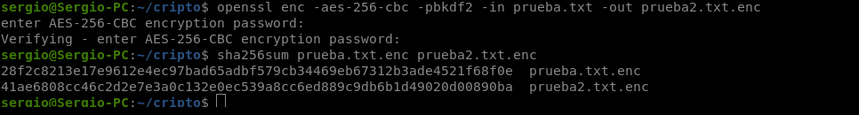

> c) Si tienes que compartir tu fichero cifrado con diez compañeros, ¿qué problema de seguridad se presenta?

Que les tengo que pasar la contraseña a los diez. Cuanta más gente la sabe más fácil es que se filtre, y si uno se la dice a alguien de fuera ya puede leer el fichero cualquiera y no sabría quién ha sido.

## Parte 2. Cifrado asimétrico

### Paso 1. Generación de claves

> Genera un par de claves. ¿En qué directorio se guardan las claves de un usuario?

Genero mis claves con `gpg --gen-key` poniendo mi nombre y mi correo. Se guardan en el directorio .gnupg dentro del home, en mi caso /home/sergio/.gnupg. Las públicas están en pubring.kbx y las privadas en la carpeta private-keys-v1.d.

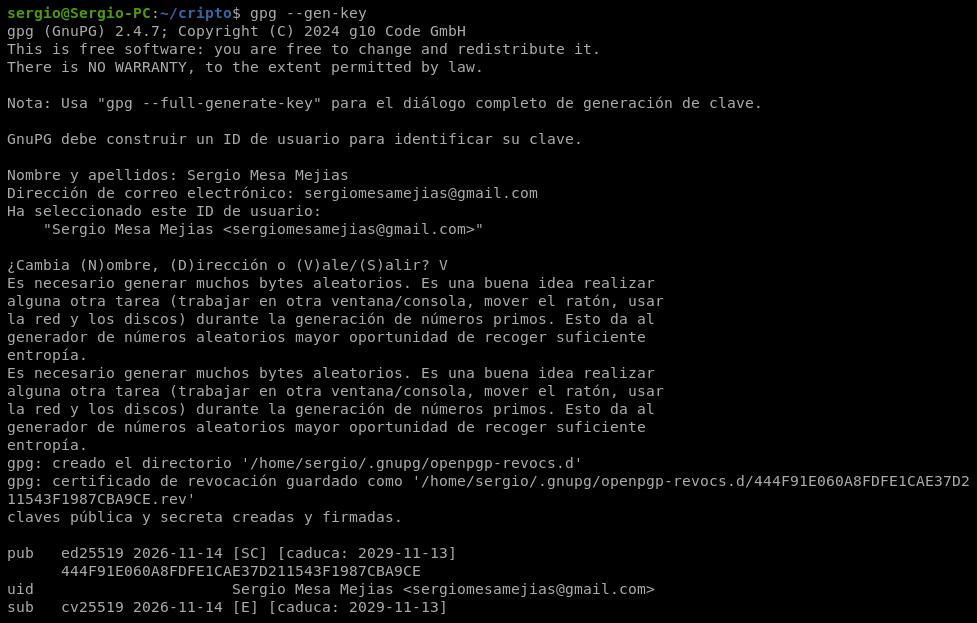

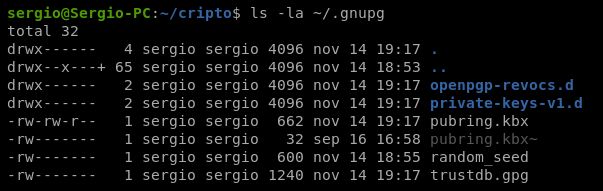

> Lista las claves públicas y explica los datos. ¿Cómo las habrías generado para que tuvieran 1 mes de validez?

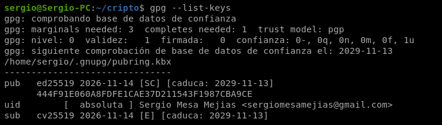

- **pub**: la clave pública principal. ed25519 es el algoritmo, luego va la fecha en que se creó, [SC] quiere decir que sirve para firmar y certificar, y al final la fecha en que caduca.
- La línea larga de letras y numeros es la **huella**, que identifica a la clave.
- **uid**: el nombre y el correo del dueño. Pone [absoluta] porque es mi propia clave.
- **sub**: la subclave, la que se usa para cifrar ([E]).

Para que tuviera 1 mes de validez tendría que haberla generado con `gpg --full-generate-key`, que pregunta cuánto tiempo va a ser válida, y ahí poner 1m.

> Lista las claves privadas.

Con `gpg --list-secret-keys`. Sale lo mismo pero con sec y ssb en vez de pub y sub.

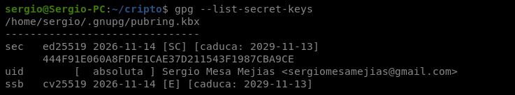

### Paso 2. Importación y exportación de claves públicas

> Exporta tu clave pública en formato ASCII y envíala al compañero.

Exporto mi clave pública con -a para que salga en texto y la guardo en sergio_mesa.asc. Se la paso al compañero dejándola en /tmp/intercambio, que sería como mandársela por correo.

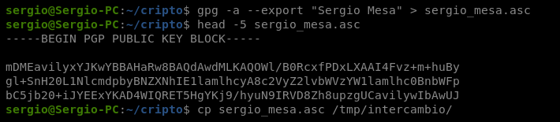

> Importa la clave pública de tu compañero.

El compañero genera sus claves, me deja su clave pública e importa la mía:

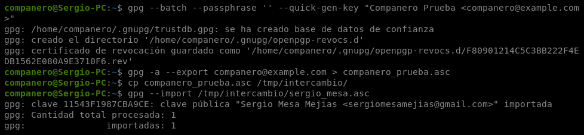

Y yo importo la suya:

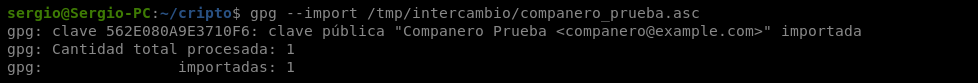

> Comprueba que las claves están en el keyring.

Con `gpg --list-keys` ya salen las dos. La suya pone [desconocida] porque todavia no he dicho cuánto confío en ella:

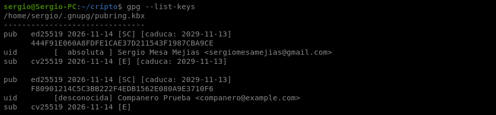

Al compañero le pasa igual pero al revés:

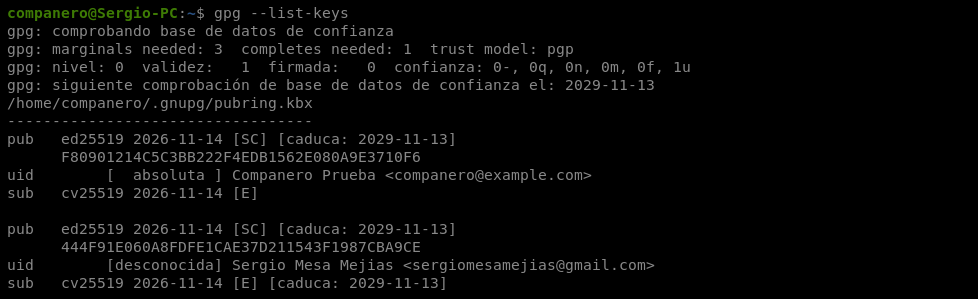

### Paso 3. Cifrado asimétrico con claves públicas

> Cifra un archivo y envíaselo a un compañero.

Cifro secreto_sergio.txt con la clave pública del compañero (-e para cifrar y -r para decir a quién va). Me avisa de que no es seguro que la clave sea suya porque no la he verificado, y le digo que sí.

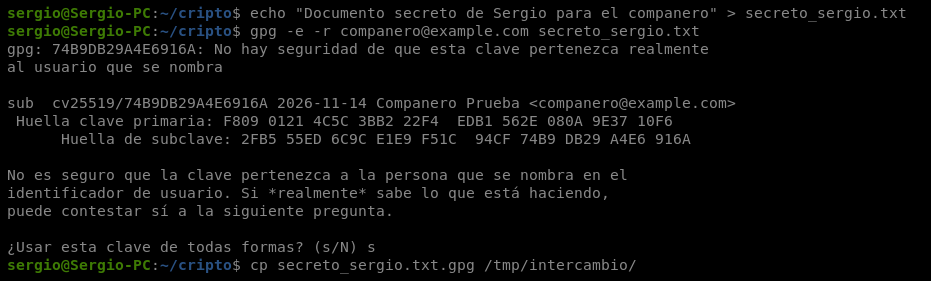

> Tu compañero te manda un archivo cifrado y lo descifráis los dos.

El compañero hace lo mismo con mi clave pública:

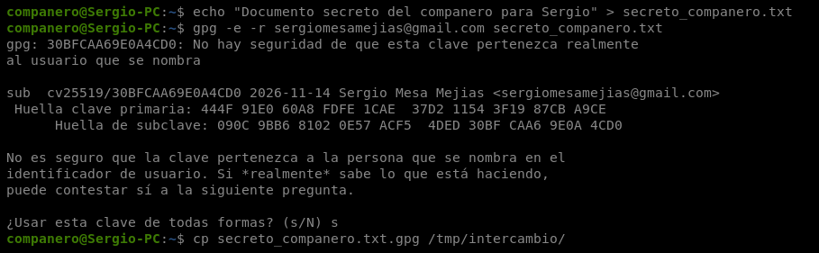

Él descifra el mío y yo el suyo. Solo hace falta `gpg -d`, porque usa él solo la clave privada:

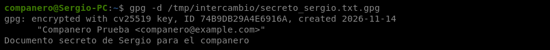

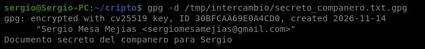

> Envía el documento a alguien que no estaba en los destinatarios.

He creado otro usuario (intruso) que no estaba en los destinatarios. No puede descifrarlo porque no tiene la clave privada del compañero:

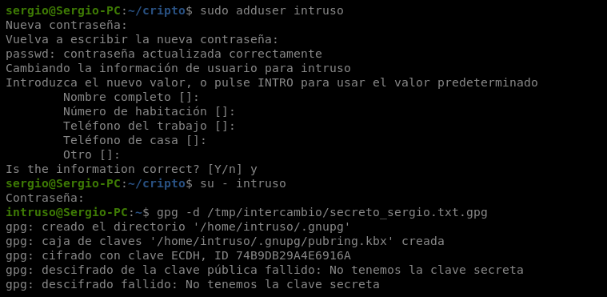

> Indica los comandos para borrar las claves públicas y privadas.

Primero hay que borrar la privada y despues la pública, si no gpg no deja:

```
gpg --delete-secret-keys sergiomesamejias@gmail.com
gpg --delete-keys sergiomesamejias@gmail.com
gpg --delete-keys companero@example.com
```

No los he ejecutado porque las claves me hacen falta para el paso siguiente.

### Paso 4. Servidor público de claves

> Genera la clave de revocación.

Con --gen-revoke genero el certificado de revocación y lo guardo en revocacion_sergio.asc. Si algún día pierdo la clave o me la roban, importo ese fichero y lo subo al servidor para que la clave quede anulada.

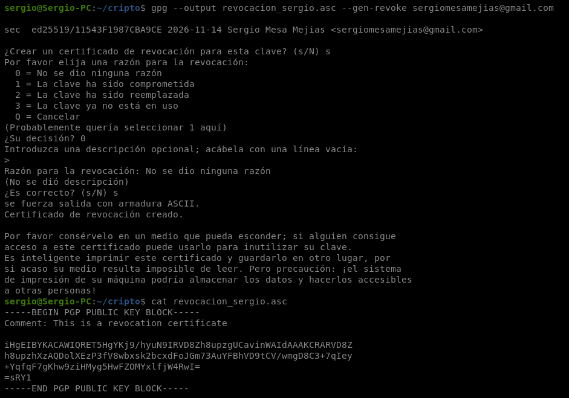

> Exporta tu clave pública a un servidor de claves.

Subo mi clave a keyserver.ubuntu.com con --send-keys y la huella. El compañero sube también la suya.

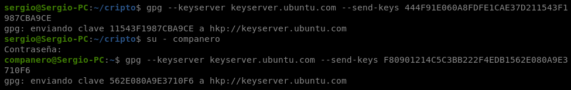

> Borra la clave de un compañero e impórtala del servidor.

Borro la clave del compañero y compruebo que ya no está:

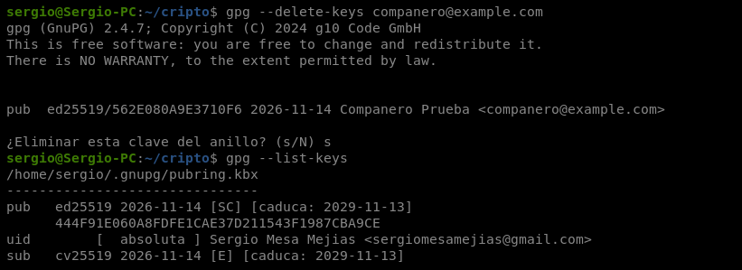

La bajo del servidor con --recv-keys y su huella, y vuelve a aparecer:

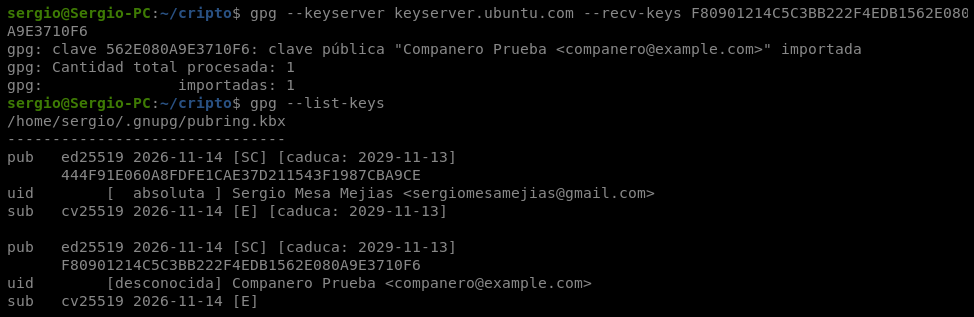

### Paso 5. Cifrado asimétrico con OpenSSL

> Genera una clave privada RSA de 4096 bits protegida con password y saca la pública.

Con -aes256 me pide una contraseña para proteger la clave privada. Luego saco la pública con -pubout:

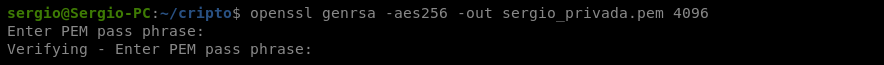

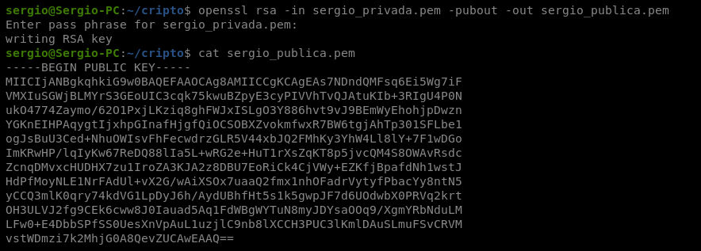

> Intercambia las claves públicas, cifra un fichero y descifra el que te manden.

Le dejo mi pública en la carpeta compartida y el compañero hace lo mismo con la suya:

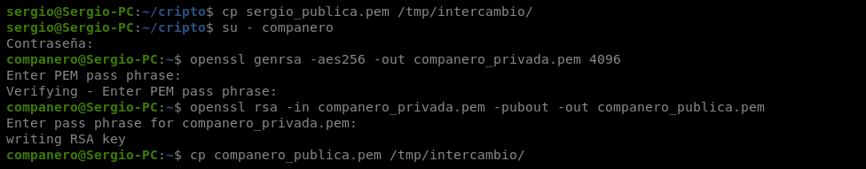

Cifro un mensaje con su pública y él cifra otro con la mía:

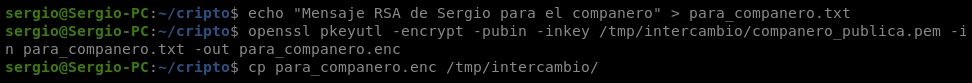

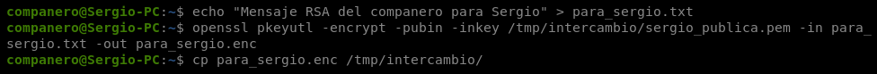

Yo lo descifro con mi clave privada, que me pide su contraseña:

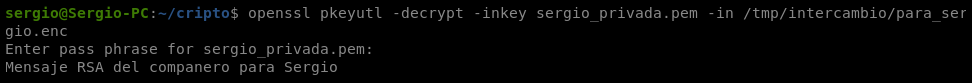

> Intenta cifrar un fichero de más de 50 MB con la clave pública. ¿Qué problema hay?

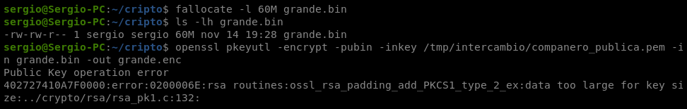

No deja y da el error data too large for key size. RSA solo puede cifrar datos más pequeños que la propia clave (con 4096 bits, unos 500 bytes), así que un fichero de 60 MB no cabe. Por eso el cifrado asimétrico no se usa directamente con ficheros grandes, y además seria muy lento.

## Parte 3. Cifrado híbrido con OpenSSL

El cifrado híbrido junta los dos: el fichero se cifra con una clave simétrica (rápido) y esa clave se cifra con RSA (seguro para mandarla).

> Genera una clave AES-256 aleatoria con openssl rand.

Genero 32 bytes aleatorios (256 bits) y los guardo en clave_aes.key:

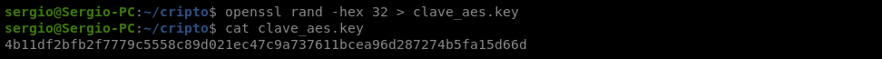

> Cifra el fichero grande con esa clave simétrica.

Ahora sí funciona y es rápido:

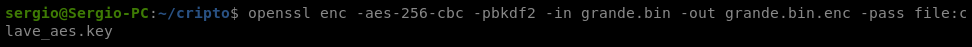

> Cifra la clave simétrica con la clave pública RSA del destinatario.

Como la clave es muy pequeña, aquí RSA sí puede:

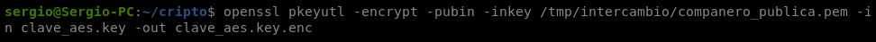

> Envía el fichero cifrado y la clave cifrada.

Le dejo grande.bin.enc y clave_aes.key.enc en la carpeta compartida, y saco el hash del original para comprobarlo luego. Aunque alguien coja la clave cifrada no pasa nada, porque solo se puede descifrar con la clave privada del compañero.

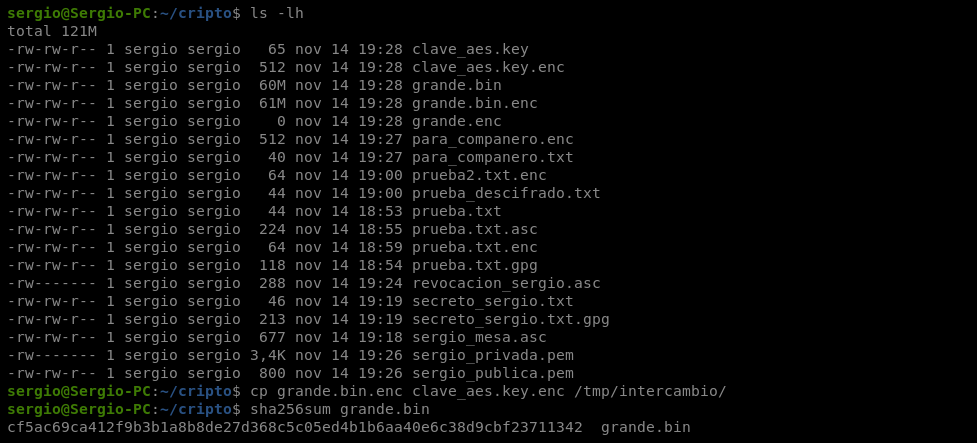

> Muestra cómo el destinatario hace el proceso inverso.

El compañero descifra primero la clave simétrica con su clave privada RSA, y con esa clave descifra el fichero grande. El hash le sale igual que el mío, así que el fichero es el mismo que el original.

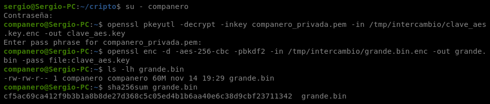
