# SAD Práctica 1 — Integridad de ficheros

Alumno: Sergio — Alumno 2

## 1. Objetivo y escenario

Voy a detectar modificaciones, creaciones, eliminaciones y cambios de permisos en los archivos. Utilizo tres máquinas en la red `default`: `servidor-seg` (Debian con Nginx y PostgreSQL), `debian13` (cliente Linux) y `windows-seguridad` (cliente Windows).

Utilizo AIDE en las dos máquinas Linux y un comprobador de hashes y permisos en PowerShell para Windows. AIDE no se instala de forma nativa con estos comandos en Windows. Las comprobaciones serán periódicas, no en tiempo real. Detectar un cambio no implica que sea malicioso y no lo bloquea ni lo repara automáticamente.

Esta guía contiene pasos para realizar las pruebas. Solo describo una prueba como completada después de ejecutarla y adjuntar su resultado real. Los valores `TU_...` deben sustituirse por datos reales.

## 2. Instalación de AIDE en el servidor

Ejecuto los comandos de este apartado dentro de `servidor-seg`.

```bash
sudo apt update
sudo apt install aide aide-common msmtp ca-certificates -y
sudo aide --version
```

Instalo AIDE y el cliente SMTP que utilizaré para enviar informes por correo. Si msmtp pregunta por AppArmor, mantengo su opción predeterminada; si posteriormente impide el envío, revisaré los registros en lugar de desactivar protecciones a ciegas.

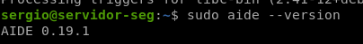

## 3. Archivos de prueba y configuración

Creo una carpeta para pruebas sin alterar inicialmente los servicios.

```bash
sudo install -d -m 0755 /opt/sad-integridad
printf 'Contenido original\n' | sudo tee /opt/sad-integridad/prueba.txt
sudo chmod 0644 /opt/sad-integridad/prueba.txt
sudo install -d -m 0700 /var/lib/aide-sad /var/log/aide-sad
```

Creo una configuración propia para no depender de las rutas predeterminadas de cada versión de Debian. No sobrescribo `/etc/aide/aide.conf`.

```bash
sudo nano /etc/aide/sad.conf
```

Escribo este contenido:

```text
database_in=file:/var/lib/aide-sad/base.db
database_out=file:/var/lib/aide-sad/nueva.db
gzip_dbout=no
report_url=stdout
report_level=changed_attributes

SAD = p+u+g+s+m+sha256

/opt/sad-integridad SAD
/etc/nginx SAD
/var/www/html SAD
/etc/postgresql SAD
```

Compruebo la configuración:

```bash
sudo aide --config=/etc/aide/sad.conf --config-check
```

La regla `SAD` comprueba permisos (`p`), propietario (`u`), grupo (`g`), tamaño (`s`), fecha de modificación (`m`) y contenido mediante SHA-256. Vigilo la web y las configuraciones de Nginx y PostgreSQL. Si mi sitio utiliza otra raíz web, añado su ruta real. No monitorizo los archivos de datos vivos de PostgreSQL ni los logs, porque cambian durante el funcionamiento normal. Tampoco incluyo la base de AIDE entre los archivos vigilados.

> 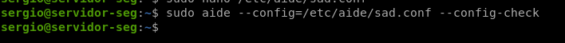

## 4. Referencia inicial y primera comprobación

Creo la referencia cuando considero legítimo el estado inicial:

```bash
sudo aide --config=/etc/aide/sad.conf --init
sudo cp /var/lib/aide-sad/nueva.db /var/lib/aide-sad/base.db
sudo chmod 0600 /var/lib/aide-sad/base.db
sudo aide --config=/etc/aide/sad.conf --check
```

La última orden debería mostrar que no existen diferencias. Si aparecen cambios, los reviso antes de continuar. La referencia está protegida por permisos, pero un atacante con control de root podría alterarla; en producción conservaría además una copia protegida fuera del equipo.

> 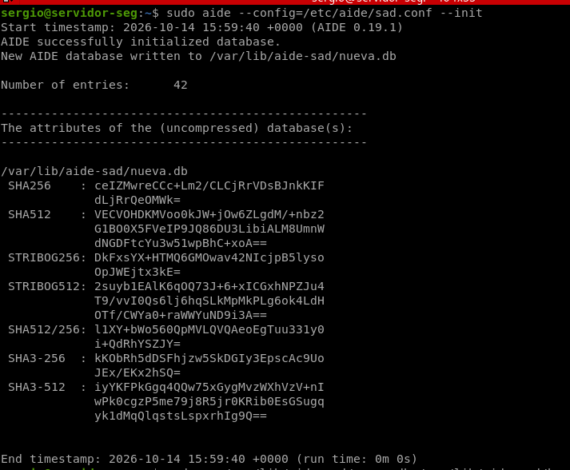
> 
> 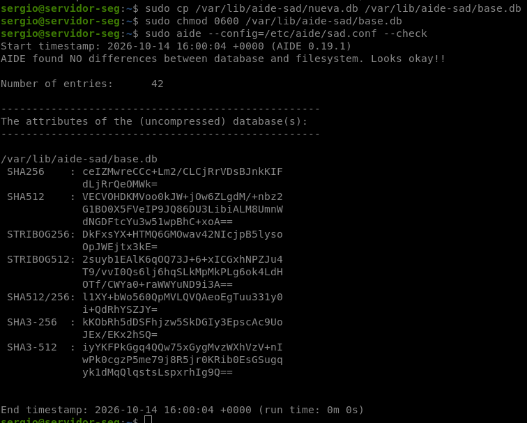

## 5. Demostraciones de detección

Ejecutaré cada prueba por separado y conservaré la salida completa relevante.

### 5.1. Modificación de contenido

```bash
printf 'Cambio controlado\n' | sudo tee -a /opt/sad-integridad/prueba.txt
sudo aide --config=/etc/aide/sad.conf --check
```

Busco el archivo en la sección de modificados y los atributos que han cambiado.

> 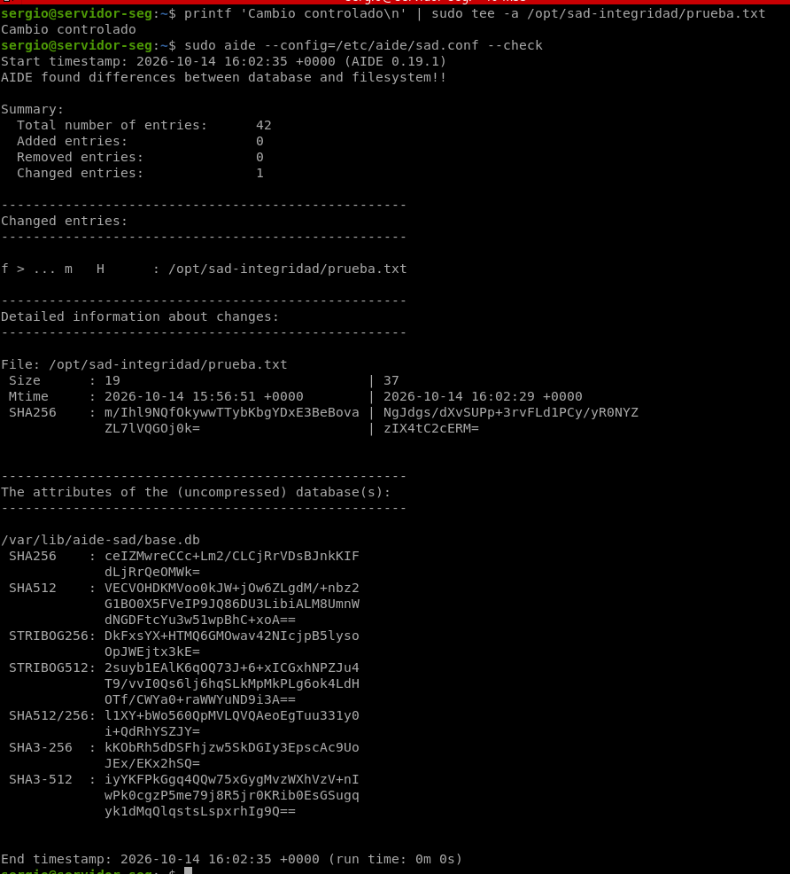

### 5.2. Cambio de permisos

```bash
sudo chmod 0600 /opt/sad-integridad/prueba.txt
sudo aide --config=/etc/aide/sad.conf --check
```

Busco la diferencia de permisos. El cambio anterior también seguirá apareciendo porque todavía no he actualizado la referencia.

> 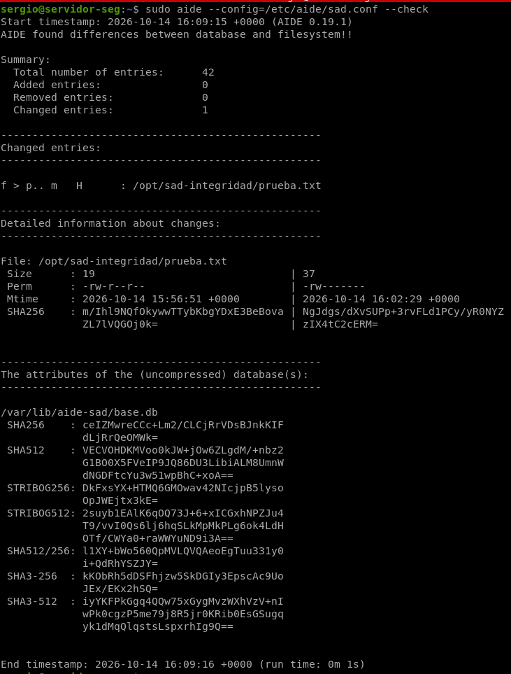

### 5.3. Creación de archivo

```bash
printf 'Archivo añadido\n' | sudo tee /opt/sad-integridad/nuevo.txt
sudo aide --config=/etc/aide/sad.conf --check
```

Busco `nuevo.txt` entre los archivos añadidos.

> 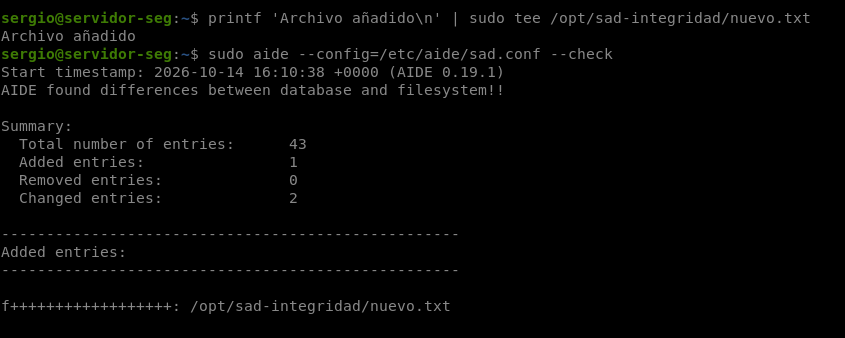

### 5.4. Eliminación de archivo

```bash
sudo rm /opt/sad-integridad/prueba.txt
sudo aide --config=/etc/aide/sad.conf --check
```

Busco `prueba.txt` entre los archivos eliminados. Solo elimino este archivo creado para la práctica.

> 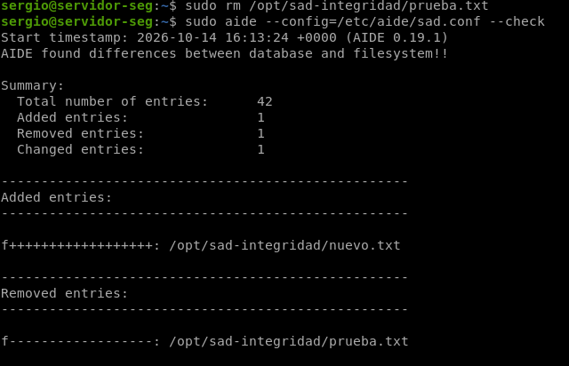

### 5.5. Restauración y aceptación controlada

```bash
printf 'Contenido original\n' | sudo tee /opt/sad-integridad/prueba.txt
sudo chmod 0644 /opt/sad-integridad/prueba.txt
sudo rm /opt/sad-integridad/nuevo.txt
sudo aide --config=/etc/aide/sad.conf --check
```

Aunque restauro el contenido, pueden quedar diferencias en fechas o directorios. Después de revisar que todos los cambios restantes son legítimos, actualizo la referencia:

```bash
sudo aide --config=/etc/aide/sad.conf --update
sudo cp /var/lib/aide-sad/base.db /var/lib/aide-sad/base.db.bak
sudo cp /var/lib/aide-sad/nueva.db /var/lib/aide-sad/base.db
sudo chmod 0600 /var/lib/aide-sad/base.db
sudo aide --config=/etc/aide/sad.conf --check
```

No incorporo cambios desconocidos automáticamente: eso podría ocultar una modificación no autorizada.

> 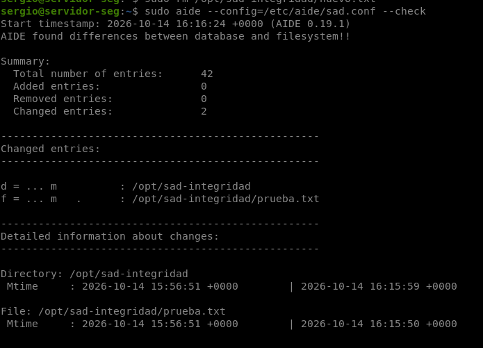
> 
> He restaurado el contenido y los permisos de prueba.txt y he eliminado nuevo.txt. AIDE ya no detecta diferencias de contenido ni permisos, pero siguen apareciendo cambios en las fechas de modificación del archivo y del directorio. Esto es normal, porque restaurar el contenido no recupera automáticamente sus fechas originales.
> 
> 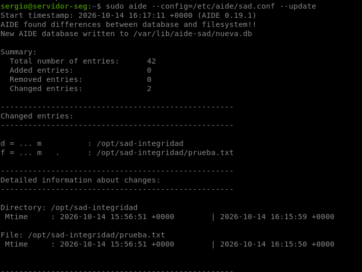
> 
> Tras comprobar que las diferencias restantes corresponden a mis pruebas, he generado una nueva referencia. He guardado una copia de la base anterior, he sustituido la referencia activa por la nueva y he limitado sus permisos a lectura y escritura del propietario.
> 
> 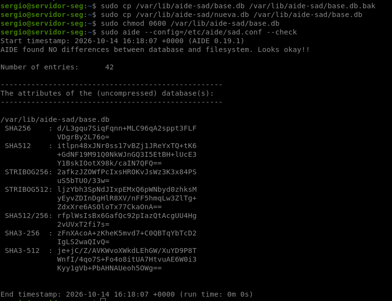
> 
> Finalmente, he ejecutado otra comprobación. AIDE no ha encontrado diferencias, lo que confirma que el estado actual de los archivos coincide con la nueva referencia aceptada.

## 

# 6. Aplicación real a Nginx

## 6.1. Creación de la página y referencia inicial

Creo una página adicional sin sobrescribir la principal:

```bash
printf '<h1>Prueba SAD original</h1>\n' | sudo tee /var/www/html/sad-integridad.html
sudo aide --config=/etc/aide/sad.conf --check
```

Reviso que las diferencias sean únicamente las esperadas por la creación de la página. Si aparecen cambios desconocidos, no continúo con la actualización.

Genero una nueva referencia, guardo la anterior y activo la nueva:

```bash
sudo aide --config=/etc/aide/sad.conf --update
sudo cp /var/lib/aide-sad/base.db /var/lib/aide-sad/base.db.pre-web.bak
sudo cp /var/lib/aide-sad/nueva.db /var/lib/aide-sad/base.db
sudo chmod 0600 /var/lib/aide-sad/base.db
sudo aide --config=/etc/aide/sad.conf --check
```

Compruebo que aparece el mensaje `NO differences` antes de modificar la página.

> 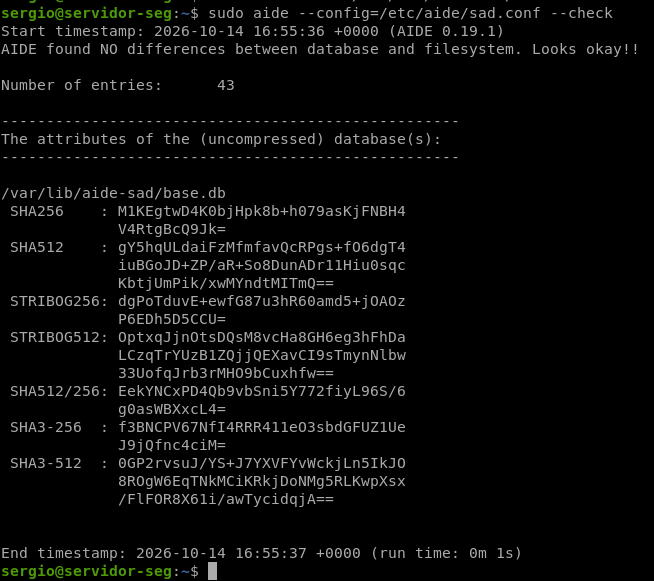

### 6.2. Modificación de la página web

Cambio el contenido y ejecuto la comprobación:

```bash
printf '<h1>Contenido modificado para SAD</h1>\n' | sudo tee /var/www/html/sad-integridad.html
sudo aide --config=/etc/aide/sad.conf --check
```

Busco la página en `Changed entries`, no en `Added entries`. Reviso las diferencias de tamaño, fecha y SHA-256 que muestre el informe.

> 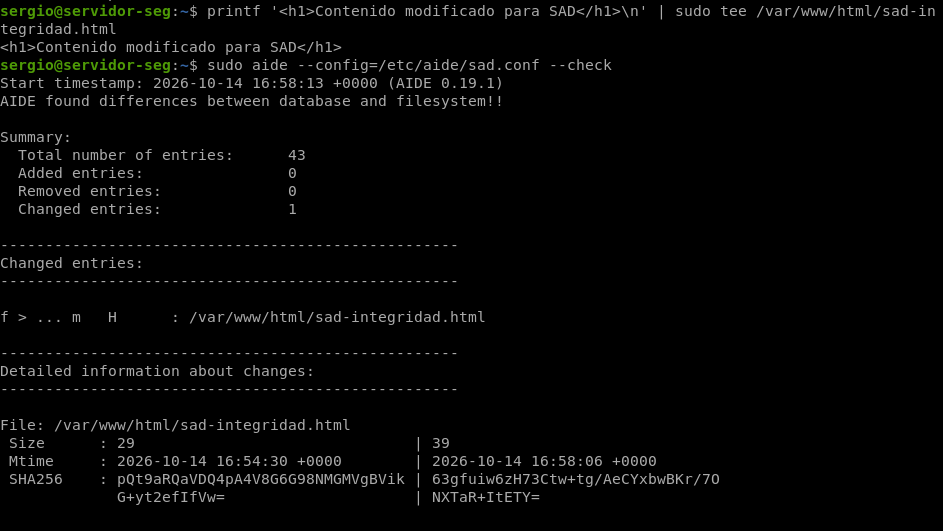

Desde la terminal de Windows consulto la página de Nginx y compruebo el contenido devuelto.

```text
http://192.168.122.130/sad-integridad.html
```

Desde el cliente Linux consulto la página:

```bash
curl http://192.168.122.130/sad-integridad.html
```

> 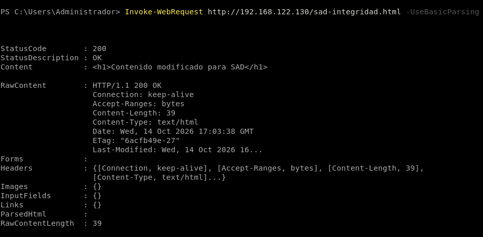
> 
> 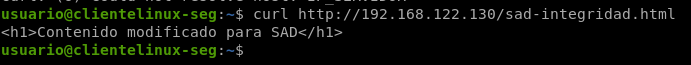

### 6.3. Modificación de la configuración

Guardo una copia de la configuración antes de modificarla:

```bash
sudo cp -p /etc/nginx/nginx.conf /root/nginx.conf.sad.bak
```

Añado un comentario, compruebo la sintaxis y ejecuto AIDE:

```bash
printf '\n# Prueba controlada SAD\n' | sudo tee -a /etc/nginx/nginx.conf
sudo nginx -t
sudo aide --config=/etc/aide/sad.conf --check
```

No necesito recargar Nginx para detectar el cambio del archivo. El informe muestra también el cambio de la página, que todavía no he restaurado.

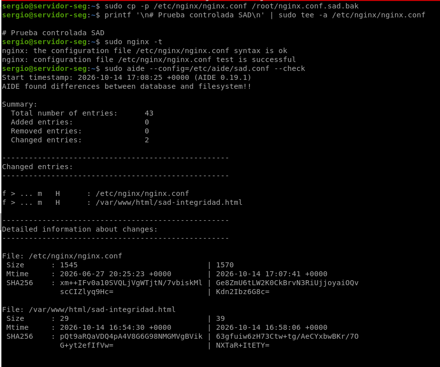

### 6.4. Restauración y comprobación

Restauro la configuración y el contenido original de la página:

```bash
sudo cp -p /root/nginx.conf.sad.bak /etc/nginx/nginx.conf
printf '<h1>Prueba SAD original</h1>\n' | sudo tee /var/www/html/sad-integridad.html
sudo nginx -t
sudo aide --config=/etc/aide/sad.conf --check
```

Compruebo que ya no hay diferencias de contenido. Puede quedar un cambio de fecha de modificación en la página, porque la he vuelto a escribir.

> 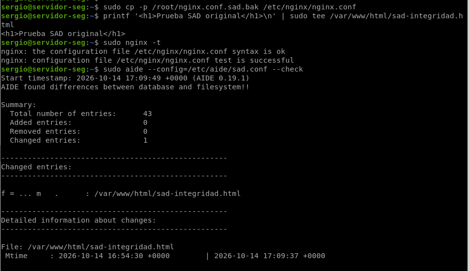

### 6.5. Actualización final

Solo después de revisar que las diferencias restantes son legítimas, actualizo la referencia:

```bash
sudo aide --config=/etc/aide/sad.conf --update
sudo cp /var/lib/aide-sad/base.db /var/lib/aide-sad/base.db.pre-restauracion-web.bak
sudo cp /var/lib/aide-sad/nueva.db /var/lib/aide-sad/base.db
sudo chmod 0600 /var/lib/aide-sad/base.db
sudo aide --config=/etc/aide/sad.conf --check
```

> 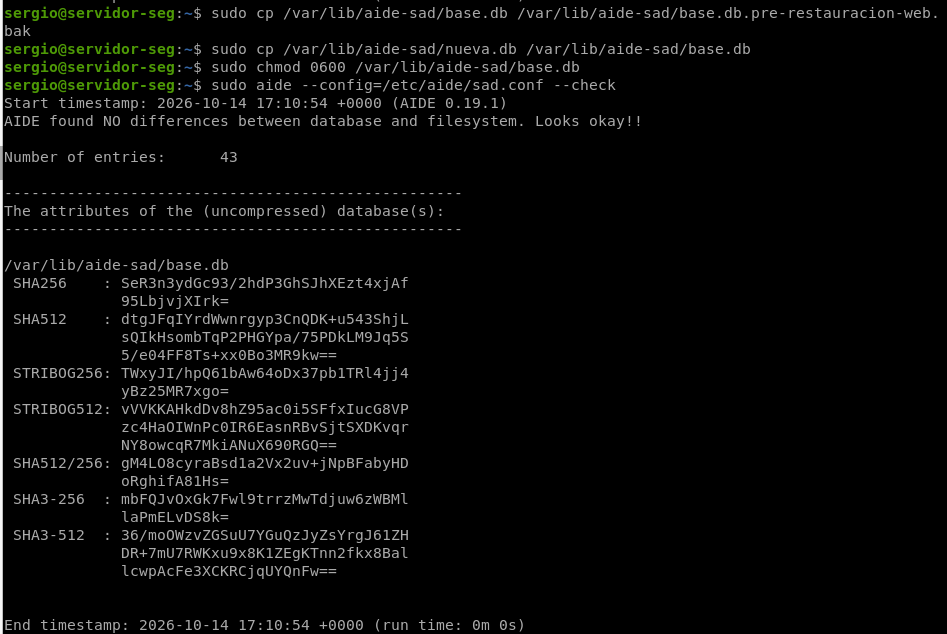

### Resultado

He comprobado la detección de cambios en la página y en la configuración de Nginx. Después he restaurado los archivos y actualizado la referencia tras revisar las diferencias legítimas. La coincidencia final con la referencia no demuestra por sí sola que todo el sistema sea seguro.

## 7. Aplicación real a PostgreSQL

Localizo la configuración del clúster predeterminado:

```bash
sergio@servidor-seg:~$ sudo -u postgres psql -Atc 'SHOW config_file;'
/etc/postgresql/17/main/postgresql.conf
```

Si tengo varios clústeres, identifico primero el correcto con `pg_lsclusters` y especifico su puerto en `psql`. Copio la ruta real del resultado:

```bash
sergio@servidor-seg:~$ PGCONF='/etc/postgresql/17/main/postgresql.conf'
sergio@servidor-seg:~$ sudo cp -p "$PGCONF" /root/postgresql.conf.sad.bak
sergio@servidor-seg:~$ printf '\n# Prueba controlada SAD\n' | sudo tee -a "$PGCONF"

# Prueba controlada SAD
sergio@servidor-seg:~$ sudo aide --config=/etc/aide/sad.conf --check
```

He añadido solo un comentario, sin cambiar autenticación ni conexiones. La ruta debe estar dentro de las vigiladas; si no lo está, la añado y preparo previamente una referencia legítima.

> 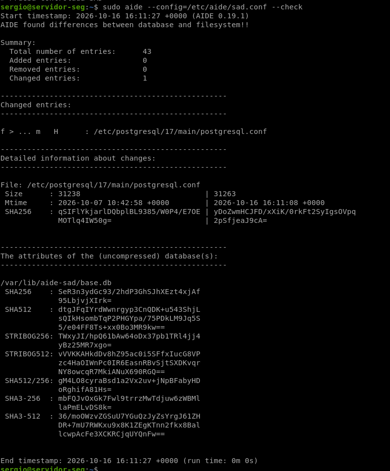

Restauro el archivo:

```bash
sergio@servidor-seg:~$ sudo cp -p /root/postgresql.conf.sad.bak "$PGCONF"
sergio@servidor-seg:~$ sudo aide --config=/etc/aide/sad.conf --check
```

Compruebo el acceso a la base desde mis dos clientes con sus usuarios de prueba. No publico sus contraseñas. Actualizo la referencia si quedan únicamente diferencias legítimas.

> 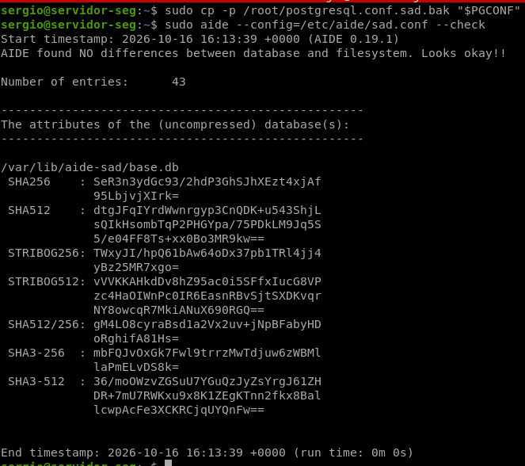

## 8. Correo electrónico

Configuro un servidor SMTP de una cuenta que puedo utilizar. Los datos siguientes son marcadores, no una cuenta válida. Si mi proveedor no admite contraseña SMTP, utilizo su método admitido o un relay autorizado; no desactivo TLS.

```bash
sudo nano /etc/msmtprc
```

```text
sergio@servidor-seg:~$ sudo cat /etc/msmtprc
defaults
auth on
tls on
tls_starttls on
tls_trust_file /etc/ssl/certs/ca-certificates.crt
logfile /var/log/aide-sad/msmtp.log

account sad
host smtp.gmail.com
port 587
from sergiomesamejias@gmail.com
user sergiomesamejias@gmail.com
passwordeval "cat /root/.sad-smtp-secret"

account default : sad
```

Para SMTP con TLS implícito en 465, utilizo `port 465` y `tls_starttls off`, manteniendo `tls on`. Elijo el modo exigido por mi proveedor.

```bash
sudo nano /root/.sad-smtp-secret
```

Escribo únicamente la contraseña SMTP o contraseña de aplicación (la contraseña la he generado activando la verificacion en dos pasos con la cuenta de google que pertenece a la de correo, tras hacer eso genero una contraseña de aplicacion). No la capturo ni la incluyo en la memoria. El archivo sigue conteniendo un secreto en texto plano, protegido con permisos; para producción utilizaría un mecanismo de gestión de secretos adecuado.

```bash
sudo chmod 0600 /etc/msmtprc /root/.sad-smtp-secret
sudo nano /etc/aide/sad-mail.env
```

```text
sergio@servidor-seg:~$ sudo cat /etc/aide/sad-mail.env 
MAIL_FROM='sergiomesamejias@gmail.com'
MAIL_TO='sergiomesamejias@gmail.com'
```

```bash
sergio@servidor-seg:~$ sudo chmod 0600 /etc/aide/sad-mail.env
sergio@servidor-seg:~$ sudo bash -c '. /etc/aide/sad-mail.env; printf "From: %s\nTo: %s\nSubject: Prueba SAD\n\nPrueba de correo de integridad.\n" "$MAIL_FROM" "$MAIL_TO" | /usr/bin/msmtp -- "$MAIL_TO"'
msmtp: cannot log to /var/log/aide-sad/msmtp.log: cannot open: Permission denied
msmtp: log info was: host=smtp.gmail.com tls=on auth=on user=sergiomesamejias@gmail.com from=sergiomesamejias@gmail.com recipients=sergiomesamejias@gmail.com mailsize=212 smtpstatus=250 smtpmsg='250 2.0.0 OK  1792168790 5b1f17b1804b1-4a1c8ad6245sm77558495e9.3 - gsmtp' exitcode=EX_OK
```

Compruebo la recepción antes de automatizar.

> 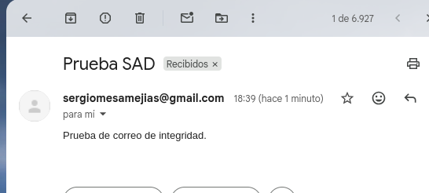

## 9. Automatización y uso desatendido en Linux

Creo un script que guarda el informe y envía correo cuando hay cambios o errores.

```bash
sudo nano /usr/local/sbin/sad-aide-check
```

```bash
sergio@servidor-seg:~$ sudo nano /usr/local/sbin/sad-aide-check
sergio@servidor-seg:~$ sudo cat /usr/local/sbin/sad-aide-check
#!/bin/bash
set -u
umask 077
. /etc/aide/sad-mail.env
exec 9>/run/sad-aide.lock
flock -n 9 || exit 0
informe="/var/log/aide-sad/$(date +%Y%m%d-%H%M%S).txt"
/usr/bin/aide --config=/etc/aide/sad.conf --check > "$informe" 2>&1
rc=$?
if [ "$rc" -ne 0 ]; then
    if [ "$rc" -le 7 ]; then
        asunto="SAD: cambios de integridad en $(hostname)"
    else
        asunto="SAD: error de comprobacion en $(hostname)"
    fi
    {
        printf 'From: %s\nTo: %s\nSubject: %s\nContent-Type: text/plain; charset=UTF-8\n\n' "$MAIL_FROM" "$MAIL_TO" "$asunto"
        printf 'Fecha: %s\nCodigo AIDE: %s\n\n' "$(date -Is)" "$rc"
        cat "$informe"
    } | /usr/bin/msmtp -- "$MAIL_TO" || exit 20
fi
if [ "$rc" -gt 7 ]; then exit "$rc"; fi
exit 0
```

```bash
sudo chmod 0750 /usr/local/sbin/sad-aide-check
sudo nano /etc/systemd/system/sad-aide.service
```

```ini
sergio@servidor-seg:~$ sudo chmod 0750 /usr/local/sbin/sad-aide-check
sergio@servidor-seg:~$ sudo nano /etc/systemd/system/sad-aide.service
sergio@servidor-seg:~$ sudo cat /etc/systemd/system/sad-aide.service
[Unit]
Description=Comprobacion SAD de integridad con AIDE
[Service]
Type=oneshot
ExecStart=/usr/local/sbin/sad-aide-check
```

```bash
sudo nano /etc/systemd/system/sad-aide.timer
```

```ini
sergio@servidor-seg:~$ sudo nano /etc/systemd/system/sad-aide.timer
sergio@servidor-seg:~$ sudo cat /etc/systemd/system/sad-aide.timer
[Unit]
Description=Comprobacion periodica SAD
[Timer]
OnBootSec=2min
OnUnitActiveSec=5min
Unit=sad-aide.service
[Install]
WantedBy=timers.target
```

```bash
sergio@servidor-seg:~$ sudo systemctl daemon-reload
sergio@servidor-seg:~$ sudo systemctl enable --now sad-aide.timer
Created symlink '/etc/systemd/system/timers.target.wants/sad-aide.timer' → '/etc/systemd/system/sad-aide.timer'.
sergio@servidor-seg:~$ sudo systemctl list-timers sad-aide.timer
NEXT                            LEFT LAST                         PASSED UNIT           ACTIVATES       
Fri 2026-10-16 16:51:30 UTC 4min 46s Fri 2026-10-16 16:46:30 UTC 13s ago sad-aide.timer sad-aide.service

1 timers listed.
Pass --all to see loaded but inactive timers, too.
sergio@servidor-seg:~$ 
```

La comprobación se ejecuta aproximadamente cada cinco minutos mientras el sistema está encendido. No es detección en tiempo real ni garantiza detectar cambios que se hagan y reviertan entre comprobaciones.

> 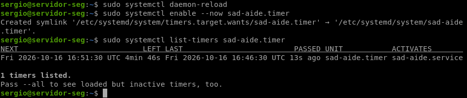

Provoco un cambio y espero la ejecución automática, sin iniciar el servicio manualmente:

```bash
printf 'Prueba automatica\n' | sudo tee -a /opt/sad-integridad/prueba.txt
```

Después consulto:

- `NEXT`: próxima ejecución prevista.

- `LEFT`: cuánto falta.

- `LAST`: última activación.

```bash
sergio@servidor-seg:~$ sudo systemctl list-timers sad-aide.timer
NEXT                           LEFT LAST                              PASSED UNIT           ACTIVATES  >
Fri 2026-10-16 16:56:48 UTC 2min 1s Fri 2026-10-16 16:51:48 UTC 2min 58s ago sad-aide.timer sad-aide.se>

1 timers listed.
Pass --all to see loaded but inactive timers, too.

sergio@servidor-seg:~$ sudo systemctl list-timers sad-aide.timer
NEXT                            LEFT LAST                              PASSED UNIT           ACTIVATES >
Fri 2026-10-16 16:56:48 UTC 1min 19s Fri 2026-10-16 16:51:48 UTC 3min 40s ago sad-aide.timer sad-aide.s>

1 timers listed.
Pass --all to see loaded but inactive timers, too.

sergio@servidor-seg:~$ sudo ls -lt /var/log/aide-sad
total 12
-rw------- 1 root root 1761 Oct 16 16:57 20261016-165703.txt
-rw------- 1 root root 1073 Oct 16 16:51 20261016-165148.txt
-rw------- 1 root root 1073 Oct 16 16:46 20261016-164630.txt
```

> 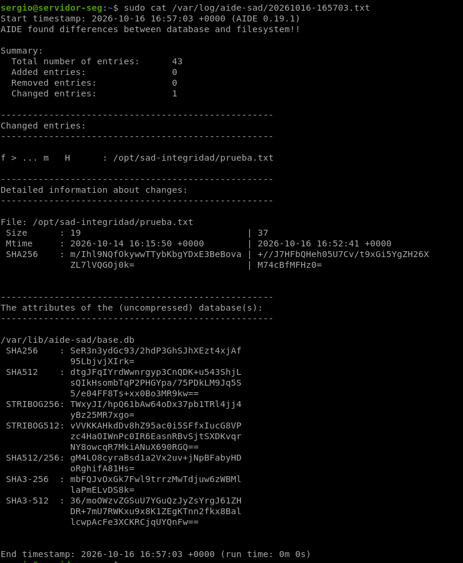

> 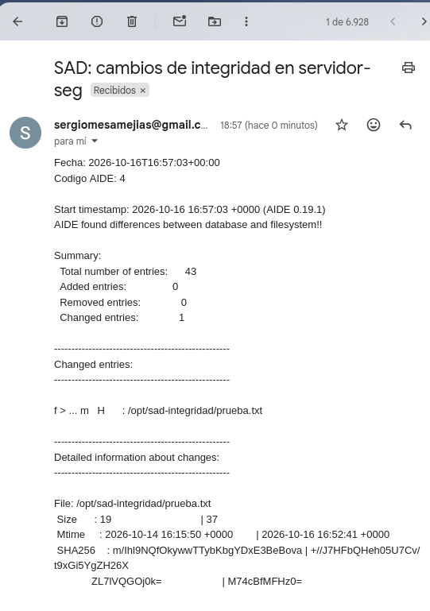

Restauro y reviso antes de actualizar la referencia. Mientras no resuelva las diferencias, recibiré avisos repetidos. Esto está previsto en el script.

## 10. Opciones de informes y alertas utilizadas

He configurado AIDE con `report_level=changed_attributes` para mostrar los atributos modificados y `report_url=stdout` para que el script guarde la salida en un archivo de informe.

La comprobación se ejecuta automáticamente aproximadamente cada **cinco minutos**. Si AIDE detecta cambios o devuelve un error, el script envía el informe mediante msmtp al destinatario configurado. Si no hay diferencias ni errores, no envía correo.

La herramienta no distingue entre cambios legítimos y ataques, por lo que reviso las diferencias antes de actualizar la referencia. Mientras no resuelva los cambios detectados, pueden repetirse los avisos.

> 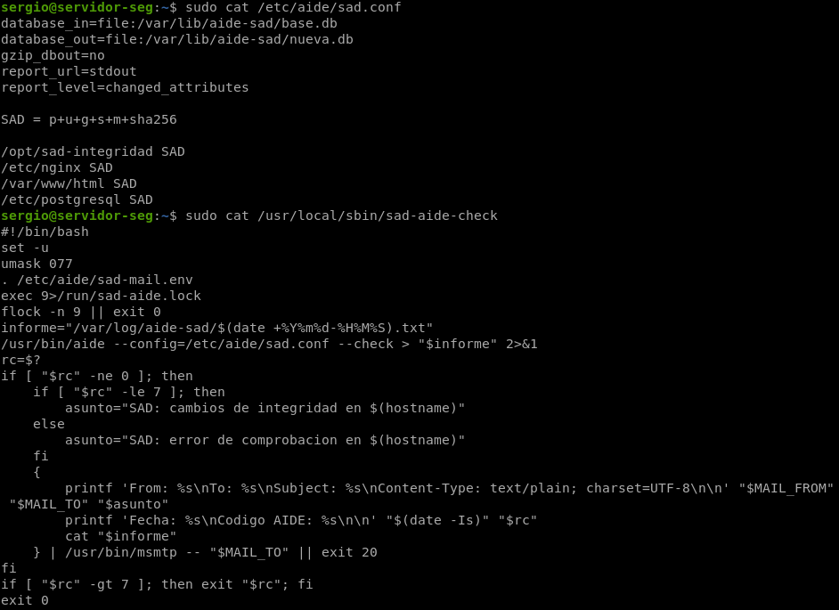

## 

## 11. Prueba integrada: alteración remota de una página web

### 11.1. Objetivo

Realizo una modificación controlada desde el cliente Linux sobre una página de prueba alojada en el servidor. Después consulto la página desde Windows y compruebo que AIDE detecta el cambio mediante la tarea automática y envía una alerta por correo.

Utilizo una cuenta autorizada y una página de laboratorio. No exploto ninguna vulnerabilidad ni modifico la página principal del sitio.

| Equipo                     | Función                                        |
| -------------------------- | ---------------------------------------------- |
| Cliente Linux `debian13`   | Acceso por SSH y modificación controlada       |
| Servidor `192.168.122.130` | Nginx, comprobación con AIDE y envío del aviso |
| Cliente Windows            | Consulta de la página desde la terminal        |

### 11.2. Preparación en el servidor

Compruebo el contenido de la página y guardo una copia antes de modificarla:

```bash
sergio@servidor-seg:~$ sudo cat /var/www/html/sad-integridad.html
<h1>Prueba SAD original</h1>
sergio@servidor-seg:~$ sudo cp -p /var/www/html/sad-integridad.html /root/sad-integridad.pre-remota.html
```

Compruebo el estado respecto a la referencia:

```bash
sergio@servidor-seg:~$ sudo aide --config=/etc/aide/sad.conf --check
Start timestamp: 2026-10-16 17:14:45 +0000 (AIDE 0.19.1)
AIDE found differences between database and filesystem!!

Summary:
  Total number of entries:    43
  Added entries:        0
  Removed entries:        0
  Changed entries:        1

---------------------------------------------------
Changed entries:
---------------------------------------------------

f > ... m   H      : /opt/sad-integridad/prueba.txt

---------------------------------------------------
Detailed information about changes:
---------------------------------------------------

File: /opt/sad-integridad/prueba.txt
 Size      : 19                               | 37
 Mtime     : 2026-10-14 16:15:50 +0000        | 2026-10-16 16:52:41 +0000
 SHA256    : m/Ihl9NQfOkywwTTybKbgYDxE3BeBova | +//J7HFbQHeh05U7Cv/t9xGi5YgZH26X
             ZL7lVQGOj0k=                     | M74cBfMFHz0=


---------------------------------------------------
The attributes of the (uncompressed) database(s):
---------------------------------------------------

/var/lib/aide-sad/base.db
 SHA256    : SeR3n3ydGc93/2hdP3GhSJhXEzt4xjAf
             95LbjvjXIrk=
 SHA512    : dtgJFqIYrdWwnrgyp3CnQDK+u543ShjL
             sQIkHsombTqP2PHGYpa/75PDkLM9Jq5S
             5/e04FF8Ts+xx0Bo3MR9kw==
 STRIBOG256: TWxyJI/hpQ61bAw64oDx37pb1TRl4jj4
             yBz25MR7xgo=
 STRIBOG512: vVVKKAHkdDv8hZ95ac0i5SFfxIucG8VP
             zc4HaOIWnPc0IR6EasnRBvSjtSXDKvqr
             NY8owcqR7MkiANuX690RGQ==
 SHA512/256: gM4LO8cyraBsd1a2Vx2uv+jNpBFabyHD
             oRghifA81Hs=
 SHA3-256  : mbFQJvOxGk7Fwl9trrzMwTdjuw6zWBMl
             laPmELvDS8k=
 SHA3-512  : 36/moOWzvZGSuU7YGuQzJyZsYrgJ61ZH
             DR+7mU7RWKxu9x8K1ZEgKTnn2fkx8Bal
             lcwpAcFe3XCKRCjqUYQnFw==


End timestamp: 2026-10-16 17:14:45 +0000 (run time: 0m 0s)
```

Verifico que la página esté incluida entre las rutas vigiladas y en la referencia inicial. Antes de continuar, reviso y resuelvo las diferencias pendientes de otras pruebas. No acepto cambios desconocidos para obtener una comprobación sin diferencias.

### 11.3. Modificación desde el cliente Linux

Desde `debian13` accedo al servidor mediante SSH:

```bash
usuario@clientelinux-seg:~$ ssh -i ~/.ssh/sad_cliente sergio@192.168.122.130
Enter passphrase for key '/home/usuario/.ssh/sad_cliente': 
Linux servidor-seg 6.12.111+deb13-amd64 #1 SMP PREEMPT_DYNAMIC Debian 6.12.111-1 (2026-09-28) x86_64

The programs included with the Debian GNU/Linux system are free software;
the exact distribution terms for each program are described in the
individual files in /usr/share/doc/*/copyright.

Debian GNU/Linux comes with ABSOLUTELY NO WARRANTY, to the extent
permitted by applicable law.
Last login: Fri Oct 16 17:18:21 2026 from 192.168.122.101
```

Una vez dentro, compruebo en qué equipo estoy:

```bash
sergio@servidor-seg:~$ hostname
servidor-seg
```

Modifico únicamente la página de prueba:

```bash
sergio@servidor-seg:~$ printf '<h1>Prueba SAD: pagina modificada desde el cliente Linux</h1>\n' | sudo tee /var/www/html/sad-integridad.html
<h1>Prueba SAD: pagina modificada desde el cliente Linux2</h1>
```

```bash
exit
```

No ejecuto AIDE manualmente después del cambio: quiero demostrar que lo detecta la comprobación programada.

> 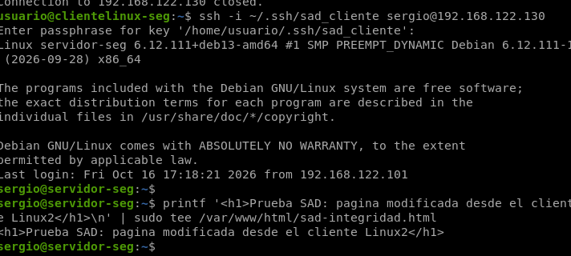

### 11.4. Comprobación desde Windows

Desde la terminal de PowerShell de Windows consulto la página:

```powershell
PS C:\Users\Administrador> (Invoke-WebRequest -Uri "http://192.168.122.130/sad-integridad.html" -UseBasicParsing).Content
<h1>Prueba SAD: pagina modificada desde el cliente Linux2</h1>

PS C:\Users\Administrador>   
```

Compruebo que devuelve este contenido:

```html
<h1>Prueba SAD: pagina modificada desde el cliente Linux2</h1>
```

Esta consulta muestra que el contenido modificado está siendo servido a otro cliente.

> 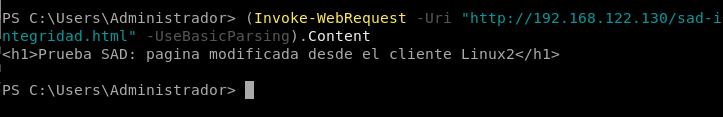

### 11.5. Detección automática y alerta

En el servidor consulto la siguiente ejecución prevista:

```bash
sergio@servidor-seg:~$ sudo systemctl list-timers sad-aide.timer
NEXT                            LEFT LAST                         PASSED UNIT           ACTIVATES       
Fri 2026-10-16 17:33:48 UTC 4min 23s Fri 2026-10-16 17:28:48 UTC 36s ago sad-aide.timer sad-aide.service

1 timers listed.
Pass --all to see loaded but inactive timers, too.
```

Espero a que se ejecute automáticamente y reviso:

```bash
sergio@servidor-seg:~$ sudo journalctl -u sad-aide.service --since '15 minutes ago' --no-pager
Oct 16 17:23:34 servidor-seg systemd[1]: Starting sad-aide.service - Comprobacion SAD de integridad con AIDE...
Oct 16 17:23:36 servidor-seg sad-aide-check[1998]: msmtp: cannot log to /var/log/aide-sad/msmtp.log: cannot open: Permission denied
Oct 16 17:23:36 servidor-seg sad-aide-check[1998]: msmtp: log info was: host=smtp.gmail.com tls=on auth=on user=sergiomesamejias@gmail.com from=sergiomesamejias@gmail.com recipients=sergiomesamejias@gmail.com mailsize=2425 smtpstatus=250 smtpmsg='250 2.0.0 OK  1792171416 ffacd0b85a97d-48dfd510d60sm5979842f8f.58 - gsmtp' exitcode=EX_OK
Oct 16 17:23:36 servidor-seg systemd[1]: sad-aide.service: Deactivated successfully.
Oct 16 17:23:36 servidor-seg systemd[1]: Finished sad-aide.service - Comprobacion SAD de integridad con AIDE.
Oct 16 17:28:48 servidor-seg systemd[1]: Starting sad-aide.service - Comprobacion SAD de integridad con AIDE...
Oct 16 17:28:50 servidor-seg sad-aide-check[2052]: msmtp: cannot log to /var/log/aide-sad/msmtp.log: cannot open: Permission denied
Oct 16 17:28:50 servidor-seg sad-aide-check[2052]: msmtp: log info was: host=smtp.gmail.com tls=on auth=on user=sergiomesamejias@gmail.com from=sergiomesamejias@gmail.com recipients=sergiomesamejias@gmail.com mailsize=2425 smtpstatus=250 smtpmsg='250 2.0.0 OK  1792171730 ffacd0b85a97d-48dfd4f576asm6593792f8f.32 - gsmtp' exitcode=EX_OK
Oct 16 17:28:50 servidor-seg systemd[1]: sad-aide.service: Deactivated successfully.
Oct 16 17:28:50 servidor-seg systemd[1]: Finished sad-aide.service - Comprobacion SAD de integridad con AIDE.
Oct 16 17:34:04 servidor-seg systemd[1]: Starting sad-aide.service - Comprobacion SAD de integridad con AIDE...
Oct 16 17:34:07 servidor-seg sad-aide-check[2102]: msmtp: cannot log to /var/log/aide-sad/msmtp.log: cannot open: Permission denied
Oct 16 17:34:07 servidor-seg sad-aide-check[2102]: msmtp: log info was: host=smtp.gmail.com tls=on auth=on user=sergiomesamejias@gmail.com from=sergiomesamejias@gmail.com recipients=sergiomesamejias@gmail.com mailsize=2425 smtpstatus=250 smtpmsg='250 2.0.0 OK  1792172046 ffacd0b85a97d-48dfd4f5b2dsm6773299f8f.31 - gsmtp' exitcode=EX_OK
Oct 16 17:34:07 servidor-seg systemd[1]: sad-aide.service: Deactivated successfully.
Oct 16 17:34:07 servidor-seg systemd[1]: Finished sad-aide.service - Comprobacion SAD de integridad con AIDE.
sergio@servidor-seg:~$ sudo ls -lt /var/log/aide-sad
total 40
-rw------- 1 root root 2124 Oct 16 17:34 20261016-173404.txt
-rw------- 1 root root 2124 Oct 16 17:28 20261016-172848.txt
-rw------- 1 root root 2124 Oct 16 17:23 20261016-172334.txt
-rw------- 1 root root 1761 Oct 16 17:18 20261016-171818.txt
-rw------- 1 root root 1761 Oct 16 17:13 20261016-171304.txt
-rw------- 1 root root 1761 Oct 16 17:07 20261016-170748.txt
-rw------- 1 root root 1761 Oct 16 17:02 20261016-170234.txt
-rw------- 1 root root 1761 Oct 16 16:57 20261016-165703.txt
-rw------- 1 root root 1073 Oct 16 16:51 20261016-165148.txt
-rw------- 1 root root 1073 Oct 16 16:46 20261016-164630.txt
```

Abro el informe correspondiente a esa ejecución, sustituyendo el nombre del ejemplo por el real:

```bash
sudo cat /var/log/aide-sad/NOMBRE_DEL_INFORME.txt
```

Compruebo que aparece `/var/www/html/sad-integridad.html` como modificado y reviso el correo recibido por esa misma comprobación. No doy por demostrado el envío únicamente porque exista un informe.

> 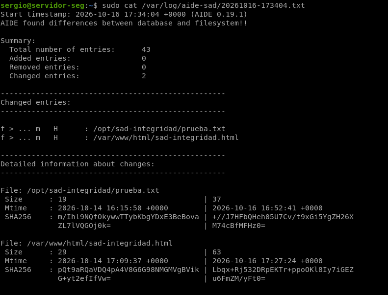

> 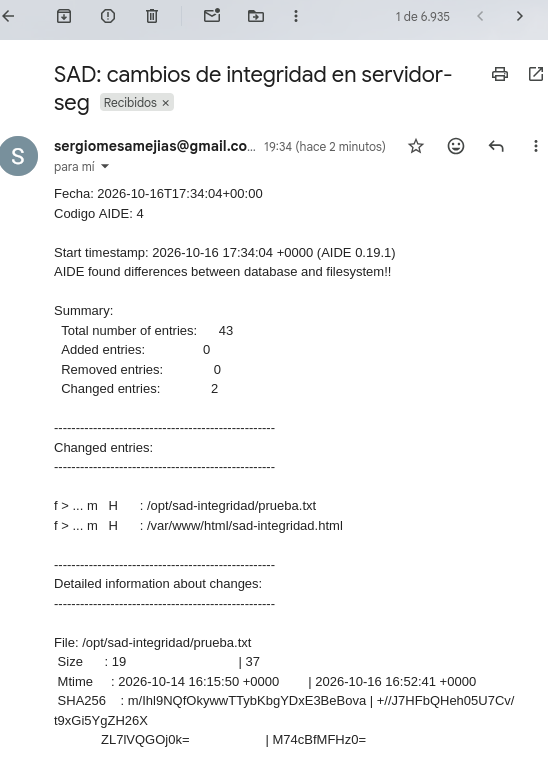

### 11.6. Restauración

En el servidor restauro la página desde la copia guardada:

```bash
sergio@servidor-seg:~$ sudo cp -p /root/sad-integridad.pre-remota.html /var/www/html/sad-integridad.html 
sergio@servidor-seg:~$ sudo aide --config=/etc/aide/sad.conf --check
Start timestamp: 2026-10-16 17:36:42 +0000 (AIDE 0.19.1)
AIDE found differences between database and filesystem!!

Summary:
  Total number of entries:    43
  Added entries:        0
  Removed entries:        0
  Changed entries:        1

---------------------------------------------------
Changed entries:
---------------------------------------------------

f > ... m   H      : /opt/sad-integridad/prueba.txt

---------------------------------------------------
Detailed information about changes:
---------------------------------------------------

File: /opt/sad-integridad/prueba.txt
 Size      : 19                               | 37
 Mtime     : 2026-10-14 16:15:50 +0000        | 2026-10-16 16:52:41 +0000
 SHA256    : m/Ihl9NQfOkywwTTybKbgYDxE3BeBova | +//J7HFbQHeh05U7Cv/t9xGi5YgZH26X
             ZL7lVQGOj0k=                     | M74cBfMFHz0=


---------------------------------------------------
The attributes of the (uncompressed) database(s):
---------------------------------------------------

/var/lib/aide-sad/base.db
 SHA256    : SeR3n3ydGc93/2hdP3GhSJhXEzt4xjAf
             95LbjvjXIrk=
 SHA512    : dtgJFqIYrdWwnrgyp3CnQDK+u543ShjL
             sQIkHsombTqP2PHGYpa/75PDkLM9Jq5S
             5/e04FF8Ts+xx0Bo3MR9kw==
 STRIBOG256: TWxyJI/hpQ61bAw64oDx37pb1TRl4jj4
             yBz25MR7xgo=
 STRIBOG512: vVVKKAHkdDv8hZ95ac0i5SFfxIucG8VP
             zc4HaOIWnPc0IR6EasnRBvSjtSXDKvqr
             NY8owcqR7MkiANuX690RGQ==
 SHA512/256: gM4LO8cyraBsd1a2Vx2uv+jNpBFabyHD
             oRghifA81Hs=
 SHA3-256  : mbFQJvOxGk7Fwl9trrzMwTdjuw6zWBMl
             laPmELvDS8k=
 SHA3-512  : 36/moOWzvZGSuU7YGuQzJyZsYrgJ61ZH
             DR+7mU7RWKxu9x8K1ZEgKTnn2fkx8Bal
             lcwpAcFe3XCKRCjqUYQnFw==


End timestamp: 2026-10-16 17:36:42 +0000 (run time: 0m 0s)
```

Reviso el resultado. Si quedan diferencias, las investigo antes de actualizar la referencia. No actualizo la referencia mientras la página contenga la alteración de prueba.

> 

### 11.7. Conclusión

He realizado una modificación remota desde el cliente Linux y he comprobado su efecto desde Windows. 

La prueba demuestra la detección de una alteración del contenido web, no la explotación de una vulnerabilidad. El informe de AIDE identifica el cambio del archivo; por sí solo no demuestra quién lo modificó ni desde qué cliente.

## 

## 12. Integridad en Windows con AFICK

## 12.1. Instalación y preparación

Para comprobar la integridad de archivos en Windows utilizo **AFICK**. Trabajo desde CMD como administrador, sin entorno gráfico.

AFICK necesita Perl. Descargo el instalador MSI de Strawberry Perl desde el repositorio oficial de GitHub del proyecto y lo guardo en `C:\SAD\perl.msi`.

Creo la carpeta de trabajo:

```bat
mkdir C:\SAD
```

Descargo e instalo Perl:

```bat
curl.exe -L -o C:\SAD\perl.msi "https://github.com/StrawberryPerl/Perl-Dist-Strawberry/releases/download/SP_54231_64bit/strawberry-perl-5.42.3.1-64bit.msi"
start /wait msiexec.exe /i "C:\SAD\perl.msi" /qn /norestart /L*v "C:\SAD\instalacion-perl.log"
```

La descarga finaliza correctamente:

```text
100  200M  100  200M    0     0  39.7M      0  0:00:05  0:00:05 --:--:--  51.4M
```

Compruebo que el instalador se ha descargado con el tamaño esperado:

```bat
dir C:\SAD
```

```text
17/10/2026  21:02       210.153.216 perl.msi
```

Una vez finalizada la instalación silenciosa, compruebo que Perl funciona:

```bat
C:\Strawberry\perl\bin\perl.exe -v
```

```text
This is perl 5, version 42, subversion 3 (v5.42.3) built for MSWin32-x64-multi-thread

Copyright 1987-2026, Larry Wall
```

A continuación descargo AFICK desde su proyecto oficial en SourceForge. Creo la carpeta correspondiente, descargo el paquete ZIP y lo extraigo:

```bat
mkdir C:\SAD\AFICK
curl.exe -L -o C:\SAD\AFICK\afick.zip "https://sourceforge.net/projects/afick/files/afick/3.8.2/afick-3.8.2.zip/download"
powershell -Command "Expand-Archive -Path 'C:\SAD\AFICK\afick.zip' -DestinationPath 'C:\SAD\AFICK' -Force"
```

Compruebo que el archivo ZIP se ha descargado correctamente:

```bat
dir C:\SAD\AFICK
```

```text
17/10/2026  22:41           944.091 afick.zip
```

Localizo el script principal de AFICK:

```bat
dir /s /b C:\SAD\AFICK\afick.pl
```

La ruta real obtenida es:

```text
C:\SAD\AFICK\afick\afick.pl
```

Al ejecutar AFICK por primera vez aparece un error porque falta el módulo Perl `Win32::FileSecurity`, necesario para trabajar con los permisos NTFS en Windows:

```text
CRITICAL : can not find Afick::WinAcl : Can't locate Win32/FileSecurity.pm in @INC
```

Para resolverlo, añado Perl y sus herramientas de compilación al `PATH` de la sesión actual:

```bat
set PATH=C:\Strawberry\perl\bin;C:\Strawberry\c\bin;%PATH%
```

Compruebo que Perl ya está disponible como comando:

```bat
perl -v
```

Instalo el módulo necesario con `cpanm`:

```bat
cpanm Win32::FileSecurity
```

```text
Successfully installed Win32-FileSecurity-1.09
1 distribution installed
```

Verifico que el módulo se puede cargar:

```bat
perl -e "use Win32::FileSecurity; print qq(OK\n);"
```

```text
OK
```

Finalmente, compruebo que AFICK ya funciona correctamente:

```bat
C:\Strawberry\perl\bin\perl.exe C:\SAD\AFICK\afick\afick.pl --help
```

AFICK muestra su ayuda correctamente, confirmando que Perl, sus dependencias y la herramienta están instalados:

```text
Usage:
    afick [action] [options]

    Mandatory action (one and only one must be used) :

     -i|--init                    initialize the hash.dbm database
     -k|--compare                 compare the hash.dbm database
     -u|--update                  compare and update the hash.dbm database
```

## 12.2. Configuración y referencia inicial

Creo una carpeta de prueba y un archivo:

```bat
mkdir C:\SAD\Integridad
mkdir C:\SAD\Referencia
echo Contenido original> C:\SAD\Integridad\prueba.txt
```

Configuro AFICK para vigilar esa carpeta:

```bat
echo database := C:/SAD/Referencia/base > C:\SAD\afick.conf
echo C:/SAD/Integridad all >> C:\SAD\afick.conf
echo warn_missing_file := true >> C:\SAD\afick.conf
```

Utilizo el alias predefinido `all` de AFICK para vigilar la carpeta de prueba. Este alias incluye atributos como permisos, usuario, grupo, tamaño, fecha de modificación, número de enlaces y suma MD5, permitiendo detectar cambios en el contenido y en los metadatos de los archivos.

Compruebo que el archivo de configuración es válido:

```bat
C:\Strawberry\perl\bin\perl.exe C:\SAD\AFICK\afick\afick.pl -c C:\SAD\afick.conf --check_config
```

```text
# config file C:\SAD\afick.conf ok
```

Creo la referencia inicial:

```bat
C:\Strawberry\perl\bin\perl.exe C:\SAD\AFICK\afick\afick.pl -c C:\SAD\afick.conf -i
```

```text
# Afick (3.8.2) init at 2026/10/17 23:14:03 with options (C:\SAD\afick.conf):
# database:=C:/SAD/Referencia/base
# warn_missing_file:=1
# dbm:=Storable
# #################################################################
# MD5 hash of C:/SAD/Referencia/base => 1WRdS6X9oIn2rquVztPXxA

# Hash database created successfully. 46 files entered.
```

Realizo una primera comparación:

```bat
C:\Strawberry\perl\bin\perl.exe C:\SAD\AFICK\afick\afick.pl -c C:\SAD\afick.conf -k
```

La opción `-i` inicializa la base de referencia y `-k` compara el estado actual con ella. Tras crear la referencia, no existen diferencias inesperadas antes de comenzar las pruebas.

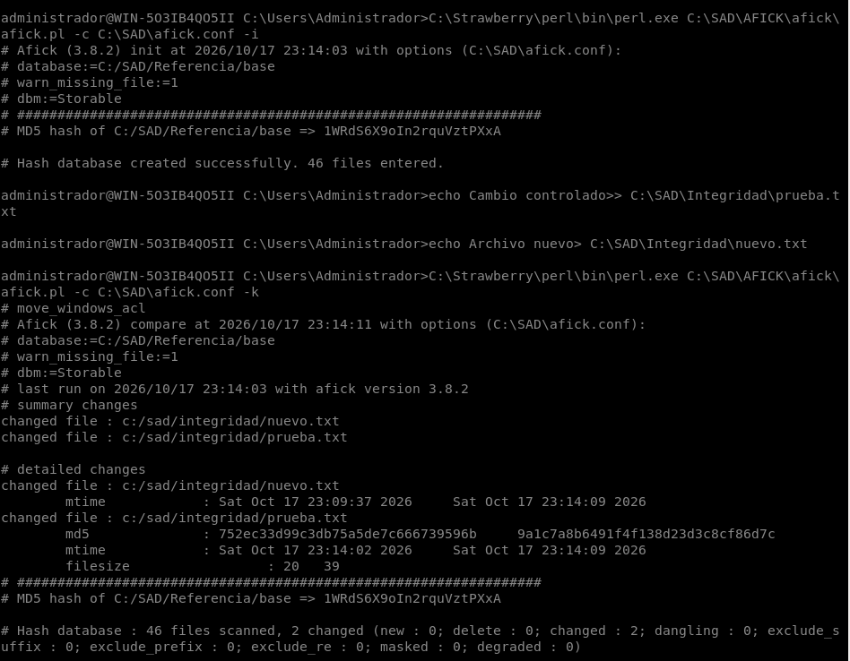

## 12.3. Prueba: modificación, creación y eliminación

Simulo una alteración del archivo y creo otro nuevo:

```bat
echo Cambio controlado>> C:\SAD\Integridad\prueba.txt
echo Archivo nuevo> C:\SAD\Integridad\nuevo.txt
```

Compruebo las diferencias:

```bat
C:\Strawberry\perl\bin\perl.exe C:\SAD\AFICK\afick\afick.pl -c C:\SAD\afick.conf -k
```

AFICK detecta los dos cambios:

```text
# summary changes
changed file : c:/sad/integridad/nuevo.txt
changed file : c:/sad/integridad/prueba.txt

# detailed changes
changed file : c:/sad/integridad/nuevo.txt
        mtime            : Sat Oct 17 23:09:37 2026     Sat Oct 17 23:14:09 2026
changed file : c:/sad/integridad/prueba.txt
        md5              : 752ec33d99c3db75a5de7c666739596b     9a1c7a8b6491f4f138d23d3c8cf86d7c        
        mtime            : Sat Oct 17 23:14:02 2026     Sat Oct 17 23:14:09 2026
        filesize                 : 20   39
# #################################################################
# MD5 hash of C:/SAD/Referencia/base => 1WRdS6X9oIn2rquVztPXxA

# Hash database : 46 files scanned, 2 changed (new : 0; delete : 0; changed : 2; dangling : 0; exclude_suffix : 0; exclude_prefix : 0; exclude_re : 0; masked : 0; degraded : 0)
```

En `prueba.txt` se detecta el cambio del hash MD5, de la fecha de modificación y del tamaño. En `nuevo.txt` se detecta que es un archivo nuevo respecto a la referencia inicial.

Después elimino el archivo que estaba en la referencia:

```bat
del C:\SAD\Integridad\prueba.txt
```

Repito la comparación:

```bat
C:\Strawberry\perl\bin\perl.exe C:\SAD\AFICK\afick\afick.pl -c C:\SAD\afick.conf -k
```

AFICK detecta la eliminación del archivo original y mantiene el archivo nuevo como cambio respecto a la referencia:

```text
# summary changes
deleted file : c:/sad/integridad/prueba.txt
changed directory : c:/sad/integridad
changed file : c:/sad/integridad/nuevo.txt

# detailed changes
deleted file : c:/sad/integridad/prueba.txt
        parent_date              : Sat Oct 17 23:14:02 2026
changed directory : c:/sad/integridad
        mtime            : Sat Oct 17 23:14:02 2026     Sat Oct 17 23:14:15 2026
changed file : c:/sad/integridad/nuevo.txt
        mtime            : Sat Oct 17 23:09:37 2026     Sat Oct 17 23:14:09 2026
# #################################################################
# MD5 hash of C:/SAD/Referencia/base => 1WRdS6X9oIn2rquVztPXxA

# Hash database : 45 files scanned, 3 changed (new : 0; delete : 1; changed : 2; dangling : 0; exclude_suffix : 0; exclude_prefix : 0; exclude_re : 0; masked : 0; degraded : 0)
```

La eliminación de `prueba.txt` queda registrada como `deleted file`. Además, AFICK informa de que la fecha de modificación del directorio `C:/SAD/Integridad` ha cambiado y de que `nuevo.txt` sigue siendo una diferencia respecto a la referencia, ya que no he actualizado la base.

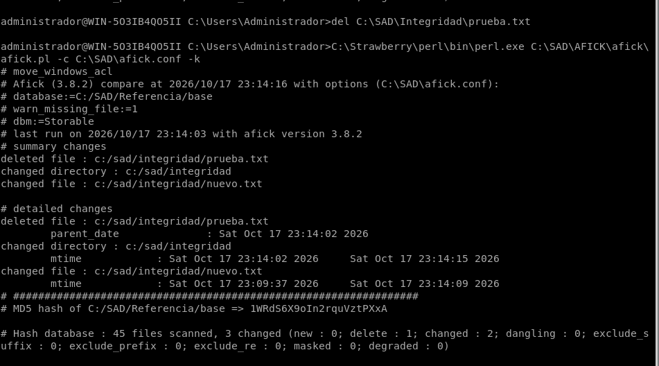

## 12.4. Conclusión

He comprobado que AFICK permite detectar modificaciones, archivos nuevos y eliminaciones comparando una carpeta con una referencia inicial.

En la prueba, AFICK ha detectado el cambio del contenido de `prueba.txt` mediante el hash MD5, la creación de `nuevo.txt` y, posteriormente, la eliminación de `prueba.txt`. También ha informado del cambio de fecha de modificación del directorio afectado.

La herramienta informa de diferencias, pero no determina si son cambios legítimos o un ataque. En esta demostración no he configurado correo, comprobación de permisos ni ejecución automática. 

13. Actualizaciones automáticas y cambios legítimos

En este apartado configuro y compruebo las actualizaciones automáticas de seguridad en el servidor Debian, que aloja tanto el servicio **Nginx** como **PostgreSQL**. Después reviso la política de actualizaciones en el cliente Windows y relaciono estas actualizaciones con el control de integridad realizado con AIDE y AFICK.

Una actualización legítima puede modificar ficheros del sistema, por lo que la referencia de integridad debe revisarse y actualizarse solo después de comprobar que los cambios son esperados.

> **Máquinas utilizadas:**
> 
> - **Servidor Debian:** aloja Nginx y PostgreSQL.
> - **Cliente Linux:** máquina Debian utilizada para acceder a los servicios.
> - **Cliente Windows:** máquina Windows utilizada para acceder a los servicios y para la parte de integridad con AFICK.
> 
> No es necesario forzar una actualización si no hay paquetes pendientes. La evidencia práctica consiste en configurar el mecanismo, comprobar que funciona y documentar cómo se revisan los cambios detectados por AIDE o AFICK.


## 13. Actualizaciones automáticas y cambios legítimos

## 13.1. Servidor Debian: Nginx y PostgreSQL

Esta parte se realiza en la **máquina servidor Debian**, donde están instalados Nginx y PostgreSQL.

### 13.1.1. Instalar y activar actualizaciones automáticas

Ejecuta:

```bash
sudo apt update
sudo apt install unattended-upgrades -y
sudo dpkg-reconfigure -plow unattended-upgrades
```

Cuando aparezca la pregunta:

```text
¿Descargar e instalar automáticamente actualizaciones de forma periódica?
```

Selecciona **Sí** y pulsa **Enter**.

> 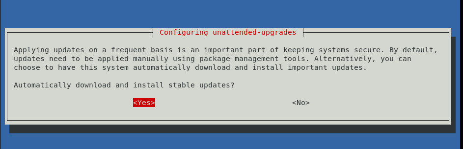

### 13.1.2. Comprobar la activación periódica

Ejecuta:

```bash
cat /etc/apt/apt.conf.d/20auto-upgrades
```

Debe aparecer algo similar a:

```text
APT::Periodic::Update-Package-Lists "1";
APT::Periodic::Unattended-Upgrade "1";
```

Si no aparece `APT::Periodic::Unattended-Upgrade "1";`, editamos el archivo:

```bash
sudo nano /etc/apt/apt.conf.d/20auto-upgrades
```

El archivo debe quedar así:

```text
APT::Periodic::Update-Package-Lists "1";
APT::Periodic::Unattended-Upgrade "1";
```

> 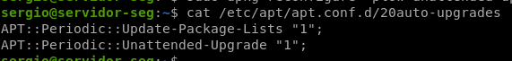

### 13.1.3. Revisar los orígenes permitidos

Compruebo los orígenes que `unattended-upgrades` tiene habilitados mediante una ejecución en modo simulación:

```bash
sudo unattended-upgrade --dry-run --debug | grep -i -A 5 -E 'allowed|origin|security'
```

La salida confirma que están habilitados los orígenes oficiales de Debian y los orígenes de seguridad:

```text
Allowed origins are: origin=Debian,codename=trixie,label=Debian, origin=Debian,codename=trixie,label=Debian-Security, origin=Debian,codename=trixie-security,label=Debian-Security
```

También se comprueba que hay actualizaciones de seguridad pendientes para los paquetes `libexpat1` y `linux-image-amd64`:

```text
Checking: libexpat1=2.9.0-1~deb13u1 ([<Origin component:'main' archive:'stable-security' origin:'Debian' label:'Debian-Security' site:'' isTrusted:True>])
Checking: linux-image-amd64=6.12.113-1 ([<Origin component:'main' archive:'stable-security' origin:'Debian' label:'Debian-Security' site:'' isTrusted:True>])
pkgs that look like they should be upgraded: libexpat1
linux-image-amd64
```

> 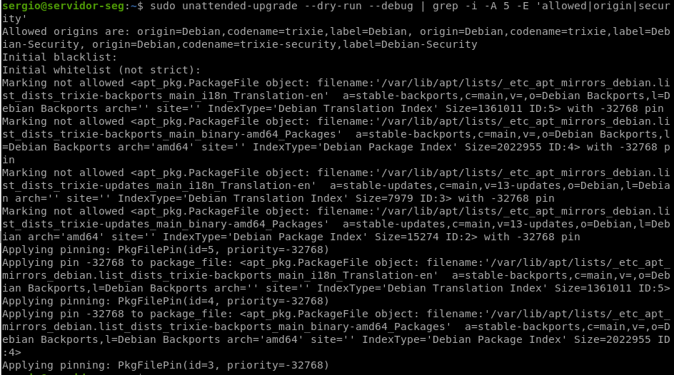

### 13.1.4. Comprobar el funcionamiento sin instalar nada

Ejecuto una simulación completa para comprobar qué actualizaciones aplicaría el sistema sin instalarlas realmente:

```bash
sudo unattended-upgrade --dry-run --debug
```

La simulación confirma que están habilitados los orígenes de Debian y Debian-Security:

```text
Allowed origins are: origin=Debian,codename=trixie,label=Debian, origin=Debian,codename=trixie,label=Debian-Security, origin=Debian,codename=trixie-security,label=Debian-Security
```

Se detectan dos actualizaciones de seguridad pendientes:

```text
Checking: libexpat1=2.9.0-1~deb13u1 ([<Origin component:'main' archive:'stable-security' origin:'Debian' label:'Debian-Security' site:'' isTrusted:True>])
Checking: linux-image-amd64=6.12.113-1 ([<Origin component:'main' archive:'stable-security' origin:'Debian' label:'Debian-Security' site:'' isTrusted:True>])
pkgs that look like they should be upgraded: libexpat1
linux-image-amd64
```

La ejecución se realiza en modo simulación, por lo que no se instalan realmente los paquetes:

```text
Option --dry-run given, *not* performing real actions
```

Al finalizar, la simulación confirma que habría aplicado todas las actualizaciones disponibles:

```text
Se han instalado todas las actualizaciones
upgrade result: True Se han instalado todas las actualizaciones
```

Reviso después el registro generado:

```bash
sudo tail -n 50 /var/log/unattended-upgrades/unattended-upgrades.log
```

El registro confirma que la ejecución fue una simulación:

```text
2026-10-17 21:41:40,414 INFO Option --dry-run given, *not* performing real actions
2026-10-17 21:41:40,414 INFO Packages that will be upgraded: libexpat1 linux-image-amd64
2026-10-17 21:41:43,285 INFO All upgrades installed
2026-10-17 21:41:43,755 DEBUG upgrade result: True All upgrades installed
```

Aunque el mensaje indica “All upgrades installed”, el propio registro muestra que se utilizó el modo `dry-run`, por lo que no se realizó una instalación real.

## 13.2. Cliente Linux: comprobación de la configuración

Esta parte se realiza en la **máquina cliente Linux**.

Compruebo si el paquete `unattended-upgrades` está instalado:

```bash
dpkg -l unattended-upgrades
```

```text
dpkg-query: no se ha encontrado ningún paquete que corresponda con unattended-upgrades.
```

Como no está instalado, actualizo los repositorios e instalo el paquete:

```bash
sudo apt update
sudo apt install unattended-upgrades -y
```

La instalación finaliza correctamente y se crea el servicio de actualizaciones automáticas:

```text
Configurando unattended-upgrades (2.12) ...
Creating config file /etc/apt/apt.conf.d/50unattended-upgrades with new version
Created symlink '/etc/systemd/system/multi-user.target.wants/unattended-upgrades.service' → '/usr/lib/systemd/system/unattended-upgrades.service'.
```

Activo las actualizaciones automáticas:

```bash
sudo dpkg-reconfigure -plow unattended-upgrades
```

Cuando aparece la pregunta, selecciono **Sí**. El sistema crea el archivo de configuración periódica:

```text
Creating config file /etc/apt/apt.conf.d/20auto-upgrades with new version
```

Compruebo la configuración:

```bash
cat /etc/apt/apt.conf.d/20auto-upgrades
```

```text
APT::Periodic::Update-Package-Lists "1";
APT::Periodic::Unattended-Upgrade "1";
```

Estas opciones indican que se actualizará diariamente la lista de paquetes y que se ejecutarán automáticamente las actualizaciones configuradas.

> 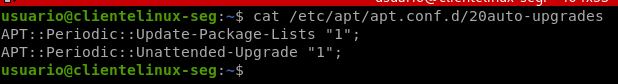

Compruebo el funcionamiento mediante una simulación, sin instalar paquetes:

```bash
sudo unattended-upgrade --dry-run --debug
```

La simulación confirma que están habilitados los orígenes oficiales de Debian y los orígenes de seguridad:

```text
Allowed origins are: origin=Debian,codename=trixie,label=Debian, origin=Debian,codename=trixie,label=Debian-Security, origin=Debian,codename=trixie-security,label=Debian-Security
```

Se detectan actualizaciones de seguridad pendientes para varios paquetes, entre ellos Apache, OpenSSL, curl, rsync, xz-utils y el núcleo Linux:

```text
Paquetes que se actualizarán: apache2 apache2-bin apache2-data apache2-utils curl libcurl3t64-gnutls libcurl4t64 libexpat1 liblzma5 libpcre2-8-0 libpcre2-posix3 libpng16-16t64 libssl3t64 linux-image-amd64 linux-libc-dev openssl openssl-provider-legacy rsync xz-utils
```

La ejecución se realiza en modo simulación, por lo que no se instalan realmente los paquetes:

```text
Option --dry-run given, *not* performing real actions
```

Al finalizar, la simulación confirma que habría aplicado todas las actualizaciones disponibles:

```text
Se han instalado todas las actualizaciones
upgrade result: True Se han instalado todas las actualizaciones
```

Reviso el registro generado por `unattended-upgrades`:

```bash
sudo tail -n 50 /var/log/unattended-upgrades/unattended-upgrades.log
```

```text
2026-10-17 23:46:35,344 INFO Se han instalado todas las actualizaciones
2026-10-17 23:46:35,750 DEBUG InstCount=0 DelCount=0 BrokenCount=0
2026-10-17 23:46:35,751 INFO The list of kept packages can't be calculated in dry-run mode.
2026-10-17 23:46:35,759 DEBUG upgrade result: True Se han instalado todas las actualizaciones
```

Aunque el mensaje indica “Se han instalado todas las actualizaciones”, el propio registro muestra que se utilizó el modo `dry-run`, por lo que la ejecución fue una simulación y no una instalación real.

## 13.3. Cliente Windows: política e historial de actualizaciones

Esta parte se realiza en la **máquina cliente Windows**.

### 13.3.1. Comprobar actualizaciones desde PowerShell

Abre **PowerShell como administrador** y ejecuta:

```powershell
Get-HotFix | Sort-Object InstalledOn -Descending | Select-Object -First 10
```

Este comando muestra las actualizaciones recientes instaladas en el equipo.

> 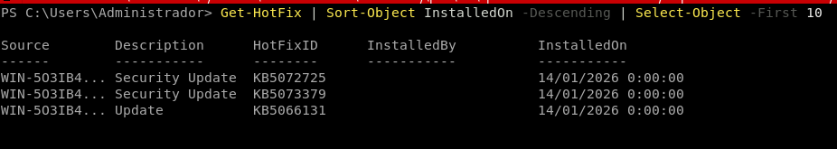

## 13.4. Relación con AIDE y AFICK

Las actualizaciones automáticas pueden modificar ficheros del sistema de forma legítima: binarios, librerías, ficheros de configuración o metadatos. AIDE y AFICK detectarán esos cambios como diferencias respecto a la referencia creada anteriormente.

Por ello, después de una actualización real se debe seguir este procedimiento:

1. Ejecutar la comprobación de integridad.
2. Revisar el informe generado.
3. Comprobar que los cambios corresponden a la actualización autorizada.
4. Solo en ese caso, regenerar la referencia.
5. Volver a ejecutar la comprobación para confirmar que no quedan diferencias inesperadas.

### 13.4.1. En el servidor Debian con AIDE

Ejecuto en la **máquina servidor Debian**, donde está configurado AIDE:

```bash
sudo aide --config /etc/aide/aide.conf --check
```

Antes de poder realizar la comprobación, es necesario inicializar la base de referencia:

```bash
sudo aide --config /etc/aide/aide.conf --init
```

```text
AIDE successfully initialized database.
New AIDE database written to /var/lib/aide/aide.db.new
Number of entries:43039
```

Convierto la base inicial en la base utilizada para las comprobaciones:

```bash
sudo mv /var/lib/aide/aide.db.new /var/lib/aide/aide.db
```

Después ejecuto la comprobación de integridad:

```bash
sudo aide --config /etc/aide/aide.conf --check
```

```text
AIDE found differences between database and filesystem!!

Summary:
  Total number of entries:43040
  Added entries:1
  Removed entries:1
  Changed entries:2

Added entries:
f++++++++++++++++++: /var/log/aide-sad/20261017-215402.txt

Removed entries:
f------------------: /var/lib/aide/aide.db.new

Changed entries:
f =.... mc..... .  : /run/sad-aide.lock
d =.... mc.. .. .  : /var/log/aide-sad
```

Las diferencias detectadas son esperadas: el informe generado por la propia ejecución de AIDE aparece como archivo nuevo, la base temporal `aide.db.new` desaparece porque se ha renombrado a `aide.db`, y se modifican la fecha del directorio de registros y el fichero de bloqueo utilizado por AIDE.

Por tanto, no se trata de cambios sospechosos, sino de efectos normales de la propia herramienta y de la creación de la referencia inicial.

> 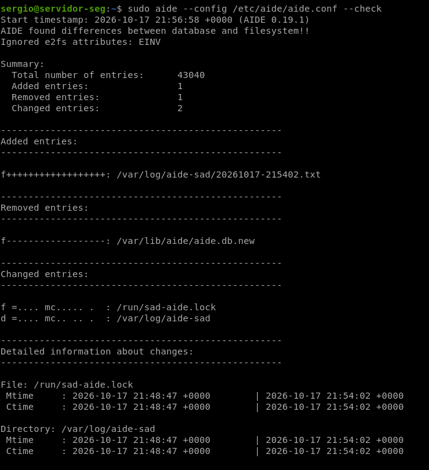

### 13.4.2. En el cliente Windows con AFICK

Ejecuto en la **máquina cliente Windows**:

```bat
C:\Strawberry\perl\bin\perl.exe C:\SAD\AFICK\afick\afick.pl -c C:\SAD\afick.conf -k
```

AFICK muestra las diferencias pendientes de la prueba de integridad anterior:

```text
# summary changes
deleted file : c:/sad/integridad/prueba.txt
changed directory : c:/sad/integridad
changed file : c:/sad/integridad/nuevo.txt

# Hash database : 45 files scanned, 3 changed (new : 0; delete : 1; changed : 2; dangling : 0; exclude_suffix : 0; exclude_prefix : 0; exclude_re : 0; masked : 0; degraded : 0)
```

Estos cambios corresponden a la prueba realizada en el apartado 12: se eliminó `prueba.txt`, se creó `nuevo.txt` y se modificó la fecha del directorio. No corresponden a una actualización del sistema.

Después de revisar que los cambios son conocidos y legítimos, regenero la referencia de integridad:

```bat
C:\Strawberry\perl\bin\perl.exe C:\SAD\AFICK\afick\afick.pl -c C:\SAD\afick.conf -i
```

```text
WARNING: (create) init on an already existing database : changes will be lost
# Afick (3.8.2) init at 2026/10/17 23:58:46 with options (C:\SAD\afick.conf):
# database:=C:/SAD/Referencia/base
# warn_missing_file:=1
# dbm:=Storable
# Hash database created successfully. 45 files entered.
```

La advertencia indica que la base anterior será sustituida. Esto es correcto porque he revisado previamente las diferencias y he decidido aceptar el estado actual como nueva referencia.

Finalmente, compruebo que no quedan diferencias respecto a la nueva referencia:

```bat
C:\Strawberry\perl\bin\perl.exe C:\SAD\AFICK\afick\afick.pl -c C:\SAD\afick.conf -k
```

```text
# Hash database : 45 files scanned, 0 changed (new : 0; delete : 0; changed : 0; dangling : 0; exclude_suffix : 0; exclude_prefix : 0; exclude_re : 0; masked : 0; degraded : 0)
```

La comprobación final no detecta ninguna diferencia, confirmando que la referencia de integridad se ha actualizado correctamente después de revisar los cambios legítimos.

Nunca se debe programar una aceptación ciega de todos los cambios: actualizar automáticamente la referencia sin revisarla anularía la utilidad del control de integridad.

## 13.5. Conclusión

He configurado y comprobado las actualizaciones automáticas de seguridad en el servidor Debian, que aloja Nginx y PostgreSQL, mediante `unattended-upgrades`. También he instalado y configurado el mismo mecanismo en el cliente Linux, y he revisado la configuración y el historial de Windows Update en el cliente Windows.

Además, he relacionado las actualizaciones con el control de integridad: cuando el sistema se actualiza de forma legítima, AIDE o AFICK pueden detectar cambios en ficheros del sistema. La referencia de integridad solo debe actualizarse después de revisar que esos cambios corresponden a mantenimiento autorizado.

14. Demostración de restauración de snapshot

Esta prueba se realiza en la **máquina servidor Debian**, que aloja los servicios Nginx y PostgreSQL. El objetivo es demostrar la relación entre un snapshot de ficheros y el control de integridad realizado con AIDE.

En este contexto, un snapshot no es una instantánea completa de la máquina virtual, sino una copia previa de un fichero vigilado. AIDE permite detectar que el fichero ha sido modificado, mientras que el snapshot permite restaurar su contenido original.

### 14.1. Creación del archivo y del snapshot

Creo un archivo de prueba dentro de una ruta vigilada por AIDE:

```bash
sudo bash -c 'echo "Contenido original del archivo" > /var/www/html/prueba-snapshot.txt'
```

Compruebo su contenido:

```bash
sergio@servidor-seg:~$ cat /var/www/html/prueba-snapshot.txt
Contenido original del archivo
```

Creo un snapshot del fichero mediante una copia de seguridad:

```bash
sudo cp /var/www/html/prueba-snapshot.txt /root/prueba-snapshot.txt.bak
```

Compruebo que la copia se ha creado:

```bash
sudo ls -l /root/prueba-snapshot.txt.bak
```

> 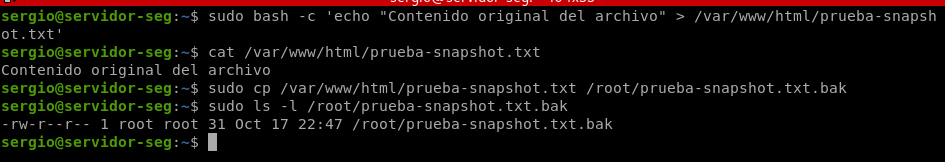

### 14.2. Actualización de la referencia de AIDE

Compruebo el estado actual del sistema:``

```bash
ergio@servidor-seg:~$ sudo aide --config /etc/aide/aide.conf --check
Start timestamp: 2026-10-17 22:48:29 +0000 (AIDE 0.19.1)
AIDE found differences between database and filesystem!!
Ignored e2fs attributes: EINV

Summary:
  Total number of entries:	43019
  Added entries:		2
  Removed entries:		0
  Changed entries:		2

---------------------------------------------------
Added entries:
---------------------------------------------------

f++++++++++++++++++: /root/prueba-snapshot.txt.bak
f++++++++++++++++++: /var/www/html/prueba-snapshot.txt

---------------------------------------------------
Changed entries:
---------------------------------------------------

d =.... mc.. .. .  : /root
d =.... mc.. .. .  : /var/www/html

---------------------------------------------------
Detailed information about changes:
---------------------------------------------------

Directory: /root
 Mtime     : 2026-10-16 17:14:10 +0000        | 2026-10-17 22:47:48 +0000
 Ctime     : 2026-10-16 17:14:10 +0000        | 2026-10-17 22:47:48 +0000

Directory: /var/www/html
 Mtime     : 2026-10-14 16:34:47 +0000        | 2026-10-17 22:47:20 +0000
 Ctime     : 2026-10-14 16:34:47 +0000        | 2026-10-17 22:47:20 +0000


---------------------------------------------------
The attributes of the (uncompressed) database(s):
---------------------------------------------------

/var/lib/aide/aide.db
 SHA256    : HJN1DuA3QcFRoUncACI83L9FqoAflZF/
             AglNBZ9YSXw=
 SHA512    : /croNDlVkRKUac9sFd5QWhPx1bezG3Ij
             GY4TNZSX/hOk+Ld9F35OXf6oJILRupmN
             XR+anCtR7HsYfuFWRn5Sow==
 STRIBOG256: yBbWAf4H2owKxMgPl94yKh72SSCl/R/s
             K6EeokdKDt4=
 STRIBOG512: /GTw1TvCpcQiHupKpfgsYpMbRn8N/5qJ
             m6vjPEH5aa7tadxX+JRfGx5+h+gOcKDc
             SpMdyMNjfzpXONKBQDGzFA==
 SHA512/256: 4FYjcIwDSYRtoPb8/rP3OjxVqN8TKApu
             aJcL/kNVs3c=
 SHA3-256  : tXMIkHa5VnLKqMuaCQIq/aJg878MUQLt
             ZqD3cS0ZHSw=
 SHA3-512  : nxCstMt0hp4cEI9zSSe1/4hwJl+y5lfN
             ITv5xrXIsJte4w1BKZT5Iee5NF7eHk9Q
             H9IIdxvmKlBRffcrAC8BCQ==


End timestamp: 2026-10-17 22:49:07 +0000 (run time: 0m 38s)

```

Si aparecen diferencias relacionadas con ficheros temporales, informes o registros de AIDE, las reviso. Como son cambios esperados, regenero la referencia:

```bash
sergio@servidor-seg:~$ sudo aide --config /etc/aide/aide.conf --init
Start timestamp: 2026-10-17 22:50:47 +0000 (AIDE 0.19.1)
AIDE successfully initialized database.
New AIDE database written to /var/lib/aide/aide.db.new
Ignored e2fs attributes: EINV

Number of entries:	43019

---------------------------------------------------
The attributes of the (uncompressed) database(s):
---------------------------------------------------

/var/lib/aide/aide.db.new
 SHA256    : N91qB62yAwQDtvuDW4IN9LWeWsZa62SL
             uazs1Gh3jpk=
 SHA512    : Be5mSVBwWlxpwqHnEjfJ2QDYinLFRPqo
             Tpjj/uiC5EUdAcciiG05LcorRmGB7rOc
             tRKRpZY210fHitIFjG+h3Q==
 STRIBOG256: RC7djnM9KeKJWLANY63YWKSe/O4qEiad
             8Vujh5Hma9c=
 STRIBOG512: ePFvtibmnnGYV71VmgVkts95oqJ9NEfd
             4X3EE3lWTYhXJ648Tm0wDnTFTdLhFrjI
             1fx2BZgvuX5GuEiq5L1sMg==
 SHA512/256: +MI1CoR8oEPWmlq4kxR0xGjX5vaFQhQ2
             XcV6Y8Q+YN8=
 SHA3-256  : MoFc2wFMRowQLu/Zq97O2EWnvvjhkUzS
             gL/3uiXfkh8=
 SHA3-512  : ghuARhkUSnARnwLHFUEAV3t4T8cksK94
             qbudh6jkfB1kkCk6++cH87Kf5ApFLWfe
             8tz3T3XbcivGnf2tb7kk+g==


End timestamp: 2026-10-17 22:51:27 +0000 (run time: 0m 40s)
sergio@servidor-seg:~$ sudo mv /var/lib/aide/aide.db.new /var/lib/aide/aide.db

```

Vuelvo a comprobar que no existen diferencias:

```bash
sudo aide --config /etc/aide/aide.conf --check
```

> 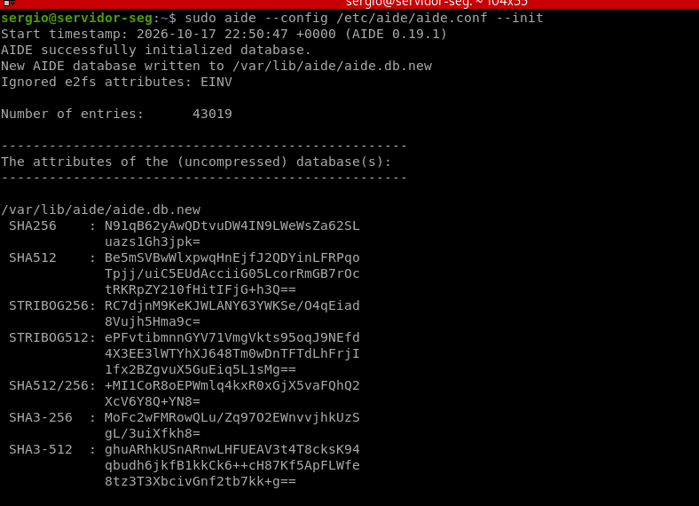

> 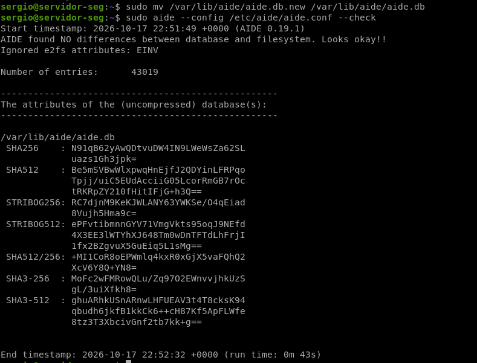

### 14.3. Modificación del fichero

Simulo una modificación no autorizada del archivo:

```bash
sudo bash -c 'echo "Contenido modificado" > /var/www/html/prueba-snapshot.txt'
```

Compruebo el nuevo contenido:

```bash
cat /var/www/html/prueba-snapshot.txt
```

```text
Contenido modificado
```

Ejecuto la comprobación de integridad:

```bash
sudo aide --config /etc/aide/aide.conf --check
```

AIDE detecta el cambio del archivo:

```text
Changed entries:
f =.... mc..... .  : /var/www/html/prueba-snapshot.txt
```

> 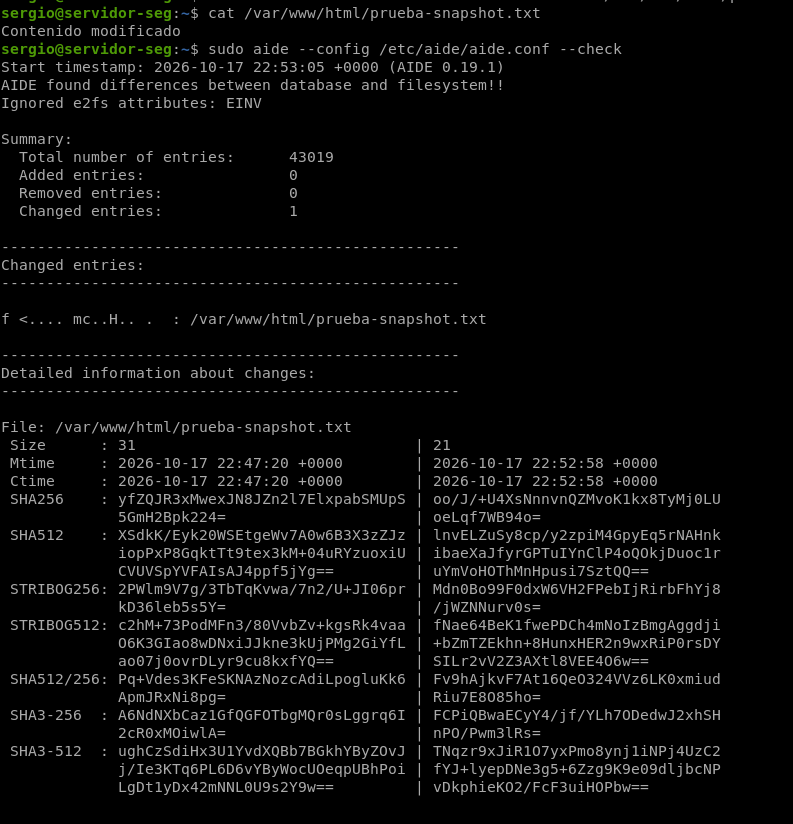

### 14.4. Restauración desde el snapshot

Restauro el contenido original del fichero desde la copia de seguridad creada anteriormente:

```bash
sudo cp /root/prueba-snapshot.txt.bak /var/www/html/prueba-snapshot.txt
```

Compruebo que el contenido original se ha recuperado:

```bash
cat /var/www/html/prueba-snapshot.txt
```

```text
Contenido original del archivo
```

> 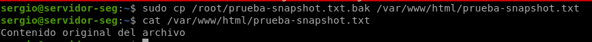

### 14.5. Comprobación final de integridad

Vuelvo a ejecutar la comprobación de integridad:

```bash
sergio@servidor-seg:~$ sudo aide --config /etc/aide/aide.conf --check
Start timestamp: 2026-10-17 22:55:22 +0000 (AIDE 0.19.1)
AIDE found differences between database and filesystem!!
Ignored e2fs attributes: EINV

Summary:
  Total number of entries:	43019
  Added entries:		0
  Removed entries:		0
  Changed entries:		1

---------------------------------------------------
Changed entries:
---------------------------------------------------

f =.... mc..... .  : /var/www/html/prueba-snapshot.txt

---------------------------------------------------
Detailed information about changes:
---------------------------------------------------

File: /var/www/html/prueba-snapshot.txt
 Mtime     : 2026-10-17 22:47:20 +0000        | 2026-10-17 22:54:30 +0000
 Ctime     : 2026-10-17 22:47:20 +0000        | 2026-10-17 22:54:30 +0000


---------------------------------------------------
The attributes of the (uncompressed) database(s):
---------------------------------------------------

/var/lib/aide/aide.db
 SHA256    : N91qB62yAwQDtvuDW4IN9LWeWsZa62SL
             uazs1Gh3jpk=
 SHA512    : Be5mSVBwWlxpwqHnEjfJ2QDYinLFRPqo
             Tpjj/uiC5EUdAcciiG05LcorRmGB7rOc
             tRKRpZY210fHitIFjG+h3Q==
 STRIBOG256: RC7djnM9KeKJWLANY63YWKSe/O4qEiad
             8Vujh5Hma9c=
 STRIBOG512: ePFvtibmnnGYV71VmgVkts95oqJ9NEfd
             4X3EE3lWTYhXJ648Tm0wDnTFTdLhFrjI
             1fx2BZgvuX5GuEiq5L1sMg==
 SHA512/256: +MI1CoR8oEPWmlq4kxR0xGjX5vaFQhQ2
             XcV6Y8Q+YN8=
 SHA3-256  : MoFc2wFMRowQLu/Zq97O2EWnvvjhkUzS
             gL/3uiXfkh8=
 SHA3-512  : ghuARhkUSnARnwLHFUEAV3t4T8cksK94
             qbudh6jkfB1kkCk6++cH87Kf5ApFLWfe
             8tz3T3XbcivGnf2tb7kk+g==


End timestamp: 2026-10-17 22:56:05 +0000 (run time: 0m 43s)

```

Tras restaurar el fichero desde el snapshot, AIDE solamente detectara el cambio de la restauración del fichero.

> 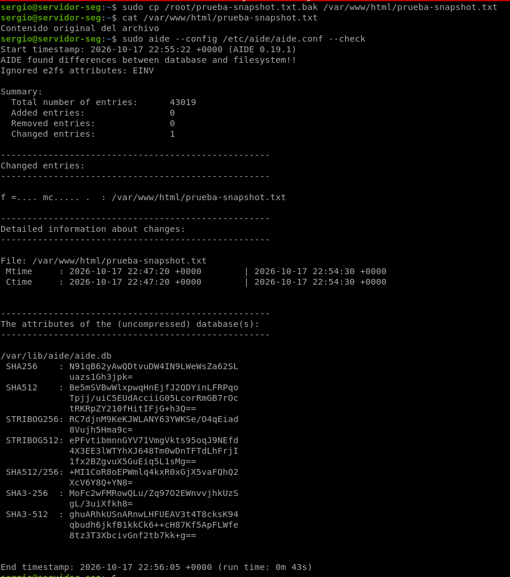

### 14.6. Conclusión de la prueba

He demostrado la relación entre un snapshot de ficheros y el control de integridad. AIDE ha detectado la modificación del archivo vigilado y, gracias a la copia de seguridad creada previamente, he podido restaurar su contenido original.

Esta prueba muestra que AIDE permite detectar alteraciones, mientras que un snapshot de ficheros permite recuperar un estado anterior conocido. En un entorno real, ambas medidas serían complementarias: la detección de integridad avisaría de un cambio no autorizado y el snapshot permitiría recuperar el fichero afectado.

## 15. Conclusión

He aplicado la comprobación de integridad de ficheros en el servidor Debian, que aloja Nginx y PostgreSQL, utilizando AIDE, y en el cliente Windows utilizando AFICK.
En el servidor Debian he creado una referencia inicial con AIDE, he comprobado que detecta cambios en ficheros y directorios, y he realizado una prueba de snapshot de ficheros. AIDE detectó la modificación de un archivo en `/var/www/html` y, tras restaurar su contenido desde una copia de seguridad, la única diferencia restante correspondía a los metadatos modificados por la restauración.


En Windows, al no disponer de entorno gráfico, he trabajado completamente desde la línea de comandos. He instalado AFICK, creado una referencia de una carpeta de prueba y comprobado que detecta la modificación de un fichero, la creación de otro nuevo y su eliminación. Tras revisar que los cambios eran conocidos, regeneré la referencia y la comprobación final no detectó diferencias.


También he configurado y comprobado las actualizaciones automáticas de seguridad en las máquinas Debian mediante `unattended-upgrades`. En el cliente Windows he comprobado las actualizaciones instaladas mediante el cmdlet de PowerShell `Get-HotFix`. Tras un cambio legítimo, la referencia de AIDE o AFICK solo debe actualizarse después de revisar que los cambios son esperados.


Estas herramientas permiten detectar alteraciones en ficheros importantes, como configuraciones, páginas web o binarios del sistema, pero no impiden los cambios ni determinan por sí solas si son legítimos o maliciosos. Por ello, la revisión de los informes es imprescindible antes de actualizar la referencia.
