# PRÁCTICA EXPRESS: PHP2SHELL

**Alumno/a:** _Sergio Mesa_  
**Fecha:** 22/10/2026  
**Módulo:** _Seguridad Informatica_  

---

## 1. ¿Habías oído hablar de php2shell?

Si, ayer me entere de la noticia, personas como Jose Domingo o mi hermano lo habian comentado estando yo delante, tambien por medios como twitter o "x" en usuarios como Cristian Borghello que subio info acerca de php2shell, no entendi la gravedad del asunto hasta que note su viralidad.

**Qué entendí al principio:** no era un fallo de una web o de un plugin concreto, sino del propio PHP (el intérprete). Da igual lo bien hecha que esté la aplicacion, si el PHP que la ejecuta es vulnerable, un atacante puede mandar una petición HTTP especial y ejecutar comandos en el servidor sin usuario ni contraseña. De ahí el nombre: *PHP to Shell*.

**Cómo evitaría enterarme tarde en el futuro:**

En caso de que yo tuviese varias maquinas servidoras o simplemente informacion que proteger mediante CMS o aplicaciones web, seguiria estos pasos para enterarme dia a dia de lo que pasa.

- Seguir fuentes de seguridad (INCIBE-CERT, CERT-EU, PHP.net, BleepingComputer, The Hacker News).
- Suscribirme a los avisos de seguridad de mi distribución (Debian/Ubuntu Security Announcements), de hecho hace poco me suscribí.
- Tener un inventario de qué versión de PHP, Node, GitLab, etc. corre en cada servidor.
- Activar `unattended-upgrades` y programar escaneos de vulnerabilidades.
- Reducir la superficie expuesta (publicar solo lo necesario, administración por VPN/SSH).
- Mantener copias de seguridad probadas.

---

## 2. Investigación de la vulnerabilidad

### 2.1. Cómo he buscado la información

**Paso 1 – Prensa generalista.** Búsquedas usadas: `php2shell`, `PHP vulnerabilidad crítica servidores`, `sgsys`. 

| Medio                     | Que cuenta                                                                                                              |
| ------------------------- | ----------------------------------------------------------------------------------------------------------------------- |
| Europa Press (Portaltic)  | Dos fallos críticos de PHP que obligaron a aislar sitios y aplicaciones web en todo el mundo; CVSS 9.2                  |
| El Mundo                  | "El fallo que amenaza a siete de cada diez webs"; PHP está detrás de ~70% de las webs con lenguaje de servidor conocido |
| RTVE                      | Alerta por fallos críticos en el núcleo de PHP                                                                          |
| La Tercera / La República | Descubiertos con ayuda de IA (Wiz junto con el equipo de PHP, OpenAI y Calif)                                           |

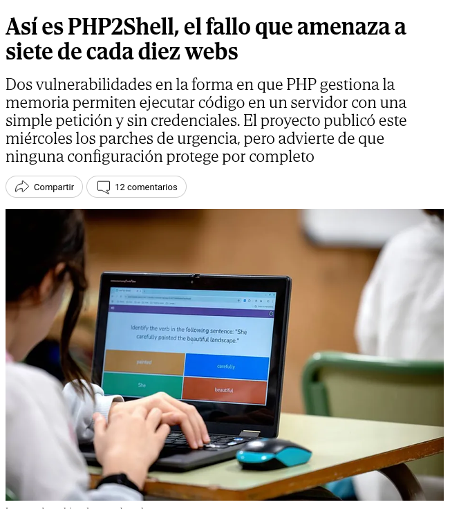

**Paso 2 – Páginas especializadas.**

| Fuente                                           | Tipo                |
| ------------------------------------------------ | ------------------- |
| Aviso oficial de PHP (php.net, 21/10/2026)       | Fabricante          |
| Ubuntu / Canonical y SUSE                        | Distribuciones      |
| CERT-EU y NCSC-NL (repositorio GitHub operativo) | CERT                |
| Datadog Security Labs                            | Análisis técnico    |
| BleepingComputer, The Hacker News                | Prensa técnica      |
| Malwarebytes (en español)                        | Divulgación técnica |

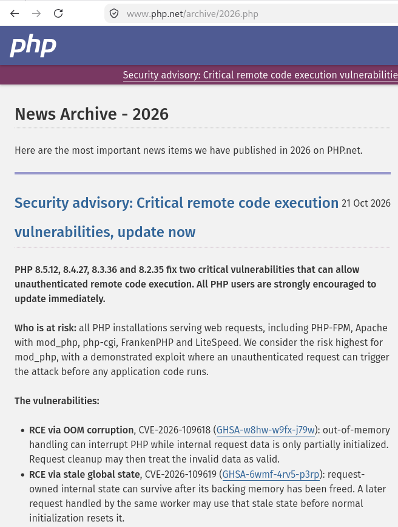

Este aviso o nueva update salio ayer (21 de octubre) a las 16:00.

**Cómo he comprobado que era fiable:** prioricé fabricante, distribuciones y CERTs; contrasté CVEs, puntuación (9.2) y versiones corregidas entre varias fuentes.

### 2.2. CVEs asignados

| CVE                 | Resumen                                                                                                    | CVSS v4.0     |
| ------------------- | ---------------------------------------------------------------------------------------------------------- | ------------- |
| **CVE-2026-109618** | RCE por corrupción de memoria cuando PHP se queda sin memoria durante la limpieza de una petición          | 9.2 (Crítica) |
| **CVE-2026-109619** | RCE por estado obsoleto de una petición anterior reutilizado por otra en el mismo proceso (use-after-free) | 9.2 (Crítica) |

He buscado los dos identificadores de las vulnerabilidades para poder saber explicar en que consiste cada uno.

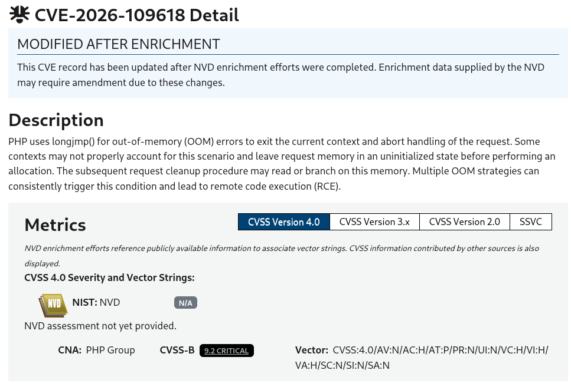

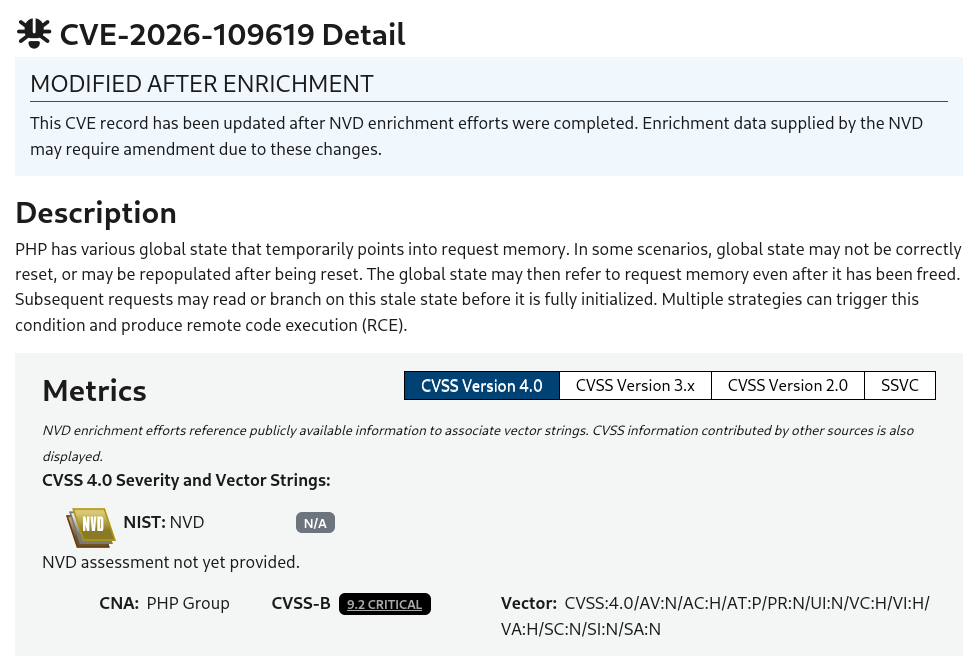

### 2.3. ¿En qué consiste?

Los dos fallos van de lo mismo, PHP se queda a medias haciendo algo, y luego sigue como si nada usando datos que están rotos o que ya no deberían estar ahí. El atacante aprovecha ese hueco para colar sus propios datos y que PHP acabe ejecutando lo que el quiere.

- **CVE-2026-109618:** si mandas un formulario con un campo con un nombre enorme, PHP se queda sin memoria justo mientras lo está guardando, y el array de datos queda a medias. Al terminar la petición, PHP confía en esa entrada rota para limpiar, y si el atacante la ha preparado bien, ahí consigue ejecutar lo que quiera.

- **CVE-2026-109619:** un mismo proceso de PHP atiende varias peticiones seguidas, y a veces una deja un "puntero" apuntando a datos de la petición anterior que ya se borraron. Si la siguiente petición usa ese puntero, está leyendo memoria que ya no le pertenece.

Lo grave es que esto pasa **antes** de que se ejecute el código de la propia web, así que da igual el login o los filtros de la aplicación: con que el servidor tenga PHP vulnerable y 
reciba la petición adecuada, no hace falta usuario ni contraseña.

### 2.4. ¿Cómo se ha conseguido explotar?

Por encima, sin meterme en payloads ni nada que se pueda usar para atacar de verdad:

El atacante manda un formulario (`POST`) con un campo que tiene un nombre gigante (en la prueba de Datadog eran unos 3,5 MB) y otro campo con datos preparados a propósito. PHP se queda sin memoria justo mientras procesa ese nombre tan largo, y la entrada en `$_POST` se queda a medias, rota.

A partir de ahí el atacante juega con cómo reserva y libera memoria el sistema (lo que se conoce como *heap grooming*) para conseguir que esa entrada rota contenga justo lo que el quiere. Cuando PHP destruye el array al terminar la petición, acaba llamando a una función que en realidad controla el atacante, y ahí es donde se ejecuta el comando.

Para que esto funcione también necesita esquivar el ASLR (la protección que hace que las direcciones de memoria cambien cada vez), y para eso consigue direcciones reales a base de fuerza bruta (haciendo que el proceso crashee varias veces) o filtrando memoria, por ejemplo a través de la cookie `PHPSESSID`.

El comando que se ejecuta corre con los permisos del proceso web (normalmente `www-data`), y desde ahí ya se puede montar una reverse shell. Segun AWS, ya había intentos de explotación desde el 17 de octubre, cuatro dias antes de que salieran los parches.

### 2.5. ¿A qué sistemas afecta?

- **Software:** PHP desde la rama 5.x hasta las versiones anteriores a las corregidas.
- **Configuraciones:** cualquier PHP que sirva peticiones web: Apache `mod_php`, PHP-FPM, `php-cgi`, FrankenPHP y LiteSpeed. El riesgo es mayor con `mod_php`.
- **Aplicaciones:** al ser un fallo del runtime, afecta a CMS como WordPress, Drupal, MediaWiki, Symfony y a cualquier aplicación PHP.

| Rama          | Vulnerable          | Primera versión corregida                                     |
| ------------- | ------------------- | ------------------------------------------------------------- |
| 8.2           | < 8.2.35            | **8.2.35**                                                    |
| 8.3           | < 8.3.36            | **8.3.36**                                                    |
| 8.4           | < 8.4.27            | **8.4.27**                                                    |
| 8.5           | < 8.5.12            | **8.5.12**                                                    |
| 7.4, 8.0, 8.1 | Sin soporte oficial | Backports de código fuente de PHP; depende de tu distribución |

La info para realizar esta tabla la he sacado de: https://openwall.com/lists/oss-security/2026/10/21/7 

### 2.6. ¿Cómo se parchea?

Solo actualizar PHP lo arregla del todo. Las mitigaciones temporales reducen exposición pero no son una solución completa.

**Ubuntu** (versiones con la corrección):

| Ubuntu | Paquete | Versión corregida       |
| ------ | ------- | ----------------------- |
| 22.04  | php8.1  | 8.1.2-1ubuntu2.28       |
| 24.04  | php8.3  | 8.3.6-0ubuntu0.24.04.13 |
| 26.04  | php8.5  | 8.5.4-0ubuntu1.5        |

En Ubuntu/Debian el número de versión de PHP **no cambia** con el parche (los fabricantes hacen *backports*), así que compara siempre con el aviso de tu distribución y no solo con `php -v`.

```bash
# 1. Ver qué PHP tienes instalado
php -v
apt list --installed 2>/dev/null | grep -E '^php[0-9.]+/'

# 2. Actualizar
sudo apt update
sudo apt install --only-upgrade 'php*'

# 3. Reiniciar el servicio que usa PHP
sudo systemctl restart apache2
sudo systemctl restart php8.3-fpm   # ajusta a tu versión
```

Aqui se puede ver que antes tenia la 8.4.26 y he upgradeado a la 8.4.27

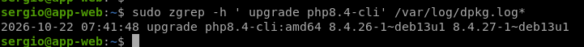

Tras actualizar php ahora tengo esta nueva version:

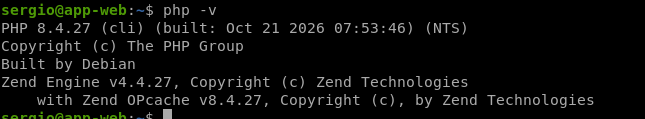

### 2.7. ¿Cómo he encontrado esta información?

Primero busqué directamente el nombre `php2shell` en buscadores y en noticias, para hacerme una idea general. De ahí saqué los CVEs concretos, y con esos números ya pude ir a fuentes más técnicas como PHP.net, Ubuntu, CERT-EU/NCSC-NL, Datadog y BleepingComputer.

Para saber exactamente cómo parchear miré el aviso de seguridad de mi propia distribución, y para las otras dos vulnerabilidades (GitLab y Node.js) fui directamente a sus avisos oficiales.

---

## 3. Reconocimiento del dominio del IES Gonzalo Nazareno

### 3.1. DNS y direcciones IP

```bash
dig +short dit.gonzalonazareno.org
dig dit.gonzalonazareno.org ANY +noall +answer
dig +short NS dit.gonzalonazareno.org
dig +short MX dit.gonzalonazareno.org
```

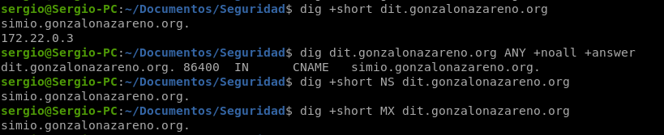

### 3.2. Puertos y servicios (solo con autorización)

```bash
nmap -sV -p 80,443 --script http-headers,http-server-header $DOMINIO
```

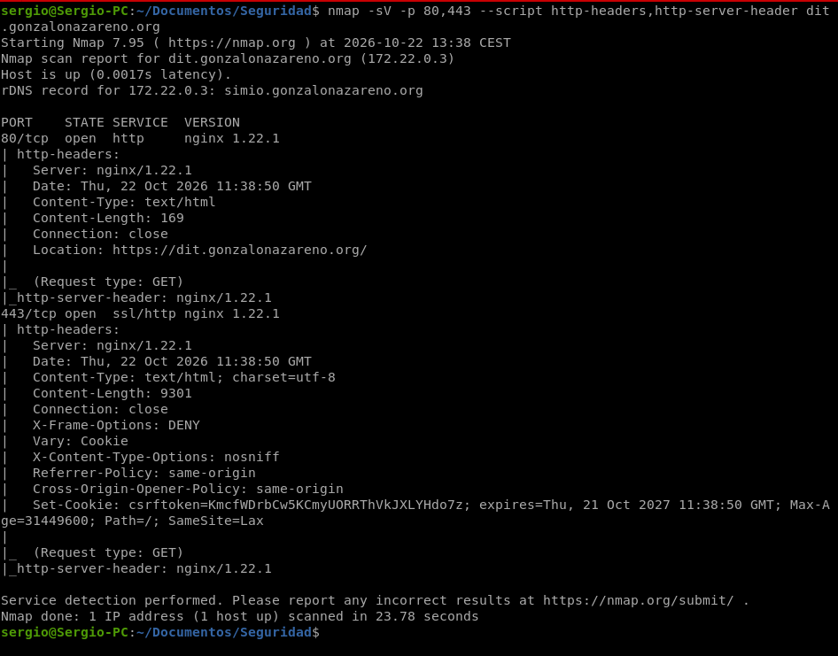

### 3.3 Reconocimiento con Wappalyzer — Moodle (gonzalonazareno.org)

Para complementar el reconocimiento, hee utilizado la extensión **Wappalyzer** 
sobre el entorno Moodle del dominio `gonzalonazareno.org`.

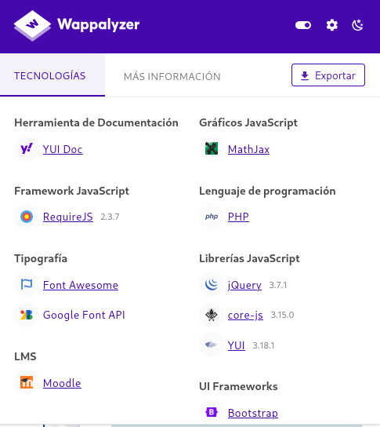

**Tecnologías detectadas**

| Categoría                    | Tecnología                     | Versión         |
| ---------------------------- | ------------------------------ | --------------- |
| Lenguaje de programación     | PHP                            | No especificada |
| LMS                          | Moodle                         | No especificada |
| Framework JavaScript         | RequireJS                      | 2.3.7           |
| Librerías JavaScript         | jQuery                         | 3.7.1           |
| Librerías JavaScript         | core-js                        | 3.15.0          |
| Librerías JavaScript         | YUI                            | 3.18.1          |
| UI Frameworks                | Bootstrap                      | -               |
| Herramienta de documentación | YUI Doc                        | -               |
| Gráficos JavaScript          | MathJax                        | -               |
| Tipografía                   | Font Awesome / Google Font API | -               |

**Análisis:**

Wappalyzer me confirma que el server usa PHP, así que ya entra dentro de los posibles 
afectados por php2shell (recordemos que pillaba a un 70-75% de servidores web). El 
problema es que no me da la versión exacta de PHP, cosa que sí hace con otras tecnologías tipo jQuery o RequireJS, así que no puedo confirmar al 100% si está dentro del rango vulnerable.

Aun así, como la vulnerabilidad se anunció hace menos de 24h y parchear en producción lleva su tiempo (pruebas, ventana de mantenimiento, etc.), pinta bastante a que todavía no está parcheado y por tanto sigue expuesto.

## 3.4. Conclusión: ¿está afectado?

| Dato                   | Resultado                                        |
| ---------------------- | ------------------------------------------------ |
| ¿Usa PHP?              | Sí                                               |
| Versión de PHP visible | No se ve                                         |
| Servidor web           | nginx 1.22.1                                     |
| ¿Oculta versiones?     | Sí (no aparece cabecera X-Powered-By en el nmap) |

**Conclusión:** Entre el `dig`, el `nmap` y Wappalyzer tengo claro que detrás de 
`dit.gonzalonazareno.org` hay un nginx 1.22.1 sirviendo una Moodle en PHP, pero en 
ningún momento se expone la versión concreta de PHP: ni en las cabeceras HTTP del nmap (no hay `X-Powered-By`) ni en Wappalyzer. O sea, que el admin ha tenido la precaución de no filtrar esa información hacia fuera, cosa que dificulta el reconocimiento.

Con esto no puedo afirmar con seguridad si está parcheado o no, asi que lo correcto es 
decir que **no es determinable desde fuera**. Lo único que puedo hacer es la deducción 
razonada de antes (vulnerabilidad muy reciente conlleva una alta probabilidad de que aún no esté parcheada), pero para confirmarlo de verdad habría que ser el admin del server y mirar directamente el paquete instalado con algo como `apt list --installed | grep php`.

---

## 4. Escáner de vulnerabilidades

Antes de nada probé con OpenVAS, que es lo que usamos en clase, pero en mi Debian no venía el paquete completo en los repos, solo piezas sueltas. Montarlo entero a mano me hubiera llevado demasiado tiempo, así que probé otras alternativas.

Primero probé Nuclei con unas plantillas que encontré en GitHub hechas específicamente para esta vulnerabilidad, pero no detectó nada. Investigando vi que dependían de cosas que mi servidor no muestra hacia fuera, como la versión de PHP en la cabecera o los mensajes de error en pantalla.

Después probé Trivy, que en vez de mirar por red mira los paquetes instalados del sistema. Tampoco detectó nada relacionado con PHP, y comprobé que la vulnerabilidad es tan reciente (se publicó ayer mismo) que lo más probable es que su base de datos aún no la tuviera metida.

También miré el repositorio oficial del CERT de Países Bajos sobre esta vulnerabilidad, que tiene información muy completa (confirma que mi versión de PHP, la 8.1, ya no recibe soporte ni parche oficial), pero no trae ninguna herramienta de escaneo, solo información y alguna mitigación para cPanel.

### La herramienta que sí funcionó

Al final encontré un script en GitHub (CyberRoute/php2shell-scanner) que no se basa en una sola cosa, sino en comprobar varias señales a la vez: la versión de PHP, si el servidor acepta el identificador de sesión mandado por el usuario en vez de exigir cookie propia, y si el mecanismo de subida de ficheros con progreso de sesión está activo (que es la pieza central del fallo).

Lo lancé contra mi servidor:

```bash
python3 scan.py --target http://biblioteca.sergiomesamejias.org --session-path / --yes
```

La primera vez no detectó la vulnerabilidad completa porque mi servidor tenía la versión de PHP oculta y no aceptaba el identificador de sesión por el método que necesita el ataque. 

Para comprobar el caso en el que sí se detecta, cambié dos ajustes en el fichero de 
configuración de PHP (`/etc/php/8.1/fpm/php.ini`): activé que el servidor muestre su 
versión hacia fuera, y dejé que aceptara el identificador de sesión sin necesidad de 
cookie. Esto simula un servidor con la versión vulnerable y además sin ningún tipo de 
endurecimiento extra, que es un escenario bastante real.

Con esos dos cambios, el escáner sí detectó todo:


### Parcheo y comprobación

Para parchear de verdad, volví a poner la versión de PHP 8.4.27 (la que tenía el servidor 
originalmente, antes de bajarla a la 8.1 para esta práctica), y relancé el mismo escáner 
para confirmar que ya no detecta la vulnerabilidad:


Con esto queda demostrado el ciclo completo: simular el servidor vulnerable, detectarlo con  un escáner, parchear a la versión corregida, y confirmar con el mismo escáner que ya no sale como vulnerable, para que salga patched tambien deberiamos poner expose_php = On en el fichero php.ini de nuestra version php.

## 5. Comprobación y solución en mi aplicación web

Este apartado está cubierto también en el punto 4, ya que he hecho exactamente lo que se pide aquí en mi máquina `app-web`, que contiene la aplicación web de la biblioteca (y WordPress), aunque no lo haya mencionado antes. Remito a lo documentado allí para todo el proceso: detección con el escáner, parcheo a PHP 8.4.27 y verificación posterior.

## 6. Otras vulnerabilidades: GitLab y Node.js

### GitLab

La vulnerabilidad de GitLab afecta a los servidores que tienen instalada su propia instancia, tanto de la edición Community como de Enterprise. El fallo está relacionado con el motor de expresiones regulares de Ruby y puede permitir ejecutar código de forma remota sin necesidad de iniciar sesión.

Esto es peligroso porque un servidor GitLab puede almacenar código fuente privado y credenciales de los proyectos. Para corregir el problema, hay que actualizar a una versión que incluya el parche de seguridad.

> 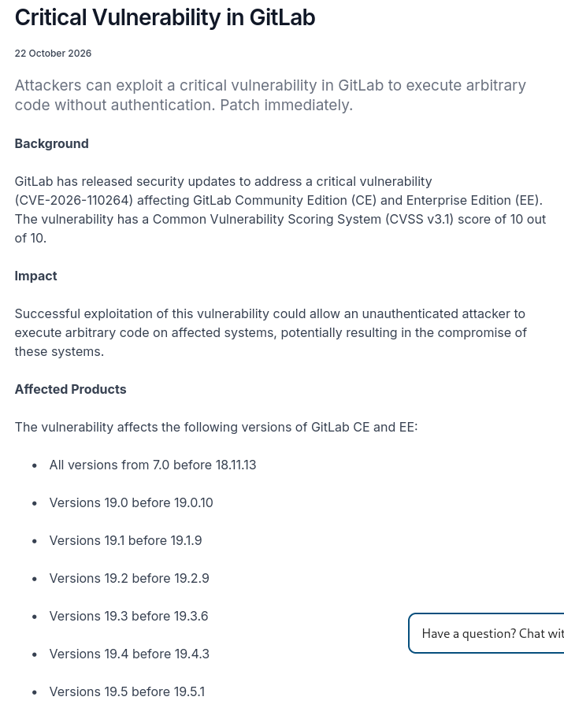

En la captura se ve el aviso de la Agencia de Ciberseguridad de Singapur sobre la vulnerabilidad CVE-2026-110264. Tiene una gravedad de 10 sobre 10 porque permite que un atacante ejecute código en el servidor sin iniciar sesión.

Afecta a distintas versiones de GitLab Community Edition y Enterprise Edition. Por ejemplo, en la rama 19.4 están afectadas las versiones anteriores a la 19.4.3, por lo que hay que actualizar a esa versión corregida o a una posterior.

### Node.js

En Node.js se han descrito varios fallos de seguridad. Uno de los más importantes afecta al procesamiento de datos comprimidos con Brotli y puede permitir ejecutar código debido a un error en el manejo de la memoria.

Afecta a servidores y aplicaciones que utilizan versiones vulnerables de Node.js, por ejemplo, APIs y aplicaciones web. Sin embargo, no todos tienen el mismo riesgo: en el caso de Brotli, depende de si la aplicación descomprime datos que puede controlar un atacante. La solución principal es actualizar a una versión corregida.

> 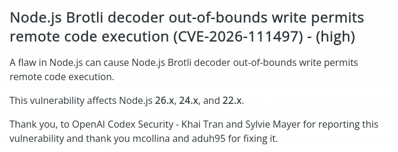

**Aviso oficial de Node.js** confirmando la CVE-2026-111497, un fallo de severidad alta en el decodificador Brotli que permite ejecución remota de código. Afecta a las tres ramas activas (26.x, 24.x y 22.x). El propio aviso agradece el hallazgo a investigadores de OpenAI Codex Security, curiosamente una IA ayudó a detectar este fallo.

### ¿Cuál es más crítica?

Segun lo investigado, la más crítica sería **GitLab**, con puntuación máxima (10/10) y RCE sin autenticación.

Comparandola con PHP2Shell, hay que distinguir gravedad de urgencia, GitLab tiene la puntuación más alta, pero PHP2Shell ya tiene explotación activa reportada, lo que la hace más urgente de parchear en la práctica.

Así que la puntuación por sí sola no basta, también cuenta si tu servidor usa una versión vulnerable, si está expuesto a Internet   y si ya hay ataques en marcha.

## 7. Conclusiones

He visto cómo se gestiona una vulnerabilidad crítica en tiempo real, aviso, parche, y mitigaciones temporales para quien no puede actualizar al momento.

También confirmé que sin inventario de versiones no sabes si estás expuesto, y que un escáner con la base de datos desactualizada puede dar falsa sensación de seguridad, que no detecte nada no significa que no haya nada.

En un servidor real, lo primero sería parchear, reiniciar los workers, revisar logs por si ya hubo algún intento de explotación, restringir el acceso mientras se aplica el parche, y tener backups por si algo falla durante la actualización.
