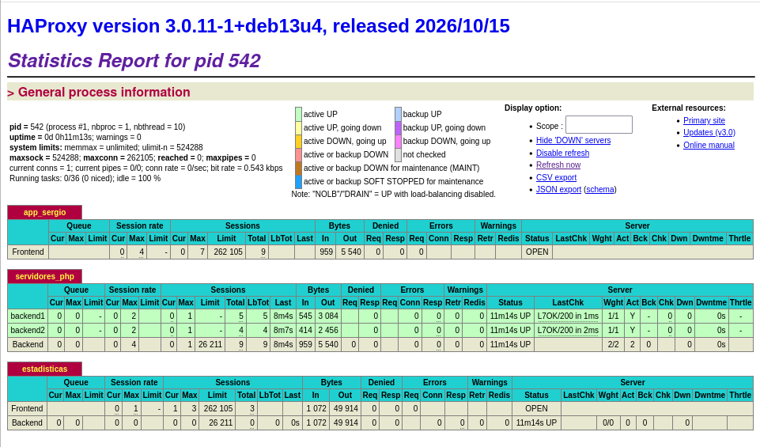
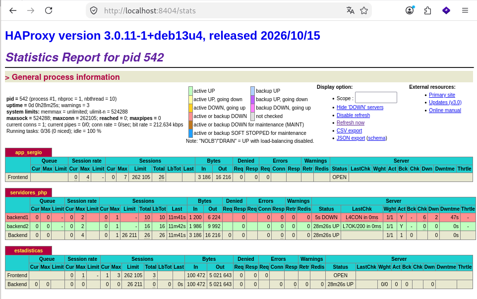

# Guía paso a paso: proxy inverso, servidor web y balanceador de carga

En esta guía explico cómo he montado la práctica de protocolo HTTP: un **proxy inverso** con nginx que da acceso a varias aplicaciones web, un **servidor web** con nginx y dos contenedores Docker (2048 y Grafana), y un **balanceador de carga** con haproxy que reparte el tráfico entre dos servidores PHP.

Lo he hecho todo con **Debian 13** sobre un host Debian con **libvirt (KVM)** y **LXC**. Si sigues los pasos en orden, deberías acabar con lo mismo que yo.

---

## 0. El escenario que he elegido

He elegido el **Escenario 2**: todos los servidores están en la misma red interna (`10.0.0.0/24`) y el proxy, además de proxy inverso, hace de **router/NAT** para que las máquinas internas salgan a Internet.

```
                 Internet / host
                       │
            192.168.122.217 (red "default" de libvirt)
                  ┌────┴────┐
                  │  proxy  │  LXC  · nginx (proxy inverso) + NAT
                  └────┬────┘
                   10.0.0.1
                       │  red interna "red-practica" (10.0.0.0/24)
     ┌─────────────┬───┴─────────┬──────────────┐
 10.0.0.10     10.0.0.20     10.0.0.21      10.0.0.22
servidorweb   balanceador    backend1       backend2
   VM            LXC           VM             VM
nginx+Docker   haproxy     Apache+PHP     Apache+PHP
```

Por qué unas cosas son contenedores LXC y otras máquinas virtuales: el enunciado pide que **servidorweb, backend1 y backend2 sean VMs**, porque en la segunda parte de la práctica usarán iSCSI y NFS, y eso no funciona en un contenedor LXC sin tocar su seguridad. El proxy y el balanceador sí pueden ser contenedores, que son más ligeros.

Los nombres que uso son `nas.sergio.org`, `www.sergio.org` y `app.sergio.org`. Si haces la práctica tú, cambia `sergio` por tu nombre en todos los ficheros.

### Una regla que me ahorró muchos problemas

- Los comandos `lxc-*` y `virsh` los ejecuto como **root** en el host (los contenedores son de root; como usuario normal, `lxc-attach` falla con *Failed to get init pid*).
- Los comandos `ssh` los ejecuto como **mi usuario** (`sergio`), porque es quien tiene las claves y el `~/.ssh/config`.

Lo más cómodo es tener **dos pestañas de terminal**: una como root (`sudo -i`) y otra como usuario normal.

> **Ojo al pegar bloques con `sudo`:** en Debian 13, `sudo` ejecuta cada comando en su propia pseudoterminal y se "come" las líneas que hayas pegado detrás. Por eso escribo `sudo -i` **solo**, pulso Enter, y después pego los bloques ya como root.

---

## 1. La red interna en libvirt

**En el host, como root.** Creo una red aislada, sin IP en el host, a la que conectaré tanto las VMs como los contenedores:

```bash
cat > red-practica.xml << 'EOF'
<network>
  <name>red-practica</name>
  <bridge name="virbr-prac" stp="on" delay="0"/>
</network>
EOF
virsh -c qemu:///system net-define red-practica.xml
virsh -c qemu:///system net-start red-practica
virsh -c qemu:///system net-autostart red-practica
ip a show virbr-prac
```

Como no lleva bloque `<ip>`, el host no tiene dirección en esa red y no choca con ninguna otra.

---

## 2. Los contenedores LXC: proxy y balanceador

### 2.1. Crearlos

**En el host, como root:**

```bash
lxc-create -n proxy -t download -- -d debian -r trixie -a amd64
lxc-create -n balanceador -t download -- -d debian -r trixie -a amd64
```

### 2.2. Conectarlos a las redes

El proxy tiene **dos interfaces**: `eth0` a la red `default` de libvirt (`virbr0`, sale a Internet por DHCP) y `eth1` a la red interna. El balanceador solo tiene una, a la red interna. Les pongo MAC fijas para que el DHCP del proxy le dé siempre la misma IP.

```bash
sed -i '/^lxc.net/d;/^lxc.start/d' /var/lib/lxc/proxy/config
cat >> /var/lib/lxc/proxy/config << 'EOF'
lxc.net.0.type = veth
lxc.net.0.link = virbr0
lxc.net.0.flags = up
lxc.net.0.name = eth0
lxc.net.0.hwaddr = 00:16:3e:bb:00:01

lxc.net.1.type = veth
lxc.net.1.link = virbr-prac
lxc.net.1.flags = up
lxc.net.1.name = eth1
lxc.net.1.hwaddr = 00:16:3e:aa:00:01

lxc.start.auto = 1
EOF

sed -i '/^lxc.net/d;/^lxc.start/d' /var/lib/lxc/balanceador/config
cat >> /var/lib/lxc/balanceador/config << 'EOF'
lxc.net.0.type = veth
lxc.net.0.link = virbr-prac
lxc.net.0.flags = up
lxc.net.0.name = eth0
lxc.net.0.hwaddr = 00:16:3e:aa:00:20

lxc.start.auto = 1
EOF

lxc-start -n proxy
lxc-start -n balanceador
```

### 2.3. Red del proxy

La imagen Debian de LXC usa **systemd-networkd** y **systemd-resolved**, así que configuro la red con ficheros `.network`.

**En el host, como root**, entro en el contenedor (con `--clear-env` evito los avisos de *locale*):

```bash
lxc-attach -n proxy --clear-env
```

**Dentro del proxy:**

```bash
rm -f /etc/systemd/network/*.network

cat > /etc/systemd/network/eth0.network << 'EOF'
[Match]
Name=eth0

[Network]
DHCP=ipv4
EOF

cat > /etc/systemd/network/eth1.network << 'EOF'
[Match]
Name=eth1

[Network]
Address=10.0.0.1/24
EOF

systemctl restart systemd-networkd
ip -4 a
ping -c 2 deb.debian.org
```

A mí `eth0` cogió la IP `192.168.122.217`. **Apúntate la tuya**, porque es la que usarás para acceder a todo desde el host.

### 2.4. NAT en el proxy

Sigo **dentro del proxy**. Activo el reenvío de paquetes y hago *masquerade* de la red interna con nftables:

```bash
apt update
apt install -y nftables

echo "net.ipv4.ip_forward=1" > /etc/sysctl.d/99-router.conf
sysctl -p /etc/sysctl.d/99-router.conf

cat > /etc/nftables.conf << 'EOF'
#!/usr/sbin/nft -f
flush ruleset

table ip nat {
  chain postrouting {
    type nat hook postrouting priority srcnat;
    oifname "eth0" ip saddr 10.0.0.0/24 masquerade
  }
}
EOF

systemctl enable --now nftables
nft list ruleset
exit
```

### 2.5. Red del balanceador

**En el host, como root:**

```bash
lxc-attach -n balanceador --clear-env
```

**Dentro del balanceador:**

```bash
rm -f /etc/systemd/network/*.network

cat > /etc/systemd/network/eth0.network << 'EOF'
[Match]
Name=eth0

[Network]
Address=10.0.0.20/24
Gateway=10.0.0.1
DNS=192.168.122.1
EOF

systemctl restart systemd-networkd
ping -c 2 deb.debian.org
exit
```

Sobre el **DNS**: uso `192.168.122.1`, que es el dnsmasq de la red `default` de libvirt. Él reenvía las consultas al DNS que tenga el host en cada momento, así que la práctica funciona igual en clase que en casa sin cambiar nada.

> **Error que cometí:** al principio escribí el DNS a mano en `/etc/resolv.conf`. Funcionó, pero al reiniciar el contenedor se perdió, porque ese fichero lo regenera systemd-resolved. El DNS hay que ponerlo en el `.network` (línea `DNS=`).

---

## 3. Las máquinas virtuales: servidorweb, backend1 y backend2

Las creo a partir de la imagen cloud de Debian 13 (`debian-13-generic-amd64.qcow2`) con **cloud-init**, que les pone el hostname, la IP fija y mi clave SSH al arrancar. Uso la variante *generic* y no *genericcloud* porque trae el kernel completo, que hará falta para iSCSI y NFS.

**En el host, como root**, guardo este script con `nano /root/crear-vms.sh`. Cambia la ruta de la clave pública por la tuya.

```bash
#!/bin/bash
set -e
DIR=/var/lib/libvirt/images
BASE=$DIR/debian-13-generic-amd64.qcow2
PUBKEY=$(cat /home/sergio/.ssh/id_rsa.pub)
TMP=$(mktemp -d)

crear_vm() {
  NOMBRE=$1; IP=$2; MAC=$3; RAM=$4; DISCO=$5

  cat > $TMP/user-data << EOF
#cloud-config
hostname: $NOMBRE
manage_etc_hosts: true
users:
  - name: debian
    sudo: ALL=(ALL) NOPASSWD:ALL
    shell: /bin/bash
    lock_passwd: false
    ssh_authorized_keys:
      - $PUBKEY
chpasswd:
  expire: false
  users:
    - name: debian
      password: debian
      type: text
EOF

  cat > $TMP/network-config << EOF
version: 2
ethernets:
  interna:
    match: {macaddress: "$MAC"}
    addresses: [$IP/24]
    routes:
      - {to: default, via: 10.0.0.1}
    nameservers: {addresses: [192.168.122.1]}
EOF

  qemu-img create -f qcow2 -F qcow2 -b $BASE $DIR/http-$NOMBRE.qcow2 ${DISCO}G
  cloud-localds --network-config=$TMP/network-config \
       $DIR/http-$NOMBRE-seed.iso $TMP/user-data

  virt-install --connect qemu:///system \
    --name http-$NOMBRE --memory $RAM --vcpus 1 \
    --disk path=$DIR/http-$NOMBRE.qcow2 \
    --disk path=$DIR/http-$NOMBRE-seed.iso,device=cdrom \
    --network network=red-practica,mac=$MAC \
    --os-variant debian13 --import --noautoconsole
}

crear_vm servidorweb 10.0.0.10 52:54:00:aa:00:10 2048 20
crear_vm backend1    10.0.0.21 52:54:00:aa:00:21 1024 10
crear_vm backend2    10.0.0.22 52:54:00:aa:00:22 1024 10

rm -rf $TMP
```

Y lo ejecuto:

```bash
which cloud-localds || apt install -y cloud-image-utils
bash /root/crear-vms.sh
```

> **Importante:** el script hay que **guardarlo en un fichero y ejecutarlo**, no pegarlo directamente en la terminal. Si lo pegas, el `set -e` se queda activo en tu shell y cualquier comando que falle después te la cierra.

A servidorweb le doy 2 GB de RAM porque va a ejecutar Docker y Grafana.

---

## 4. Acceso por SSH saltando por el proxy

Mi host no tiene IP en la red `10.0.0.0/24`, así que no llega directamente a las VMs. Uso el proxy como **salto SSH** (ProxyJump).

**En el host, como root**, meto mi clave pública en el proxy:

```bash
mkdir -p /var/lib/lxc/proxy/rootfs/root/.ssh
cat /home/sergio/.ssh/id_rsa.pub >> /var/lib/lxc/proxy/rootfs/root/.ssh/authorized_keys
chmod 700 /var/lib/lxc/proxy/rootfs/root/.ssh
chmod 600 /var/lib/lxc/proxy/rootfs/root/.ssh/authorized_keys
lxc-attach -n proxy --clear-env -- apt install -y openssh-server
```

**En el host, como mi usuario** (no como root), añado esto a `~/.ssh/config`, poniendo la IP externa de tu proxy:

```
Host proxy
    HostName 192.168.122.217
    User root

Host servidorweb
    HostName 10.0.0.10
    User debian
    ProxyJump proxy

Host backend1
    HostName 10.0.0.21
    User debian
    ProxyJump proxy

Host backend2
    HostName 10.0.0.22
    User debian
    ProxyJump proxy
```

Y compruebo que llego a todas:

```bash
ssh proxy hostname
ssh servidorweb 'hostname; ping -c 2 deb.debian.org'
ssh backend1 'hostname; ping -c 2 deb.debian.org'
ssh backend2 'hostname; ping -c 2 deb.debian.org'
```

---

## 5. El servidor web: nas.sergio.org

```bash
ssh servidorweb
sudo -i
```

### 5.1. Instalación y contenido

```bash
apt update
apt install -y nginx apache2-utils enscript ghostscript curl

mkdir -p /var/www/nas/documentos

# Genero tres PDF de ejemplo
for doc in apuntes-http manual-nginx guia-haproxy; do
  echo "Documento $doc - Practica HTTP - Sergio" | enscript -q -o - | ps2pdf - /var/www/nas/documentos/$doc.pdf
done
```

Creo la hoja de estilo `/var/www/nas/estilo.css`, la página principal `/var/www/nas/index.html` (con mi nombre e información del servidor y un enlace a `/nas`) y la página de documentos `/var/www/nas/documentos/index.html` con un enlace de descarga a cada PDF:

```html
<ul class="docs">
  <li><a href="apuntes-http.pdf" download>Apuntes de HTTP</a></li>
  <li><a href="manual-nginx.pdf" download>Manual de nginx</a></li>
  <li><a href="guia-haproxy.pdf" download>Guía de haproxy</a></li>
</ul>
```

Las dos páginas enlazan la misma hoja de estilo con `<link rel="stylesheet" href="/estilo.css">`.

### 5.2. Usuario para la autenticación básica

```bash
htpasswd -c /etc/nginx/.htpasswd sergio
```

Me pide la contraseña dos veces.

### 5.3. El sitio

```bash
cat > /etc/nginx/sites-available/nas.sergio.org << 'EOF'
server {
    listen 80;
    listen [::]:80;
    server_name nas.sergio.org;

    root /var/www/nas;
    index index.html;

    # /nas redirige a /documentos
    location /nas {
        return 301 /documentos/;
    }

    # /documentos con autenticación básica
    location /documentos {
        auth_basic "Zona de documentos";
        auth_basic_user_file /etc/nginx/.htpasswd;
    }
}
EOF

ln -s /etc/nginx/sites-available/nas.sergio.org /etc/nginx/sites-enabled/
chown -R www-data:www-data /var/www/nas
nginx -t && systemctl reload nginx
```

La redirección va a `/documentos/` **con barra final** para que nginx no haga una segunda redirección de `/documentos` a `/documentos/`.

> **Error que cometí:** al principio solo puse `listen 80;` y al probar con `curl http://localhost` desde la propia máquina me daba **404**. El motivo es que `localhost` resuelve primero a `::1` (IPv6), y en IPv6 solo escuchaba el sitio por defecto. Lo arreglé añadiendo `listen [::]:80;`.

Pruebo en local, simulando el nombre con la cabecera `Host`:

```bash
curl -I -H "Host: nas.sergio.org" http://localhost/nas
curl -I -H "Host: nas.sergio.org" http://localhost/documentos/
curl -I -u sergio:TU_CONTRASEÑA -H "Host: nas.sergio.org" http://localhost/documentos/
```

Debo ver `301`, `401` y `200`.

---

## 6. Docker en servidorweb: 2048 y Grafana

Sigo **dentro de servidorweb** como root.

```bash
apt install -y docker.io
systemctl enable --now docker
```

### 6.1. El juego 2048

```bash
docker run -d --name juego2048 --restart always -p 8080:80 josedom24/2048:v1
```

### 6.2. Grafana

```bash
docker run -d --name grafana --restart always -p 3000:3000 \
  -e GF_SERVER_ROOT_URL=http://www.sergio.org/grafana/ \
  -e GF_SERVER_SERVE_FROM_SUB_PATH=true \
  grafana/grafana
```

Estas dos variables son la clave para publicar Grafana en una subruta:

- **`GF_SERVER_ROOT_URL`** le dice a Grafana cuál es su URL pública, para que genere bien los enlaces y las redirecciones.
- **`GF_SERVER_SERVE_FROM_SUB_PATH=true`** hace que atienda las peticiones que le llegan con el prefijo `/grafana/`.

Sin ellas, Grafana cree que está en la raíz del sitio y genera rutas absolutas (`/login`, `/public/...`). Detrás de `/grafana` el navegador pediría esos ficheros en la raíz de `www.sergio.org`, que no es Grafana, y la aplicación no cargaría.

Compruebo que los dos responden:

```bash
docker ps
curl -I http://localhost:8080/
curl -I http://localhost:3000/grafana/login
```

---

## 7. Los backends: aplicación PHP

Esto lo hago **igual en backend1 y en backend2**. Uso Apache con mod_php, que es lo más directo para PHP.

```bash
ssh backend1
sudo -i
```

```bash
apt update
apt install -y apache2 libapache2-mod-php curl
rm -f /var/www/html/index.html
```

Creo una hoja de estilo en `/var/www/html/estilo.css` y la página `/var/www/html/index.php`, que lleva en el cuerpo el código PHP del enunciado:

```php
<!DOCTYPE html>
<html lang="es">
<head>
  <meta charset="UTF-8">
  <title>App balanceada - Sergio</title>
  <link rel="stylesheet" href="estilo.css">
</head>
<body>
  <div class="tarjeta">
<?php
// Mostrar el hostname del servidor
echo "<h1>Servidor: " . gethostname() . "</h1>";

// Información adicional opcional (útil para diagnóstico)
echo "<p>Dirección IP del servidor: " . $_SERVER['SERVER_ADDR'] . "</p>";
echo "<p>Dirección IP del cliente: " . $_SERVER['REMOTE_ADDR'] . "</p>";
echo "<p>Fecha y hora: " . date('Y-m-d H:i:s') . "</p>";
?>
    <footer>app.sergio.org — Práctica HTTP de Sergio</footer>
  </div>
</body>
</html>
```

```bash
systemctl restart apache2
curl -s http://localhost/ | grep Servidor
```

Debe mostrar `Servidor: backend1` (o `backend2`). Es importante que cada VM tenga un hostname distinto, porque es lo que muestra la página.

---

## 8. El balanceador: haproxy

**En el host, como root:**

```bash
lxc-attach -n balanceador --clear-env
```

**Dentro del balanceador**, añado al final de `/etc/haproxy/haproxy.cfg` (dejo `global` y `defaults` como vienen en Debian):

```bash
apt update
apt install -y haproxy curl

cat >> /etc/haproxy/haproxy.cfg << 'EOF'

frontend app_sergio
    bind *:80
    default_backend servidores_php

backend servidores_php
    balance roundrobin
    option forwardfor
    option httpchk GET /
    server backend1 10.0.0.21:80 check
    server backend2 10.0.0.22:80 check

listen estadisticas
    bind *:8404
    stats enable
    stats uri /stats
    stats refresh 5s
    stats auth admin:admin1234
EOF

haproxy -c -f /etc/haproxy/haproxy.cfg
systemctl restart haproxy
```

Qué hace cada parte:

- **`balance roundrobin`**: reparte las peticiones por turnos entre los dos backends.
- **`option httpchk GET /`** + **`check`**: cada 2 segundos haproxy pide `/` a cada backend. Si uno deja de responder, lo saca del reparto.
- **`option forwardfor`**: añade la cabecera `X-Forwarded-For` con la IP original del cliente.
- **`listen estadisticas`**: publica la página de estadísticas en el puerto 8404, protegida con usuario y contraseña.

Pruebo el reparto y la autenticación de las estadísticas:

```bash
for i in 1 2 3 4; do curl -s http://localhost/ | grep -o "Servidor: [a-z0-9]*"; done
curl -s -o /dev/null -w "%{http_code}\n" http://localhost:8404/stats
curl -s -o /dev/null -w "%{http_code}\n" -u admin:admin1234 http://localhost:8404/stats
exit
```

Debe alternar backend1 y backend2, y las estadísticas dar `401` sin credenciales y `200` con ellas.

---

## 9. El proxy inverso: nginx

**En el host, como root:**

```bash
lxc-attach -n proxy --clear-env
```

**Dentro del proxy:**

```bash
apt install -y nginx curl
```

### 9.1. nas.sergio.org → servidorweb

```bash
cat > /etc/nginx/sites-available/nas.sergio.org << 'EOF'
server {
    listen 80;
    server_name nas.sergio.org;

    location / {
        proxy_pass http://10.0.0.10;
        proxy_set_header Host $host;
        proxy_set_header X-Real-IP $remote_addr;
        proxy_set_header X-Forwarded-For $proxy_add_x_forwarded_for;
    }
}
EOF
```

`proxy_set_header Host $host` es necesario: así servidorweb recibe el nombre `nas.sergio.org` y sabe qué sitio servir.

### 9.2. www.sergio.org → 2048 y Grafana

```bash
cat > /etc/nginx/sites-available/www.sergio.org << 'EOF'
# Necesario para los websockets de Grafana
map $http_upgrade $connection_upgrade {
    default upgrade;
    ''      close;
}

server {
    listen 80;
    server_name www.sergio.org;

    # 2048: la barra final en proxy_pass QUITA el prefijo /game/
    location /game/ {
        proxy_pass http://10.0.0.10:8080/;
        proxy_set_header Host $host;
        proxy_set_header X-Real-IP $remote_addr;
        proxy_set_header X-Forwarded-For $proxy_add_x_forwarded_for;
    }

    # Grafana: SIN barra final, se pasa la URL completa con /grafana/
    location /grafana/ {
        proxy_pass http://10.0.0.10:3000;
        proxy_set_header Host $host;
        proxy_set_header X-Real-IP $remote_addr;
        proxy_set_header X-Forwarded-For $proxy_add_x_forwarded_for;
        proxy_http_version 1.1;
        proxy_set_header Upgrade $http_upgrade;
        proxy_set_header Connection $connection_upgrade;
    }
}
EOF
```

**La diferencia entre `/game` y `/grafana` está en la barra final de `proxy_pass`:**

- `proxy_pass http://10.0.0.10:8080/;` **(con barra)** sustituye `/game/` por `/`. Una petición a `/game/style.css` llega al contenedor como `/style.css`. Al 2048 le va bien porque es una web estática con **rutas relativas**: le da igual en qué subruta esté publicada.
- `proxy_pass http://10.0.0.10:3000;` **(sin barra)** pasa la URL tal cual, con `/grafana/` incluido. Es justo lo que Grafana espera, porque la configuré con `GF_SERVER_SERVE_FROM_SUB_PATH=true`.

Además, como las locations están definidas con barra final (`/game/`), nginx redirige automáticamente `/game` a `/game/` con un **301**.

### 9.3. app.sergio.org → balanceador

```bash
cat > /etc/nginx/sites-available/app.sergio.org << 'EOF'
server {
    listen 80;
    server_name app.sergio.org;

    location / {
        proxy_pass http://10.0.0.20;
        proxy_set_header Host $host;
        proxy_set_header X-Real-IP $remote_addr;
        proxy_set_header X-Forwarded-For $proxy_add_x_forwarded_for;
    }
}
EOF
```

### 9.4. Activar los sitios

```bash
ln -s /etc/nginx/sites-available/nas.sergio.org /etc/nginx/sites-enabled/
ln -s /etc/nginx/sites-available/www.sergio.org /etc/nginx/sites-enabled/
ln -s /etc/nginx/sites-available/app.sergio.org /etc/nginx/sites-enabled/
nginx -t && systemctl reload nginx
exit
```

---

## 10. Resolución de nombres en el host

**En el host, como root**, apunto los tres nombres a la IP externa del proxy:

```bash
echo "192.168.122.217 nas.sergio.org www.sergio.org app.sergio.org" >> /etc/hosts
```

---

## 11. Comprobaciones desde el host

Ya como mi usuario, pruebo todo a través del proxy inverso.

### 11.1. nas.sergio.org

```
$ curl -I http://nas.sergio.org/nas
HTTP/1.1 301 Moved Permanently
Server: nginx
Location: http://nas.sergio.org/documentos/

$ curl -I http://nas.sergio.org/documentos/
HTTP/1.1 401 Unauthorized
Server: nginx
WWW-Authenticate: Basic realm="Zona de documentos"

$ curl -I -u sergio:sergio1223 http://nas.sergio.org/documentos/
HTTP/1.1 200 OK
Server: nginx
Content-Type: text/html
```

### 11.2. El juego 2048

```
$ curl -I http://www.sergio.org/game
HTTP/1.1 301 Moved Permanently
Server: nginx
Location: http://www.sergio.org/game/
```

Sin la barra final, el proxy redirige a `/game/`. En el navegador, `http://www.sergio.org/game/` muestra el juego:


### 11.3. Grafana

```
$ curl -I http://www.sergio.org/grafana/login
HTTP/1.1 200 OK
Server: nginx
Content-Type: text/html; charset=UTF-8
```

En el navegador entro en `http://www.sergio.org/grafana/` con el usuario `admin` y la contraseña `admin` (la primera vez pide cambiarla; se puede saltar con *Skip*):


### 11.4. La aplicación balanceada

```
$ for i in 1 2 3 4; do curl -s http://app.sergio.org/ | grep -o "Servidor: [a-z0-9]*"; done
Servidor: backend1
Servidor: backend2
Servidor: backend1
Servidor: backend2
```

Las peticiones se reparten por turnos. Un detalle curioso: en la página, la **IP del cliente** que aparece es `10.0.0.20` y no la mía. Es la del balanceador, porque es haproxy quien abre la conexión con el backend; mi IP original viaja en la cabecera `X-Forwarded-For`.

---

## 12. La página de estadísticas de haproxy

El balanceador está en la red interna y mi host no llega a ella, así que abro un **túnel SSH** a través del proxy. En una terminal aparte, como mi usuario:

```bash
ssh -L 8404:10.0.0.20:8404 proxy
```

Mientras esa terminal siga abierta, el puerto 8404 de mi PC lleva al puerto 8404 del balanceador. En el navegador entro en `http://localhost:8404/stats` con `admin` / `admin1234`:



Los dos backends aparecen en **verde (UP)** con el chequeo `L7OK/200`, que significa que han respondido a la petición HTTP de comprobación con un 200.

---

## 13. ¿Qué pasa si se cae un backend?

### 13.1. Qué hace cada pieza

- El **proxy inverso** es la puerta de entrada. Recibe todas las peticiones de fuera y, según el nombre o la ruta, las manda a un sitio u otro. Además oculta la red interna: desde fuera solo se ve el proxy.
- El **balanceador** se encarga de una sola aplicación que está en varios servidores iguales. Reparte las peticiones entre ellos y comprueba constantemente que siguen vivos, para dejar de mandar tráfico al que falle.

Trabajan en cadena: cliente → proxy inverso → balanceador → backend1 o backend2.

### 13.2. La prueba

Con la página de estadísticas abierta, paro Apache en backend1 y lanzo una petición por segundo:

```
$ ssh backend1 'sudo systemctl stop apache2'
$ for i in $(seq 1 12); do echo "$(date +%T) $(curl -s -w ' [%{http_code}]' http://app.sergio.org/ | grep -oE 'Servidor: [a-z0-9]*|\[[0-9]+\]' | tr '\n' ' ')"; sleep 1; done
14:18:28 Servidor: backend2 [200]
14:18:29 Servidor: backend2 [200]
14:18:30 Servidor: backend2 [200]
14:18:31 Servidor: backend2 [200]
14:18:32 Servidor: backend2 [200]
14:18:33 Servidor: backend2 [200]
14:18:34 Servidor: backend2 [200]
```

En unos segundos, backend1 se pone en **rojo (DOWN)** en las estadísticas, con el chequeo `L4CON` (conexión rechazada):



En el log de haproxy se ve el momento exacto en que lo detecta y cuando vuelve (está en hora UTC):

```
$ sudo lxc-attach -n balanceador --clear-env -- journalctl -u haproxy --no-pager | grep -E "backend1 is (DOWN|UP)"
Oct 27 13:18:27 balanceador haproxy[542]: Server servidores_php/backend1 is DOWN, reason: Layer4 connection problem, info: "Connection refused" ...
Oct 27 13:19:09 balanceador haproxy[542]: Server servidores_php/backend1 is UP, reason: Layer7 check passed, code: 200 ...
```

Al arrancar Apache otra vez, vuelve el reparto:

```
$ ssh backend1 'sudo systemctl start apache2'
14:19:09 Servidor: backend2 [200]
14:19:10 Servidor: backend1 [200]
14:19:11 Servidor: backend2 [200]
14:19:12 Servidor: backend1 [200]
```

### 13.3. Lo que he observado

1. Al parar Apache, el puerto 80 de backend1 rechaza la conexión. El chequeo de haproxy falla y lo marca como **DOWN**.
2. A partir de ahí, haproxy manda todas las peticiones a **backend2** y todas responden con **200**. El usuario no nota nada.
3. El proxy inverso **no se entera**: sigue mandándolo todo al balanceador como siempre. La tolerancia a fallos la da el balanceador, no el proxy.
4. Cuando arranco Apache, el chequeo HTTP vuelve a recibir un 200, haproxy marca backend1 como **UP** y vuelve a repartir entre los dos.

---

## Resumen de errores que me encontré

- **`lxc-attach` falla con *Failed to get init pid***: lo estaba ejecutando como usuario normal. Los contenedores son de root.
- **`ssh backend1` dice *Could not resolve hostname***: lo estaba ejecutando como root, y el alias está en el `~/.ssh/config` de mi usuario.
- **Las líneas pegadas después de un `sudo` desaparecen**: en Debian 13, `sudo` usa `use_pty`. Solución: `sudo -i` solo y luego pegar.
- **El DNS del contenedor se pierde al reiniciar**: hay que ponerlo en el `.network` de systemd-networkd, no en `/etc/resolv.conf`.
- **nginx da 404 al probar con `curl localhost`**: faltaba `listen [::]:80;` en el sitio.
- **El script de creación de VMs me cerraba la terminal**: lo había pegado directamente con `set -e` dentro. Hay que guardarlo en un fichero y ejecutarlo con `bash`.
